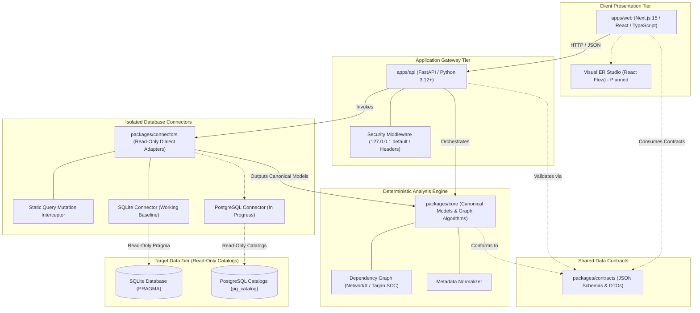

<!-- DERA:I18N_NAV:START -->
**English** | [Español](docs/i18n/README.es.md) | [Français](docs/i18n/README.fr.md) | [Deutsch](docs/i18n/README.de.md) | [Português](docs/i18n/README.pt.md) | [Italiano](docs/i18n/README.it.md) | [日本語](docs/i18n/README.ja.md) | [한국어](docs/i18n/README.ko.md) | [简体中文](docs/i18n/README.zh-CN.md) | [Русский](docs/i18n/README.ru.md)
<!-- DERA:I18N_NAV:END -->

---

<div align="center">

# DERA

### Database Engineering & Reverse Analysis

**Understand Every Schema. Engineer Every Change.**

An independent open-source, deterministic database engineering and reverse-analysis platform for software engineers, database architects, and engineering teams.

Explore database structures, reconstruct entity relationships, evaluate structural risks, and plan schema changes — completely deterministic, without AI models or external inference APIs.

<br/>

[](LICENSE)
[](https://github.com/krishanth7/dera/actions/workflows/ci.yml)
[](https://github.com/krishanth7/dera/actions/workflows/codeql.yml)
[](https://github.com/krishanth7/dera/actions/workflows/documentation.yml)
[](pyproject.toml)
[](tsconfig.json)
[-orange?style=for-the-badge)](#-strict-non-ai-architecture)
[](CONTRIBUTING.md)

<br/>

[Overview](#-overview) ·
[Feature Matrix](#-feature-status-matrix) ·
[Architecture](#-architecture-overview) ·
[Monorepo Structure](#-repository-structure) ·
[Getting Started](#-getting-started) ·
[Database Compatibility](#-database-compatibility-matrix) ·
[Security](#-security-principles) ·
[Documentation Hub](#-developer-documentation-navigation) ·
[Roadmap](#-master-roadmap) ·
[Contributing](#-contributing) ·
[Community](#-community)

</div>

---

## 🌍 Language Support

DERA maintains synchronized documentation in 10 international languages. The English README serves as the authoritative source of truth under our [Documentation Maintenance Contract](docs/development/README_MAINTENANCE.md).

| Language | Code | Documentation Link | Status |
|---|---|---|---|
| 🇬🇧 English | `en` | [English Primary (Root)](README.md) · [Synchronized Copy](docs/i18n/README.en.md) | **Authoritative Source of Truth** |
| 🇪🇸 Español | `es` | [Documentación en Español](docs/i18n/README.es.md) | Complete Translation |
| 🇫🇷 Français | `fr` | [Documentation en Français](docs/i18n/README.fr.md) | Complete Translation |
| 🇩🇪 Deutsch | `de` | [Dokumentation auf Deutsch](docs/i18n/README.de.md) | Complete Translation |
| 🇵🇹 Português | `pt` | [Documentação em Português](docs/i18n/README.pt.md) | Complete Translation |
| 🇮🇹 Italiano | `it` | [Documentazione in Italiano](docs/i18n/README.it.md) | Complete Translation |
| 🇯🇵 日本語 | `ja` | [日本語ドキュメント](docs/i18n/README.ja.md) | Complete Translation |
| 🇰🇷 한국어 | `ko` | [한국어 문서](docs/i18n/README.ko.md) | Complete Translation |
| 🇨🇳 简体中文 | `zh-CN` | [简体中文文档](docs/i18n/README.zh-CN.md) | Complete Translation |
| 🇷🇺 Русский | `ru` | [Документация на русском](docs/i18n/README.ru.md) | Complete Translation |

---

## 📖 Overview

Modern relational databases are the foundational backbone of software infrastructure. However, understanding unfamiliar, legacy, or rapidly changing schemas presents significant engineering challenges:
- **Complex Schemas:** Enterprise databases often encompass hundreds of tables, thousands of columns, and undocumented foreign-key relationships.
- **Architectural Debt:** Circular foreign-key dependencies, missing primary keys, unindexed foreign keys, and redundant indexes accumulate silently over time.
- **Migration Hazards:** Making schema changes without a complete topological graph risks lock escalation, data loss, and cascading constraint violations.
- **Privacy & Security Risks:** Organizations cannot risk exposing production database credentials or confidential data rows to cloud AI services.

**DERA is engineered to solve these challenges through mathematical determinism.**

DERA provides an open-source, modular platform that inspects relational database catalogs, reconstructs dependency graphs, evaluates structural risks, and previews migrations through verifiable, reproducible algorithms.

### Core Engineering Principles

1. **Deterministic by Design:** Every schema snapshot, graph topological sort, and diagnostic finding is reproducible and grounded in relational algebra.
2. **Strictly Non-AI:** Zero generative AI, zero large language models (LLMs), zero vector databases, and zero external inference APIs.
3. **Read-Only Database Safety:** Strict connection-level read-only enforcement, static AST query mutation blocking, and catalog-only queries.
4. **Zero Customer Row-Data Extraction:** Pure metadata introspection (`information_schema`, `pg_catalog`, `sqlite_master`). Application table rows are never extracted, transmitted, or stored.
5. **Decoupled Monorepo Architecture:** Clean architectural boundaries separating core graph algorithms, isolated database connectors, the API gateway, and visual studio presentation.
6. **Open Source & Permissive:** Independent software released under the permissive [MIT License](LICENSE).

---

## 🧠 Strict Non-AI Architecture

DERA is intentionally engineered without artificial intelligence or machine learning components.

```text
┌───────────────────────────────────────────────────────────┐
│               STRICT NON-AI ARCHITECTURE                  │
│                                                           │
│   ❌  No OpenAI, Anthropic Claude, or Google Gemini       │
│   ❌  No Groq, DeepSeek, or Hosted Model APIs            │
│   ❌  No Local LLMs (Ollama, vLLM, llama.cpp)            │
│   ❌  No Stochastic Predictions or Hallucinations         │
│   ❌  No Cloud Vector Embeddings or External RAG          │
│                                                           │
│   ✅  Native System Catalog Queries (information_schema)   │
│   ✅  Mathematical Graph Algorithms (NetworkX / Tarjan)   │
│   ✅  Abstract Syntax Tree SQL Parsers (SQLGlot)          │
│   ✅  Reproducible Static Rule Engines                    │
│   ✅  Cryptographic Hash Fingerprints (SHA-256)           │
└───────────────────────────────────────────────────────────┘
```

**Why DERA is Deterministic:**
- **Mathematical Auditability:** Every relationship, cycle warning, and diagnostic finding cites concrete catalog evidence and reproducible graph algorithms.
- **Byte-for-Byte Reproducibility:** Running an audit on the same schema snapshot always yields identical results across all developer machines and CI pipelines.
- **Enterprise Data Sovereignty:** Database schemas and structural topologies never leave your network to third-party model inference providers.
- **Zero Operating Overhead:** Zero token pricing, zero rate-limiting, and zero network inference latency.

---

## 📊 Feature Status Matrix

DERA maintains transparent, evidence-based feature reporting. Status reflects actual code implemented in the repository, verified by automated test suites:

| Capability | Status | Implementation Evidence | Monorepo Location |
|---|:---:|---|---|
| **Core Schema Models** | **Implemented** | Canonical `Column`, `Table`, `ForeignKey`, `Index` models | [`packages/core/src/dera/models.py`](packages/core/src/dera/models.py) |
| **Dependency Graph Engine** | **Implemented** | Cycle-resistant DAG & topological sorting via Tarjan SCC | [`packages/core/src/dera/graph.py`](packages/core/src/dera/graph.py) |
| **Read-Only Mutation Interceptor** | **Implemented** | Static query AST blocking destructive SQL (`DROP`, `ALTER`, etc.) | [`packages/connectors/src/dera_connectors/base/`](packages/connectors/src/dera_connectors/base/connector.py) |
| **SQLite Catalog Introspection** | **Implemented** | Table, column, PK, FK, and index discovery | [`packages/connectors/src/dera_connectors/sqlite/`](packages/connectors/src/dera_connectors/sqlite/connector.py) |
| **PostgreSQL Catalog Inspection** | **In Progress** | Ephemeral PostgreSQL service integration tests | [`tests/integration/`](tests/integration/) |
| **API Gateway & Telemetry** | **Implemented** | FastAPI service with loopback defaults & health endpoints | [`apps/api/src/dera_api/main.py`](apps/api/src/dera_api/main.py) |
| **Web Studio Application Base** | **Implemented** | Next.js 15 TypeScript base & architecture status card | [`apps/web/src/app/page.tsx`](apps/web/src/app/page.tsx) |
| **Shared Data Contracts** | **Implemented** | Versioned JSON schemas and serialization DTOs | [`packages/contracts/schemas/`](packages/contracts/schemas/) |
| **Visual ER Studio Canvas** | Planned | React Flow interactive diagram canvas | Phase 7 Roadmap |
| **Deterministic Rule Matrix** | Planned | Missing PK, unindexed FK, redundant index detectors | Phase 8 Roadmap |
| **Schema Snapshot Diff Engine** | Planned | Semantic snapshot comparison & DDL preview | Phase 9 Roadmap |
| **SQL AST Performance Analyzer** | Planned | SQLGlot query complexity & execution plan visualizer | Phase 10 Roadmap |

> **Status Legend:**
> - **`Implemented`** &mdash; Coded, verified, and backed by automated tests in CI.
> - **`In Progress`** &mdash; Active implementation and integration testing in the current milestone.
> - **`Planned`** &mdash; Scheduled in DERA's master 12-phase development roadmap.

---

## 🏗️ Architecture Overview

DERA organizes its capabilities into decoupled workspaces following our [Monorepo Architecture Specification](docs/architecture/README_ARCHITECTURE.md):



### Textual Architecture Breakdown (Accessibility)
- **Client Presentation Tier (`apps/web`):** Next.js 15 TypeScript frontend that communicates with the API via JSON and will host the visual ER diagram studio canvas.
- **Application Gateway Tier (`apps/api`):** FastAPI backend binding to `127.0.0.1` by default, hosting health telemetry, catalog extraction routes, and security middleware.
- **Shared Data Contracts (`packages/contracts`):** JSON Schema definitions and TypeScript interfaces defining the canonical format for tables, columns, indexes, relationships, and snapshots.
- **Deterministic Core Engine (`packages/core`):** Pure Python library implementing canonical domain models, Tarjan's strongly connected components algorithm, topological sorting, and metadata normalization. Zero external runtime dependencies outside standard graph algebra.
- **Isolated Database Connectors (`packages/connectors`):** Pluggable adapters that query database metadata catalogs (`sqlite_master`, `pg_catalog`). Enforces AST query mutation interception before execution.
- **Target Data Tier (Read-Only):** The user's target databases. DERA connects using read-only credentials and inspects structural catalogs exclusively.

For comprehensive technical specifications:
- [Architecture & Blueprint Guide](docs/architecture/README_ARCHITECTURE.md)
- [Module Boundaries & Dependency Rules](docs/architecture/MODULE_BOUNDARIES.md)
- [Monorepo Directory Layout](docs/architecture/MONOREPO_STRUCTURE.md)
- [Platform Database & Migrations](docs/database/README.md)
- [Architecture Decision Record (ADR 0001)](docs/architecture/adr/0001-monorepo-architecture.md)

---

## 📁 Repository Structure

The actual monorepo layout of DERA is structured as follows:

```text
dera/
├── apps/
│   ├── api/                      # FastAPI backend application & health endpoints
│   │   ├── src/dera_api/         # Gateway routes, middleware, and schemas
│   │   └── pyproject.toml        # API packaging specification
│   └── web/                      # Next.js 15 TypeScript frontend studio
│       ├── src/                  # App router, components, and API client
│       └── package.json          # Web workspace configuration
├── packages/
│   ├── core/                     # Canonical schema models & graph processing engine
│   │   └── src/dera_core/        # Schema models, DAG algorithms, and graph theory
│   ├── connectors/               # Database-specific metadata extraction adapters
│   │   └── src/dera_connectors/  # Base connector, mutation guards, and SQLite adapter
│   └── contracts/                # Shared JSON schemas and serialization contracts
│       └── schemas/              # Versioned snapshot and API contracts
├── tests/
│   ├── architecture/             # AST import boundary & dependency tests
│   ├── integration/              # Real SQLite and PostgreSQL catalog tests
│   ├── regression/               # Deterministic DAG and hash regression tests
│   └── unit/                     # Schema model, PR title, and readiness tests
├── scripts/
│   ├── ci/                       # CI validation scripts (docs, i18n, PR title/readiness)
│   └── development/              # Unified cross-platform CLI runner (dev.py)
├── docs/
│   ├── audit/                    # Repository audits, baseline reports, and completion audits
│   ├── architecture/             # Monorepo blueprint, boundaries, and ADRs
│   ├── development/              # Onboarding, commands, maintenance, and Git workflow guides
│   ├── governance/               # Stewardship, maintainers, GAD records, and licenses
│   ├── security/                 # Threat model, database security, and vulnerability response
│   ├── community/                # Community hub, discussions guide, triage, and onboarding
│   ├── roadmap/                  # Master 12-Phase development roadmap
│   └── i18n/                     # Synchronized 10-language technical documentation
├── .github/
│   ├── workflows/                # Enterprise CI/CD, CodeQL, and gate automation
│   ├── ISSUE_TEMPLATE/           # Structured YAML bug, feature, and connector forms
│   ├── PULL_REQUEST_TEMPLATE/    # Domain-specialized pull request templates
│   ├── CODEOWNERS                # Maintainer code ownership definitions
│   └── PULL_REQUEST_TEMPLATE.md  # Standardized pull request qualification template
├── pyproject.toml                # Root Python workspace configuration (PEP 621)
├── package.json                  # Root npm workspace configuration
├── tsconfig.json                 # Shared strict TypeScript configuration
├── Makefile                      # Standard developer command automation
├── CONTRIBUTING.md               # End-to-end contributor workflow guide
├── SECURITY.md                   # Coordinated vulnerability disclosure policy
└── LICENSE                       # MIT License
```

---

## 🚀 Getting Started

DERA provides a unified cross-platform CLI tool (`scripts/development/dev.py`) to verify, test, and run the monorepo across Windows, Linux, and macOS without platform friction.

### Prerequisites

| Tool | Minimum Version | Recommended Version | Verification Command |
|---|---|---|---|
| **Python** | `3.12+` | `3.12` or `3.13` | `python --version` |
| **Node.js** | `20.x LTS` | `20.x` or `22.x LTS` | `node --version` |
| **Git** | `2.30+` | Latest | `git --version` |

### 1. Clone the Repository

```bash
git clone https://github.com/krishanth7/dera.git
cd dera
```

### 2. Configure Environment

Copy the safe environment template:

```bash
# Windows PowerShell
Copy-Item .env.example .env

# Linux / macOS
cp .env.example .env
```

### 3. Set Up Python Virtual Environment

```bash
# Linux / macOS
python3 -m venv .venv
source .venv/bin/activate
pip install -e ".[dev]"

# Windows PowerShell
python -m venv .venv
.venv\Scripts\Activate.ps1
pip install -e ".[dev]"
```

### 4. Install Node.js Dependencies

```bash
npm install
```

### 5. Run the Full Validation Suite

Verify that all Python packages, TypeScript compilers, test suites, and documentation links pass:

```bash
python scripts/development/dev.py all
```

**Expected Result:**
```text
Ran 32 tests in 0.25s
OK (skipped=2)
Validating 69 markdown documentation files...
SUCCESS: All 69 markdown documentation files are valid.
Validating 10 multilingual documentation files in i18n...
SUCCESS: All 10 language documentation files verified with valid navigation and parity.
[SUCCESS]: All development baseline checks passed successfully.
```

### 6. Developer Commands Reference

| Task | Cross-Platform CLI (`dev.py`) | GNU Make (UNIX / macOS) |
|---|---|---|
| **Run all tests** | `python scripts/development/dev.py test` | `make test` |
| **Run TypeScript check** | `python scripts/development/dev.py typecheck` | `make typecheck` |
| **Byte-compile Python** | `python scripts/development/dev.py compile` | `make build` |
| **Validate documentation** | `python scripts/development/dev.py validate-docs` | `make lint` |
| **Validate PR / commit title** | `python scripts/development/dev.py validate-title "<title>"` | `make validate-title TITLE="..."` |
| **Run local API server** | `python -m uvicorn dera_api.main:app --reload --port 8000` | `make dev-api` |
| **Run web studio frontend** | `npm run dev --workspace=apps/web` | `npm run dev --workspace=apps/web` |

For detailed onboarding instructions, consult the [Getting Started Guide](docs/development/GETTING_STARTED.md) and [Commands Catalog](docs/development/COMMANDS.md).

---

## 🗄️ Database Compatibility Matrix

DERA adopts a pluggable, isolated database connector architecture. Support levels are grounded in concrete code and automated test coverage:

| Database Engine | Supported Versions | Connector Status | Introspection Mechanism | Read-Only Enforcement Safeguard |
|---|:---:|:---:|---|---|
| **SQLite** | 3.35+ | **Implemented** | `sqlite_master`, `PRAGMA table_info`, `PRAGMA foreign_key_list` | Static AST mutation blocker & `PRAGMA query_only = ON` |
| **PostgreSQL** | 12 – 17 | **In Progress** | `pg_catalog`, `information_schema` | `SET default_transaction_read_only = ON` & read-only roles |
| **Supabase PostgreSQL** | Cloud / Local | **In Progress** | Native PostgreSQL catalog extraction | Connection-level read-only session & unprivileged roles |
| **MySQL** | 8.0+ | Planned | `information_schema`, `performance_schema` | Read-only session transaction mode |
| **MariaDB** | 10.5+ | Planned | `information_schema` | Read-only session transaction mode |
| **Microsoft SQL Server** | 2019+ | Planned | `sys.tables`, `INFORMATION_SCHEMA` | Read-only user permissions |

> [!NOTE]
> Connectors marked **`In Progress`** undergo automated testing against ephemeral test containers in CI. Connectors marked **`Planned`** are scheduled in DERA's Phase 5 roadmap.

---

## 🔒 Security Principles

Security is the primary engineering pillar of DERA. Because the platform interacts with database architectures, it enforces strict defense-in-depth controls:

1. **Static Query Mutation Interceptor:** Before executing any SQL against a target database, queries pass through an AST keyword validator. Statements containing `DROP`, `ALTER`, `TRUNCATE`, `INSERT`, `UPDATE`, `DELETE`, `GRANT`, or `REVOKE` are immediately blocked.
2. **Catalog-Only Extraction:** Inspection is restricted exclusively to system metadata catalogs (`information_schema`, `pg_catalog`, `sqlite_master`). Application table-row records are never queried.
3. **Loopback Address Default:** Development servers and API endpoints bind to `127.0.0.1` by default to prevent unintended exposure to external networks.
4. **Least-Privilege Database Accounts:** DERA operates entirely using unprivileged, read-only database roles without administrative privileges.
5. **Zero Committed Secrets:** Credentials are never written to disk, included in version control, or logged in application traces.
6. **Responsible Disclosure:** Security vulnerabilities are handled through coordinated private reporting via our [Security Policy](SECURITY.md).

> [!NOTE]
> DERA follows rigorous open-source security engineering practices (CodeQL, Bandit SAST, secret detection). It does not claim formal third-party commercial certifications (such as SOC 2 or ISO 27001).

For specialized security architecture and policy documents:
- [**Database Security Policy**](docs/security/DATABASE_SECURITY.md) — Catalog-only inspection, credential handling, and session isolation.
- [**Secure Development Standards**](docs/security/SECURE_DEVELOPMENT.md) — Input validation, parameterization, and DevSecOps gates.
- [**Vulnerability Response Process**](docs/security/VULNERABILITY_RESPONSE.md) — 5-stage triage workflow and private advisory disclosure.
- [**Threat Model Matrix**](docs/security/model.md) — Attack vector analysis and defensive mitigations.

---

## 📚 Developer Documentation Navigation

Explore DERA's structured documentation suite:

| Domain | Key Guides |
|---|---|
| **Architecture** | [Monorepo Blueprint](docs/architecture/README_ARCHITECTURE.md) · [Module Boundaries](docs/architecture/MODULE_BOUNDARIES.md) · [Monorepo Structure](docs/architecture/MONOREPO_STRUCTURE.md) · [ADRs](docs/architecture/adr/0001-monorepo-architecture.md) |
| **Development** | [Getting Started](docs/development/GETTING_STARTED.md) · [Commands Catalog](docs/development/COMMANDS.md) · [Environment Setup](docs/development/ENVIRONMENT.md) · [Troubleshooting](docs/development/TROUBLESHOOTING.md) |
| **Documentation Lifecycle** | [README Maintenance Contract](docs/development/README_MAINTENANCE.md) · [Technical Guidelines](docs/development/README_GUIDELINES.md) |
| **Governance & Stewardship** | [Maintainers Policy](docs/governance/MAINTAINERS.md) · [Governance Decisions](docs/governance/GOVERNANCE_DECISIONS.md) · [Third-Party Licenses](docs/governance/THIRD_PARTY_LICENSES.md) |
| **Security** | [Security Policy](SECURITY.md) · [Database Security](docs/security/DATABASE_SECURITY.md) · [Secure Development](docs/security/SECURE_DEVELOPMENT.md) · [Vulnerability Response](docs/security/VULNERABILITY_RESPONSE.md) |
| **Community & Triage** | [Contributing Guide](CONTRIBUTING.md) · [Discussions Guide](https://github.com/krishanth7/dera/discussions) · [Issue Triage](https://github.com/krishanth7/dera/issues) · [Code of Conduct](CODE_OF_CONDUCT.md) |
| **Audits & Verification** | [Repository Audit Index](docs/audit/README.md) · [Phase 2.1 README Audit](docs/audit/PHASE_2_1_README_AUDIT.md) · [Repository Baseline](docs/audit/BASELINE.md) |
| **Roadmap** | [Master 12-Phase Roadmap](docs/roadmap/README.md) |

---

## 🗺️ Master Roadmap

DERA is executing a structured **12-Phase Roadmap** to build a comprehensive database reverse-engineering platform:

- [x] **Phase 1: Repository Foundation & Governance (Completed)**
  - [x] Phase 1.1: Complete repository audit & baseline verification
  - [x] Phase 1.2: Enterprise monorepo folder architecture (`apps/`, `packages/`)
  - [x] Phase 1.3: Git branching, Conventional Commits, and PR qualification gates
  - [x] Phase 1.4: Professional README, project identity, and architecture diagrams
<<<<<<< HEAD
  - [x] Phase 1.5: Security policy, vulnerability reporting, and community governance
  - [x] Phase 1.6: GitHub issue forms, Discussions guide, and community operations ([Audit](docs/audit/PHASE_1_COMPLETION.md))
- [ ] **Phase 2: Multilingual Documentation & Internationalization**
=======
  - [x] Phase 1.5: Security policy, vulnerability reporting, and maintainer governance
  - [x] Phase 1.6: Structured issue forms, discussions governance, and community operations (Pending PR #20)
- [ ] **Phase 2: Multilingual Documentation & Developer Experience**
  - [x] Phase 2.1: Authoritative primary English README & documentation foundation (Current)
  - [ ] Phase 2.2: Synchronized international documentation in 9 languages
>>>>>>> 8fa3937 (docs(readme): establish authoritative project overview, feature matrix, and architecture)
- [x] **Phase 3: GitHub Actions, CI/CD & DevSecOps Automation**
- [ ] **Phase 4: Backend & Platform Infrastructure**
- [ ] **Phase 5: Database Connectors & Metadata Inspection**
- [ ] **Phase 6: Reverse Engineering Core Engine**
- [ ] **Phase 7: Frontend & Visual Engineering Studio**
- [ ] **Phase 8: Diagnostics & Schema Intelligence**
- [ ] **Phase 9: Schema Comparison & Migration Engineering**
- [ ] **Phase 10: SQL Analysis & Engineering Tools**
- [ ] **Phase 11: Enterprise Security, Reliability & Large-Scale QA**
- [ ] **Phase 12: Release, Deployment & Open-Source Growth**

For the complete milestone breakdown, timeline, and deliverables, read the [Master Development Roadmap](docs/roadmap/README.md).

---

## 🤝 Contributing

We warmly welcome contributions from software engineers, database administrators, security researchers, and technical writers worldwide!

### Contributor Resources

- **[Contributing Guide](CONTRIBUTING.md):** Complete end-to-end contributor instructions and standards.
- **[Community Hub](docs/community/README.md):** Central community portal, discussions guide, and operational procedures.
- **[First-Time Contributor Guide](docs/community/FIRST_CONTRIBUTION.md):** Beginner-friendly walkthrough from repository setup to your first PR.
- **[Contribution Workflow](docs/development/CONTRIBUTION_WORKFLOW.md):** Complete step-by-step guide from forking to opening a qualified pull request.
- **[Discussions Guide](docs/community/DISCUSSIONS_GUIDE.md):** How to ask technical questions and propose architectural changes.
- **[Branching Strategy](docs/development/BRANCHING_STRATEGY.md):** Trunk-based development and branch naming conventions (`feat/...`, `fix/...`).
- **[Commit Conventions](docs/development/COMMIT_CONVENTIONS.md):** Conventional Commits 1.0.0 format specification and SemVer mapping.
- **[Code Review Policy](docs/development/CODE_REVIEW_POLICY.md):** Peer review criteria, code owner approval, and qualification gates.
- **[Code of Conduct](CODE_OF_CONDUCT.md):** Community standards, positive behaviors, and enforcement guidelines.

---

## 💬 Community

- [Community Hub](docs/community/README.md) — Comprehensive portal for issue forms, discussions, triage workflows, and first-time contributor onboarding.
- [GitHub Discussions](https://github.com/krishanth7/dera/discussions) — Ask questions, share ideas, and discuss database reverse engineering.
- [GitHub Issues](https://github.com/krishanth7/dera/issues) — Report bugs or submit feature proposals.
- [GitHub Pull Requests](https://github.com/krishanth7/dera/pulls) — Submit code, test, and documentation contributions.
- [Private Security Advisories](https://github.com/krishanth7/dera/security/advisories/new) — Disclose security vulnerabilities privately.
- [Governance Decisions](docs/governance/GOVERNANCE_DECISIONS.md) — Architectural and community steering records.

---

## 📜 License

DERA is distributed under the permissive **[MIT License](LICENSE)**.

```text
Copyright (c) 2026 Krishanth
```

---

## 👨‍💻 Maintainer

**Krishanth**  
Founder & Lead Maintainer

- GitHub: [@krishanth7](https://github.com/krishanth7)  
- Repository: [github.com/krishanth7/dera](https://github.com/krishanth7/dera)  
- Contact: `krishanth.b.2008@gmail.com`

*DERA is an independent open-source project maintained by Krishanth. OVIC Labs is acknowledged as part of the maintainer's broader engineering ecosystem.*

---

<div align="center">

### DERA — Database Engineering & Reverse Analysis

**Understand Every Schema. Engineer Every Change.**

*Built with mathematical determinism, engineering precision, and open-source transparency.*

© 2026 DERA Contributors. Distributed under the MIT License.

[Back to Top](#dera)

</div>
