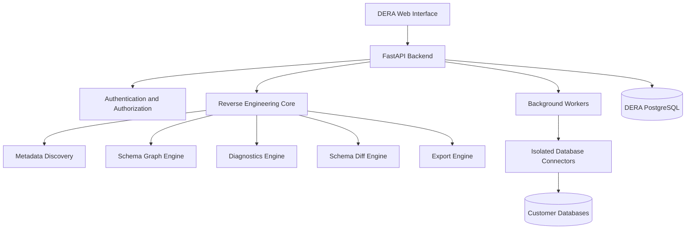

<div align="center">

# DERA

### Database Engineering & Reverse Analysis

**Understand Every Schema. Engineer Every Change.**

An open-source, deterministic database reverse-engineering platform for developers, database engineers, architects, and engineering teams.

Explore database structures, visualize relationships, analyze schemas, identify structural risks, and generate engineering documentation — without AI models or external AI APIs.

<br/>

[](https://github.com/krishanth7/dera/stargazers)
[](https://github.com/krishanth7/dera/forks)
[](https://github.com/krishanth7/dera/issues)
[](https://github.com/krishanth7/dera/blob/main/LICENSE)
[](https://github.com/krishanth7/dera/releases)

<br/>

[Overview](#-overview) ·
[Features](#-features) ·
[Architecture](#-architecture) ·
[Roadmap](#-development-roadmap) ·
[Contributing](#-contributing) ·
[Community](#-community)

</div>

---

## 🌍 Language Support

DERA aims to provide documentation in 10 international languages.

> **Documentation status:** English is the primary documentation language. The translations listed below are planned and will be linked as they become available.

| Language | Documentation |
|---|---|
| 🇬🇧 English | Current README |
| 🇪🇸 Español | Planned |
| 🇫🇷 Français | Planned |
| 🇩🇪 Deutsch | Planned |
| 🇵🇹 Português | Planned |
| 🇯🇵 日本語 | Planned |
| 🇰🇷 한국어 | Planned |
| 🇨🇳 简体中文 | Planned |
| 🇸🇦 العربية | Planned |
| 🇷🇺 Русский | Planned |

---

## 📖 Overview

Modern databases are powerful, but understanding an unfamiliar database can be challenging.

Large systems often contain hundreds of tables, thousands of columns, complex foreign-key relationships, indexes, constraints, views, and dependencies.

Understanding these structures manually requires significant engineering time.

**DERA is designed to simplify this process.**

DERA will provide a unified workspace for exploring database architecture, reconstructing relationships, identifying structural problems, and documenting database systems.

### Our Mission

Make database reverse engineering accessible, transparent, reproducible, and reliable for every developer.

### Our Philosophy

- **Deterministic by Design** — Reproducible analysis using defined algorithms.
- **No Generative AI** — No LLMs, AI inference services, or external AI APIs.
- **Privacy First** — Database metadata analysis without copying customer table rows by default.
- **Open Source** — Transparent engineering and community collaboration.
- **Developer Focused** — Practical tools for real engineering workflows.
- **Security First** — Least-privilege connections and controlled operations.
- **Engineering Accuracy** — Evidence-based findings instead of fabricated explanations.

---

## ✨ Features

The following describes DERA's planned capabilities. Availability will depend on the development phase and published release.

### 🔍 Database Discovery

Inspect supported database engines and discover:

- Databases and schemas
- Tables and columns
- Data types and default values
- Primary and foreign keys
- Unique and check constraints
- Indexes and sequences
- Views and materialized views
- Object dependencies

### 🧬 Reverse Engineering Engine

Reconstruct database structure using native metadata inspection and deterministic algorithms.

Planned capabilities include:

- Canonical schema representation
- Schema object classification
- Dependency graph construction
- Foreign-key relationship mapping
- Structural metadata normalization
- Schema snapshot generation
- SQL DDL reconstruction
- Schema export and documentation

### 🕸️ Visual ER Studio

Explore database relationships through an interactive entity-relationship diagram interface.

Planned functionality:

- Interactive table nodes
- Foreign-key connections
- Automatic graph layouts
- Zoom and pan
- Search and filtering
- Relationship highlighting
- Schema grouping
- SVG and PNG exports

### 🛡️ Database Diagnostics

Analyze schema metadata against configurable engineering rules.

Example diagnostic categories:

| Rule | Description |
|---|---|
| Missing Primary Key | Detect tables without declared primary keys |
| Potentially Redundant Index | Identify overlapping index definitions |
| Unindexed Foreign Key | Identify foreign keys without suitable supporting indexes |
| Naming Convention | Detect violations of configured naming standards |
| Constraint Review | Highlight missing or inconsistent declared constraints |
| Privilege Review | Detect deviations from configured access policies |

Diagnostic results are evidence-based recommendations and must be reviewed before applying changes.

### 🔄 Schema Comparison

Compare database schema snapshots to understand structural changes.

Planned capabilities:

- Added and removed tables
- Modified columns
- Data type changes
- Index changes
- Foreign-key modifications
- Constraint differences
- Version history
- Change impact classification

### ⚡ SQL Performance Engineering

Future versions will support:

- SQL query inspection
- Execution plan visualization
- Query plan comparison
- Potential index recommendations
- Query complexity analysis
- Performance diagnostics
- Optimization reports

### 📑 Documentation Generator

Generate engineering documentation from database metadata.

Planned export formats:

- Markdown
- HTML
- JSON
- SQL
- SVG
- PNG

### 🔐 Security Engineering

DERA is designed around secure database inspection.

Security principles include:

- Read-only inspection by default
- Encrypted database credentials
- Least-privilege access
- Organization-level access controls
- Audit logging
- Tenant isolation
- Connection timeouts
- Controlled background jobs
- No automatic database modification

---

## 🧠 No AI. Just Engineering.

DERA is designed without artificial intelligence models.

It does not require:

- OpenAI
- Anthropic Claude
- Google Gemini
- Groq
- Hosted LLM services
- AI inference APIs
- Proprietary AI model subscriptions

Instead, DERA uses:

- SQL metadata inspection
- Database system catalogs
- Deterministic rule engines
- SQL parsing
- Graph algorithms
- Schema comparison algorithms
- Dependency analysis
- Database engineering principles

**The goal is predictable, inspectable, and reproducible engineering analysis.**

DERA may expose its own application APIs and use native database protocols. These are not external AI services.

---

## 🏗️ Architecture

DERA follows a modular architecture designed for maintainability, extensibility, and secure database access.



### Architecture Principles

1. Modular monolith architecture for the initial release.
2. Independent database connectors.
3. Canonical schema representation.
4. Immutable schema snapshots.
5. Versioned deterministic diagnostic rules.
6. Isolated background processing.
7. Metadata-first inspection.
8. Explicit approval for potentially destructive operations.

---

## 🛠️ Technology Stack

| Layer | Technology |
|---|---|
| Frontend | Next.js, React, TypeScript |
| Styling | Tailwind CSS |
| UI Components | shadcn/ui |
| Graph Visualization | React Flow, ELK.js |
| SQL Editor | Monaco Editor |
| Backend | Python, FastAPI |
| Database Inspection | SQLAlchemy |
| SQL Parsing | SQLGlot |
| Graph Algorithms | NetworkX |
| Background Jobs | Celery |
| Message Broker | Redis |
| Platform Database | PostgreSQL |
| Database Migrations | Alembic |
| Containerization | Docker |
| Backend Testing | Pytest |
| Frontend Testing | Playwright |
| CI/CD | GitHub Actions |

All technologies are subject to implementation review and dependency license verification.

---

## 🗄️ Database Compatibility

DERA will introduce database support incrementally.

| Database | Planned Priority |
|---|---|
| PostgreSQL | Initial MVP |
| Supabase PostgreSQL | Initial MVP connection scenario |
| MySQL | Future release |
| SQLite | Future release |
| MariaDB | Future release |
| Microsoft SQL Server | Future release |
| Oracle Database | Under consideration |

Compatibility with a database engine does not automatically guarantee support for every version, extension, or vendor-specific object.

---

## 🚀 Getting Started

DERA is currently being designed and developed.

Production installation instructions will be published after the initial implementation has been validated.

### Planned Prerequisites

- Python 3.12 or newer
- Node.js LTS
- PostgreSQL
- Docker and Docker Compose
- Git

### Clone the Repository

```bash
git clone https://github.com/krishanth7/dera.git
cd dera
```

### Development Environment

The project will provide a Docker-based development environment after the backend, frontend, and supporting services have been implemented.

Planned components include:

```text
DERA Web
DERA API
DERA Worker
PostgreSQL
Redis
```

> Do not assume the application is runnable until the required configuration files, services, and installation instructions are published.

---

## 📁 Planned Repository Structure

```text
dera/
├── apps/
│   ├── web/
│   └── api/
├── packages/
│   ├── core/
│   ├── connectors/
│   └── contracts/
├── workers/
├── tests/
│   ├── unit/
│   ├── integration/
│   ├── security/
│   └── performance/
├── infrastructure/
│   ├── docker/
│   ├── deployment/
│   └── monitoring/
├── docs/
│   └── translations/
├── .github/
│   └── workflows/
├── LICENSE
└── README.md
```

This structure is a proposed architecture and may evolve as the project develops.

---

## 🗺️ Development Roadmap

### Phase 1 — Project Foundation

- [ ] Initialize the application monorepo
- [ ] Configure frontend and backend
- [ ] Configure PostgreSQL application storage
- [ ] Implement authentication and authorization
- [ ] Establish CI and testing
- [ ] Configure Docker development environment

### Phase 2 — Database Inspection Engine

- [ ] Implement PostgreSQL connector
- [ ] Extract schemas, tables, and columns
- [ ] Extract keys and constraints
- [ ] Extract indexes and views
- [ ] Implement canonical schema model
- [ ] Create immutable schema snapshots

### Phase 3 — Reverse Engineering Studio

- [ ] Develop interactive ER diagrams
- [ ] Implement relationship mapping
- [ ] Implement schema search
- [ ] Add dependency visualization
- [ ] Generate data dictionaries
- [ ] Support diagram exports

### Phase 4 — Diagnostics and Schema Comparison

- [ ] Implement deterministic diagnostic rules
- [ ] Detect potential structural problems
- [ ] Implement schema comparison
- [ ] Generate schema difference reports
- [ ] Add configurable rule policies
- [ ] Add diagnostic evidence and explanations

### Phase 5 — Advanced Engineering

- [ ] Implement SQL analysis tools
- [ ] Support execution plan inspection
- [ ] Generate migration previews
- [ ] Implement dependency-aware migration ordering
- [ ] Add advanced documentation exports
- [ ] Expand supported database engines

### Phase 6 — Production Readiness

- [ ] Complete security testing
- [ ] Perform performance benchmarking
- [ ] Validate database compatibility
- [ ] Implement monitoring and operational documentation
- [ ] Publish installation instructions
- [ ] Prepare the first stable release

> Roadmap items describe planned work and are not claims of completed implementation.

---

## 🧪 Testing and Quality

DERA aims to maintain high engineering standards through automated testing and repeatable validation.

Planned quality practices:

- Unit testing
- Integration testing
- Database compatibility testing
- Schema fixture validation
- Deterministic output verification
- Security testing
- Performance benchmarking
- Browser-based end-to-end testing
- Continuous integration

The same schema snapshot, rule configuration, and engine version should produce the same diagnostic results.

---

## 🔒 Security Policy

DERA handles database connection information and sensitive structural metadata.

Security is therefore a core engineering requirement.

### Security Principles

1. Never store database credentials in plaintext.
2. Never commit secrets or production connection strings.
3. Use least-privilege database accounts.
4. Enforce tenant isolation and authorization.
5. Avoid collecting customer row data by default.
6. Restrict database connector network access.
7. Record security-relevant operations.
8. Require explicit approval for database modifications.
9. Validate backups and recovery procedures.
10. Review security findings before production releases.

### Reporting Vulnerabilities

Please report security vulnerabilities privately rather than publishing exploit details in a public issue.

A dedicated security policy and private reporting process will be documented in `SECURITY.md`.

---

## 🤝 Contributing

DERA welcomes developers, database engineers, designers, technical writers, testers, and open-source contributors.

You can contribute through:

- Database connector development
- Backend engineering
- Frontend development
- Graph visualization improvements
- Diagnostic rule development
- Automated testing
- Documentation
- Translations
- Security improvements
- Bug reports and feature proposals

### Contribution Workflow

1. Fork the repository.
2. Create a descriptive feature branch.
3. Implement your changes.
4. Add or update relevant tests.
5. Document the changes.
6. Open a pull request.
7. Participate in code review.

Please review the contribution guidelines once `CONTRIBUTING.md` is published.

---

## 💬 Community

Join the DERA open-source community.

- [GitHub Discussions](https://github.com/krishanth7/dera/discussions) — Questions, ideas, and community conversations.
- [GitHub Issues](https://github.com/krishanth7/dera/issues) — Bugs and development tasks.
- [Pull Requests](https://github.com/krishanth7/dera/pulls) — Code contributions.
- [Releases](https://github.com/krishanth7/dera/releases) — Official version history.
- [Project Repository](https://github.com/krishanth7/dera) — Source code and documentation.

---

## ❤️ Support the Project

DERA is intended to remain an open-source, community-driven engineering project.

If you find DERA useful, you can support its development by:

- Starring the repository
- Sharing the project
- Reporting bugs
- Contributing code
- Improving documentation
- Participating in discussions
- Sponsoring development

[](https://github.com/sponsors/krishanth7)

---

## ❓ Frequently Asked Questions

### Does DERA use artificial intelligence?

No. DERA is designed to use deterministic database inspection, parsing, graph analysis, and rule-based algorithms.

### Does DERA require external AI APIs?

No. DERA does not require OpenAI, Claude, Gemini, Groq, or other AI inference services.

### Does DERA modify my database?

The initial design uses read-only inspection. Future migration tools will require explicit review and authorization.

### Can DERA reconstruct an entire database?

DERA aims to reconstruct supported schema structures and dependencies. Completeness depends on the database engine, permissions, metadata availability, and supported object types.

### Can DERA analyze large databases?

Large-schema support is a design objective. Actual performance and capacity limits will be documented after benchmarking.

### Is DERA free and open source?

DERA is planned as an open-source project. The repository's `LICENSE` file defines the applicable legal permissions.

### Can I contribute?

Yes. Contributions, documentation improvements, issue reports, and engineering discussions are welcome.

---

## 📜 License

DERA is intended to be distributed under the **MIT License**.

See the [LICENSE](https://github.com/krishanth7/dera/blob/main/LICENSE) file for the applicable license terms.

---

## 👨‍💻 Maintainer

**Krishanth**

Founder & Developer

- GitHub: [@krishanth7](https://github.com/krishanth7)
- Repository: [github.com/krishanth7/dera](https://github.com/krishanth7/dera)

DERA is a personal open-source development initiative, with OVIC Labs acknowledged as the associated engineering ecosystem.

---

## ⭐ Star History

[](https://star-history.com/#krishanth7/dera&Date)

---

<div align="center">

### DERA

**Database Engineering & Reverse Analysis**

*Understand Every Schema. Engineer Every Change.*

Built with engineering precision, transparency, and a commitment to open source.

**© 2026 DERA Contributors.**

[Back to Top](#dera)

</div>
