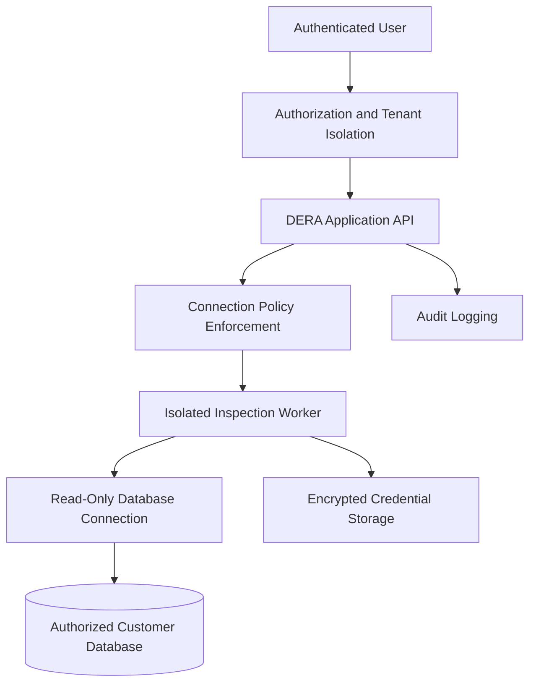

# Security Policy

## 🔐 DERA Security

### Database Engineering & Reverse Analysis

**Security by Design. Privacy by Default. Trust Through Transparency.**

---

## Overview

Security is a fundamental engineering priority for **DERA — Database Engineering & Reverse Analysis**.

DERA is designed to inspect database schemas, analyze structural metadata, visualize relationships, and generate engineering documentation.

Because the platform may connect to databases containing sensitive business information, security and privacy are essential to its architecture.

Our security objectives include:

- Protecting database connection credentials.
- Preventing unauthorized database access.
- Maintaining strict tenant isolation.
- Minimizing access to customer information.
- Preventing unintended database modifications.
- Ensuring secure execution of database inspection operations.
- Maintaining transparent and responsible vulnerability disclosure.

DERA follows a **security-first, least-privilege, metadata-first** engineering philosophy.

---

## Supported Versions

Security updates will be provided for supported releases once official versions become available.

| Version | Supported |
|---|---|
| Development / Unreleased | Best-effort fixes |
| First stable release | Planned |
| Older releases | To be determined |

> DERA is currently under development. No stable release is declared supported until it has been officially published.

Future releases will document their security support lifecycle and end-of-support dates.

---

## Reporting a Vulnerability

We appreciate responsible security research and encourage researchers to report vulnerabilities privately.

### Preferred Method: GitHub Private Vulnerability Reporting

If private vulnerability reporting is enabled, submit a report through:

**[Report a Security Vulnerability](https://github.com/krishanth7/dera/security/advisories/new)**

This allows maintainers and reporters to coordinate privately.

### Alternative Contact

If GitHub private vulnerability reporting is unavailable, contact:

**Security Contact:** krishanth.b.2008@gmail.com

**Maintainer:** [Krishanth](https://github.com/krishanth7)

**Repository:** https://github.com/krishanth7/dera

### What to Include

Please provide:

1. A clear description of the vulnerability.
2. The affected DERA version or commit.
3. The affected component or endpoint.
4. Steps to reproduce the issue safely.
5. The potential security impact.
6. Relevant logs, screenshots, or proof-of-concept details.
7. Suggested mitigations, if available.

Never include real production passwords, access tokens, or customer database records.

---

## Responsible Disclosure

We ask security researchers to follow responsible disclosure practices.

Please:

- Report vulnerabilities privately.
- Allow maintainers reasonable time to investigate and remediate.
- Avoid public disclosure before coordinating with maintainers.
- Use test environments and accounts you own or are authorized to assess.
- Minimize access to sensitive information.
- Stop testing if unintended access to private data occurs.
- Avoid actions that disrupt services or damage data.

Do not perform:

- Unauthorized access to third-party databases.
- Destructive testing against production environments.
- Denial-of-service attacks.
- Data exfiltration.
- Credential harvesting.
- Social engineering against contributors or maintainers.
- Testing of infrastructure without explicit authorization.

This policy does not grant permission to test third-party systems.

---

## Security Response Process

The following describes DERA's intended vulnerability response workflow.

### 1. Acknowledgment

The maintainer aims to acknowledge a valid security report within **3 business days**.

### 2. Initial Assessment

Reports will be reviewed to determine:

- Reproducibility
- Affected components
- Severity
- Potential impact
- Exploitability
- Immediate mitigation options

### 3. Investigation

Confirmed vulnerabilities will be investigated and prioritized according to their security impact.

### 4. Remediation

Where feasible, fixes will include:

- A targeted code change
- Regression tests
- Security review
- Updated documentation
- Release notes
- Relevant mitigation guidance

### 5. Coordinated Disclosure

Public disclosure may occur after a fix or appropriate mitigation is available, coordinated with the reporter where practical.

> Response times are best-effort targets, not guaranteed service-level agreements.

For the full operational triage workflow, CVSS evaluation criteria, and private patch procedures, see [Vulnerability Response Process](docs/security/VULNERABILITY_RESPONSE.md).

---

## Severity Classification

DERA intends to use CVSS and contextual risk assessment when evaluating vulnerabilities.

| Severity | Examples |
|---|---|
| Critical | Cross-tenant database credential exposure, unauthenticated remote code execution |
| High | Unauthorized database access, privilege escalation, sensitive data disclosure |
| Medium | Limited information exposure, authorization bypass with restricted impact |
| Low | Minor information leakage or limited security misconfiguration |

Final severity depends on exploitability, prerequisites, affected deployments, and actual impact.

---

## Security Architecture

DERA's planned security architecture follows defense-in-depth principles.

This is a target architecture, not a claim that every control has already been implemented.

---

## Database Connection Security

DERA should use least-privilege credentials for all database inspection operations.

Security requirements include:

- Read-only database roles by default.
- Restricted access to system catalogs and metadata.
- TLS encryption where supported and appropriate.
- Connection timeouts.
- Statement execution timeouts.
- Connection pooling limits.
- Controlled connection retries.
- Secure credential handling.
- Explicit authorization for each connected database.

DERA must never silently elevate database privileges.

### Credential Protection

Database credentials must:

- Never be stored in plaintext.
- Never appear in application logs.
- Never be included in exported reports.
- Never be committed to source control.
- Be encrypted at rest.
- Be transmitted over secure channels.
- Be accessible only to authorized services.
- Support rotation and revocation.

Use environment variables or a secure secrets-management solution for local and production deployments.

For full database security standards, credential handling rules, and system catalog access policies, see [Database Security Policy](docs/security/DATABASE_SECURITY.md).

---

## SQL Execution Safety

DERA's initial architecture is metadata-first and read-only.

Security controls should include:

- Database-enforced read-only permissions.
- Parameterized queries for supported values.
- Safe handling of database identifiers.
- Statement timeouts.
- Query resource limits.
- Restricted database operations.
- SQL inspection and validation.
- Separate authorization for any future write-enabled operations.

**Important:** SQL keyword filtering alone does not guarantee safe read-only execution.

Any future migration or schema modification functionality must require explicit user authorization and appropriate database privileges.

---

## Tenant Isolation

For multi-tenant deployments, DERA must enforce isolation between organizations and users.

Required controls include:

- Organization-scoped resources.
- Role-based access control.
- Server-side authorization.
- Tenant-aware database queries.
- Secure session handling.
- Access checks on background jobs.
- Restricted export permissions.
- Auditable administrative operations.

PostgreSQL Row-Level Security may be used as an additional defense-in-depth control.

---

## Connector and Network Security

Database connectors may communicate with private or sensitive network resources.

To reduce risk, DERA should implement:

- Connection destination validation.
- Network egress restrictions.
- SSRF prevention.
- Isolated worker execution.
- Resource limits.
- Controlled DNS resolution.
- Secure connection configuration.
- Database-specific privilege restrictions.

User-provided connection destinations must not provide unrestricted access to internal infrastructure or cloud metadata services.

---

## Data Privacy

DERA follows a metadata-first design.

By default, database analysis should focus on:

- Schema names
- Table names
- Column names
- Data types
- Constraints
- Indexes
- Foreign-key relationships
- Supported database object definitions

DERA should not extract customer table-row data during ordinary schema analysis.

### Metadata Sensitivity

Database metadata may still reveal sensitive information about internal systems, business processes, or data models.

Therefore, schema snapshots, diagrams, exports, and reports must be protected using appropriate access controls.

---

## Dependency and Supply Chain Security

DERA aims to maintain secure software dependencies and reproducible builds.

Planned practices include:

- Dependency vulnerability scanning.
- Dependency version management.
- Software Bill of Materials generation.
- Secret scanning.
- Container image scanning.
- Release artifact verification.
- Code review for security-sensitive changes.
- Security updates for supported releases.

Release immutability may be enabled to help protect published release assets and tags.

---

## Authentication and Authorization

Security requirements include:

- Secure password handling where password authentication is supported.
- Session expiration and revocation.
- Protection against session fixation.
- CSRF protection where applicable.
- Role-based access control.
- Administrative access restrictions.
- Rate limiting.
- Audit logging.
- Optional multi-factor authentication in future releases.

Authentication must not be treated as a substitute for authorization.

---

## Audit Logging

Security-relevant operations should be recorded.

Examples include:

- User authentication events.
- Database connection creation.
- Connection configuration changes.
- Schema inspection requests.
- Schema exports.
- Permission changes.
- Administrative actions.
- Security policy changes.

Audit records must avoid storing secrets or unnecessary sensitive information.

---

## Secure Development Practices

Contributors should follow secure software engineering principles.

### Required Practices

- Validate untrusted input.
- Use least-privilege access.
- Avoid hardcoded credentials.
- Handle errors without exposing secrets.
- Use secure dependency versions.
- Add security regression tests.
- Review database permissions.
- Document security-sensitive changes.

### Recommended Testing

- Static application security testing.
- Dependency scanning.
- Authentication testing.
- Authorization testing.
- Tenant isolation testing.
- Connector security testing.
- SQL safety testing.
- Container security scanning.

For comprehensive engineering standards, input validation rules, and automated CI gates, see [Secure Development Standards](docs/security/SECURE_DEVELOPMENT.md).

---

## Security Updates and Advisories

When security releases become available, maintainers may publish:

- GitHub Security Advisories.
- Patched release versions.
- Security changelogs.
- Mitigation instructions.
- Upgrade recommendations.

Users should monitor the repository's Releases and Security sections for updates.

[View Releases](https://github.com/krishanth7/dera/releases)

[View Security Advisories](https://github.com/krishanth7/dera/security/advisories)

---

## Security Research Recognition

DERA appreciates responsible security researchers.

Researchers who submit valid reports may be acknowledged in release notes or security advisories with their consent.

DERA does not currently advertise a paid bug bounty program.

Submitting a vulnerability report does not guarantee financial compensation.

---

## Security Contact

For security-related concerns:

**Maintainer:** Krishanth

**Email:** krishanth.b.2008@gmail.com

**GitHub:** https://github.com/krishanth7

**Repository:** https://github.com/krishanth7/dera

Please use private reporting channels for vulnerabilities.

---

## Security Documentation Index

The following detailed security specifications are maintained in the repository:

- [**docs/security/DATABASE_SECURITY.md**](docs/security/DATABASE_SECURITY.md) — Database connection, catalog access, and credential isolation standards.
- [**docs/security/SECURE_DEVELOPMENT.md**](docs/security/SECURE_DEVELOPMENT.md) — Secure coding guidelines, input validation, and DevSecOps gates.
- [**docs/security/VULNERABILITY_RESPONSE.md**](docs/security/VULNERABILITY_RESPONSE.md) — Operational response workflow, triage, and disclosure.
- [**docs/security/model.md**](docs/security/model.md) — Architectural threat modeling matrix.

---

## Policy Maintenance

This security policy may be updated as DERA evolves.

Changes may reflect:

- New database connectors.
- New deployment environments.
- Security architecture improvements.
- Supported version changes.
- Vulnerability disclosure procedures.
- New security requirements.

---

### DERA — Database Engineering & Reverse Analysis

**Security by Design. Privacy by Default.**

Maintained by [Krishanth](https://github.com/krishanth7)

© 2026 DERA Contributors

