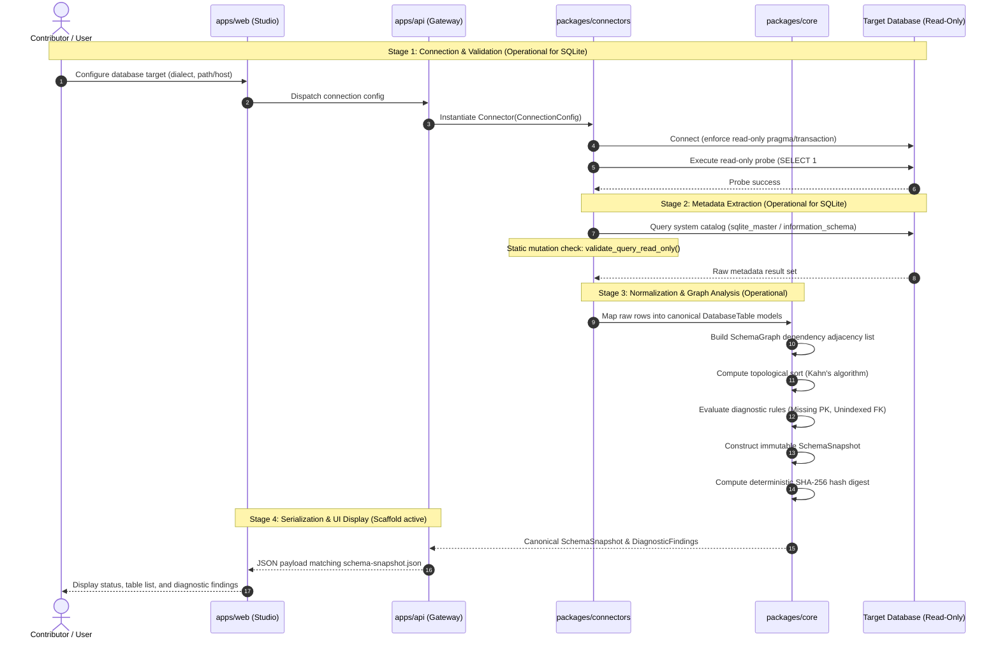
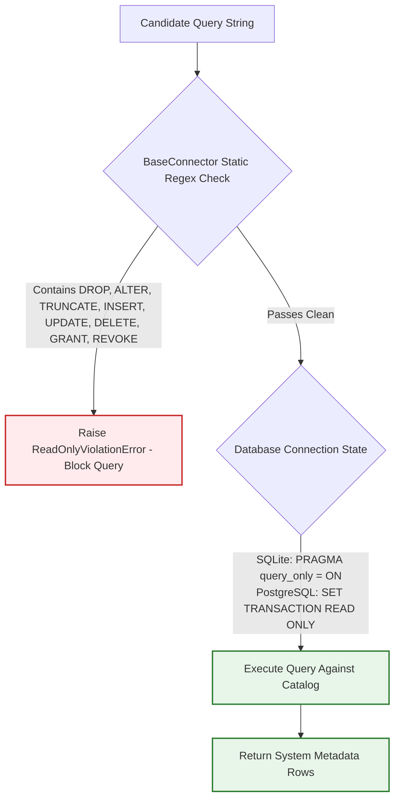

# DERA End-to-End Data Flow Architecture

> **Project:** DERA — Database Engineering & Reverse Analysis  
> **Maintainer:** Krishanth  
> **Status:** Active Architectural Specification  
> **Last Verified:** 2026-10-26 (Commit `e550fdd`)  

---

## 1. Introspection Lifecycle Overview

DERA's end-to-end metadata processing lifecycle transforms raw database catalog rows into canonical domain models, dependency graphs, and diagnostic reports without touching customer table rows.

The full processing pipeline consists of 8 discrete stages:

```text
[1. Connection Configuration]
           │
           ▼
[2. Connection Validation (Read-Only Test)]
           │
           ▼
[3. Catalog Metadata Inspection]
           │
           ▼
[4. Canonical Schema Normalization]
           │
           ▼
[5. Referential Graph & Cycle Analysis]
           │
           ▼
[6. Diagnostic Rule Linting]
           │
           ▼
[7. Cryptographic Hashing & Serialization]
           │
           ▼
[8. Presentation / API Response]
```

---

## 2. Implemented vs. Planned Processing Stages

To maintain truth-in-documentation, the implementation status of each stage is classified as follows:

| Stage | Name | Implementation Status | Active Code Reference |
|---|---|---|---|
| **1** | Connection Configuration | **Implemented** | `ConnectionConfig` in [`dera_connectors.base.connector`](../../packages/connectors/src/dera_connectors/base/connector.py) |
| **2** | Connection Validation | **Implemented (SQLite)** | `SqliteConnector.test_connection()` in [`dera_connectors.sqlite.connector`](../../packages/connectors/src/dera_connectors/sqlite/connector.py) |
| **3** | Catalog Metadata Inspection | **Implemented (SQLite)** | `SqliteConnector.inspect_tables()` querying `sqlite_master` and PRAGMAs |
| **4** | Canonical Normalization | **Implemented** | `DatabaseTable`, `DatabaseColumn`, `PrimaryKeyConstraint`, `ForeignKeyConstraint`, `TableIndex` in [`dera.models`](../../packages/core/src/dera/models.py) |
| **5** | Dependency Graph Analysis | **Implemented** | `build_dependency_graph()` & `compute_topological_sort()` in [`dera.graph`](../../packages/core/src/dera/graph.py) |
| **6** | Diagnostic Rule Linting | **Implemented** | `run_all_diagnostics()` evaluating rules `RULE-INT-001` and `RULE-PERF-002` in [`dera.diagnostics`](../../packages/core/src/dera/diagnostics/__init__.py) |
| **7** | Snapshot Hashing & Serialization | **Implemented** | `SchemaSnapshot.compute_hash()` generating deterministic SHA-256 fingerprint in `dera.models` |
| **8** | API Response / Web Canvas | **Partially Implemented** | Health and meta endpoints active in `apps/api`; full inspection endpoint (`POST /api/v1/inspect`) and canvas visualizer scheduled for Phase 5 & 7 |

---

## 3. Sequence Architecture Diagram

The sequence diagram below models the end-to-end introspection flow, clearly distinguishing operational calls from planned service invocations:



---

## 4. Query Safety & Read-Only Invariant Flow

To protect target databases against accidental modification or malicious queries, DERA enforces a multi-layer safety check:



---

## 5. Related Architecture Specifications

- [System Overview](SYSTEM_OVERVIEW.md)
- [Monorepo Directory Layout](MONOREPO_STRUCTURE.md)
- [Module Boundaries](MODULE_BOUNDARIES.md)
- [Database Connector Architecture](../connectors/CONNECTOR_ARCHITECTURE.md)
- [Graph Engine Documentation](../core/GRAPH_ENGINE.md)
