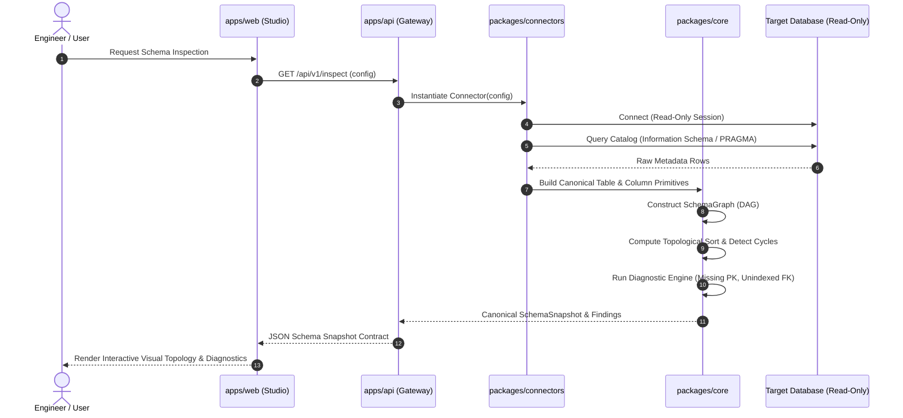
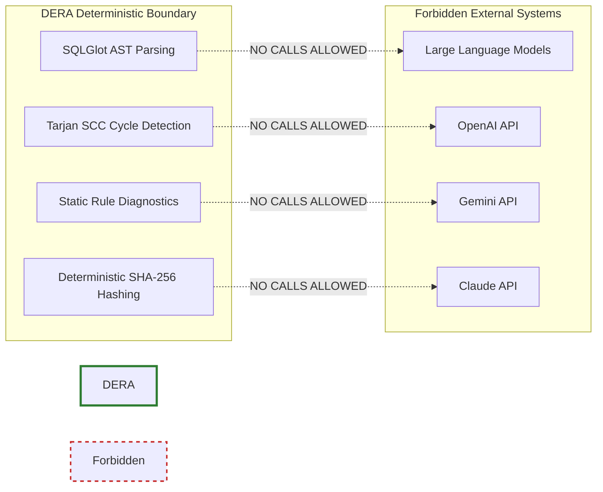

# DERA Package Dependency Graph & Data Flow Architecture

> **Phase:** 1.2 Monorepo Architecture Foundation  
> **Status:** Active Architectural Reference  

---

## 1. Package Dependency Graph

```mermaid
graph TD
    subgraph Frontend Ecosystem
        WEB["apps/web<br/>(Next.js / React Flow)"]
        CONTRACTS["packages/contracts<br/>(TypeScript Interfaces & Schemas)"]
        WEB -->|imports types| CONTRACTS
    end

    subgraph Backend Transport
        API["apps/api<br/>(FastAPI HTTP Gateway)"]
    end

    subgraph Core Domain (Strictly Deterministic)
        CORE["packages/core<br/>(Models, Graph DAG, Diagnostics)"]
        CONNECTORS["packages/connectors<br/>(Read-Only Database Adapters)"]
    end

    subgraph Target Databases (Read-Only)
        SQLITE[("SQLite Database")]
        PG[("PostgreSQL Database")]
        MYSQL[("MySQL Database")]
    end

    API -->|serializes with| CONTRACTS
    API -->|orchestrates| CONNECTORS
    API -->|executes algorithms| CORE
    CONNECTORS -->|constructs| CORE

    CONNECTORS -.->|PRAGMA query_only| SQLITE
    CONNECTORS -.->|SET TRANSACTION READ ONLY| PG
    CONNECTORS -.->|READ ONLY session| MYSQL

    classDef web fill:#e3f2fd,stroke:#1565c0,stroke-width:2px;
    classDef api fill:#f3e5f5,stroke:#6a1b9a,stroke-width:2px;
    classDef core fill:#e8f5e9,stroke:#2e7d32,stroke-width:2px;
    classDef db fill:#fff3e0,stroke:#e65100,stroke-width:2px;

    class WEB,CONTRACTS web;
    class API api;
    class CORE,CONNECTORS core;
    class SQLITE,PG,MYSQL db;
```

---

## 2. End-to-End Introspection Data Flow



---

## 3. Strict Non-AI Boundary Verification


