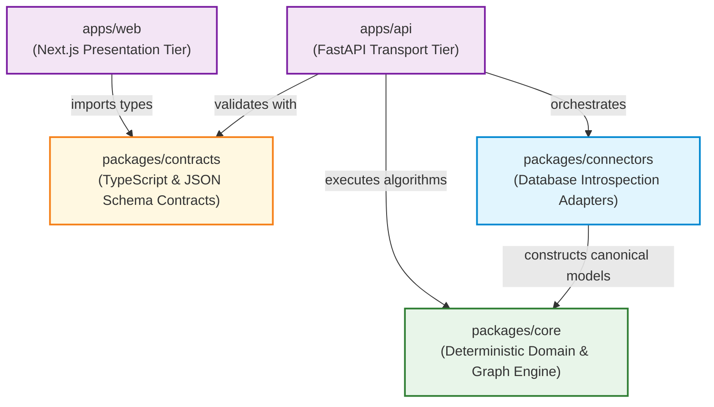

# DERA Module Boundaries & Architectural Dependency Rules

> **Project:** DERA — Database Engineering & Reverse Analysis  
> **Maintainer:** Krishanth  
> **Status:** Active Architectural Standard  
> **Enforcement:** Automated via [`tests/architecture/test_module_boundaries.py`](../../tests/architecture/test_module_boundaries.py)  
> **Last Verified:** 2026-10-26 (Commit `e550fdd`)  

---

## 1. Architectural Dependency Hierarchy

DERA strictly enforces a **unidirectional dependency hierarchy**. Code in lower layers must never import or depend on code from higher layers.



---

## 2. Core Architectural Principles

1. **Framework Independence of Core:** Domain models (`DatabaseTable`, `DatabaseColumn`), graph algorithms, and diagnostic rules must depend exclusively on the Python standard library. They must never import `fastapi`, `starlette`, or external database network drivers.
2. **Explicit Connector Contracts:** Database connectors must inherit from `BaseConnector` and adhere to its abstract interface. Concrete connectors are isolated in dialect-specific subpackages (`dera_connectors.sqlite`, `dera_connectors.postgresql`).
3. **Transport Layer Delegation:** API routes in `apps/api` must never implement database introspection or graph logic directly; they act strictly as request validation, transport dispatch, and error serialization layers.
4. **Contract-Driven Frontend Parity:** Frontend views in `apps/web` must consume API data exclusively through typed contracts defined in `@dera/contracts`.
5. **Security at Trust Boundaries:** Database connection parameters and credentials must remain strictly within server-side components (`apps/api` and `packages/connectors`). Credentials must never leak into client-side JavaScript bundles or error messages.

---

## 3. Forbidden Import Matrix

The following imports are strictly forbidden and will fail architectural linting and CI gate checks:

| Source Module | Forbidden Import Targets | Architectural Rationale |
|---|---|---|
| `packages/core` | `fastapi`, `starlette`, `apps/api`, `apps/web` | Core domain must remain a transport-independent, embeddable Python library. |
| `packages/core` | Concrete database drivers (`psycopg`, `mysql`, `snowflake`) | Core primitives must be decoupled from specific network drivers and databases. |
| `packages/core` | Generative AI libraries (`openai`, `google.genai`, `anthropic`, `torch`) | Strict non-AI mandate. DERA relies purely on deterministic algorithms. |
| `packages/connectors` | `apps/api`, `apps/web`, `fastapi` | Connectors must remain callable from CLI runners, migration scripts, or background workers. |
| `packages/connectors` | Generative AI libraries (`openai`, `google.genai`, `anthropic`, `torch`) | Zero AI in database catalog querying or schema reconstruction. |
| `apps/api` | `apps/web` | Backend services must not depend on frontend code. |
| `apps/web` | Backend database credentials (`NEXT_PUBLIC_*PASSWORD*`) | Database credentials must never be bundled into browser JavaScript. |
| Any module | Circular imports across package boundaries | Circular dependencies break modularity and prevent static analysis. |

---

## 4. Contributor Extension Guide

### 4.1 How to Add a New Database Connector
1. Create a dedicated subdirectory under `packages/connectors/src/dera_connectors/<dialect>/` (e.g. `postgresql`).
2. Subclass `BaseConnector` in `dera_connectors.base.connector`.
3. Implement the required abstract methods:
   - `connect()`: Open connection and enforce session-level read-only constraints (`SET TRANSACTION READ ONLY;`).
   - `disconnect()`: Release connection and pool resources.
   - `test_connection() -> bool`: Validate connectivity and catalog read permissions.
   - `inspect_tables() -> List[DatabaseTable]`: Query system catalog views (`pg_catalog`, `information_schema`) and map into canonical `DatabaseTable` primitives.
4. Add integration tests under `tests/integration/test_<dialect>_connector.py`.
5. Register the connector in `packages/connectors/src/dera_connectors/__init__.py`.

### 4.2 How to Add a New Diagnostic Rule
1. Navigate to `packages/core/src/dera/diagnostics.py`.
2. Define an evaluation function matching the signature:
   ```python
   def evaluate_rule_name(tables: Iterable[DatabaseTable]) -> list[DiagnosticFinding]:
       ...
   ```
3. Use a unique rule ID (e.g., `RULE-INTEG-003`, `RULE-PERF-004`) and specify `RuleSeverity` (`INFO`, `WARNING`, `ERROR`).
4. Include actionable `remediation_ddl` where applicable.
5. Register the rule in `run_all_diagnostics()`.
6. Add unit test coverage in `tests/unit/test_models.py`.

### 4.3 How to Add or Update a Schema Contract
1. Update Python dataclasses in `packages/core/src/dera/models.py`. Ensure immutability via `@dataclass(frozen=True)`.
2. Update shared TypeScript contracts in `packages/contracts/src/index.ts` to maintain type parity.
3. Update JSON Schema definitions in `packages/contracts/schemas/schema-snapshot.json`.
4. Verify cross-platform validation by executing:
   ```bash
   python scripts/development/dev.py all
   ```

### 4.4 How to Add a New API Endpoint
1. Define request and response schemas using Pydantic in `apps/api/src/dera_api/schemas/`.
2. Register the route handler in `apps/api/src/dera_api/main.py` (or a dedicated router under `routers/`).
3. Handle domain exceptions using `format_error_response` from `dera_api.core.exceptions`.
4. Add unit test coverage in `tests/unit/test_api.py`.

---

## 5. Architectural Debt & Remediation Roadmap

The following architectural debt items have been identified and logged:

| Debt Item | Affected Location | Risk Level | Target Remediation |
|---|---|---|---|
| **Namespace Split** | `packages/core/src/dera` vs `dera_core` | Low | Unify into `dera` namespace in Phase 3. |
| **Connector Delegation** | `dera_connectors.sqlite` importing `dera.connectors.sqlite` | Medium | Implement native PRAGMA introspection in `dera_connectors.sqlite` directly. |
| **Monolithic Route File** | `apps/api/src/dera_api/main.py` | Low | Refactor into modular routers (`routers/health.py`, `routers/meta.py`, `routers/inspect.py`) as endpoints expand. |

---

## 6. Related Architecture Documents

- [System Overview & Principles](SYSTEM_OVERVIEW.md)
- [Monorepo Structure Specification](MONOREPO_STRUCTURE.md)
- [End-to-End Introspection Data Flow](DATA_FLOW.md)
- [Technology Decisions](TECHNOLOGY_DECISIONS.md)
- [Architecture Decision Records (ADRs)](adr/README.md)
