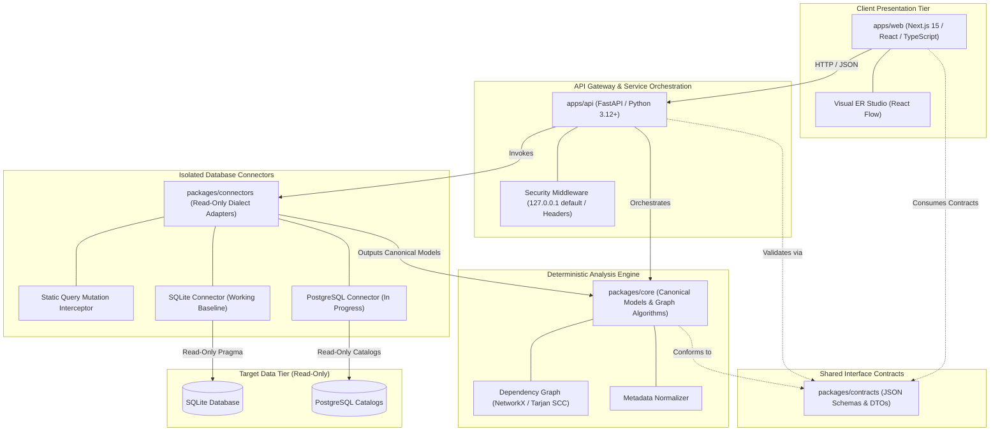
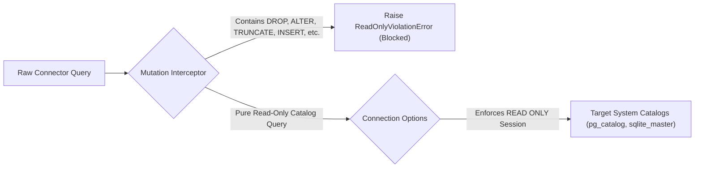

# DERA Architecture & Engineering Blueprint

> **Project:** DERA — Database Engineering & Reverse Analysis  
> **Maintainer:** Krishanth ([@krishanth7](https://github.com/krishanth7))  
> **Tagline:** Understand Every Schema. Engineer Every Change.  
> **Status:** Official Monorepo Architecture Specification  

---

## 1. High-Level Architectural Vision

DERA is structured as a **modular monolith** optimized for deterministic execution, strict security isolation, high testability, and developer productivity.



---

## 2. Component Responsibilities & Module Boundaries

| Monorepo Workspace | Primary Responsibility | Strict Boundary Constraints |
|---|---|---|
| [`apps/web`](../../apps/web) | Presentation layer, studio navigation, ER diagram rendering, accessible UI controls | **Forbidden:** Must never access production database credentials directly or execute native SQL queries. |
| [`apps/api`](../../apps/api) | HTTP gateway, input validation, security middleware, service orchestration | **Decoupled:** Must depend on generic engine contracts rather than concrete database connection drivers. |
| [`packages/core`](../../packages/core) | Canonical schema models, topological dependency graph, normalization, hashing | **Framework-Independent:** Must zero dependencies on web frameworks (FastAPI, React, Next.js) or active database network connections. |
| [`packages/connectors`](../../packages/connectors) | Database-specific metadata extraction, capability negotiation, query mutation guards | **Least-Privilege:** Enforces strictly read-only catalog extraction; never exposes credentials to frontend code. |
| [`packages/contracts`](../../packages/contracts) | Versioned API schemas, data contracts, snapshot JSON specifications | **Zero-Logic:** Declarative schema models and serialization definitions shared between backend and web. |

---

## 3. Database Connector Isolation & Safety

Database reverse engineering requires connecting to mission-critical databases. DERA enforces three layers of safety:



1. **Static AST Mutation Guard:**
   Before any query is sent through `BaseConnector.execute_query()`, a static token parser inspects the query string. If any destructive keyword (`DROP`, `ALTER`, `TRUNCATE`, `INSERT`, `UPDATE`, `DELETE`, `GRANT`, `REVOKE`) is detected, execution is immediately aborted with a `ReadOnlyViolationError`.
2. **Catalog-Only Introspection:**
   Connectors query metadata views exclusively (`information_schema`, `pg_catalog`, `sqlite_master`). Table-row application data is never queried.
3. **Loopback & Credential Safety:**
   API endpoints bind to `127.0.0.1` by default to prevent inadvertent network exposure. Credentials are never written to disk, included in logs, or reflected in API responses.

---

## 4. Deterministic Processing Mandate (Zero AI)

DERA strictly prohibits generative AI models, large language models (LLMs), or third-party probabilistic inference APIs.

```text
┌──────────────────────────────────────────────────────────┐
│             PURE DETERMINISTIC ENGINEERING               │
│                                                          │
│   ❌  No OpenAI, Anthropic, Gemini, or Groq APIs        │
│   ❌  No Local Language Models (Ollama, vLLM)            │
│   ❌  No Stochastic Predictions or Hallucinations        │
│                                                          │
│   ✅  Mathematical Graph Algorithms (NetworkX)          │
│   ✅  Abstract Syntax Tree SQL Parsing (SQLGlot)        │
│   ✅  Native System Catalog Introspection               │
│   ✅  Deterministic Structural Diagnostics               │
│   ✅  Cryptographic Hash Fingerprints                    │
└──────────────────────────────────────────────────────────┘
```

**Benefits:**
- **Zero Hallucination:** Findings are guaranteed by mathematical graph proofs and concrete catalog tuples.
- **Reproducibility:** Running an audit on the same schema snapshot always yields byte-for-byte identical results.
- **Data Sovereignty:** Enterprise database structural topologies never leave the local environment.

---

## 5. Extension Strategy

To add new capabilities to DERA, contributors follow standard extension points:

1. **Adding a Database Connector:**
   - Inherit from `BaseConnector` in `packages/connectors/src/dera_connectors/base/connector.py`.
   - Implement `connect()`, `disconnect()`, `test_connection()`, and catalog extraction methods.
   - Map vendor catalog types to canonical `Column`, `Table`, `ForeignKey`, and `Index` models.
2. **Adding a Diagnostic Rule:**
   - Define rule metadata and static evaluation logic in `packages/core`.
   - Accept canonical schema models and emit deterministic diagnostic reports.
3. **Adding API Endpoints:**
   - Define typed request/response models in `apps/api/src/dera_api/schemas/`.
   - Implement the endpoint in `apps/api/src/dera_api/api/` and attach to FastAPI gateway.
