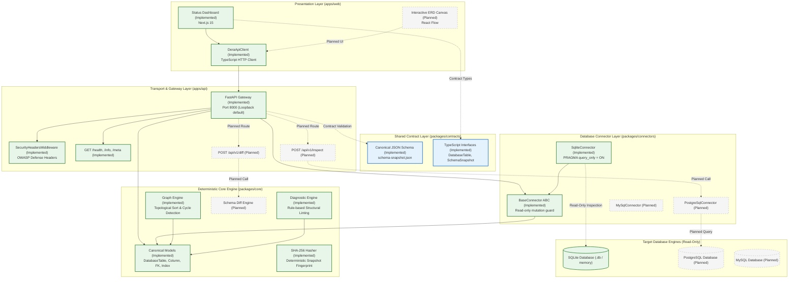

# DERA System Architecture Overview

> **Project:** DERA — Database Engineering & Reverse Analysis  
> **Tagline:** Understand Every Schema. Engineer Every Change.  
> **Maintainer:** Krishanth  
> **Status:** Authoritative Architectural Specification  
> **Last Verified:** 2026-10-26 (Commit `e550fdd`)  

---

## 1. Engineering Purpose & Scope

**DERA (Database Engineering & Reverse Analysis)** is an open-source, deterministic database engineering platform. Its mission is to introspect relational database catalogs, extract structural metadata, reconstruct referential relationships, analyze foreign-key dependency topologies, execute static diagnostic linting, and generate reproducible migration paths.

Unlike contemporary tools that introduce generative artificial intelligence into database management, DERA enforces an absolute invariant:
> **Strict Non-AI Policy:** Zero large language models (LLMs), zero machine-learning inference, zero vector embeddings, zero cloud inference API calls, and zero probabilistic recommendations.

Database schema architecture and migration engineering require mathematical precision, determinism, and auditability. A single hallucinated column type or incorrectly ordered DDL statement can cause catastrophic data corruption or prolonged production downtime. DERA replaces probabilistic guesswork with formal graph algorithms (Kahn's topological sort, Tarjan's strongly connected components) and rule-based diagnostic engines.

---

## 2. Implemented vs. Planned Architecture

To maintain complete transparency for contributors and users, DERA documentation strictly delineates between what is operational in the codebase and what is scheduled for future phases.

### 2.1 Implemented Capabilities (Verified in Code)
- **Canonical Schema Domain Primitives (`packages/core`):** Frozen, immutable dataclasses representing tables, columns, primary keys, foreign keys, and indexes ([`dera.models`](../../packages/core/src/dera/models.py)).
- **Deterministic Schema Hashing (`packages/core`):** Cryptographic SHA-256 fingerprinting of canonical schema models for immutable snapshot comparison.
- **Dependency Graph Engine (`packages/core`):** Construction of table dependency graphs and topological creation ordering via Kahn's algorithm ([`dera.graph`](../../packages/core/src/dera/graph.py)).
- **Rule-Based Diagnostic Linting (`packages/core`):** Static detection of missing primary keys (`RULE-INT-001`) and unindexed foreign keys (`RULE-PERF-002`) ([`dera.diagnostics`](../../packages/core/src/dera/diagnostics/__init__.py)).
- **Structured Domain Exceptions (`packages/core`):** Typed error hierarchy rooted at `DeraError` ([`dera_core.exceptions`](../../packages/core/src/dera_core/exceptions.py)).
- **Read-Only Database Connector Interface (`packages/connectors`):** Abstract `BaseConnector` enforcing connection lifecycle, timeout handling, and static SQL mutation interception ([`dera_connectors.base.connector`](../../packages/connectors/src/dera_connectors/base/connector.py)).
- **SQLite Introspection Connector (`packages/connectors`):** Read-only SQLite metadata extraction via `sqlite_master` and PRAGMA statements with `PRAGMA query_only = ON;` ([`dera_connectors.sqlite.connector`](../../packages/connectors/src/dera_connectors/sqlite/connector.py)).
- **Cross-Language Shared Contracts (`packages/contracts`):** Canonical JSON Schema (`schema-snapshot.json`) and TypeScript definitions matching Python core models.
- **REST API Gateway Scaffold (`apps/api`):** FastAPI service providing health monitoring (`/health`), platform metadata (`/info`, `/api/v1/meta`), security headers middleware, and local loopback binding ([`dera_api.main`](../../apps/api/src/dera_api/main.py)).
- **Web Studio Scaffold (`apps/web`):** Next.js 15 application displaying live platform foundation status and providing a typed API client ([`apps/web/src/app/page.tsx`](../../apps/web/src/app/page.tsx)).
- **Developer Tooling & CI (`scripts/`, `.github/`):** Unified cross-platform CLI runner (`dev.py`), documentation link validator (`validate_docs.py`), 10-language navigation generator, and 18 GitHub Actions workflows.

### 2.2 Planned Capabilities (Not Yet Implemented)
- **Interactive ER Diagram Visualizer:** Node-and-edge visual canvas built with React Flow in `apps/web`.
- **Additional Database Connectors:** Live connectors for PostgreSQL (`pg_catalog`), MySQL (`information_schema`), MariaDB, and cloud data warehouses.
- **Schema Difference Engine (`packages/diff`):** Structural AST diffing comparing two schema snapshots to produce forward and reverse migration plans.
- **SQL Transpiler & Dialect Parser:** AST parsing using SQLGlot to convert DDL across dialects.
- **Authentication & User Management:** RBAC, multi-tenant workspace isolation, and user session tokens.

---

## 3. High-Level System Architecture Diagram

The following diagram illustrates DERA's system components, distinguishing operational layers from planned subsystems:

---

## 4. Logical Processing Boundaries

DERA's architecture enforces strict separation across five tiers:

1. **User Experience Tier (`apps/web`):** Executes in the user's browser or as a statically compiled Next.js bundle. Responsible exclusively for presentation. **Database credentials must never enter this tier.**
2. **Transport Tier (`apps/api`):** A stateless FastAPI HTTP service responsible for request routing, CORS filtering, security headers injection, and JSON serialization. It delegates all database access and analysis to lower-level libraries.
3. **Contract Tier (`packages/contracts`):** Independent schemas that guarantee type parity between the Python backend and TypeScript frontend without code generation lock-in.
4. **Domain Engine Tier (`packages/core`):** Pure Python standard library implementation of data models, graph algorithms, and diagnostic rules. **It has zero knowledge of HTTP, web frameworks, or specific database drivers.**
5. **Database Access Tier (`packages/connectors`):** Manages read-only connection lifecycles, executes catalog metadata queries, and maps raw database rows into canonical `DatabaseTable` domain objects.

---

## 5. Architectural Constraints & Invariants

All future contributions must respect the following invariants:

| Invariant | Description | Enforcement Mechanism |
|---|---|---|
| **Zero Non-Deterministic Inference** | No LLMs, embeddings, generative AI, or external inference APIs. | Automated AST scanning in [`tests/architecture/test_module_boundaries.py`](../../tests/architecture/test_module_boundaries.py). |
| **Strict Read-Only Introspection** | Database connectors must never execute mutating statements (`DROP`, `ALTER`, `TRUNCATE`, `INSERT`, `UPDATE`, `DELETE`). | Static regex query interceptor in `BaseConnector.validate_query_read_only()` and connection-level read-only pragmas. |
| **Pure Standard Library Core** | `packages/core` must have zero third-party runtime dependencies. | Audited via `pyproject.toml` and boundary test suite. |
| **Loopback Security by Default** | Backend API binds to `127.0.0.1` by default to prevent accidental network exposure. | Controlled via `DERA_API_HOST` in `dera_api.core.config.ApiSettings`. |
| **Deterministic Ordering** | All graph algorithms and snapshot serialization keys must be sorted deterministically to guarantee reproducible hash digests. | Deterministic alphabetical sorting in `compute_topological_sort` and `SchemaSnapshot.compute_hash`. |

---

## 6. Next Steps & Related Documentation

- [Monorepo Directory Layout & Roles](MONOREPO_STRUCTURE.md)
- [Module Dependency Boundaries & Forbidden Imports](MODULE_BOUNDARIES.md)
- [End-to-End Metadata Data Flow](DATA_FLOW.md)
- [Technology Stack Decisions](TECHNOLOGY_DECISIONS.md)
- [Architecture Decision Records (ADRs)](adr/README.md)
