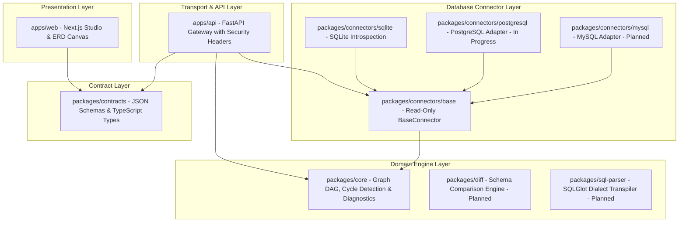

# DERA System Architecture & Core Principles

> **Phase:** 1.2 Monorepo Architecture Foundation  
> **Status:** Authoritative Architectural Specification  
> **Maintainer:** Krishanth  

---

## 1. Executive Summary

**DERA (Database Engineering & Reverse Analysis)** is a deterministic platform designed to inspect database schemas, discover relationships, generate entity-relationship diagrams, detect anti-patterns, and plan migrations.

Unlike modern trends that introduce probabilistic large language models into schema analysis, DERA adheres to a strict non-negotiable directive:
**Zero AI models, zero LLMs, zero cloud inference API calls, and zero probabilistic recommendations.**

Database engineering requires absolute precision, reproducibility, and auditability. When analyzing mission-critical schemas or generating migration scripts, non-deterministic outputs introduce dangerous risks of data loss, migration failures, or unrepeatable executions. DERA achieves deep schema intelligence through formal abstract syntax tree (AST) SQL parsing, directed acyclic graph (DAG) topological theory, catalog querying, and rule-based diagnostic linting.

---

## 2. Core Architectural Pillars

1. **Modular Monolith:** Single repository housing clear, independent packages with unidirectional dependency flow.
2. **Metadata-Only Introspection:** Introspection extracts structural schemas, column types, and constraints without touching or storing customer application data.
3. **Read-Only Database Safety:** Database connectors operate under session-level read-only constraints (`SET TRANSACTION READ ONLY` / `PRAGMA query_only = ON`). DDL and DML mutation statements are blocked by static query interceptors.
4. **Strong Typing & Contract Parity:** Python core primitives and TypeScript visualizer interfaces are synchronized via formal data contracts (`packages/contracts`).
5. **Cross-Platform Reproducibility:** Tooling runs consistently on Windows, Linux, and macOS without Unix-only toolchain dependencies.

---

## 3. System Layers & Subsystems

---

## 4. Key Architectural Documents

- [ADR 0001: Monorepo Architecture](adr/0001-monorepo-architecture.md)
- [Monorepo Structure Specification](MONOREPO_STRUCTURE.md)
- [Module Boundaries & Dependency Rules](MODULE_BOUNDARIES.md)
- [Package Dependency Graph & Data Flow](DEPENDENCY_GRAPH.md)
