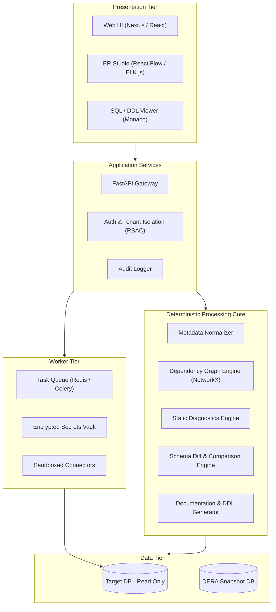

# DERA Architecture Specification

**Project:** DERA — Database Engineering & Reverse Analysis  
**Status:** Architectural Specification (Phase 1 Baseline)  
**License:** [MIT License](../../LICENSE)

---

## 1. Architectural Overview

DERA is engineered as a modular platform for deterministic database inspection, schema graph reconstruction, structural diagnostics, and migration engineering.

---

## 2. Core Subsystems

### 2.1 Metadata Extraction & Normalization
Database connectors query native system catalogs (such as `pg_catalog` and `information_schema` in PostgreSQL). Raw catalog tuples are sanitized, cast into engine-agnostic canonical models, and cryptographically hashed for snapshot immutability.

### 2.2 Schema Graph Engine
Using NetworkX, foreign keys and object references are transformed into Directed Acyclic Graphs (DAGs):
- **Cycle Detection:** Identifies circular foreign-key dependencies.
- **Topological Sorting:** Determines correct table creation and deletion sequences for migrations.
- **Transitive Reduction:** Simplifies complex entity relationship paths for clean visual rendering.

### 2.3 Rule-Based Diagnostics Engine
A deterministic rule matrix inspects normalized schema models against static engineering heuristics:
- **Missing Primary Keys:** Ensures relational entity identification.
- **Redundant Indexes:** Identifies overlapping column prefixes.
- **Unindexed Foreign Keys:** Prevents table-scan bottlenecks during join operations.
- **Naming Conventions:** Enforces organizational standards across identifiers.

### 2.4 Schema Diff & Versioning
Snapshots are treated as immutable mathematical sets. DERA computes set differences across tables, columns, constraints, and indexes, categorizing each difference as backward-compatible (safe) or breaking (destructive).

---

## 3. Pluggable Connector Architecture

Connectors implement a strict interface:
1. `validate_connection(target_config)` — Verifies TLS handshake and read-only status.
2. `extract_catalog_metadata()` — Executes read-only queries against system catalogs.
3. `normalize_to_canonical()` — Converts raw results into DERA's unified schema model.
4. `disconnect()` — Immediately terminates connections.

---

## 4. Implementation Status

| Component | Status | Target Phase |
|---|---|---|
| PostgreSQL Connector | In Development | Phase 2 (MVP) |
| Canonical Schema Model | In Development | Phase 2 (MVP) |
| Visual ER Studio | Planned | Phase 3 |
| Rule Diagnostic Engine | Planned | Phase 4 |
| Schema Diff Engine | Planned | Phase 4 |
| MySQL / SQLite Connectors | Planned | Phase 5 |
