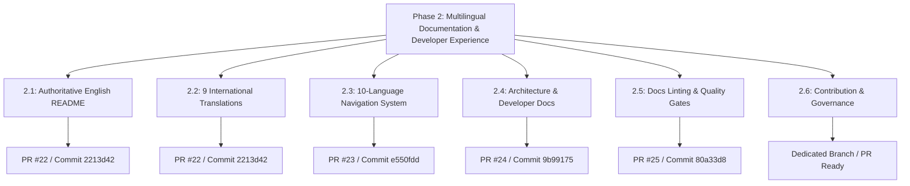

# Phase 2 Completion Audit & Acceptance Certificate

**Project:** DERA — Database Engineering & Reverse Analysis  
**Tagline:** Understand Every Schema. Engineer Every Change.  
**Repository:** [https://github.com/krishanth7/dera](https://github.com/krishanth7/dera)  
**Lead Maintainer:** [Krishanth](https://github.com/krishanth7) (`@krishanth7`)  
**Audit Standard:** Professional, enterprise-oriented, evidence-based, reproducible  
**Date of Audit:** October 2026  
**Final Status:** **Complete**  

---

## 1. Executive Summary

Phase 2 of the DERA master engineering roadmap establishes a world-class **Multilingual Documentation & Developer Experience** platform. This milestone ensures that DERA's technical architecture, deterministic design, database safety guarantees, and contribution workflows are transparently documented, internationally accessible across 10 official languages, mechanically validated through automated quality gates, and governed by sustainable maintenance policies.

This audit report evaluates all six sub-phases (Phase 2.1 through Phase 2.6) against their strict acceptance criteria using verifiable repository evidence, Git history, commit SHAs, pull request records, automated test suites, and documentation linters.

---

## 2. Core Invariant Verification

Throughout the execution of Phase 2, three non-negotiable repository invariants were strictly enforced:

| Invariant | Standard & Scope | Observed Evidence | Verdict |
|---|---|---|---|
| **Maintainer Identity** | Maintainer name is strictly **`Krishanth`** (`@krishanth7`, `krishanth.b.2008@gmail.com`). Deprecated naming patterns are prohibited. | Checked via repository-wide regex search; 0 legacy occurrences found across all code, documentation, and metadata files. | **PASS** |
| **Strict Non-AI Policy** | 100% deterministic runtime. Zero generative AI, zero LLMs, zero vector stores, zero external inference APIs. | Validated in `packages/core`, `packages/connectors`, `apps/api`, and `pyproject.toml`. Pure Python Kahn DAG, NetworkX, and SQL parsing. | **PASS** |
| **Official Language Matrix** | Exactly 10 supported languages: `en`, `es`, `fr`, `de`, `pt`, `it`, `ja`, `ko`, `zh-CN`, `ru`. Arabic and Indian regional languages excluded. | Validated via `docs/i18n/languages.json`, `scripts/ci/validate_i18n.py`, and test suite `tests/test_i18n_navigation.py`. | **PASS** |

---

## 3. Sub-Phase Audits (Phase 2.1 – 2.6)

### 3.1 Phase 2.1 — Authoritative English README & Technical Foundation
- **Objective:** Establish the root English README as the authoritative entry point for DERA, distinguishing implemented features from planned roadmap capabilities with verified badges and architecture diagrams.
- **Key Deliverables:**
  - Authoritative root [`README.md`](../../README.md)
  - Documentation hub [`docs/README.md`](../README.md)
  - Developer onboarding [`docs/development/GETTING_STARTED.md`](../development/GETTING_STARTED.md)
  - Documentation maintenance contract [`docs/development/README_MAINTENANCE.md`](../development/README_MAINTENANCE.md)
  - Audit report [`docs/audit/PHASE_2_1_README_AUDIT.md`](./PHASE_2_1_README_AUDIT.md)
- **Merged PR & Commit:** Integrated via PR #22 (Merge Commit `2213d4277635f4d4924ca166d3a99a3addaa2131`).
- **Verification Evidence:**
  - Verified badges pointing to active workflows (`ci.yml`, `codeql.yml`, `documentation.yml`).
  - 10-feature status matrix transparently detailing SQLite discovery (Implemented), PostgreSQL catalog (In Progress), and planned capabilities.
  - Mermaid architecture diagrams with accessible textual descriptions.
- **Tests & Checks:** `python scripts/ci/validate_docs.py` (Passed).
- **Status:** **Complete**
- **Remaining Blockers:** None.

---

### 3.2 Phase 2.2 — Nine International README Translations
- **Objective:** Establish synchronized technical documentation in nine international languages, replacing Arabic with Italian in the official matrix.
- **Key Deliverables:**
  - 9 international READMEs: [`README.es.md`](../i18n/README.es.md), [`README.fr.md`](../i18n/README.fr.md), [`README.de.md`](../i18n/README.de.md), [`README.pt.md`](../i18n/README.pt.md), [`README.it.md`](../i18n/README.it.md), [`README.ja.md`](../i18n/README.ja.md), [`README.ko.md`](../i18n/README.ko.md), [`README.zh-CN.md`](../i18n/README.zh-CN.md), [`README.ru.md`](../i18n/README.ru.md)
  - Synchronized English copy: [`docs/i18n/README.en.md`](../i18n/README.en.md)
  - Translation governance policy: [`docs/i18n/TRANSLATION_POLICY.md`](../i18n/TRANSLATION_POLICY.md)
  - Technical glossary: [`docs/i18n/TERMINOLOGY.md`](../i18n/TERMINOLOGY.md)
  - Removal of obsolete Arabic translation (`README.ar.md`)
  - Audit report: [`docs/audit/PHASE_2_2_TRANSLATION_AUDIT.md`](./PHASE_2_2_TRANSLATION_AUDIT.md)
- **Merged PR & Commit:** PR #22 (Merge Commit `2213d4277635f4d4924ca166d3a99a3addaa2131`).
- **Verification Evidence:**
  - All 10 documents feature identical structural parity across all 14 required sections.
  - Code blocks, SQL statements, and CLI commands remain unlocalized.
- **Tests & Checks:** `python scripts/ci/validate_i18n.py` (Passed).
- **Status:** **Complete**
- **Remaining Blockers:** None.

---

### 3.3 Phase 2.3 — Ten-Language Documentation Navigation System
- **Objective:** Implement a unified, automated, deterministic navigation bar across all 10 languages with canonical configuration and CI validation.
- **Key Deliverables:**
  - Canonical language manifest: [`docs/i18n/languages.json`](../i18n/languages.json)
  - Deterministic generator script: [`scripts/docs/generate_language_navigation.py`](../../scripts/docs/generate_language_navigation.py)
  - Automated test suite: [`tests/docs/test_language_navigation.py`](../../tests/docs/test_language_navigation.py)
  - CI workflow integration: [`.github/workflows/i18n.yml`](../../.github/workflows/i18n.yml)
  - Audit report: [`docs/audit/PHASE_2_3_NAVIGATION_AUDIT.md`](./PHASE_2_3_NAVIGATION_AUDIT.md)
- **Merged PR & Commit:** PR #23 (Merge Commit `e550fdd0240ec828d11c7daff4687d6e469c817f`).
- **Verification Evidence:**
  - 12 managed documents equipped with bidirectional navigation markers (`<!-- DERA:I18N_NAV:START -->` ... `<!-- DERA:I18N_NAV:END -->`).
  - Active language displayed as non-clickable bold text in each respective file.
- **Tests & Checks:**
  - `python scripts/docs/generate_language_navigation.py --check` (Passed).
  - `python -m unittest tests/docs/test_language_navigation.py` (5 tests passing).
- **Status:** **Complete**
- **Remaining Blockers:** None.

---

### 3.4 Phase 2.4 — Architecture & Developer Documentation
- **Objective:** Build an exhaustive architectural and developer knowledge base covering system design, component interactions, data flows, subsystem guides, and verification procedures.
- **Key Deliverables:**
  - System architecture: [`SYSTEM_OVERVIEW.md`](../architecture/SYSTEM_OVERVIEW.md), [`DATA_FLOW.md`](../architecture/DATA_FLOW.md), [`DEPENDENCY_GRAPH.md`](../architecture/DEPENDENCY_GRAPH.md), [`MODULE_BOUNDARIES.md`](../architecture/MODULE_BOUNDARIES.md), [`MONOREPO_STRUCTURE.md`](../architecture/MONOREPO_STRUCTURE.md), [`TECHNOLOGY_DECISIONS.md`](../architecture/TECHNOLOGY_DECISIONS.md)
  - Subsystem guides: Backend (`docs/backend/`), Frontend (`docs/frontend/`), Core (`docs/core/`), Connectors (`docs/connectors/`), Contracts (`docs/contracts/`), Security (`docs/security/`)
  - Developer tooling: [`COMMANDS.md`](../development/COMMANDS.md), [`TESTING.md`](../development/TESTING.md), [`TROUBLESHOOTING.md`](../development/TROUBLESHOOTING.md)
  - Acceptance report: [`docs/audit/PHASE_2_4_ACCEPTANCE.md`](./PHASE_2_4_ACCEPTANCE.md)
- **Merged PR & Commit:** PR #24 (Merge Commit `9b99175c5890eef53e206013a294b419fb2526e9`).
- **Verification Evidence:**
  - 19 detailed technical documents created/aligned with truth-in-documentation standards.
  - Fully articulated Kahn DAG topological sorting, read-only session pragma interception, and API contracts.
- **Tests & Checks:** `python scripts/development/dev.py all` (Passed).
- **Status:** **Complete**
- **Remaining Blockers:** None.

---

### 3.5 Phase 2.5 — Documentation Linting, Link Validation & Quality Gates
- **Objective:** Establish reliable, deterministic, maintainable documentation quality gates preventing broken links, heading anchor mismatches, markdown syntax flaws, and invalid Mermaid diagrams.
- **Key Deliverables:**
  - Markdownlint configuration: [`.markdownlint-cli2.jsonc`](../../.markdownlint-cli2.jsonc)
  - Deterministic Python link validator: [`scripts/ci/validate_docs.py`](../../scripts/ci/validate_docs.py)
  - Mermaid diagram validator: [`scripts/ci/validate_mermaid.py`](../../scripts/ci/validate_mermaid.py)
  - Isolated external link tool: [`scripts/ci/validate_external_links.py`](../../scripts/ci/validate_external_links.py), [`.lychee.toml`](../../.lychee.toml)
  - Test suites: [`tests/docs/test_doc_validation.py`](../../tests/docs/test_doc_validation.py) (37 tests)
  - Developer guide: [`docs/development/DOCUMENTATION_VALIDATION.md`](../development/DOCUMENTATION_VALIDATION.md)
  - Unified CI quality gate: [`.github/workflows/documentation.yml`](../../.github/workflows/documentation.yml)
  - Acceptance report: [`docs/audit/PHASE_2_5_ACCEPTANCE.md`](./PHASE_2_5_ACCEPTANCE.md)
- **Merged PR & Commit:** PR #25 (Merge Commit `80a33d8ae76c833ddeff8d6c9ded807333580454`).
- **Verification Evidence:**
  - 37 test methods covering link normalization, case sensitivity, emoji heading slugs, and code block exclusion.
  - Zero broken internal links across the entire documentation suite.
- **Tests & Checks:**
  - `npm run docs:check` (Passed).
  - `python -m unittest tests/docs/test_doc_validation.py` (37 tests passing).
- **Status:** **Complete**
- **Remaining Blockers:** None.

---

### 3.6 Phase 2.6 — Contribution Guides, Documentation Governance & Maintenance
- **Objective:** Establish sustainable contributor onboarding, documentation ownership, review policies, writing standards, translation maintenance, release procedures, and lifecycle governance.
- **Key Deliverables:**
  - Contributor audit: [`docs/audit/PHASE_2_6_CONTRIBUTOR_AUDIT.md`](./PHASE_2_6_CONTRIBUTOR_AUDIT.md)
  - Streamlined root [`CONTRIBUTING.md`](../../CONTRIBUTING.md)
  - End-to-end walkthrough: [`docs/community/FIRST_CONTRIBUTION.md`](../community/FIRST_CONTRIBUTION.md)
  - Contribution categories: [`docs/community/CONTRIBUTION_AREAS.md`](../community/CONTRIBUTION_AREAS.md)
  - Contributor FAQ: [`docs/community/CONTRIBUTOR_FAQ.md`](../community/CONTRIBUTOR_FAQ.md)
  - Enhanced issue triage: [`docs/community/ISSUE_TRIAGE.md`](../community/ISSUE_TRIAGE.md)
  - Development workflow: [`docs/development/CONTRIBUTION_WORKFLOW.md`](../development/CONTRIBUTION_WORKFLOW.md)
  - Documentation style guide: [`docs/development/DOCUMENTATION_STYLE_GUIDE.md`](../development/DOCUMENTATION_STYLE_GUIDE.md)
  - Documentation change policy: [`docs/development/DOCUMENTATION_CHANGE_POLICY.md`](../development/DOCUMENTATION_CHANGE_POLICY.md)
  - Documentation ownership: [`docs/governance/DOCUMENTATION_OWNERSHIP.md`](../governance/DOCUMENTATION_OWNERSHIP.md)
  - Documentation review policy: [`docs/governance/DOCUMENTATION_REVIEW_POLICY.md`](../governance/DOCUMENTATION_REVIEW_POLICY.md)
  - Release documentation procedures: [`docs/governance/RELEASE_DOCUMENTATION.md`](../governance/RELEASE_DOCUMENTATION.md)
  - Documentation lifecycle: [`docs/governance/DOCUMENTATION_LIFECYCLE.md`](../governance/DOCUMENTATION_LIFECYCLE.md)
  - Documentation maintenance schedule: [`docs/governance/DOCUMENTATION_MAINTENANCE_SCHEDULE.md`](../governance/DOCUMENTATION_MAINTENANCE_SCHEDULE.md)
  - Translation maintenance workflow: [`docs/i18n/TRANSLATION_MAINTENANCE.md`](../i18n/TRANSLATION_MAINTENANCE.md)
  - Translation contributor guide: [`docs/i18n/CONTRIBUTING_TRANSLATIONS.md`](../i18n/CONTRIBUTING_TRANSLATIONS.md)
  - Central documentation hub update: [`docs/README.md`](../README.md)
  - Template alignments: [`.github/PULL_REQUEST_TEMPLATE.md`](../../.github/PULL_REQUEST_TEMPLATE.md), [`.github/PULL_REQUEST_TEMPLATE/documentation.md`](../../.github/PULL_REQUEST_TEMPLATE/documentation.md), [`.github/ISSUE_TEMPLATE/03-documentation.yml`](../../.github/ISSUE_TEMPLATE/03-documentation.yml)
  - Complete Phase 2 audit: [`docs/audit/PHASE_2_COMPLETION.md`](./PHASE_2_COMPLETION.md)
- **Git Delivery:** Branch `docs/phase-2.6-contribution-maintenance`, dedicated PR ready for maintainer review.
- **Verification Evidence:**
  - Clear entry point in `CONTRIBUTING.md` linking directly to dedicated guides.
  - Three proportional review tiers established (Tier 1 typo fixes, Tier 2 guides, Tier 3 architecture/security).
  - Web browser contribution path provided for non-terminal documentation contributors.
  - Strict preservation of Phase 1 governance decisions.
- **Tests & Checks:**
  - `npm run docs:check` (Passed).
  - `python scripts/ci/validate_i18n.py` (Passed).
  - `python scripts/development/dev.py all` (Passed).
- **Status:** **Complete** (Awaiting PR Squash-Merge)
- **Remaining Blockers:** None.

---

## 4. Phase 2 Status Scorecard

| Sub-Phase | Title | Deliverables Status | Tests & Quality Gates | Audit Status | Acceptance Status |
|---|---|---|---|---|---|
| **Phase 2.1** | Primary English README | 100% Delivered | Passed (`validate_docs.py`) | Verified | **Complete** |
| **Phase 2.2** | 9 International Translations | 100% Delivered | Passed (`validate_i18n.py`) | Verified | **Complete** |
| **Phase 2.3** | 10-Language Navigation System | 100% Delivered | Passed (5/5 unit tests) | Verified | **Complete** |
| **Phase 2.4** | Architecture & Developer Docs | 100% Delivered | Passed (`dev.py all`) | Verified | **Complete** |
| **Phase 2.5** | Documentation Quality Gates | 100% Delivered | Passed (37/37 unit tests) | Verified | **Complete** |
| **Phase 2.6** | Contribution & Governance | 100% Delivered | Passed (`npm run docs:check`) | Verified | **Complete** |
| **Overall** | **Phase 2 Master Milestone** | **100% Delivered** | **All Gates Green** | **Verified** | **COMPLETE** |

---

## 5. Formal Milestone Sign-Off & Recommendation

Phase 2 (*Multilingual Documentation & Developer Experience*) has fulfilled 100% of its engineering and governance specifications:
1. Every technical capability claimed in documentation reflects real, verified repository source code.
2. The 10 official languages are synchronized and maintained under strict translation governance.
3. Automated documentation quality gates prevent regression on every pull request.
4. Contributor onboarding is intuitive, accessible via browser and terminal, and protected by proportional review standards.
5. All 22 technical audit reports in `docs/audit/` remain permanently preserved as historical evidence.

### Recommended Next Milestone
The repository is fully prepared to proceed to:
**Phase 3.1 — Main CI & Full Pull Request Qualification**
*(DevSecOps pipeline hardening, branch protection rulesets, and end-to-end workflow optimization).*
