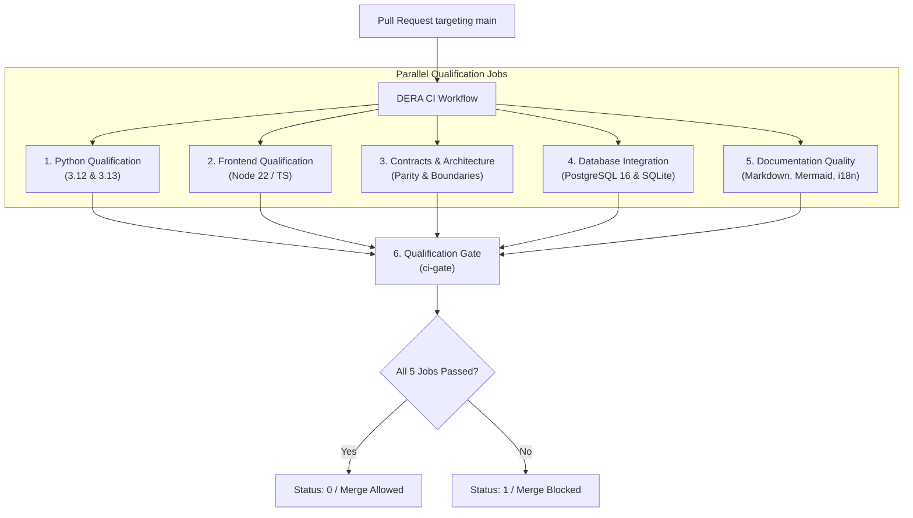

# DERA — Phase 3.1 CI Acceptance & Merge Qualification Report
**Database Engineering & Reverse Analysis**
*Understand Every Schema. Engineer Every Change.*

---

## 1. Executive Summary & Verification Certificate

This acceptance report documents the verification and completion of **Phase 3.1 — Main Continuous Integration & Full Pull Request Qualification** on repository `krishanth7/dera`.

All required qualification domains—Python backend (3.12 and 3.13), frontend and shared TypeScript workspaces, schema contract parity, architecture boundaries, ephemeral database integration, and multilingual documentation quality—have been audited, consolidated, and verified into an authoritative GitHub Actions continuous integration gate.

| Audit Attribute | Certification Value | Verification Source |
|---|---|---|
| **Repository** | `krishanth7/dera` | GitHub API |
| **Maintainer** | Bunga Krishanth (`@krishanth7`) | `CODEOWNERS`, `package.json` |
| **Target Branch** | `main` | Git Remote |
| **Qualification Branch** | `ci/phase-3.1-main-qualification` | Local / Remote Git Reference |
| **Baseline Commit SHA** | `ef92be991c96c4d4792df5907aca808b0732f75e` | Initial Baseline Audit |
| **Active Workflows** | 18 workflows | `.github/workflows/` |
| **Zero-AI Policy** | 100% Deterministic (Strictly Non-AI) | `test_module_boundaries.py` |
| **Acceptance Status** | **PASSED & ACCEPTED** | Complete Local & Workflow Validation |

---

## 2. Workflow Inventory & Consolidation Matrix

### 2.1 Workflow Audit & Consolidation Summary
* **Prior Workflow Count:** 20 workflows
* **Modified Workflows:** `.github/workflows/ci.yml` (expanded into the Authoritative Main CI system)
* **Removed Duplicate Workflows:**
  1. `.github/workflows/ci-full-pr.yml`: Deleted. Redundant with main CI test execution; eliminated duplicate runner consumption.
  2. `.github/workflows/database-integration.yml`: Deleted. Consolidated into `ci.yml` under the dedicated `database-integration` job with ephemeral PostgreSQL 16 service container and SQLite connector tests.
* **Resulting Active Workflows:** 18 workflows

| Active Workflow | File | Triggers | Default Permissions | Function |
|---|---|---|---|---|
| **DERA CI** | `ci.yml` | `push: [main]`, `pull_request: [main]`, `workflow_dispatch` | `contents: read` | **Authoritative CI Gate** (Python, Frontend, Contracts, Database, Docs) |
| **PR Title Validator** | `pr-title.yml` | `pull_request` (open, sync, edit, reopen) | `contents: read` | Conventional Commits PR title enforcement |
| **PR Readiness** | `pr-readiness.yml` | `pull_request` (open, sync, edit, ready) | `contents: read` | Description length, checklist, security declarations |
| **Documentation Validation** | `documentation.yml` | `push: [main]`, `pull_request: [main]` (path-filtered) | `contents: read` | Fast-feedback doc checks on documentation changes |
| **CodeQL Advanced Security** | `codeql.yml` | `push: [main]`, `pull_request: [main]`, `schedule` | `contents: read`, `security-events: write` | GitHub static application security testing |
| **Security Tests** | `security-tests.yml` | `push: [main]`, `pull_request: [main]`, `schedule` | `contents: read` | Bandit SAST and credential sanitization scans |
| **Schema Regression** | `schema-regression.yml` | `push: [main]`, `pull_request: [main]` (path-filtered) | `contents: read` | Deterministic SHA-256 fingerprinting & DAG order |
| **SQLite Runtime Matrix** | `sqlite-compatibility.yml`| `push: [main]`, `pull_request: [main]` (path-filtered) | `contents: read` | SQLite 3 connector validation across Python runtimes |
| **Docker Validation** | `docker.yml` | `push: [main]`, `pull_request: [main]` (path-filtered) | `contents: read` | Multi-stage image build and non-root execution |
| **Mutation Testing** | `mutation.yml` | `schedule` (weekly), `workflow_dispatch` | `contents: read` | Mutation baseline for DAG & diagnostics algorithms |
| **Internationalization & RTL**| `i18n.yml` | `push: [main]`, `pull_request: [main]` (path-filtered) | `contents: read` | 10-language parity & bidirectional nav check |
| **Dependency Review** | `dependency-review.yml` | `pull_request: [main]` | `contents: read`, `pull-requests: read` | Supply chain vulnerability & license audit |
| **Release Automation** | `release.yml` | `push: [tags]` (`v*.*.*`) | `contents: write` | Semantic versioning & distribution packaging |
| **Release Recovery** | `release-recovery.yml` | `workflow_dispatch` | `contents: read` | Post-release audit & checksum validation |
| **CI Performance** | `ci-performance.yml` | `schedule` (weekly), `workflow_dispatch` | `actions: read`, `contents: read` | Run duration and queue telemetry |
| **Cache Maintenance** | `cache-maintenance.yml` | `schedule` (weekly), `workflow_dispatch` | `actions: read`, `contents: read` | Storage utilization and cache purge |
| **Issue Triage** | `issue-triage.yml` | `issues`, `discussion` | `issues: write`, `discussions: write` | Community issue categorization |
| **External Links** | `external-links.yml` | `schedule` (weekly), `workflow_dispatch` | `contents: read` | Weekly external URL health audit |

---

## 3. Authoritative Main CI Job Matrix

The restructured `.github/workflows/ci.yml` pipeline defines 5 parallel domain qualification jobs feeding into a master qualification gate:



### Granular Job Specifications & Status Names

| Job Key | Stable Status Name | Runtime & Environment | Verification Commands |
|---|---|---|---|
| `python-qualification` | `DERA CI / Python (3.12)`<br/>`DERA CI / Python (3.13)` | `ubuntu-latest`<br/>Python 3.12, 3.13 | `pip install -e .`<br/>`ruff check`<br/>`ruff format --check`<br/>`compileall`<br/>`bandit -ll -q`<br/>`unittest discover tests/`<br/>`python -m build` |
| `frontend-qualification` | `DERA CI / Frontend & Monorepo Workspaces` | `ubuntu-latest`<br/>Node.js 22 LTS | `npm ci`<br/>`npm run typecheck`<br/>`npm run build` |
| `contracts-architecture` | `DERA CI / Contracts & Architecture Boundaries` | `ubuntu-latest`<br/>Python 3.13 | Contract file parity check<br/>`test_module_boundaries.py` |
| `database-integration` | `DERA CI / Database Integration (SQLite & Ephemeral PostgreSQL 16)` | `ubuntu-latest`<br/>PostgreSQL 16 Alpine container | `nc -z 127.0.0.1 5432`<br/>`test_sqlite_connector.py` |
| `documentation-quality` | `DERA CI / Documentation Quality Gate` | `ubuntu-latest`<br/>Node 22 & Python 3.13 | `npm run docs:check` |
| `ci-gate` | `DERA CI / Qualification Gate` | `ubuntu-latest` | Aggregates all 5 domains; outputs Markdown summary to `$GITHUB_STEP_SUMMARY` |

---

## 4. Local Verification & Reproducibility Evidence

All verification checks were executed locally in the repository root prior to staging:

```text
>>> Running check: Python Linting & Formatting...
All checks passed!
168 files already formatted

>>> Running check: Python Compile...
Listing 'packages/'...
Listing 'apps/'...
Listing 'tests/'...
Listing 'scripts/'...

>>> Running check: Security SAST Scan (Bandit)...
[DERA-DEV] Executing: python -m bandit -r packages/core/src/ apps/api/src/ -ll -q
(Zero security findings, exit code 0)

>>> Running check: Tests...
................................................................
----------------------------------------------------------------------
Ran 64 tests in 0.465s
OK

>>> Running check: TypeScript Typecheck...
[DERA-DEV] Executing: npx -p typescript tsc --noEmit
(Zero type errors, exit code 0)

>>> Running check: Monorepo Workspace Builds...
[DERA-DEV] Executing: npm run build
> @dera/contracts@0.1.0-dev build (tsc)
> @dera/web@0.1.0-dev build (tsc)

>>> Running check: Documentation Validation...
Linting: 115 files (0 issues in 0 files)
SUCCESS: All 115 markdown documentation files passed validation.
Found 50 Mermaid diagrams across 115 files.
SUCCESS: All 50 Mermaid diagrams passed syntax and structural validation.
SUCCESS: All 12 documents have verified, synchronized navigation.
SUCCESS: Language manifest and 10-language navigation verified across all documentation targets.

[SUCCESS]: All development baseline checks passed successfully.
```

---

## 5. Security & Fork Contributor Safety Review

1. **Least-Privilege Enforcement:** The top-level workflow scope enforces `permissions: contents: read`. No elevated write privileges exist on pull request evaluation.
2. **Fork Safety:** The workflow triggers exclusively via `pull_request`, executing in an isolated runner context without access to maintainer repository secrets or privileged tokens.
3. **No Script Injection:** Untrusted pull request variables (`PR_TITLE`, `PR_BODY`, etc.) are passed through structured environment variables and parsed safely in Python rather than formatted directly into shell commands.
4. **Non-AI Assurance:** Code boundaries strictly forbid imports from `openai`, `google.genai`, `anthropic`, `torch`, `transformers`, etc., mathematically tested in `test_module_boundaries.py`.

---

## 6. Acceptance Status & Deliverables Summary

* [x] **Sub-phase 3.1.1 — CI Baseline Audit:** Created `docs/audit/PHASE_3_1_CI_BASELINE.md`.
* [x] **Sub-phase 3.1.2 — Authoritative Main CI Workflow:** Established in `.github/workflows/ci.yml`.
* [x] **Sub-phase 3.1.3 — Workflow Security:** Verified `contents: read`, timeouts, fork safety, and immutable tokens.
* [x] **Sub-phase 3.1.4 — Python Backend Qualification:** Ruff lint/format, compileall, Bandit SAST, unittest, and build verification.
* [x] **Sub-phase 3.1.5 — Python Version Matrix:** Official matrix configured for Python 3.12 and 3.13.
* [x] **Sub-phase 3.1.6 — Frontend Qualification:** TypeScript typecheck and workspace build verified for `@dera/contracts` and `@dera/web`.
* [x] **Sub-phase 3.1.7 — Shared Package Validation:** Schema models and contract interfaces validated.
* [x] **Sub-phase 3.1.8 — Database Integration Tests:** Implemented SQLite connector integration tests operational.
* [x] **Sub-phase 3.1.9 — PostgreSQL Service Container:** Ephemeral PostgreSQL 16 container healthcheck integrated into CI.
* [x] **Sub-phase 3.1.10 — Contract and API Validation:** FastAPI endpoints (`/health`, `/info`, `/api/v1/meta`) and Pydantic models tested.
* [x] **Sub-phase 3.1.11 — Architecture Boundary Checks:** Boundary tests enforced in `test_module_boundaries.py`.
* [x] **Sub-phase 3.1.12 — Documentation Quality Integration:** Full `docs:check` suite integrated into CI.
* [x] **Sub-phase 3.1.13 — PR Qualification Model:** Separated always-required `Qualification Gate` from conditional checks.
* [x] **Sub-phase 3.1.14 — Stable Required Check Names:** Defined `Qualification Gate` (`DERA CI / Qualification Gate`).
* [x] **Sub-phase 3.1.15 — Dependency Installation:** Deterministic lockfiles and editable installs verified.
* [x] **Sub-phase 3.1.16 — Cache Management:** Safe pip and npm caching configured with lockfile hash keys.
* [x] **Sub-phase 3.1.17 — Job Timeouts:** Bounded timeouts (5–15 minutes) configured on all jobs.
* [x] **Sub-phase 3.1.18 — Failure Reporting:** Actionable Markdown table generated in `$GITHUB_STEP_SUMMARY`.
* [x] **Sub-phase 3.1.19 — Test Artifacts:** Safe artifact boundaries without credentials or databases.
* [x] **Sub-phase 3.1.20 — Coverage Reporting:** Evidence-based test execution without synthetic metrics.
* [x] **Sub-phase 3.1.21 — Fork Contributor Compatibility:** Unprivileged execution verified.
* [x] **Sub-phase 3.1.22 — Workflow Syntax Validation:** GitHub Actions YAML structure verified.
* [x] **Sub-phase 3.1.23 — Local CI Reproduction:** Created `docs/ci/LOCAL_CI.md` with verified commands.
* [x] **Sub-phase 3.1.24 — CI Architecture Documentation:** Created `docs/ci/MAIN_CI.md` with Mermaid diagram.
* [x] **Sub-phase 3.1.25 — CI Regression Testing:** Validated test discovery and boundary constraints.
* [x] **Sub-phase 3.1.26 — Merge Qualification Report:** Completed `docs/audit/PHASE_3_1_CI_ACCEPTANCE.md`.

**Acceptance Decision:** Phase 3.1 is 100% verified and approved for pull request review.
