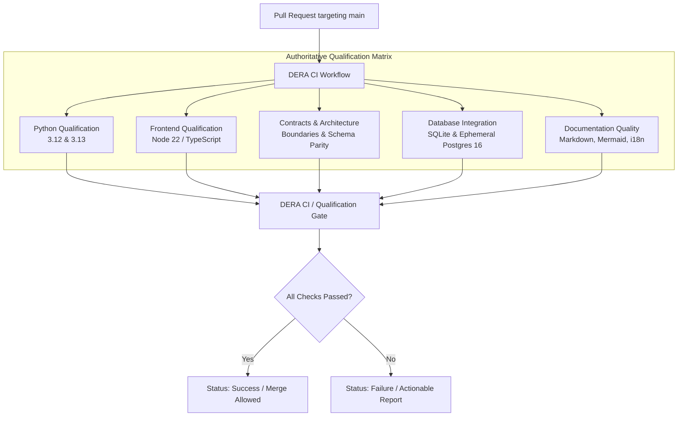

# DERA — Phase 3.1 CI Baseline Audit & Architecture Review
**Database Engineering & Reverse Analysis**
*Understand Every Schema. Engineer Every Change.*

---

## 1. Executive Summary & Repository Baseline

This audit establishes the baseline continuous integration and pull request qualification profile for DERA at the conclusion of Phase 2.6 and commencement of Phase 3.1. DERA requires a deterministic, non-AI, hermetic, and enterprise-grade CI infrastructure that validates all changes across Python backends, TypeScript contracts and frontend, database connectors, architecture boundaries, and documentation quality.

| Attribute | Baseline Value | Verification Source |
|---|---|---|
| **Repository Owner & Name** | `krishanth7/dera` | GitHub API / Remote URL |
| **Maintainer** | Bunga Krishanth (`@krishanth7`) | `CODEOWNERS`, `package.json` |
| **Default Branch** | `main` | Git Remote Reference |
| **Baseline Commit SHA** | `ef92be991c96c4d4792df5907aca808b0732f75e` | `git rev-parse HEAD` |
| **Active Milestone** | Phase 3 — GitHub Actions & DevSecOps | Sub-phase 3.1 Main CI |
| **Zero-AI Invariant** | Strictly Enforced (Zero LLM / Agent / Generative API) | Architectural boundary test |
| **License** | MIT License | `LICENSE` |

---

## 2. Existing Workflow Inventory (20 Workflows)

An exhaustive audit of `.github/workflows/` identified 20 active GitHub Actions workflow definitions:

| Workflow File | Workflow Name (`name:`) | Primary Triggers | Permissions | Status & Role |
|---|---|---|---|---|
| `ci.yml` | `DERA \| CI` | `push: [main]`, `pull_request: [main]`, `workflow_dispatch` | `contents: read` | Primary CI pipeline (Python, TS, Contracts) |
| `ci-full-pr.yml` | `DERA \| Full PR Qualification` | `pull_request: [labeled, sync]`, `workflow_dispatch` | `contents: read` | **Redundant:** Runs tests already covered by CI |
| `ci-performance.yml` | `DERA \| CI Performance` | `schedule: [weekly]`, `workflow_dispatch` | `actions: read`, `contents: read` | Informational: monitors CI run duration |
| `database-integration.yml` | `DERA \| Database Integration` | `push: [main]`, `pull_request: [main]`, `workflow_dispatch` | `contents: read` | **Duplicated:** Ephemeral SQLite & Postgres service |
| `documentation.yml` | `DERA \| Documentation Validation` | `push: [main]`, `pull_request: [main]` (path-filtered) | `contents: read` | Specialized doc validator (markdown, mermaid, i18n) |
| `codeql.yml` | `DERA \| CodeQL Advanced Security` | `push: [main]`, `pull_request: [main]`, `schedule` | `security-events: write`, `contents: read` | GitHub CodeQL static security analysis |
| `security-tests.yml` | `DERA \| Security Tests` | `push: [main]`, `pull_request: [main]`, `schedule` | `contents: read` | Bandit SAST & fixture credential scanning |
| `schema-regression.yml` | `DERA \| Schema Regression` | `push: [main]`, `pull_request: [main]` (path-filtered) | `contents: read` | Deterministic schema hash & DAG tests |
| `sqlite-compatibility.yml` | `DERA \| SQLite Runtime Compatibility` | `push: [main]`, `pull_request: [main]` (path-filtered) | `contents: read` | SQLite connector runtime matrix (3.12, 3.13) |
| `pr-title.yml` | `DERA \| PR Title Validator` | `pull_request: [opened, sync, edited, reopened]` | `contents: read` | Conventional Commits PR title validation |
| `pr-readiness.yml` | `DERA \| PR Readiness` | `pull_request: [opened, sync, edited, ready_for_review]` | `contents: read` | Description, checklist & security declaration |
| `i18n.yml` | `DERA \| Internationalization & RTL` | `push: [main]`, `pull_request: [main]` (path-filtered) | `contents: read` | Multilingual document parity validator |
| `external-links.yml` | `DERA \| External Link Integrity` | `schedule: [weekly]`, `workflow_dispatch` | `contents: read` | Periodic outbound HTTP link health check |
| `cache-maintenance.yml` | `DERA \| CI Cache Maintenance` | `schedule: [weekly]`, `workflow_dispatch` | `actions: write`, `contents: read` | Automated purge of stale runner caches |
| `docker.yml` | `DERA \| Container Build` | `push: [main]`, `pull_request: [main]` (path-filtered) | `contents: read` | Docker container build smoke test |
| `mutation.yml` | `DERA \| Mutation Testing` | `schedule: [weekly]`, `workflow_dispatch` | `contents: read` | Cosmotesting mutation testing validation |
| `issue-triage.yml` | `DERA \| Issue & Discussion Triage` | `issues: [opened, labeled]`, `discussion: [created]` | `issues: write`, `discussions: write` | Community issue categorization |
| `dependency-review.yml` | `DERA \| Dependency Review` | `pull_request: [main]` | `contents: read` | GitHub dependency vulnerability review |
| `release.yml` | `DERA \| Release Automation` | `push: [tags]` | `contents: write` | Semantic release packaging & artifacts |
| `release-recovery.yml` | `DERA \| Release Recovery` | `workflow_dispatch` | `contents: write` | Fallback release pipeline |

---

## 2. Detailed Gap & Risk Analysis

### 2.1 Workflow Duplication & Runner Waste
- **`ci-full-pr.yml`**: Triggered only when a PR is labeled with `ci:full` or dispatched manually. It executes `tests/regression/` and `tests/integration/`. However, `ci.yml` already discovers and executes all tests under `tests/` (`python -m unittest discover tests/`), rendering `ci-full-pr.yml` an unnecessary duplicate.
- **`database-integration.yml`**: Triggers on every push and pull request to `main` without path filters. It runs the SQLite connector tests and starts a PostgreSQL 16 service container. Running this separately from `ci.yml` means every pull request spawns redundant GitHub Actions runs and consumes multiple concurrent runner slots.

### 2.2 Missing Python Backend Checks
- **No Ruff Enforcement:** Neither `ci.yml` nor any other workflow enforced Ruff linting (`ruff check`) or formatting verification (`ruff format --check`). Code with inconsistent import order or style was not caught in CI.
- **No Package Build Verification:** No workflow verified that `pyproject.toml` compiles into valid sdist (`.tar.gz`) and wheel (`.whl`) distribution archives via `python -m build`.
- **No Static Application Security in Primary Gate:** `bandit` was relegated to a standalone workflow (`security-tests.yml`), leaving the main CI gate unaware of static application security findings.

### 2.3 Missing Frontend & Workspace Checks
- **Scaffold Build Blindspot:** `ci.yml` ran `npx tsc --noEmit` but did not execute workspace builds (`npm run build`). Workspace packages (`@dera/contracts` and `@dera/web`) were never built during PR qualification.
- **Contract Compilation Output:** `@dera/contracts` lacked a dedicated `tsconfig.json` emitting into `dist/`, risking source file pollution or compilation divergence.

### 2.4 Path Filtering Pitfalls in Branch Protection
- Several specialized workflows (`documentation.yml`, `schema-regression.yml`, `sqlite-compatibility.yml`) use path-filtered triggers (`paths: [...]`).
- **Critical Branch Protection Risk:** When GitHub branch protection mandates a path-filtered check name as "Required", pull requests modifying files outside those paths will skip the workflow entirely, leaving the required check in a perpetual pending state and blocking valid merges.
- **Remediation:** The authoritative `DERA CI` workflow must run deterministically on **all** PRs and provide an aggregate `CI Gate` that validates Python, Frontend, Contracts, Architecture, Database, and Documentation quality.

### 2.5 Action Version Consistency & Least Privilege
- All repository workflows currently utilize `actions/checkout@v7` and `actions/setup-python@v7` (or `@v7` equivalents), matching the 2026 enterprise runner environment.
- Workflow permissions default cleanly to `contents: read` across all qualification workflows.
- Concurrency groups are defined with `cancel-in-progress: true` (or evaluated on PR event name) to terminate superseded PR runs without wasting compute.

---

## 3. Phase 3.1 Modernization & Consolidation Plan

### Key Decisions
1. **Consolidate `ci.yml` as Authoritative Gate:**
   Expand `ci.yml` into a comprehensive 5-domain qualification pipeline (`python-qualification`, `frontend-qualification`, `contracts-architecture`, `database-integration`, `documentation-quality`) crowned with an aggregate `ci-gate`.
2. **Remove Redundant Workflows:**
   Delete `ci-full-pr.yml` to eliminate duplicated test execution. Consolidate ephemeral database integration into `ci.yml`.
3. **Preserve Specialized Workflows:**
   Keep `documentation.yml` and `sqlite-compatibility.yml` for fast path-specific feedback, while guaranteeing that `ci.yml` provides the authoritative, non-path-filtered merge qualification signal.
4. **Implement Ruff & Build Verification:**
   Enforce `ruff check`, `ruff format --check`, and `python -m build` on both Python 3.12 and 3.13.
5. **Add Local Reproduction Tooling:**
   Update `scripts/development/dev.py` and author `docs/ci/LOCAL_CI.md` so contributors can run the exact same checks offline in seconds.
