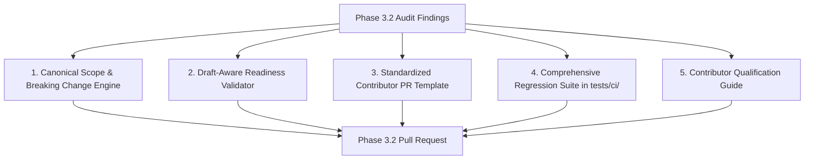

# DERA — Phase 3.2 PR Governance Baseline Audit
**Database Engineering & Reverse Analysis**
*Understand Every Schema. Engineer Every Change.*

---

## 1. Executive Summary & Audit Baseline

This audit establishes the baseline pull request governance, title validation, description readiness, and reviewer qualification mechanisms across the DERA repository at the start of Phase 3.2.

Pull requests represent the primary entry point for community contributions and maintainer changes. Establishing deterministic, contributor-friendly, and secure PR qualification is essential to maintain repository health, automated changelog generation, and supply chain security without relying on non-deterministic external AI code review services.

| Audit Attribute | Baseline Value | Source |
|---|---|---|
| **Repository** | `krishanth7/dera` | GitHub Remote |
| **Maintainer** | Bunga Krishanth (`@krishanth7`) | `CODEOWNERS`, `package.json` |
| **Active Branch** | `ci/phase-3.2-pr-governance` | Git Repository |
| **Target Branch** | `main` | Default Remote Branch |
| **Baseline Commit SHA** | `ef92be991c96c4d4792df5907aca808b0732f75e` | `git rev-parse main` |
| **Active Milestone** | Phase 3 — GitHub Actions & DevSecOps | Sub-phase 3.2 PR Governance |
| **Zero-AI Invariant** | Strictly Non-AI / Deterministic Rules | Architecture Specification |

---

## 2. Existing PR Governance Infrastructure

The repository currently maintains two dedicated GitHub Actions workflows for pull request governance:

| Workflow File | Display Name | Trigger Events | Permissions | Evaluation Script |
|---|---|---|---|---|
| `.github/workflows/pr-title.yml` | `DERA \| PR Title Validator` | `pull_request: [opened, synchronize, reopened, edited]` | `contents: read` | `scripts/ci/validate_pr_title.py` |
| `.github/workflows/pr-readiness.yml` | `DERA \| PR Readiness` | `pull_request: [opened, synchronize, reopened, edited, ready_for_review]` | `contents: read` | `scripts/ci/validate_pr_readiness.py` |

---

## 3. Detailed Audit Findings & Classification

Findings have been categorized using standard risk classifications: **Critical**, **High**, **Medium**, **Low**, and **Informational**.

### Finding 1: Unvalidated PR Scopes (Medium Risk)
* **Observation:** `scripts/ci/validate_pr_title.py` uses regex `(?:\([a-z0-9._/,-]+\))*` which permits any arbitrary string inside the parentheses (e.g., `feat(foobar123): ...`).
* **Impact:** Inconsistent scope names in git history; degradation of automated changelog grouping and component-level release notes.
* **Remediation:** Define a canonical list of recognized architectural scopes (`core`, `connectors`, `api`, `web`, `contracts`, `docs`, `i18n`, `security`, `ci`, `governance`, `architecture`, `release`, `database`, `deps`, `repo`) while allowing legitimate multi-scope syntax and scope omission (`type: description`).

### Finding 2: Incomplete Event Coverage on Draft Transitions (Medium Risk)
* **Observation:** `pr-title.yml` does not trigger on `converted_to_draft` or `ready_for_review`. `pr-readiness.yml` does not trigger on `converted_to_draft`.
* **Impact:** If a contributor opens a PR as draft, changes its title or description, and converts it between draft and ready states, the status checks may not re-trigger, presenting stale check statuses.
* **Remediation:** Add `ready_for_review` and `converted_to_draft` event types to both workflows.

### Finding 3: Untouched PR Template Detection Gap (Low Risk)
* **Observation:** `scripts/ci/validate_pr_readiness.py` verifies character length (`len(body) >= 30`) and checks for presence of keywords ("summary", "testing"). If a contributor leaves the default template comments unmodified, the raw character length can exceed 30, inadvertently passing the test without real content.
* **Impact:** PRs with empty or uninformative descriptions can pass automated readiness.
* **Remediation:** Strip HTML comments (`<!-- ... -->`) and template boilerplate headers before evaluating description length and meaningful substance.

### Finding 4: Absence of "Tests Not Run / Not Applicable" Support (Medium Risk)
* **Observation:** The current readiness validator mandates checklist completion or positive testing keywords. For documentation-only, governance, or translation PRs where executable code tests are not applicable, contributors might feel compelled to check boxes untruthfully or fail the check.
* **Remediation:** Explicitly support valid alternative states in the PR template and validator:
  * `Relevant tests passed`
  * `Tests not applicable (with explanation)`
  * `Tests not run / blocked (with explanation)`

### Finding 5: Title & Description Breaking-Change Parity (Low Risk)
* **Observation:** If a PR title declares a breaking change via `!` (e.g., `feat(api)!: ...`), the PR description should explicitly include a `Breaking changes` section describing the impact and migration path.
* **Remediation:** Cross-validate breaking-change indicators between title and body in the readiness check.

### Finding 6: Shell Metacharacter & Input Sanitization (Informational)
* **Observation:** PR titles and bodies are passed as environment variables in GitHub Actions (`env: PR_TITLE: ${{ github.event.pull_request.title }}`). This avoids shell interpolation injection.
* **Status:** Verified secure. Ensure unit tests explicitly verify titles with quotes, backticks, dollar signs, semicolons, and Unicode characters.

---

## 4. Remediation Action Plan

