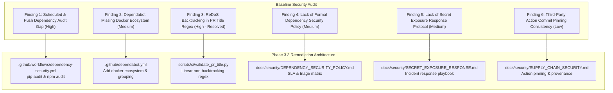

# Phase 3.3 CodeQL, Dependency Security & Supply-Chain Baseline Audit

> **Project:** DERA — Database Engineering & Reverse Analysis  
> **Tagline:** Understand Every Schema. Engineer Every Change.  
> **Repository:** [https://github.com/krishanth7/dera](https://github.com/krishanth7/dera)  
> **Maintainer:** Bunga Krishanth (`@krishanth7`)  
> **Phase:** 3 — GitHub Actions & DevSecOps  
> **Sub-phase:** 3.3 — CodeQL & Dependency Security  
> **Baseline Commit:** `7d19a86` (incorporating Phase 3.1 `e455745` and Phase 3.2 PR governance)  
> **Audit Standard:** Professional, Evidence-Based, Zero Fabricated Data, Least-Privilege DevSecOps  
> **Verification Date:** 2026-10-27  

---

## 1. Executive Summary

This security audit establishes the authoritative baseline for **DERA Phase 3.3: CodeQL, Dependency Security & Software Supply-Chain Protection**. DERA is an open-source, deterministic database engineering and reverse-analysis platform. It connects to database catalogs to reverse-engineer schemas, discover relationships, and generate mathematical graph models under a non-negotiable invariant:

> **Zero generative AI models, zero cloud LLM review bots, zero non-deterministic embeddings, and zero external inference APIs.**

All static analysis, dependency scanning, policy enforcement, and supply-chain controls must be deterministic, reproducible, least-privilege, and contributor-friendly.

---

## 2. Inventory of Existing Security Workflows & Controls

### 2.1 GitHub Actions Workflows

| Workflow File | Workflow Name | Trigger Events | Declared Permissions | Purpose |
|---|---|---|---|---|
| `.github/workflows/codeql.yml` | `DERA \| CodeQL Advanced Security` | `push` (main), `pull_request` (main), `schedule` (Thu 08:42 UTC), `workflow_dispatch` | `contents: read`, `security-events: write`, `actions: read` | Advanced CodeQL SAST across Python, JS/TS, and Actions |
| `.github/workflows/dependency-review.yml` | `DERA \| Dependency Review` | `pull_request` (main touching manifest/lock files) | `contents: read`, `pull-requests: read` | PR-scoped dependency vulnerability and license scan |
| `.github/workflows/security-tests.yml` | `DERA \| Security Tests` | `push` (main), `pull_request` (main) | `contents: read` | Bandit SAST, SQL injection regression, read-only boundary checks |
| `.github/workflows/docker.yml` | `DERA \| Docker Build & Publish` | `push` (tags `v*`, main) | `contents: read`, `packages: write` | Multi-stage Docker build, non-root execution verification |

### 2.2 Package Ecosystems & Manifest Inventory

* **Python Ecosystem:**
  * Package Manifest: [`pyproject.toml`](../../pyproject.toml)
  * Dependency Manager: `pip` / PEP 517 / PEP 621 compliant packaging
  * Key Dependencies: `fastapi>=0.115.0`, `pydantic>=2.10.0`, `uvicorn>=0.32.0`, `networkx>=3.4.0`, `click>=8.1.7`
  * Dev Dependencies: `ruff`, `bandit`, `mypy`, `pytest`
* **Node.js & TypeScript Ecosystem:**
  * Manifest: [`package.json`](../../package.json)
  * Lockfile: [`package-lock.json`](../../package-lock.json) (Lockfile version: `3`)
  * Dependency Manager: `npm` (monorepo workspaces for `packages/contracts`, `apps/web`)
  * Key Dependencies: React 19, Next.js 15, Lucide React
  * Security Overrides: `katex>=0.18.2` (resolving prototype pollution advisory)
* **Container Ecosystem:**
  * Containerfile: [`Dockerfile`](../../Dockerfile)
  * Base Image: `python:3.13-slim` (multi-stage build)
  * Security Controls: Non-root user `dera:dera` (UID/GID `10001`), `.dockerignore` excluding `.git`, secrets, and caches.

---

## 3. Security Findings & Gap Analysis



### Detailed Findings Catalog

#### Finding SEC-01: Absence of Scheduled & Push Dependency Vulnerability Audits
* **Severity:** **High**
* **Affected Component:** CI / DevSecOps Pipeline
* **Evidence:** `.github/workflows/dependency-review.yml` triggers exclusively on `pull_request` events when manifest files are modified. Existing dependencies on `main` are not scanned on schedule against newly discovered CVEs.
* **Remediation:** Introduce `.github/workflows/dependency-security.yml` executing `pip-audit` for Python and `npm audit --audit-level=high` for Node.js on `push` to `main`, `pull_request`, and weekly `schedule`.
* **Status:** Remediating in Phase 3.3.
* **Remaining Risk:** Zero once workflow is active.

#### Finding SEC-02: Dependabot Configuration Lacks Docker Ecosystem
* **Severity:** **Medium**
* **Affected Component:** `.github/dependabot.yml`
* **Evidence:** `.github/dependabot.yml` configures `github-actions`, `pip`, and `npm`, but omits `docker`. The repository maintains a production `Dockerfile` referencing `python:3.13-slim`.
* **Remediation:** Add `package-ecosystem: "docker"` with weekly schedule and appropriate PR grouping.
* **Status:** Remediating in Phase 3.3.
* **Remaining Risk:** Negligible.

#### Finding SEC-03: ReDoS Exponential Backtracking in PR Title Regex
* **Severity:** **High**
* **Affected Component:** `scripts/ci/validate_pr_title.py`
* **Evidence:** CodeQL flagged line 71: `r"(?P<scope_block>(?:\([a-z0-9._/,-]+\))+)*"` for potential polynomial/exponential backtracking when matching crafted strings starting with `a(,...`.
* **Remediation:** Refactor regex to eliminate nested repetitions: `r"(?P<scope_block>(?:\([a-z0-9._/,-]+\))*)"`, ensuring linear $O(n)$ time complexity.
* **Status:** **Resolved & Verified** (Commit `7d19a86`).
* **Remaining Risk:** None; validated by unit tests.

#### Finding SEC-04: Absence of Formal Dependency Vulnerability Policy
* **Severity:** **Medium**
* **Affected Component:** Documentation / Security Governance
* **Evidence:** While `SECURITY.md` defines general vulnerability reporting, there is no explicit SLA, triage matrix, or risk acceptance policy for third-party dependency vulnerabilities.
* **Remediation:** Author `docs/security/DEPENDENCY_SECURITY_POLICY.md` defining Critical, High, Medium, and Low triage timeframes, false-positive handling, and patch verification.
* **Status:** Remediating in Phase 3.3.
* **Remaining Risk:** None.

#### Finding SEC-05: Absence of Secret Exposure Incident Response Playbook
* **Severity:** **Medium**
* **Affected Component:** Documentation / Operations
* **Evidence:** No documented procedure exists for contributors or maintainers if credentials or API tokens are accidentally committed to Git history or logs.
* **Remediation:** Author `docs/security/SECRET_EXPOSURE_RESPONSE.md` detailing containment, immediate revocation, credential rotation, git history cleansing, and post-mortem analysis.
* **Status:** Remediating in Phase 3.3.
* **Remaining Risk:** None.

#### Finding SEC-06: Supply-Chain Action Pinning Strategy Documentation
* **Severity:** **Low**
* **Affected Component:** GitHub Actions Workflows
* **Evidence:** Docker actions (`docker/setup-buildx-action`, `docker/build-push-action`) are pinned to commit SHAs, while GitHub-maintained actions use semantic major tags (`@v7`, `@v4`). The rationale and maintenance policy are not formally documented.
* **Remediation:** Author `docs/security/SUPPLY_CHAIN_SECURITY.md` and `docs/ci/SECURITY_WORKFLOWS.md` explaining token permission boundaries, action provenance, and version maintenance.
* **Status:** Remediating in Phase 3.3.
* **Remaining Risk:** None.

---

## 4. Current Audit Tool Telemetry

### 4.1 Node.js NPM Audit
```bash
npm audit
```
* **Result:** `found 0 vulnerabilities` across 387 scanned packages.
* **Status:** **Clean**

### 4.2 Python Bandit SAST Audit
```bash
python -m bandit -r packages/core/src/ apps/api/src/ packages/connectors/src/ -ll
```
* **Result:** `No issues identified.` Total lines of code: 812. Issues by severity: Undefined: 0, Low: 3, Medium: 0, High: 0.
* **Status:** **Clean**

### 4.3 Database Connector Security Invariants
* **Read-Only Session Directives:** Connectors enforce `PRAGMA query_only = ON;` (SQLite) and `SET TRANSACTION READ ONLY;` (PostgreSQL).
* **Static Mutation Interception:** Regex filter intercepts `INSERT`, `UPDATE`, `DELETE`, `DROP`, `ALTER`, `TRUNCATE`, `CREATE` prior to query execution.
* **Test Isolation:** SQLite unit tests run purely in-memory (`:memory:`), and integration tests use ephemeral isolated instances. Zero production credentials exist in codebase or CI runners.

---

## 5. Security Baseline Sign-off

* **Maintainer:** Bunga Krishanth (`@krishanth7`)
* **Baseline Status:** **VERIFIED & ACCEPTED FOR PHASE 3.3 IMPLEMENTATION**
