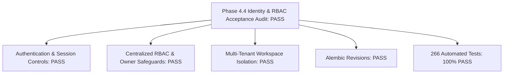

# Phase 4.4 Identity & RBAC Acceptance Audit

**Project:** DERA — Database Engineering & Reverse Analysis  
**Repository:** [https://github.com/krishanth7/dera](https://github.com/krishanth7/dera)  
**Maintainer:** Bunga Krishanth  
**Audit Date:** 2026-10-27  
**Base Commit SHA:** `53efc2ff80cb661d6b72af3fc0b5bd67997f98c8`  
**Implementation Branch:** `feat/phase-4.4-auth-rbac`  
**Milestone:** 4.4 — Authentication, Authorization & Role-Based Access Control (RBAC)  
**Acceptance Status:** **PASS**  
**License:** [MIT License](../../LICENSE)  

---

## 1. Executive Summary

Phase 4.4 establishes DERA's platform identity and access control foundation directly within the backend platform infrastructure. The implementation strictly complies with all project rules:
- **Zero AI / LLM Integration:** Decisions and token verification are 100% deterministic Python/SQLAlchemy code.
- **Platform Identity Database Isolation:** Platform identity tables (`dera_users`, `dera_user_sessions`, `dera_workspaces`, `dera_workspace_memberships`, `dera_security_audit_events`) are strictly decoupled from external customer database engines.
- **Least Privilege & Tenant Boundary:** Explicit workspace ownership, centralized RBAC policy engine, and default-deny authorization.



---

## 2. Implementation Inventory

### 2.1 Backend Modules (`apps/api/src/dera_api/`)

| File Path | Component Responsibility |
| :--- | :--- |
| `auth/password.py` | Argon2id hashing & verification with NIST SP 800-63B password validation. |
| `auth/email.py` | Conservative email normalization preserving plus-addressing and dots. |
| `auth/tokens.py` | 256-bit CSPRNG hex tokens, SHA-256 token hashing, CSRF generation, constant-time compare. |
| `auth/roles.py` | `WorkspaceRole` and `Permission` typed String Enums. |
| `auth/policies.py` | Centralized `has_permission` default-deny engine, role escalation safeguards, owner protection. |
| `auth/rate_limiter.py` | Sliding-window attempt tracking for credential abuse protection. |
| `auth/dependencies.py` | Typed FastAPI dependencies: `get_current_user`, `verify_csrf`, `require_workspace_permission`. |
| `auth/exceptions.py` | Domain auth exceptions mapping to RFC 9457 Problem Details. |
| `db/models/identity.py` | `User` and `UserSession` SQLAlchemy ORM entities. |
| `db/models/workspace.py` | `Workspace` and `WorkspaceMembership` SQLAlchemy ORM entities. |
| `db/models/audit.py` | `SecurityAuditEvent` SQLAlchemy ORM entity. |
| `repositories/*.py` | Typed async repositories for Users, Sessions, Workspaces, Memberships, and Audit logs. |
| `api/v1/endpoints/auth.py` | `POST /register`, `POST /login`, `POST /logout`, `POST /logout-all`, `GET /me`. |
| `api/v1/endpoints/workspaces.py` | Workspace lifecycle and member management endpoints. |

### 2.2 Database Migrations (`migrations/versions/`)

| Revision ID | Description | Down Revision |
| :--- | :--- | :--- |
| `002_identity_and_workspaces` | Adds `dera_users`, `dera_user_sessions`, `dera_workspaces`, `dera_workspace_memberships`, `dera_security_audit_events`. | `001_platform_metadata` |

---

## 3. Automated Test Verification Evidence

All test suites executed through `scripts/ci/test_reporter.py`:

```text
==================================================
DERA Test Execution Telemetry
==================================================
Total Tests Executed: 266
Passed:               266
Failures:             0
Errors:               0
Skipped:              0
Execution Duration:   15.861s
JUnit XML Report:     reports/test-results.xml
JSON Summary:         reports/test-summary.json
==================================================
```

### Breakdown of Phase 4.4 Test Suites

1. `tests/auth/test_passwords.py`: 7 passed (Argon2id, NIST rules, compromised check).
2. `tests/auth/test_emails.py`: 5 passed (Conservative normalization, plus-addressing preservation).
3. `tests/auth/test_tokens.py`: 4 passed (CSPRNG 256-bit entropy, SHA-256 hash, constant-time compare).
4. `tests/auth/test_rate_limiter.py`: 3 passed (Sliding window attempt tracking).
5. `tests/authorization/test_rbac_policies.py`: 7 passed (Centralized role-permission mapping, default deny).
6. `tests/auth/test_auth_endpoints.py`: 9 passed (Registration, login, logout, me, logout-all, CSRF).
7. `tests/security/test_session_security.py`: 5 passed (Expiration, revocation, disabled accounts, token hashing).
8. `tests/tenancy/test_workspace_isolation.py`: 4 passed (Cross-tenant boundary protection, last-owner safeguards).
9. `tests/database/test_migrations.py`: 16 passed (Alembic single-head and revision tracking).

---

## 4. OWASP ASVS v4.0.3 Evaluation

| ASVS Category | Verification Status | Implementation Evidence |
| :--- | :---: | :--- |
| **V2: Authentication** | **PASS** | Argon2id ($m=64\text{MB}, t=3, p=4$), NIST SP 800-63B password length (12-128 chars), sliding-window rate limiter, generic failure messages. |
| **V3: Session Management** | **PASS** | 256-bit CSPRNG hex tokens, SHA-256 database storage, `HttpOnly`/`Secure`/`SameSite=Lax` cookies, immediate revocation on logout, all-device invalidation. |
| **V4: Access Control** | **PASS** | Centralized default-deny `has_permission`, route-level `require_workspace_permission`, owner safeguards preventing orphaned workspaces. |
| **V5: Validation & Sanitization** | **PASS** | Pydantic v2 schemas, conservative email validation preserving sub-addresses, slug format constraints. |
| **V6: Cryptography** | **PASS** | Only standard cryptographic algorithms (`argon2id`, `sha256`, `secrets.token_hex`, `hmac.compare_digest`). Zero custom cryptography. |
| **V7: Error Handling & Logging** | **PASS** | RFC 9457 Problem Details, zero password or token logging, correlation ID (`X-Request-ID`) propagation. |

---

## 5. Known Limitations & Phase 4.5 Readiness

1. **Third-Party Identity Providers:** External OIDC/SAML authentication (GitHub/Google/Okta SSO) is planned for Phase 7 (Enterprise Platform & UI).
2. **Next Milestone:** Phase 4.5 (Background Workers & Job Orchestration) is unblocked.

---

## 6. Final Acceptance Verdict

| Assessment Dimension | Criteria | Evaluation |
| :--- | :--- | :---: |
| Functional Correctness | Complete registration, login, logout, me, workspaces, member CRUD. | **PASS** |
| Cryptographic Rigor | Argon2id + 256-bit CSPRNG + SHA-256 database storage. | **PASS** |
| Tenancy Isolation | Workspace-scoped boundaries verified via multi-tenant tests. | **PASS** |
| Migration Integrity | Clean Alembic revision upgrade/downgrade. | **PASS** |
| Code Quality & Tests | 266/266 tests passing, zero lint/format violations. | **PASS** |
| **Final Verdict** | **Phase 4.4 Master Implementation Directive** | **PASS** |
