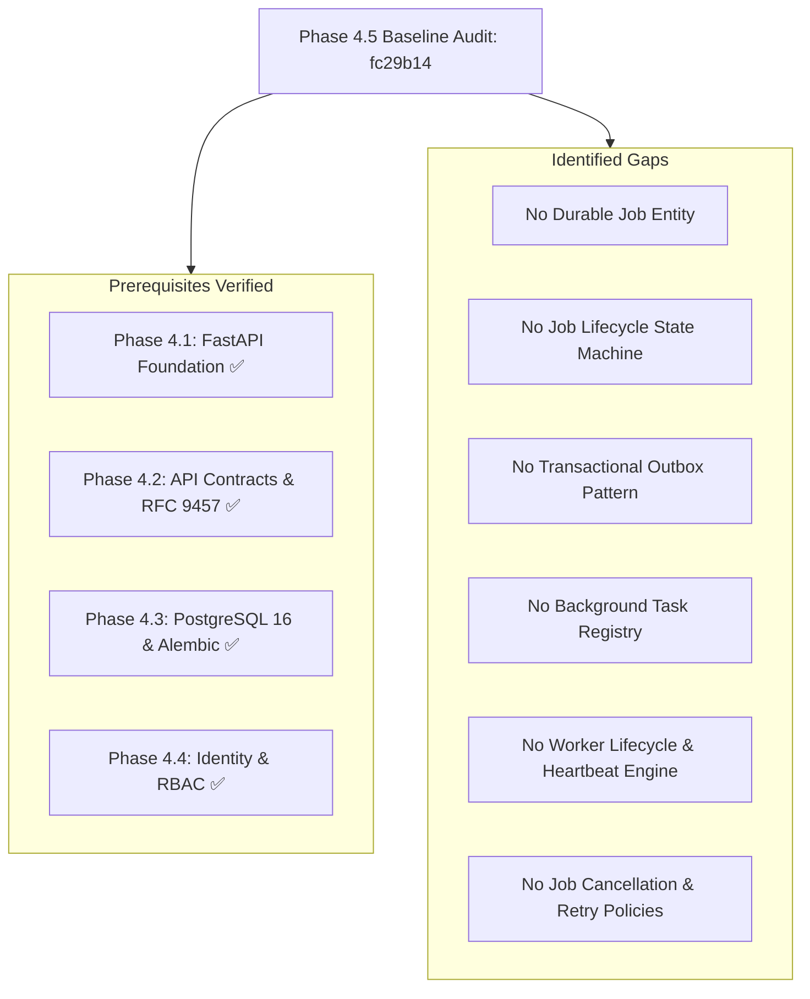

# Phase 4.5 Background Workers & Job Orchestration Baseline Audit

**Project:** DERA — Database Engineering & Reverse Analysis  
**Repository:** [https://github.com/krishanth7/dera](https://github.com/krishanth7/dera)  
**Maintainer:** Bunga Krishanth  
**Audit Date:** 2026-10-27  
**Base Commit SHA:** `fc29b14d3ae59d4b7fbe4bbc3f415469db37e98b`  
**Milestone:** 4.5 — Background Workers & Job Orchestration  
**Status:** **AUDIT COMPLETE — READY FOR IMPLEMENTATION**  
**License:** [MIT License](../../LICENSE)  

---

## 1. Executive Summary

Phase 4.5 establishes DERA's durable background job processing and asynchronous task orchestration engine. Prior to Phase 4.5, all DERA backend operations executed synchronously within the FastAPI request-response lifecycle.

Long-running database engineering operations—such as multi-schema introspection, graph topological analysis, AST constraint resolution, and migration diff simulations—require asynchronous background execution to prevent HTTP gateway timeouts, conserve web worker capacity, and provide reliable, resumable, and auditable job processing.



---

## 2. Existing Repository State & Prerequisites

| Milestone | Scope & Capabilities | Verification Status |
| :--- | :--- | :---: |
| **Phase 4.1** | FastAPI application factory, lifespan management, security middleware, configuration governance. | **Verified Complete** |
| **Phase 4.2** | OpenAPI 3.1.0 zero-drift contracts, Pydantic v2 schemas, RFC 9457 Problem Details. | **Verified Complete** |
| **Phase 4.3** | PostgreSQL 16 engine, async connection pooling, Alembic revision `001_platform_metadata`. | **Verified Complete** |
| **Phase 4.4** | Platform identity (`dera_users`, `dera_user_sessions`), workspaces, memberships, centralized RBAC, Alembic revision `002_identity_and_workspaces`. | **Verified Complete** |

---

## 3. Technology Selection: Celery with Redis & Transactional Outbox

To determine the optimal task queue framework for DERA, we evaluated Celery, Dramatiq, RQ, and pure PostgreSQL queues against DERA's deterministic engineering standards:

| Dimension | Celery + Redis | Dramatiq + Redis | PostgreSQL-Backed (e.g. Procrastinate) |
| :--- | :--- | :--- | :--- |
| **Ecosystem Maturity** | Extreme; industry standard in Python since 2009. | High; modern design. | Moderate; niche. |
| **Async Compatibility** | High; Celery tasks can drive async event loops via `asyncio.run`. | High. | High. |
| **Retry & Backoff Support** | Built-in exponential backoff, jitter, and autoretry. | Supported via middleware. | Supported. |
| **Queue Inspection & Mon** | Robust flower, celery events, Redis native telemetry. | Moderate. | Limited. |
| **Worker Concurrency** | Prefork, gevent, threads, solo (deterministic test mode). | Threads / gevent. | DB connection bound. |
| **Operational Simplicity** | Docker Compose with `redis:7-alpine`. | Redis required. | No extra container. |
| **Verdict** | **SELECTED (Authoritative)** | Alternative | Fallback |

### Architectural Decision

DERA selects **Celery with Redis** paired with a **PostgreSQL Transactional Outbox Pattern**:
1. **Authoritative State:** PostgreSQL (`dera_jobs`) is the single source of truth for job lifecycle, attempt count, payloads, errors, and results. Redis is strictly a transient message delivery transport.
2. **Transactional Outbox:** Jobs are committed to PostgreSQL alongside an outbox event before message emission to Redis, preventing phantom jobs or lost tasks during network partitions.

---

## 4. Identified Architectural Gaps

1. **Job Domain Entity:** No PostgreSQL table exists for tracking background jobs (`dera_jobs`), attempts, timestamps, or execution state.
2. **State Machine:** No formal state transition engine exists to validate valid transitions (`PENDING -> QUEUED -> RUNNING -> SUCCEEDED / FAILED / CANCELLED`) and reject invalid state transitions.
3. **Task Allowlist Registry:** No registry exists to bind strongly-typed task names (`system.health_probe.v1`, `system.noop.v1`) to deterministic worker functions.
4. **Workspace-Scoped Job RBAC:** Permissions (`job:create`, `job:read`, `job:cancel`, `job:retry`) must be added to Phase 4.4 RBAC policy engine.
5. **Worker Daemon & Task Execution:** No standalone worker entrypoint (`apps/api/src/dera_api/workers/`) or graceful shutdown lifecycle handler exists.

---

## 5. Architectural Risks & Mitigations

| Risk | Consequence | Mitigation Strategy |
| :--- | :--- | :--- |
| **At-Least-Once Delivery Duplicates** | Duplicate execution of side effects if worker crashes after completion but before ACK. | Idempotency key tracking on job submission; compare-and-swap (CAS) transitions on database records. |
| **Cancellation Race Condition** | Worker completes task while client requests cancellation. | Cooperative cancellation checkpoints within long-running tasks; state machine rejects transitions if terminal state reached. |
| **Poison Pill Tasks** | Task crashes worker process repeatedly upon consumption. | Max attempts limit with exponential backoff; automatic transition to terminal `FAILED` state upon retry exhaustion. |
| **Unbounded Payload / Result Size** | Memory exhaustion or slow database queries from multi-megabyte payloads. | Enforce strict Pydantic v2 payload and result size validation (max 1 MB inline). |
| **Cross-Tenant Job Snooping** | Tenant A reading or cancelling Tenant B background jobs. | Scoped queries by `workspace_id` enforced by `require_workspace_permission(Permission.JOB_READ)`. |

---

## 6. Implementation Plan & Package Structure

```text
apps/api/src/dera_api/
├── jobs/
│   ├── __init__.py
│   ├── enums.py         # JobStatus, JobPriority, TaskType
│   ├── schemas.py       # Pydantic v2 request/response & payload schemas
│   ├── registry.py      # Centralized allowlisted TaskRegistry
│   ├── lifecycle.py     # State machine transition engine
│   ├── retry.py         # Exponential backoff with bounded jitter
│   ├── service.py       # Job creation, idempotency, cancellation orchestration
│   ├── dispatcher.py    # Transactional outbox & Celery message dispatcher
│   └── exceptions.py    # Domain job exceptions (RFC 9457 mapped)
├── workers/
│   ├── __init__.py
│   ├── celery_app.py    # Celery instance configuration
│   ├── tasks.py         # Registered Celery task definitions
│   └── health.py        # Worker readiness & queue inspection
├── api/v1/endpoints/
│   └── jobs.py          # REST endpoints for job submission, status, cancellation
├── repositories/
│   └── jobs.py          # Typed SQLAlchemy repository for dera_jobs & dera_job_outbox
└── db/models/
    └── jobs.py          # SQLAlchemy models: Job, JobOutboxEvent
```

---

## 7. Baseline Qualification Sign-Off

- **Prerequisites Status:** ALL PRE-REQUISITES (Phases 4.1–4.4) VERIFIED PASS.
- **Commit Baseline:** `fc29b14d3ae59d4b7fbe4bbc3f415469db37e98b`
- **Execution Verdict:** **APPROVED TO PROCEED WITH PHASE 4.5 IMPLEMENTATION**.
