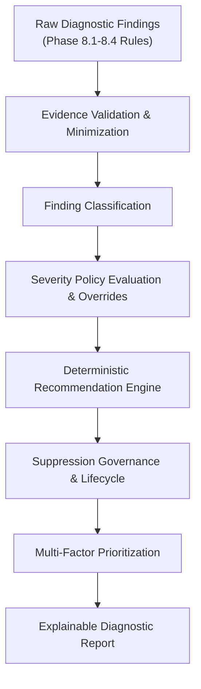

# Phase 8.5 Severity, Evidence & Engineering Recommendations Baseline Audit

**Milestone**: Phase 8.5 — Severity, Evidence & Engineering Recommendations  
**Base Commit SHA**: `e84f5ec4a905526d54bcbdb3e354fa7a151e07d7`  
**Execution Mode**: Deterministic, Read-Only, Evidence-Based, Zero AI / LLM / ML  
**Status**: Baseline Verified  

---

## 1. Executive Summary

Phase 8.5 establishes a unified, explainable, and deterministic foundation for severity evaluation, evidence traceability, safe engineering recommendations, finding prioritization, and suppression governance across DERA's diagnostic ecosystem.

Prior to Phase 8.5, diagnostic rules from Phase 8.1 (foundational), Phase 8.2 (indexes and constraints), Phase 8.3 (relationships and dependencies), and Phase 8.4 (maintainability) produced raw diagnostic findings with static default severities and unstructured recommendation strings. Phase 8.5 integrates these finding pipelines into a cohesive, auditable post-processing and reporting framework without mutating databases, executing arbitrary SQL, or introducing probabilistic heuristics.

---

## 2. Verified Prerequisites

The repository audit verifies that all required foundational phases are merged, functional, and covered by passing test suites:

| Subsystem / Phase | Required Foundation | Verified Artifacts | Status |
| :--- | :--- | :--- | :--- |
| **Phase 6 Canonical Metadata** | Schema representation, table models, constraints, indexes | `packages/core/src/dera/models.py` | PASS |
| **Phase 6 Snapshots** | Immutable snapshot schemas, cryptographic hashing | `packages/core/src/dera/snapshots/` | PASS |
| **Phase 6 Graph APIs** | Dependency graph construction, cycle detection, topological sort | `packages/core/src/dera/graphs/` | PASS |
| **Phase 8.1 Rules Engine** | Rule protocols, registry, applicability check, error isolation | `packages/core/src/dera/diagnostics/` | PASS |
| **Phase 8.2 Index & Constraint Diagnostics** | Duplicate/redundant indexes, FK coverage, PK/FK/Unique integrity | `packages/core/src/dera/diagnostics/rules/indexes/`, `constraints/` | PASS |
| **Phase 8.3 Relationship Diagnostics** | FK graph integrity, cycle detection, depth, concentration, impact radius | `packages/core/src/dera/diagnostics/rules/relationships/` | PASS |
| **Phase 8.4 Maintainability Diagnostics** | Table width, nullability, naming, reserved words, namespace imbalance, coupling | `packages/core/src/dera/diagnostics/rules/maintainability/` | PASS |
| **API Endpoints** | FastAPI diagnostic listing and evaluation endpoints | `apps/api/src/dera_api/api/v1/endpoints/reverse_engineering/diagnostics.py` | PASS |
| **Test Infrastructure** | Pytest test suite (>1000 total tests, 131 diagnostic tests) | `tests/diagnostics/` | PASS |
| **Documentation CI** | Markdown linting, mermaid verification, i18n parity across 504 docs | `scripts/ci/` | PASS |

---

## 3. Existing Diagnostic Contracts

### 3.1 Existing Severity Model

Located in [`enums.py`](../../packages/core/src/dera/diagnostics/enums.py):
- `DiagnosticSeverity`: Five discrete levels: `INFORMATIONAL` (1), `LOW` (2), `MEDIUM` (3), `HIGH` (4), `CRITICAL` (5).
- Rules assign a static `default_severity` in `RuleMetadata`.
- The evaluator currently sorts findings strictly by `(-f.severity.rank, f.object_id, f.rule_id, f.fingerprint)`.

### 3.2 Existing Evidence Model

Located in [`evidence/models.py`](../../packages/core/src/dera/diagnostics/evidence/models.py):
- `DiagnosticEvidence`: Immutable frozen dataclass capturing `object_id`, `field_name`, `observed_value`, `expected_value`, `message`, `provenance_reference`, and `context_data`.
- Basic credential sanitization using regex (`_SENSITIVE_KEY_PATTERN`, `_CONNECTION_STRING_PATTERN`).
- Deterministic dictionary conversion via `to_canonical_dict()`.

### 3.3 Existing Recommendation Behavior

- Rules currently assign free-text strings to `DiagnosticFinding.recommendation`.
- No structured recommendation IDs, risk assessments, preconditions, or verification steps.
- No recommendation catalog or template versioning.

### 3.4 Existing Finding Identity Model

Located in [`fingerprint.py`](../../packages/core/src/dera/diagnostics/fingerprint.py):
- `compute_finding_fingerprint(rule_id, rule_version, object_id, evidence)` generates a SHA-256 hash.
- Volatile timestamps are correctly excluded.
- Deduplication is not formally managed across runs or lifecycle transitions.

---

## 4. Missing Capabilities Identified

The audit identifies the following gaps to be resolved in Phase 8.5:

1. **Finding Classification**: Absence of an explicit taxonomy distinguishing confirmed structural defects from optimization candidates, maintainability concerns, naming deviations, or metadata limitations.
2. **Dynamic Severity Derivation**: Severities are statically declared on rules without dynamic adjustment based on object scope, composite keys, or incomplete metadata.
3. **Conservative Severity Bounds**: Lack of automated guards preventing non-critical findings (e.g. wide tables, naming style, lack of index) from escalating to `CRITICAL`.
4. **Authorized Severity Overrides**: No schema or authorization layer for recording audited, actor-attributed severity overrides.
5. **Typed Evidence Records & Provenance**: Evidence items lack typed categories (column reference, constraint reference, metric observation, threshold comparison) and completeness flags (`COMPLETE`, `PARTIAL`, `RESTRICTED`, `UNSUPPORTED`).
6. **Finding Confidence Terminology**: Lack of categorical confidence indicators (`VERIFIED`, `CONDITIONAL`, `INCOMPLETE`, `UNSUPPORTED`).
7. **Recommendation Catalog & Templates**: No centralized catalog of versioned recommendation templates with explicit preconditions, suggested actions, risks, and verification steps.
8. **Multi-Factor Prioritization**: Prioritization is limited to severity rank without incorporating classification, evidence completeness, rule priority, or object blast radius.
9. **Suppression Governance**: Suppressions are only supported via `disabled_rule_ids` in config. No fine-grained suppression by finding fingerprint, scope, actor, reason, expiration, or audit logging.
10. **Finding Lifecycle Tracking**: No formal lifecycle states (`OPEN`, `ACKNOWLEDGED`, `SUPPRESSED`, `RESOLVED`, `REOPENED`).
11. **Report Explainability & Versioning**: Reports lack detailed explanations of evaluated vs. skipped vs. unsupported rules, rule versions, severity policy versions, and recommendation catalog versions.

---

## 5. Security & Safety Considerations

- **Read-Only Invariant**: All diagnostics must operate strictly in read-only mode. No SQL execution, mutation statements, or DDL execution.
- **Credential & Secret Protection**: Evidence sanitization must comprehensively redact connection strings, API tokens, passwords, private keys, and customer row data.
- **Zero AI / LLM / ML**: Recommendation generation, severity evaluation, and prioritization must remain 100% deterministic, rule-based, and explainable. No probabilistic models or third-party inference APIs.
- **Authorization Enforcement**: Severity overrides and finding suppressions must be workspace-scoped and authorized by authenticated actors.
- **Suppression Auditability**: Suppressed findings must remain auditable in reports and never silently dropped without trace.
- **Resource Bounds**: Bound findings count, evidence items, recommendation evaluations, and memory footprint.

---

## 6. Implementation Plan

### Module Breakdown
- `packages/core/src/dera/diagnostics/severity/`:
  - `policy.py`: Derivation rules, policy versioning, conservative severity bounds.
  - `rationale.py`: Standardized human-readable rationale formatting.
  - `overrides.py`: Authorized severity override models and evaluator.
  - `validation.py`: Verification of severity bounds.
- `packages/core/src/dera/diagnostics/evidence/`:
  - `models.py`: Typed evidence records, completeness, and confidence enums.
  - `validator.py`: Reference validation and credential sanitization.
  - `provenance.py`: Source engine, snapshot, and connector traceability.
  - `traceability.py`: Linkage verification to canonical schema objects.
- `packages/core/src/dera/diagnostics/recommendations/`:
  - `catalog.py`: Structured recommendation entries.
  - `templates.py`: Versioned templates with preconditions, actions, risks, and verification.
  - `generator.py`: Deterministic recommendation generator.
  - `safety.py`: Advisory wording validator (prohibiting executable DDL/DML).
- `packages/core/src/dera/diagnostics/prioritization/`:
  - `classification.py`: Explicit finding classification taxonomy.
  - `ranking.py`: Explainable multi-factor deterministic scoring and ordering.
  - `ordering.py`: Stable tuple sorting.
- `packages/core/src/dera/diagnostics/governance/`:
  - `suppressions.py`: Suppression models, scoped matching, and expiration checks.
  - `lifecycle.py`: Explicit lifecycle state management.
  - `audit.py`: Audit trails for overrides and suppressions.
- `packages/core/src/dera/diagnostics/reports/`:
  - `explainability.py`: Report explainability summaries and coverage statistics.
  - `serialization.py`: Deterministic JSON export and content hashing.
- `apps/api/`:
  - Update schemas and endpoints for unified findings, overrides, suppressions, and explainability.
- `apps/web/`:
  - Add accessible diagnostic components for severity, evidence, recommendations, and suppression.
- `tests/`:
  - Comprehensive unit, integration, cross-engine, determinism, performance, and security test suites.
- `docs/`:
  - 16 technical specification documents in `docs/diagnostics/`.
  - Acceptance audit in `docs/audit/PHASE_8_5_SEVERITY_EVIDENCE_ACCEPTANCE.md`.
