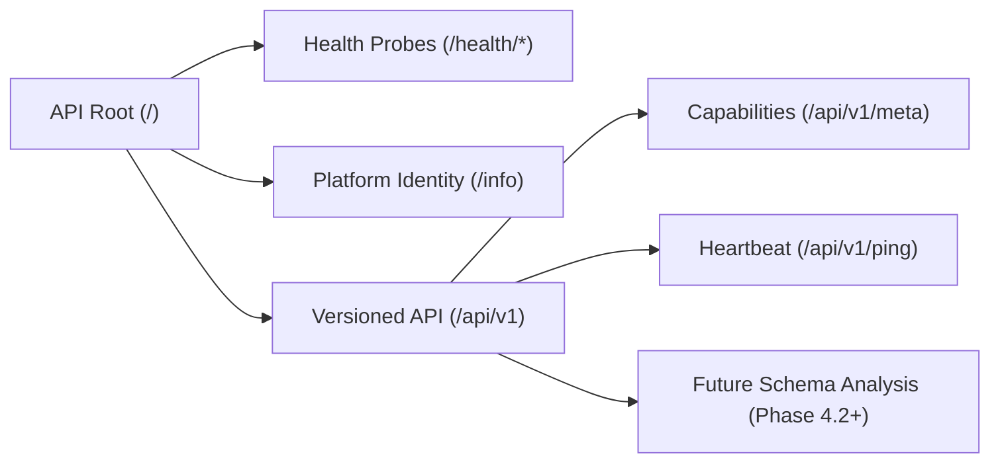

# DERA Backend API Foundation Specification

> **Component:** `apps/api/src/dera_api/api`  
> **Phase:** 4.1 — Python/FastAPI Application Foundation  
> **Status:** Authoritative Foundation Specification  

---

## 1. API Architecture & Versioning

All future domain endpoints follow strict semantic versioning rooted under the `/api/v1` namespace. Top-level system probes (`/health/*` and `/info`) reside at the root namespace to maintain standard container orchestrator conventions.



---

## 2. Endpoints Inventory

### Root Health & Platform Identity

| Method | Path | Summary | Response Model | Status Code |
|---|---|---|---|---|
| `GET` | `/health/live` | Process Liveness Probe | `LivenessResponse` | `200` |
| `GET` | `/health/ready` | Operational Readiness Probe | `ReadinessResponse` | `200` / `503` |
| `GET` | `/health` | Legacy Health Check | `HealthResponse` | `200` |
| `GET` | `/info` | Platform Identity & Philosophy | `PlatformInfoResponse` | `200` |

### Version 1 System Endpoints (`/api/v1`)

| Method | Path | Summary | Response Model | Status Code |
|---|---|---|---|---|
| `GET` | `/api/v1/meta` | Platform Capabilities & Metadata | `MetaResponse` | `200` |
| `GET` | `/api/v1/ping` | Low-Latency Heartbeat Ping | `SystemPingResponse` | `200` |

---

## 3. Truthful Readiness Semantics

The readiness probe (`GET /health/ready`) provides honest, non-simulated system state. It does not falsely claim that databases, message brokers, or worker pools are operational when those components are not yet configured:

```json
{
  "status": "ok",
  "service": "dera-api",
  "version": "0.1.0-dev",
  "ready": true,
  "subsystems": {
    "application_state": "operational",
    "database_connectors": "none_required_in_phase_4_1",
    "background_workers": "none_required_in_phase_4_1"
  }
}
```

If the application lifecycle has not completed startup or is currently undergoing shutdown, the endpoint returns `HTTP 503 Service Unavailable` with `"ready": false`.

---

## 4. Request Correlation (`X-Request-ID`)

Every incoming HTTP request is assigned a unique correlation identifier:

- **Client Header:** Clients may supply an existing `X-Request-ID` header containing 1–128 alphanumeric characters, hyphens, or underscores.
- **Auto-Generation:** If the header is absent or contains invalid characters, a new UUID4 identifier is generated automatically.
- **Propagation:** The correlation ID is attached to `request.state.request_id`, reflected in response headers, and injected into all error payloads.
