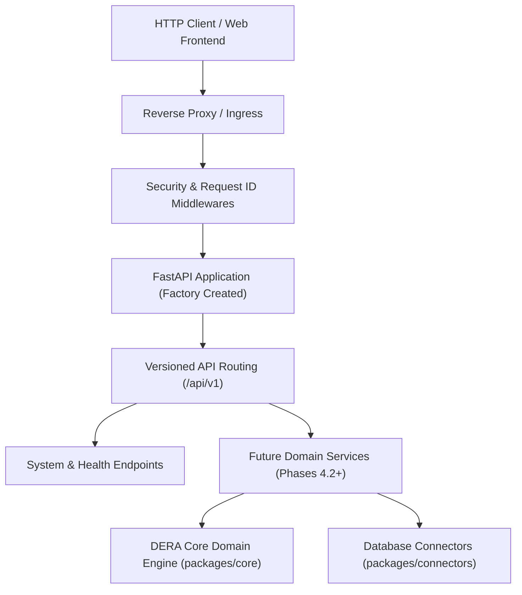

# DERA Backend Architecture Guide

> **Component:** `apps/api/src/dera_api`  
> **Phase:** 4.1 — Python/FastAPI Application Foundation  
> **Status:** Authoritative Architectural Contract  

---

## 1. Overview and Core Philosophy

The DERA backend is a deterministic, high-performance API service built with Python 3.12+ and FastAPI. It serves as the gateway for schema reverse-engineering, object graph construction, and deterministic diagnostics.



### Key Architectural Invariants

1. **Deterministic Execution:** Zero generative AI, LLM APIs, probabilistic models, or vector stores. All operations are auditable and reproducible.
2. **Factory-Driven Construction:** Applications are instantiated deterministically via `create_app(settings)`.
3. **Modern Lifespan Management:** Lifecycle execution relies on `contextlib.asynccontextmanager`. Deprecated startup/shutdown event handlers are forbidden.
4. **Explicit Configuration:** Strongly typed configuration through `pydantic-settings` with strict production constraints.
5. **Truthful Readiness:** Readiness probes only report operational status for subsystems that are actually configured and initialized.

---

## 2. Directory Layout

The backend codebase resides in `apps/api/src/dera_api/`:

```text
apps/api/
├── .env.example
└── src/
    └── dera_api/
        ├── __init__.py           # Public exports (app, create_app, get_settings, ApiSettings)
        ├── main.py               # ASGI application entrypoint for Uvicorn
        ├── factory.py            # Authoritative FastAPI application factory
        ├── api/
        │   ├── __init__.py
        │   └── v1/
        │       ├── __init__.py
        │       ├── router.py     # Top-level /api/v1 aggregator router
        │       └── endpoints/
        │           ├── __init__.py
        │           └── system.py # Metadata (/api/v1/meta) & heartbeat (/api/v1/ping)
        ├── core/
        │   ├── __init__.py
        │   ├── config.py         # Typed ApiSettings with pydantic-settings
        │   ├── lifespan.py       # Asynchronous lifespan manager & probe diagnostics
        │   ├── logging.py        # Structured logging with UTC timestamps & secret filter
        │   └── exceptions.py     # Centralized exception models & safe JSON handlers
        ├── dependencies/
        │   ├── __init__.py
        │   └── common.py         # Common FastAPI dependency providers
        ├── middleware/
        │   ├── __init__.py
        │   ├── request_id.py     # Correlation ID injection & validation
        │   └── security.py       # OWASP defensive security headers
        └── schemas/
            ├── __init__.py
            ├── error.py          # Structured error response schemas
            ├── health.py         # Liveness, readiness, and capability schemas
            └── system.py         # System identity and ping schemas
```

---

## 3. Application Lifecycle Management

DERA uses FastAPI's modern lifespan context manager in `dera_api.core.lifespan.lifespan`:

- **Startup:**
  - Emits structured UTC log indicating service name, version, and active environment.
  - Sets `app.state.startup_time` in UTC.
  - Marks `app.state.is_ready = True`.
- **Active Execution:** Serves requests while tracking health and correlation IDs.
- **Graceful Shutdown:**
  - Marks `app.state.is_ready = False`.
  - Flushes background tasks and releases open resources.
  - Emits structured shutdown completion log.

---

## 4. Middleware Pipeline

Middlewares execute in the following inward and outward sequence:

| Order | Middleware | Purpose |
|---|---|---|
| 1 | `SecurityHeadersMiddleware` | Injects defensive headers (`X-Content-Type-Options: nosniff`, `X-Frame-Options: DENY`, `X-DERA-Policy: DETERMINISTIC_ZERO_AI`) |
| 2 | `RequestIDMiddleware` | Generates or validates `X-Request-ID` (1–128 alphanumeric characters) and propagates to state and response |
| 3 | `CORSMiddleware` | Restricts browser origins based on typed allowlist; forbids wildcards in production |

---

## 5. Exception Handling & Security

All unhandled exceptions are caught by `unhandled_exception_handler` in `dera_api.core.exceptions`:
- Returns HTTP 500 with a generic, safe client message.
- Correlation `request_id` is included for debugging.
- Internal stack traces, raw SQL queries, file paths, and environment secrets are **never** returned in HTTP responses.
