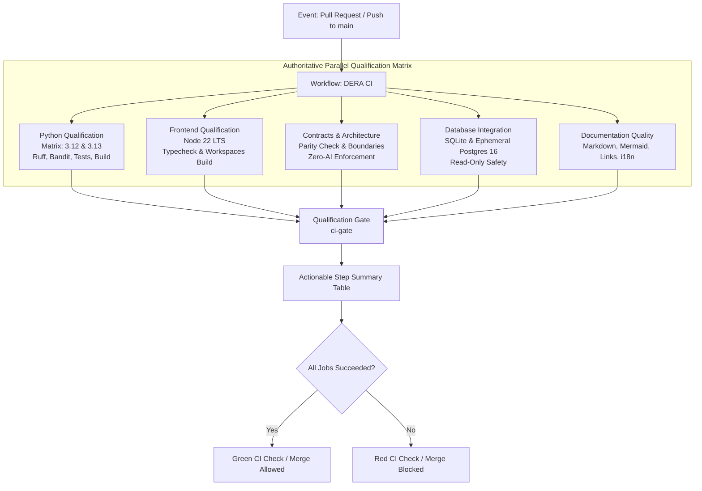

# DERA Authoritative Main Continuous Integration Architecture
**Database Engineering & Reverse Analysis**
*Understand Every Schema. Engineer Every Change.*

---

## 1. Overview & Engineering Principles

The primary continuous integration workflow (`.github/workflows/ci.yml`) is the authoritative quality and security gate for the DERA repository. Every pull request targeting `main` and every direct push to `main` must pass this qualification suite.

### Core Non-Negotiable Invariants
1. **Strictly Non-AI:** CI utilizes only deterministic static analysis, test runners, typecheckers, and compilers. Zero generative AI models, agents, embeddings, or external inference APIs are executed.
2. **Least Privilege Permissions:** All CI jobs declare `permissions: contents: read`. No repository write tokens, environment secrets, or elevated permissions are granted to pull request jobs.
3. **Hermetic & Offline Local Reproduction:** Every verification step executed in CI can be reproduced locally by contributors without requiring third-party cloud accounts.
4. **Fork Contributor Safety:** PRs submitted from external repository forks run safely without secrets, credentials, or elevated tokens.
5. **Disposable Test Databases:** Database integration tests execute solely against ephemeral, synthetic fixtures (in-memory SQLite and isolated PostgreSQL service containers). Production databases are never accessed.

---

## 2. CI Architecture & Workflow Graph

---

## 3. Granular Job Responsibilities

### Job 1: `python-qualification`
* **Job Display Name:** `Python (${{ matrix.python-version }})`
* **Matrix Strategy:** `python-version: ["3.12", "3.13"]`, `fail-fast: false`
* **Runner Environment:** `ubuntu-latest`
* **Timeout:** 15 minutes
* **Execution Steps:**
  1. **Source Checkout:** `actions/checkout@v7` with `persist-credentials: false`.
  2. **Python Setup:** `actions/setup-python@v7` with pip caching enabled.
  3. **Dependency Installation:** Deterministic installation of runtime and test dependencies, followed by editable installation of the monorepo root (`pip install -e .`).
  4. **Ruff Linting & Format Verification:** Enforces Python syntax rules, import sorting (`I001`), bug detection (`B`), and standard code formatting across `packages/`, `apps/`, `tests/`, and `scripts/`.
  5. **Bytecode Compilation:** `compileall` ensures zero syntax or bytecode compilation errors.
  6. **Static Application Security (Bandit):** Scans AST nodes for dangerous functions, insecure configuration, or eval statements (`bandit -r packages/core/src/ apps/api/src/ -ll -q`).
  7. **Test Suite:** Runs all discovered unit, regression, and architecture tests via `python -m unittest discover tests/`.
  8. **Package Build Verification:** Compiles distribution source archives and binary wheels via `python -m build --sdist --wheel`.

### Job 2: `frontend-qualification`
* **Job Display Name:** `Frontend & Monorepo Workspaces`
* **Runner Environment:** `ubuntu-latest`
* **Runtime:** Node.js 22 LTS (`actions/setup-node@v7` with npm cache)
* **Timeout:** 10 minutes
* **Execution Steps:**
  1. Clean dependency installation via `npm ci`.
  2. Static TypeScript typecheck across monorepo workspaces via `npm run typecheck` (`tsc --noEmit`).
  3. Workspace build validation via `npm run build`, building `@dera/contracts` and `@dera/web` into their respective `dist/` directories.

### Job 3: `contracts-architecture`
* **Job Display Name:** `Contracts & Architecture Boundaries`
* **Runner Environment:** `ubuntu-latest`
* **Timeout:** 5 minutes
* **Execution Steps:**
  1. Canonical schema contract parity check: verifies non-empty existence of Python models (`packages/core/src/dera/models.py`) and TypeScript interfaces (`packages/contracts/src/index.ts`).
  2. Module boundary and zero-AI policy tests (`tests/architecture/test_module_boundaries.py`), verifying unidirectional dependency flow and zero generative AI imports.

### Job 4: `database-integration`
* **Job Display Name:** `Database Integration (SQLite & Ephemeral PostgreSQL 16)`
* **Runner Environment:** `ubuntu-latest`
* **Service Container:**
  * Image: `postgres:16-alpine`
  * Port: `5432:5432`
  * Healthcheck: `pg_isready` interval 10s, timeout 5s, retries 5
* **Timeout:** 10 minutes
* **Execution Steps:**
  1. Service container health verification via `nc -z 127.0.0.1 5432`.
  2. SQLite connector integration tests (`tests/integration/test_sqlite_connector.py`), verifying table introspection, foreign keys, constraints, and DAG topological sorting against synthetic test databases.

### Job 5: `documentation-quality`
* **Job Display Name:** `Documentation Quality Gate`
* **Runner Environment:** `ubuntu-latest`
* **Runtimes:** Node.js 22 LTS & Python 3.13
* **Timeout:** 5 minutes
* **Execution Steps:**
  1. Executes `npm run docs:check`, running Markdownlint, internal link and anchor validation, Mermaid diagram syntax validation, 10-language navigation parity check, and i18n manifest verification.

### Job 6: `ci-gate` (The Authoritative Gate)
* **Job Display Name:** `Qualification Gate`
* **Prerequisites (`needs`):** `[python-qualification, frontend-qualification, contracts-architecture, database-integration, documentation-quality]`
* **Condition:** `if: always()`
* **Timeout:** 5 minutes
* **Execution Steps:**
  1. Inspects the status of all five prerequisite qualification jobs.
  2. Outputs a structured Markdown summary table to `$GITHUB_STEP_SUMMARY`.
  3. Fails immediately with exit code `1` if any required job failed, timed out, or was cancelled.

---

## 4. Branch Protection & Required Status Checks

In GitHub Repository Settings, the following exact check name should be designated as **Required**:

* **`Qualification Gate`** (`DERA CI`)

Because `ci.yml` triggers on all pull requests targeting `main` without path exclusions, `Qualification Gate` is evaluated deterministically for every pull request, preventing deadlocks or skipped required checks.

---

## 5. Security & Fork Safety Controls

| Security Concern | CI Enforcement Mechanism |
|---|---|
| **Untrusted Code Execution** | Workflows trigger on standard `pull_request` (isolated unprivileged runner), never `pull_request_target`. |
| **Token Permissions** | Declared `contents: read` at top-level workflow scope. |
| **Secrets Exposure** | Zero repository secrets are injected into PR test runners. |
| **Script Injection** | PR titles, bodies, and author usernames are passed via structured environment variables, never interpolated directly into shell strings. |
| **Third-Party Actions** | First-party official GitHub Actions used (`actions/checkout@v7`, `actions/setup-python@v7`, `actions/setup-node@v7`). |
| **Ephemeral Test Isolation** | Databases run in disposable non-root Alpine service containers destroyed upon job conclusion. |

---

## 6. Actionable Failure Troubleshooting

When a CI run fails, consult the corresponding job log:

1. **Python Failure (`Python (3.12)` or `Python (3.13)`):**
   * Review Ruff output for code formatting or import sorting errors.
   * Review Bandit output for flagged dangerous calls.
   * Review Unittest tracebacks for failing assertions.
2. **Frontend Failure (`Frontend & Monorepo Workspaces`):**
   * Check TypeScript compiler diagnostic logs (`tsc --noEmit`).
   * Verify workspace dependencies and build scripts.
3. **Database Integration Failure:**
   * Verify service container startup logs and connection timeouts.
4. **Documentation Failure:**
   * Run `npm run docs:check` locally to view exact line-number error messages for links, anchors, or Mermaid syntax.
