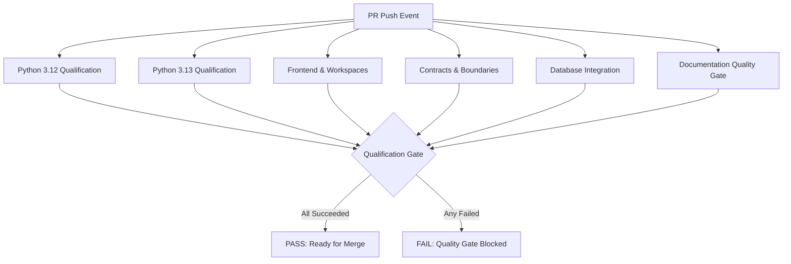

# DERA CI Performance & Resource Management

> **Project:** DERA — Database Engineering & Reverse Analysis  
> **Tagline:** Understand Every Schema. Engineer Every Change.  
> **Maintainer:** Bunga Krishanth (`@krishanth7`)  
> **Classification:** Official DevSecOps Infrastructure Standard  

---

## 1. Objectives & Principles

The DERA CI Performance Management framework ensures that continuous integration workflows remain fast, deterministic, reproducible, and resource-efficient as the codebase grows.

### Core Principles
1. **Never Sacrifice Security for Speed:** CodeQL SAST, dependency auditing, and architecture boundary validation are mandatory qualification requirements and will never be removed or weakened to shave seconds.
2. **Deterministic Reproducibility:** Caching must act purely as a performance accelerator; builds and tests must remain 100% correct in cold-cache environments.
3. **Hermetic & Least Privilege:** CI runners operate under `contents: read` permissions with zero access to external AI services or production credentials.
4. **Empirical Verification:** Performance improvements are claimed only when backed by observable GitHub Actions telemetry.

---

## 2. Target Performance Benchmarks

| Metric | Target | Measurement Method |
|---|---|---|
| **PR Qualification Duration (Median)** | **≤ 45s** | Total wall-clock time from PR trigger to qualification gate completion |
| **PR Qualification Duration (P95)** | **≤ 55s** | 95th percentile during high GitHub runner load |
| **Cold-Cache CI Duration** | **≤ 60s** | Execution time with all caches purged or bypassed |
| **Warm-Cache CI Duration** | **≤ 40s** | Execution time with warm pip and npm dependency caches |
| **Job Timeout Compliance** | **100%** | Every workflow job declares an explicit `timeout-minutes` |
| **Concurrency Waste Prevention** | **100%** | Superseded pull request commits cancel obsolete running jobs |

---

## 3. Workflow Concurrency Strategy

DERA implements granular workflow concurrency groups to balance responsiveness and integrity:

```yaml
concurrency:
  group: ${{ github.workflow }}-${{ github.ref }}
  cancel-in-progress: ${{ github.event_name == 'pull_request' }}
```

### Policy Rules
* **Pull Request Runs (`cancel-in-progress: true`):** When a contributor pushes new commits to an open PR, in-flight CI runs for prior commits are cancelled immediately, freeing runner resources and preventing queue congestion.
* **Main Branch Runs (`cancel-in-progress: false`):** Commits merged to the `main` branch are never cancelled in progress; post-merge verification must complete sequentially to ensure authoritative deployment and audit evidence.
* **Security & Triage Isolation:** Security workflows (`codeql.yml`, `dependency-security.yml`) maintain distinct concurrency groups to prevent security scans from interfering with or being cancelled by functional CI workflows.

---

## 4. Job Dependency & Parallel Execution DAG

DERA structures its primary continuous integration pipeline as an optimized Directed Acyclic Graph (DAG) maximizing parallel execution:



### Dependency Guidelines
* **Independent Execution:** Backend unit tests, frontend builds, contract verifications, ephemeral database integration, and documentation quality checks run concurrently on parallel GitHub-hosted runners.
* **Strict Gate Aggregation:** The `ci-gate` job uses `needs: [python-qualification, frontend-qualification, contracts-architecture, database-integration, documentation-quality]` and evaluates `if: always()` to ensure all checks execute and report diagnostic summaries even if an earlier check fails.

---

## 5. Job Timeout Standards

Unbounded CI jobs risk hanging runner processes and exhausting GitHub Actions minute quotas. All DERA workflows declare conservative, empirical timeouts:

| Workflow / Job | Timeout | Rationale |
|---|:---:|---|
| `python-qualification` | 15 min | Allows package installation, bytecode compilation, SAST, unit tests, and build |
| `frontend-qualification` | 10 min | Accommodates npm installation, TypeScript typecheck, and workspace builds |
| `contracts-architecture` | 5 min | Fast structural integrity and boundary checks |
| `database-integration` | 10 min | Allows PostgreSQL 16 service container startup, healthcheck, and test suite |
| `documentation-quality` | 5 min | Markdownlint, link checking, mermaid syntax, and i18n parity |
| `ci-gate` (Aggregate) | 5 min | Telemetry summary generation |
| `codeql.yml` | 60 min | Deep inter-procedural static analysis across Python, TypeScript, and Actions |
| `security-tests.yml` | 10 min | Static security scanning and credential checks |
| `pr-title.yml` / `pr-readiness.yml` | 5 min | Governance checks execute in under 10 seconds |

---

## 6. Observability & Monitoring

* **Automated Duration Tracking:** [`.github/workflows/ci-performance.yml`](../../.github/workflows/ci-performance.yml) executes weekly to report run durations and queue delays.
* **Cache Storage Monitoring:** [`.github/workflows/cache-maintenance.yml`](../../.github/workflows/cache-maintenance.yml) monitors cache storage consumption against GitHub's 10 GB repository limit.
* **Test Telemetry:** [`scripts/ci/test_reporter.py`](../../scripts/ci/test_reporter.py) records per-test execution duration and highlights the top 5 slowest test cases in every run.
