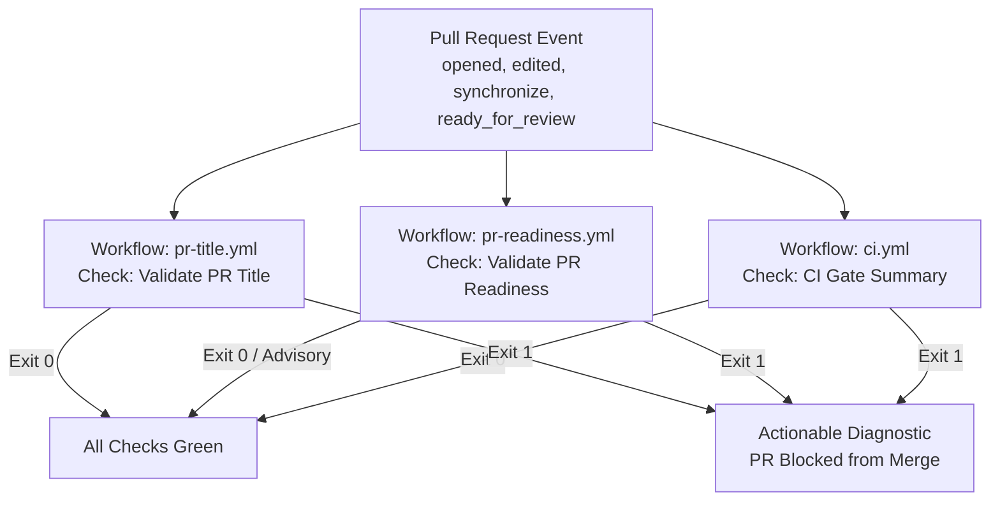

# DERA Pull Request Qualification & Review Readiness Guide

Official guideline and reference for submitting, validating, and qualifying Pull Requests in **DERA — Database Engineering & Reverse Analysis**.

Maintainer: Bunga Krishanth (`@krishanth7`)  
Engineering Standard: Deterministic, Contributor-Friendly, Secure DevSecOps Governance

---

## 1. Overview & Philosophy

DERA's pull request qualification system is designed to provide rapid, actionable feedback to contributors while maintaining strict repository integrity and security:

1. **Deterministic & Non-AI:** All validation rules rely solely on deterministic syntactic and structural parsers. No generative AI, black-box evaluators, or third-party cloud LLM review bots are used.
2. **Contributor-Friendly Guidance:** Failed checks print clear, actionable diagnostic messages explaining what failed, why it failed, and concrete examples of how to resolve the error.
3. **Draft-Aware Lifecycle:** Draft pull requests allow contributors to share work-in-progress code and collaborate without blocking CI status or triggering false-positive alerts.
4. **Least-Privilege & Fork-Safe:** All qualification workflows execute under unprivileged `pull_request` events with read-only tokens (`contents: read`). Pull requests from external forks require zero maintainer secrets or elevated permissions.

---

## 2. Pull Request Title Conventions

DERA requires all pull request titles to follow the [Conventional Commits 1.0.0](https://www.conventionalcommits.org/v1.0.0/) specification. Pull request titles serve as the source of truth for squash-merged commit history and automated release changelog generation.

### 2.1 Standard Structure

```text
type(scope): concise description in lowercase
```

Or, when the change affects the entire repository or general tooling:

```text
type: concise description in lowercase
```

### 2.2 Allowed Commit Types

| Type | Purpose | Example |
|---|---|---|
| `feat` | New feature, connector, parser, or functionality | `feat(connectors): add SQLite constraint inspection` |
| `fix` | Bug fix, error handling correction, or patch | `fix(core): resolve circular foreign key topological sort` |
| `docs` | Documentation additions, translations, or fixes | `docs(i18n): update Italian README reference table` |
| `ci` | Continuous integration workflows, action updates | `ci(pr): implement draft-aware readiness checks` |
| `test` | Unit, integration, or regression test additions | `test(api): cover invalid schema query parameters` |
| `refactor`| Code restructuring with no behavioral alterations | `refactor(models): simplify table relationship representation` |
| `perf` | Performance optimizations and throughput gains | `perf(graph): cache dependency graph acyclic checks` |
| `build` | Build system, packaging, wheels, or tool configs | `build(deps): update ruff and mypy configurations` |
| `chore` | Maintenance, minor repo housekeeping, or cleanup | `chore(repo): update copyright year notices in headers` |
| `revert`| Reverting a previous commit | `revert(api): revert commit a1b2c3d` |

### 2.3 Canonical Scopes

To prevent arbitrary or misspelled scopes while allowing domain-specific clarity, DERA enforces the following canonical scope vocabulary:

- **Architecture & System:** `core`, `api`, `web`, `contracts`, `cli`, `governance`, `architecture`, `release`
- **Data & Connectors:** `connectors`, `database`, `sqlite`, `postgres`, `postgresql`, `mysql`, `mariadb`, `models`, `erd`, `graph`, `diagnostics`
- **Quality & Operations:** `docs`, `i18n`, `security`, `ci`, `deps`, `repo`, `python`, `npm`, `github`, `actions`, `docker`
- **Hierarchical Scopes:** Sub-packages and compound scopes are fully supported (e.g., `connectors/postgres`, `deps,npm`, `actions/deps`).

Scope omission is allowed when a change broadly spans multiple subsystems (e.g., `ci: improve PR qualification gates`).

### 2.4 Breaking Changes

Breaking API or schema changes are designated using the exclamation mark (`!`) breaking change indicator immediately following the type or scope:

```text
feat(contracts)!: alter column nullability contract field
feat!: migrate configuration schema to v2 format
```

When an exclamation mark is present in the PR title, the PR body must document the breaking change and provide migration instructions in the `## Breaking Changes` section.

### 2.5 Title Validation Examples

#### Valid Titles
```text
feat(connectors): add PostgreSQL schema extraction
fix(core): correct cycle detection in schema graphs
docs(ci): document pull request qualification
ci: add matrix test for Python 3.13
test(cli): verify SQLite inspect command flags
refactor(api)!: remove deprecated v1 schema endpoint
docs(i18n): add Hindi translation for quickstart guide
chore(deps): bump actions/setup-python from v5 to v6
```

#### Invalid Titles
```text
Update README.md                       # Missing Conventional Commit type
Fixing bug in connectors              # Non-standard phrasing, capital letter
feat:                                  # Missing description
docs(unknownscope): add quickstart     # Scope 'unknownscope' is not in canonical list
FEATURE(core): add column parser       # Uppercase type
feat(core): Add SQLite model           # Description must start with lowercase letter
WIP: working on tests                  # WIP prefix is forbidden; use draft PRs instead
```

---

## 3. Pull Request Readiness Validation

To maintain high software quality and prevent incomplete submissions from overwhelming maintainer review queues, DERA validates the structure and completeness of pull request descriptions.

### 3.1 Draft PR Policy

DERA actively encourages early pull request creation in **Draft** state:
- When a PR is opened as a **Draft**, the title syntax is verified immediately.
- The readiness validator checks the body and prints non-blocking advisory notices for any missing sections.
- The check exits with code `0` (`SUCCESS`), allowing draft authors to view CI test results without failing pull request gates.
- When the contributor converts the pull request from Draft to **Ready for Review**, the readiness check automatically re-evaluates all readiness criteria.

### 3.2 Required Pull Request Sections

Every review-ready pull request must use [`.github/PULL_REQUEST_TEMPLATE.md`](../../.github/PULL_REQUEST_TEMPLATE.md) and include:

1. **## Summary / Motivation:** At least 30 characters of meaningful, human-typed explanation describing *what* was changed and *why*. Merely keeping default template HTML comments (`<!-- ... -->`) or unchecked checkboxes is flagged as incomplete.
2. **## Testing:** Explicit declaration of verification status using one of the recognized states:
   - `- [x] Relevant tests passed` (with command and output evidence)
   - `- [x] Tests not applicable` (with technical rationale, e.g., documentation or comment fix)
   - `- [x] Tests not run` (with explanation of blocker or dependency)
3. **## Documentation Impact:** Note if documentation was added, updated, or why no doc changes were required.
4. **## Security Impact:** Confirmation of read-only non-AI boundaries, vulnerability impact assessment, or declaration of "none identified". If a PR touches security components or carries the `security` label, an explicit assessment is mandatory.
5. **## Breaking Changes:** Explicit declaration of breaking changes with migration guidance, or "None identified".

---

## 4. GitHub Actions CI Qualification Integration

DERA coordinates PR qualification across dedicated, lightweight GitHub Actions workflows:



### 4.1 Stable Check Names

The following status check names are stable across the repository and are enforced by branch protection rules:

- `Validate PR Title` (workflow `.github/workflows/pr-title.yml`)
- `Validate PR Readiness` (workflow `.github/workflows/pr-readiness.yml`)
- `CI Gate Summary` (workflow `.github/workflows/ci.yml`)

### 4.2 Local Pre-Flight Testing

You can validate your PR title and description locally before pushing to GitHub:

```bash
# Validate PR title
python scripts/ci/validate_pr_title.py --title "feat(core): add schema cycle detection"

# Validate PR readiness with environment variables
export PR_TITLE="feat(core): add schema cycle detection"
export PR_BODY="$(cat my_pr_description.md)"
export PR_DRAFT="false"
python scripts/ci/validate_pr_readiness.py
```

---

## 5. Security & Trust Boundaries

DERA treats all pull request metadata (titles, descriptions, branches, author names) as **untrusted user input**:

- **No Shell Interpolation:** Workflow steps never evaluate `${{ github.event.pull_request.title }}` inside bash `run:` scripts. All metadata is transferred exclusively via safely mapped environment variables (`env: PR_TITLE: ${{ github.event.pull_request.title }}`).
- **Zero Script Injection:** Python validators parse strings directly in memory without passing content to shell sub-processes or `eval()`.
- **Read-Only Context:** Workflows use `permissions: contents: read` and never perform automated code pushes, releases, or branch merges.
- **Fork Isolation:** Workflows require zero repository secrets. Fork PRs run in clean, sandboxed GitHub-hosted runners.

---

## 6. Common Errors & Resolution

### Error: `Invalid type 'feature'`
- **Cause:** Using `feature(...)` instead of the Conventional Commit standard `feat(...)`.
- **Fix:** Update PR title to `feat(scope): your description`.

### Error: `Description must start with a lowercase letter`
- **Cause:** Starting description with an uppercase character (`feat(core): Add model`).
- **Fix:** Change to lowercase (`feat(core): add model`).

### Error: `PR description is too short (less than 30 characters)`
- **Cause:** Submitting the default template without typing explanations, or providing a one-word summary.
- **Fix:** Add a descriptive explanation of your change in the `## Summary` section.

### Error: `PR description must declare testing status`
- **Cause:** No testing checkbox was selected in `## Testing`.
- **Fix:** Check the appropriate box (`- [x] Relevant tests passed` or `- [x] Tests not applicable`) and note the commands executed.

---

## 7. Reviewer Expectations & Maintenance SLA

Once all automated checks pass:

1. **Triage:** Maintainers acknowledge new submissions within **24 to 48 hours**.
2. **Review:** Comprehensive technical review is completed within **3 to 5 business days**.
3. **Merge Strategy:** PRs are squash-merged to preserve clean, linear history. The final commit message uses the approved Conventional Commit PR title and body.
