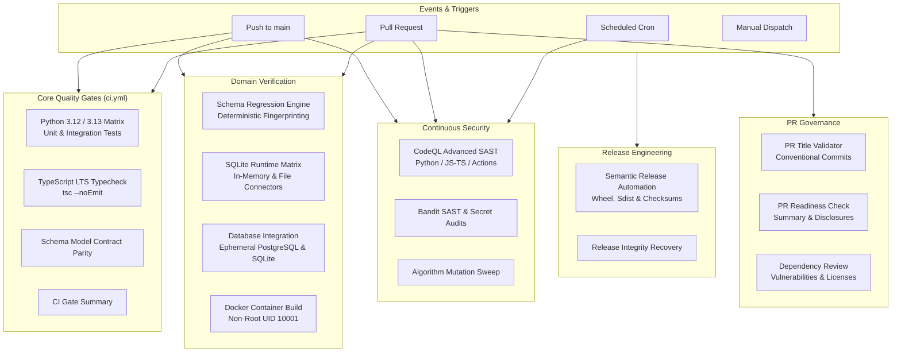

# DERA DevSecOps & GitHub Actions Architecture

Welcome to the official Continuous Integration, Quality Assurance, and DevSecOps architectural reference for **DERA — Database Engineering & Reverse Analysis**.

---

## 1. Executive Overview

DERA's CI/CD infrastructure is engineered around five fundamental pillars:

1. **Deterministic Reproducibility** — Workflows run deterministic tests, canonical schema hash evaluations, and topological sort validations without non-deterministic external AI inference APIs or generative model dependencies.
2. **Least Privilege Security** — Workflows enforce default read-only permissions (`contents: read`). Privileged write permissions are isolated to release publication (`contents: write`) and security alerts (`security-events: write`).
3. **Safe PR Qualification** — Pull requests from forks and community contributors are executed strictly via unprivileged `pull_request` events with read-only tokens, eliminating privileged token exfiltration vectors.
4. **Comprehensive Code & Schema Coverage** — Dual-stack CI pipeline validating Python backend core packages (`packages/core`, `apps/api`) and TypeScript shared contracts and web visualizer (`packages/contracts`, `apps/web`).
5. **Internationalization & Documentation Integrity** — Automated link validation, UTF-8 character parity, and RTL direction verification across all 10 supported documentation languages.

---

## 2. DevSecOps Architecture Diagram

---

## 3. Documentation Navigation

* [PR_QUALIFICATION.md](PR_QUALIFICATION.md) — Authoritative pull request title, scope, draft lifecycle, and review readiness guide.
* [MAIN_CI.md](MAIN_CI.md) — Authoritative primary CI workflow architecture and job specifications.
* [LOCAL_CI.md](LOCAL_CI.md) — Local reproduction guide and commands for offline qualification.
* [WORKFLOWS.md](WORKFLOWS.md) — Comprehensive technical inventory of all active workflows.
* [PERFORMANCE_MANAGEMENT.md](PERFORMANCE_MANAGEMENT.md) — CI performance targets, DAG parallelism, timeouts, and concurrency controls.
* [CACHE_STRATEGY.md](CACHE_STRATEGY.md) — Dependency cache architecture, cache keys, security boundaries, and cold-cache validation.
* [ARTIFACT_RETENTION_POLICY.md](ARTIFACT_RETENTION_POLICY.md) — Canonical artifact naming, category registry, retention periods, and SHA-256 manifests.
* [TEST_REPORTING.md](TEST_REPORTING.md) — Standardized JUnit XML, JSON summaries, failure diagnostics, and slow test observability.
* [FLAKY_TEST_POLICY.md](FLAKY_TEST_POLICY.md) — Flaky test taxonomy, quarantine protocol, 14-day SLA, and permitted retry boundaries.
* [DOCUMENTATION_WORKFLOWS.md](DOCUMENTATION_WORKFLOWS.md) — Reference for consolidated documentation validation, multilingual navigation, and translation parity.
* [SECURITY_WORKFLOWS.md](SECURITY_WORKFLOWS.md) — Reference for CodeQL, dependency security, review, and container workflows.
* [SECURITY.md](SECURITY.md) — Threat modeling, permission matrices, and token boundary security policies.
* [TROUBLESHOOTING.md](TROUBLESHOOTING.md) — Step-by-step diagnostic guide for contributors when CI checks fail.
* [ROADMAP.md](ROADMAP.md) — Planned, in-progress, and deferred workflows.
* [BRANCH_PROTECTION.md](BRANCH_PROTECTION.md) — Recommended repository rulesets and stable branch-protection check names.
