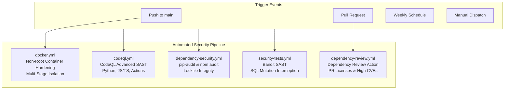

# DERA Continuous Security & DevSecOps Workflows Reference

Official architecture guide and reference for automated security scanning in **DERA — Database Engineering & Reverse Analysis**.

Maintainer: Bunga Krishanth (`@krishanth7`)  
Engineering Standard: Least-Privilege, Deterministic, Non-AI Static Security Verification

---

## 1. DevSecOps Architecture Overview

DERA enforces a multi-layered security qualification architecture in GitHub Actions:

---

## 2. Security Workflows Matrix

| Workflow File | Name | Check Name | Triggers | Required Permissions | Scanned Scope |
|---|---|---|---|---|---|
| `.github/workflows/codeql.yml` | `DERA \| CodeQL Advanced Security` | `Security Scan \| <lang>` | `push` (main), `pull_request` (main), weekly `schedule`, `workflow_dispatch` | `contents: read` `security-events: write` `actions: read` | Python, JavaScript/TypeScript, and GitHub Actions workflows |
| `.github/workflows/dependency-security.yml` | `DERA \| Dependency Security` | `Dependency Security Gate` | `push` (main), `pull_request` (main), weekly `schedule`, `workflow_dispatch` | `contents: read` | Direct and transitive dependencies in `pyproject.toml` and `package-lock.json` |
| `.github/workflows/dependency-review.yml` | `DERA \| Dependency Review` | `Vulnerability & License Review` | `pull_request` (main touching manifests) | `contents: read` `pull-requests: read` | Newly introduced PR dependencies, CVEs, and license compatibility |
| `.github/workflows/security-tests.yml` | `DERA \| Security Tests` | `Static Security Lint & Boundaries` | `push` (main), `pull_request` (main) | `contents: read` | Bandit static analysis, SQL mutation regex filtering, read-only boundary tests |
| `.github/workflows/docker.yml` | `DERA \| Docker Build & Publish` | `Docker Build & Verification` | `push` (tags `v*`, main) | `contents: read` `packages: write` | Container build validation, non-root user verification, port exposure safety |

---

## 3. Workflow Specifications

### 3.1 CodeQL Advanced Security (`codeql.yml`)
* **Engine:** GitHub CodeQL Action v4
* **Query Suite:** `security-extended` (includes all default security queries plus high-value extended CWE checks)
* **Analyzed Languages:**
  * `python`: Scans FastAPI backend, core schema models, connector implementations, and CLI scripts.
  * `javascript-typescript`: Scans React visualizer, TypeScript contract schemas, and Next.js components.
  * `actions`: Scans GitHub Actions workflow YAML files for unpinned third-party actions and insecure expression interpolation.
* **Build Mode:** `none` (zero application compilation required, minimizing runner footprint).

### 3.2 Dependency Security Audit (`dependency-security.yml`)
* **Python Job:** Executes `pip-audit --desc` against installed project packages to detect newly published advisories in the PyPI advisory database.
* **Node.js Job:** Executes `npm ci --ignore-scripts` to verify lockfile consistency, followed by `npm audit --audit-level=high` to block High and Critical CVEs.
* **Gate Job:** Fails the workflow if either ecosystem audit detects actionable security vulnerabilities.

### 3.3 Dependency Review Action (`dependency-review.yml`)
* **Scope:** Evaluates package manifest changes introduced within a pull request.
* **License Gate:** Restricts acceptable open-source licenses to permissive standards (`MIT, Apache-2.0, BSD-2-Clause, BSD-3-Clause, ISC, Python-2.0, 0BSD`).
* **Vulnerability Threshold:** Automatically blocks PRs that introduce High or Critical vulnerabilities.

### 3.4 Security Tests & Static Analysis (`security-tests.yml`)
* **Bandit SAST:** Scans `packages/core/src/`, `apps/api/src/`, and `packages/connectors/src/` with confidence and severity filters (`-ll`).
* **Deterministic Boundary Verification:** Executes unit and integration tests verifying that database connectors reject `INSERT`, `UPDATE`, `DELETE`, `DROP`, `ALTER`, and `TRUNCATE` mutations at both static AST and runtime levels.

---

## 4. Troubleshooting Failed Security Checks

### 1. CodeQL Alert: `Inefficient regular expression` (ReDoS)
* **Cause:** A regular expression contains nested quantifiers (`(...)+)*`) that cause exponential backtracking on crafted inputs.
* **Remediation:** Remove nested quantifiers and restructure the pattern to match linearly.

### 2. Dependency Audit Failure: `npm audit found vulnerabilities`
* **Cause:** A third-party frontend dependency has a published security advisory.
* **Remediation:** Upgrade the affected package in `package.json`, or if transitive, add a version constraint in the `overrides` section of `package.json` and run `npm install`.

### 3. Bandit Warning: `B101 / B608 Potential SQL injection`
* **Cause:** Dynamic string formatting used where parameterized SQL or catalog inspection is required.
* **Remediation:** Replace string concatenation with parameterized SQL queries (`cursor.execute(sql, params)`) or quote database identifiers using database-specific escaping functions.
