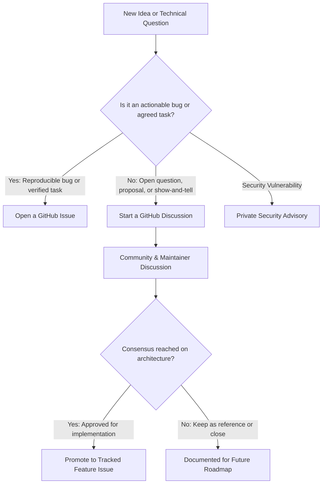

# GitHub Discussions Guide & Community Forums

**Project:** DERA — Database Engineering & Reverse Analysis  
**Repository:** [https://github.com/krishanth7/dera](https://github.com/krishanth7/dera)  
**Discussions URL:** [https://github.com/krishanth7/dera/discussions](https://github.com/krishanth7/dera/discussions)  
**Lead Maintainer:** [Krishanth](https://github.com/krishanth7)  
**License:** [MIT License](../../LICENSE)  

---

## 1. Overview

**GitHub Discussions** is DERA's open community forum for open-ended questions, brainstorming, architectural debates, and community collaboration. 

While GitHub Issues is reserved for actionable bugs and tracked feature milestones, Discussions provides a space for conversations before concrete code or tasks are defined.

---

## 2. When to Use What Channel

| Channel | Best For | When NOT to Use |
|---|---|---|
| **GitHub Discussions** | • Conceptual architecture proposals • Usage & setup questions • Showcasing projects built with DERA • Brainstorming dialect connectors | • Confirmed, reproducible bugs • Code contributions • Security vulnerabilities |
| **GitHub Issues** | • Actionable bug reports with reproduction steps • Accepted roadmap tasks & milestones • Confirmed documentation corrections | • General questions • Vague feature brainstorming • Security vulnerabilities |
| **Private Security Advisories** | • Sensitive vulnerability reports • Credential handling issues | • Public feature requests • General bugs |
| **Pull Requests** | • Concrete code and documentation contributions | • Starting design discussions without code |

---

## 3. Discussion Categories

To keep conversations structured, DERA categorizes discussions into focused areas. Below is the verified live status of repository categories:

### A. Active Live Categories (Verified via GitHub API)

| Category | Description & Purpose | Format / Expected Content |
|---|---|---|
| **📢 Announcements** | Official project milestones, version releases, and maintainer updates. | Read-only from maintainers; community comments welcome. |
| **💬 General** | Broad conversations about database engineering, reverse analysis, and community chat. | Open-ended discussions. |
| **💡 Ideas** | Proposing new deterministic capabilities, visualizations, or workflows. | Problem statement, proposed user experience, and trade-offs. |
| **❓ Q&A** | Asking for assistance with installation, configuration, or CLI commands. | Question with environment details and logs. Use "Mark as Answer" when resolved. |
| **📊 Polls** | Community sentiment, RFC feedback, and technology prioritization votes. | Structured polls. |
| **🎉 Show and tell** | Sharing schemas visualized, reverse-engineering projects, or custom tooling built on DERA. | Screenshots, ERD exports, and repository links. |

### B. Planned & Recommended Custom Categories (Manual Maintainer Setup)

The following categories are recommended for deep technical triage and can be added manually by repository maintainers under **GitHub Repository Settings &rarr; Discussions &rarr; Categories &rarr; New category**:

| Recommended Category | Intended Focus | Discussion Format |
|---|---|---|
| **🏗️ Architecture & Design** | Deep technical design discussions: DAG graph algorithms, AST parsing, schema diffing, canonical contracts. | Open discussion |
| **🔌 Database Connectors** | Dialect nuances, system catalog queries, and connector feasibility discussions (PostgreSQL, SQLite, MySQL, Supabase). | Open discussion |
| **🤝 Contributor Help** | Dedicated guidance for new contributors navigating dev environment setup, tests, or Conventional Commits. | Q&A (Answerable) |

> [!NOTE]
> Until custom categories are added in repository settings, contributors should use **`💡 Ideas`** for architectural proposals, **`💬 General`** for connector feasibility questions, and **`❓ Q&A`** for contributor onboarding support.

---

## 4. How to Structure Technical Proposals

When proposing a major architectural change or new connector in Discussions:
1. **State the Engineering Problem:** Explain the practical limitation or database pattern that is currently unsupported.
2. **Deterministic Focus:** Explain how the solution will execute deterministically without generative AI or external LLM APIs.
3. **Draft Data Contract:** Outline any new properties added to canonical schema contracts (`packages/contracts`).
4. **Security & Permissions:** Detail the minimum database user permissions required to execute the proposed inspection.
5. **Trade-offs & Alternatives:** Document alternative designs considered and why they were rejected.

---

## 5. From Discussion to Tracked Issue

When a discussion reaches technical consensus and maintainer approval:
1. A maintainer or core contributor opens a formal **GitHub Issue** referencing the discussion URL.
2. The issue defines concrete acceptance criteria and is assigned to a release milestone.
3. The discussion is marked with a link to the implementation issue for transparent tracking.
