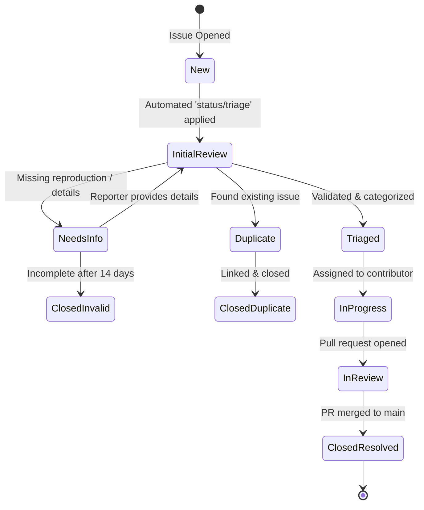

# Issue Triage & Lifecycle Policy

**Project:** DERA — Database Engineering & Reverse Analysis  
**Repository:** [https://github.com/krishanth7/dera](https://github.com/krishanth7/dera)  
**Lead Maintainer:** [Krishanth](https://github.com/krishanth7)  
**License:** [MIT License](../../LICENSE)  

---

## 1. Overview

Issue triage is the collaborative process of reviewing, classifying, prioritizing, and progressing incoming bug reports, feature requests, and maintenance tasks.

DERA follows an objective, evidence-based triage workflow designed to ensure rapid feedback for contributors while keeping the issue tracker focused on actionable engineering work.

---

## 2. Issue Lifecycle Stages

### Stage 1: Intake & Initial Classification (Target: ≤ 48 Hours)
- Every new issue receives the `status/triage` label automatically via [`.github/workflows/issue-triage.yml`](../../.github/workflows/issue-triage.yml).
- A maintainer reviews the issue to verify:
  1. Does it contain sufficient technical detail and reproduction steps?
  2. Does it expose passwords, tokens, or confidential database data? *(If so, immediate maintainer edit/sanitization is required).*
  3. Is it a duplicate of an existing open or resolved issue?

### Stage 2: Clarification & Reproduction
- If key details are missing (e.g., database engine version, minimal SQL reproduction schema):
  - Apply `status/needs-reproduction`.
  - Maintainer posts a polite, specific request detailing what is needed.
  - If no response is received within **14 calendar days**, the issue may be closed with a welcoming note inviting the reporter to reopen when ready.

### Stage 3: Priority & Component Assignment
Once an issue is validated, replace `status/triage` with appropriate operational labels:
- **Type:** `type/bug`, `type/feature`, `type/docs`, `type/connector`, `type/performance`, `type/maintenance`.
- **Component:** `component/core`, `component/connectors`, `component/api`, `component/web`, `component/contracts`, `component/ci`, `component/docs`.
- **Priority:** Assign according to the priority matrix below.

---

## 3. Priority & Severity Matrix

| Priority Label | Severity / Criteria | Target Resolution Cadence |
|---|---|---|
| `priority/critical` | • Application crash on valid standard catalog input • Query mutation guard bypass or security regression • Blocking release pipeline or test suite failure | Active focus; targeted fix within 48–72 hours. |
| `priority/high` | • Major dialect catalog extraction failure (e.g., PostgreSQL FK dropped) • Severe memory spike on moderate schemas (<500 tables) • Breaking contract regression | Scheduled for immediate next patch release. |
| `priority/medium` | • Minor introspection discrepancy (e.g., comment or custom enum missing) • CLI formatting flaw or non-blocking API warning | Scheduled for upcoming minor milestone. |
| `priority/low` | • Cosmetic UI alignment, non-critical documentation typo • Minor performance optimization suggestion | Backlog; ideal for community contributors. |

---

## 4. Special Triage Scenarios

### Duplicate Issues
- When an issue duplicates an existing ticket:
  1. Comment: *"Thank you for reporting! This appears to be a duplicate of #<number>. Consolidating conversation there."*
  2. Apply `duplicate` label and close the newer issue.

### Unreproducible Bugs
- If a reported bug cannot be reproduced with the provided steps:
  - Request the minimal synthetic SQL DDL script that triggers the error.
  - Maintainers do not test against customer production databases.

### Reopening Criteria
- An issue may be reopened if:
  - New evidence or an alternative reproduction case demonstrates the defect persists after a release.
  - A regression occurs in a newer version.
