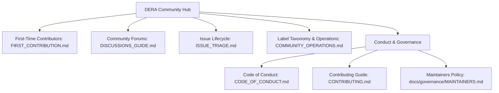

# DERA Community Hub & Contributor Operations

**Project:** DERA — Database Engineering & Reverse Analysis  
**Repository:** [https://github.com/krishanth7/dera](https://github.com/krishanth7/dera)  
**Lead Maintainer:** [Krishanth](https://github.com/krishanth7)  
**License:** [MIT License](../../LICENSE)  

---

## 1. Welcome to the DERA Community

DERA is an open-source, deterministic database engineering platform built by and for database architects, software engineers, and reverse-analysis practitioners worldwide.

We strive to create an open, transparent, and technically rigorous community where contributors of all experience levels can collaborate effectively.

---

## 2. Community Documentation Index

| Guide | Focus & Scope | Target Audience |
|---|---|---|
| [**First-Time Contributor Guide**](FIRST_CONTRIBUTION.md) | Step-by-step walkthrough for cloning, local verification, branching, testing, and opening your first PR. | New contributors and open-source newcomers. |
| [**Contribution Areas Map**](CONTRIBUTION_AREAS.md) | Skill-based guide mapping contributor capabilities (Python, SQL, Docs, Translations) to active and planned work. | Prospective and returning contributors. |
| [**Contributor FAQ**](CONTRIBUTOR_FAQ.md) | Answers to frequently asked questions regarding branching, CI checks, tests, and reviews. | All contributors. |
| [**Discussions Guide**](DISCUSSIONS_GUIDE.md) | How to use GitHub Discussions categories, propose architectural enhancements, and ask technical questions. | All community members, architects, and users. |
| [**Issue Triage Policy**](ISSUE_TRIAGE.md) | Triage lifecycle, priority and severity matrix, duplicate handling, and clarification workflows. | Maintainers and active issue reporters. |
| [**Community Operations & Labels**](COMMUNITY_OPERATIONS.md) | Standard label taxonomy (`type/*`, `priority/*`, `status/*`, `component/*`), milestone tracking, and release management. | Maintainers and reviewers. |
| [**Code of Conduct**](../../CODE_OF_CONDUCT.md) | Contributor Covenant v2.0 standards, expected positive behaviors, enforcement guidelines, and reporting contacts. | Everyone participating in DERA spaces. |
| [**Contributing Guide**](../../CONTRIBUTING.md) | Full technical standards: PEP 8, strict TypeScript, Conventional Commits, testing requirements, and DCO licensing. | Developers authoring code and docs. |

---

## 3. Communication Channels

- **[GitHub Discussions](https://github.com/krishanth7/dera/discussions):** For open-ended questions, design debates, connector proposals, and show-and-tell showcases.
- **[GitHub Issues](https://github.com/krishanth7/dera/issues):** For confirmed, reproducible bugs and accepted roadmap engineering tasks.
- **[GitHub Pull Requests](https://github.com/krishanth7/dera/pulls):** For code, test, and documentation contributions.
- **[Private Security Advisories](https://github.com/krishanth7/dera/security/advisories/new):** For confidential vulnerability disclosure.
