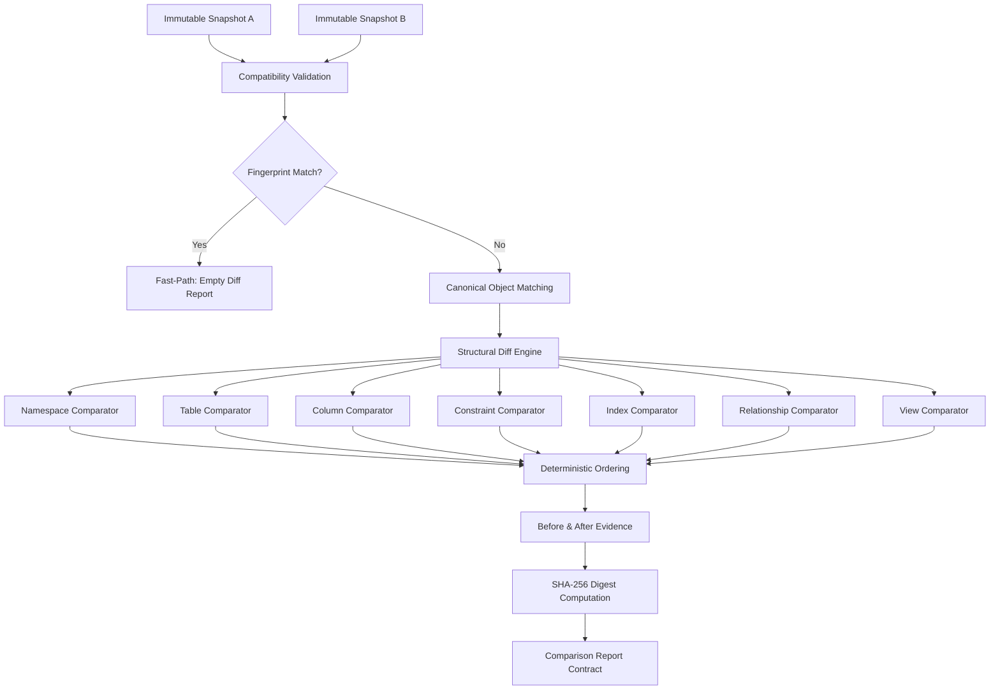

# DERA Schema Comparison Architecture

**Phase:** 9.1 — Deterministic Schema Snapshot Comparison Engine  
**Module:** `dera.comparison`  
**Status:** Certified Read-Only, Deterministic  

---

## 1. Architectural Overview

The Schema Comparison Engine compares two immutable canonical schema snapshots (`baseline` and `target`) and generates a structured, fully explainable difference report (`ComparisonReport`).

## 2. Core Design Principles

1. **Zero AI / LLM / Heuristics:** Changes are identified strictly through exact canonical object matching (`ObjectId`, namespace, native name). No probabilistic guesses or inferred renames without lineage.
2. **Strict Immutability:** Input snapshots are read-only Pydantic models. Neither snapshot payload nor envelope is modified.
3. **No Database Access:** Operates in-memory on deserialized `SchemaSnapshot` objects without connecting to customer databases.
4. **Reproducibility:** Every difference and report receives a deterministic SHA-256 fingerprint generated from canonical RFC 8785 JSON representation.
5. **No Automatic Migrations:** Generation and execution of migration DDL/DML are strictly out-of-scope for Phase 9.1.
