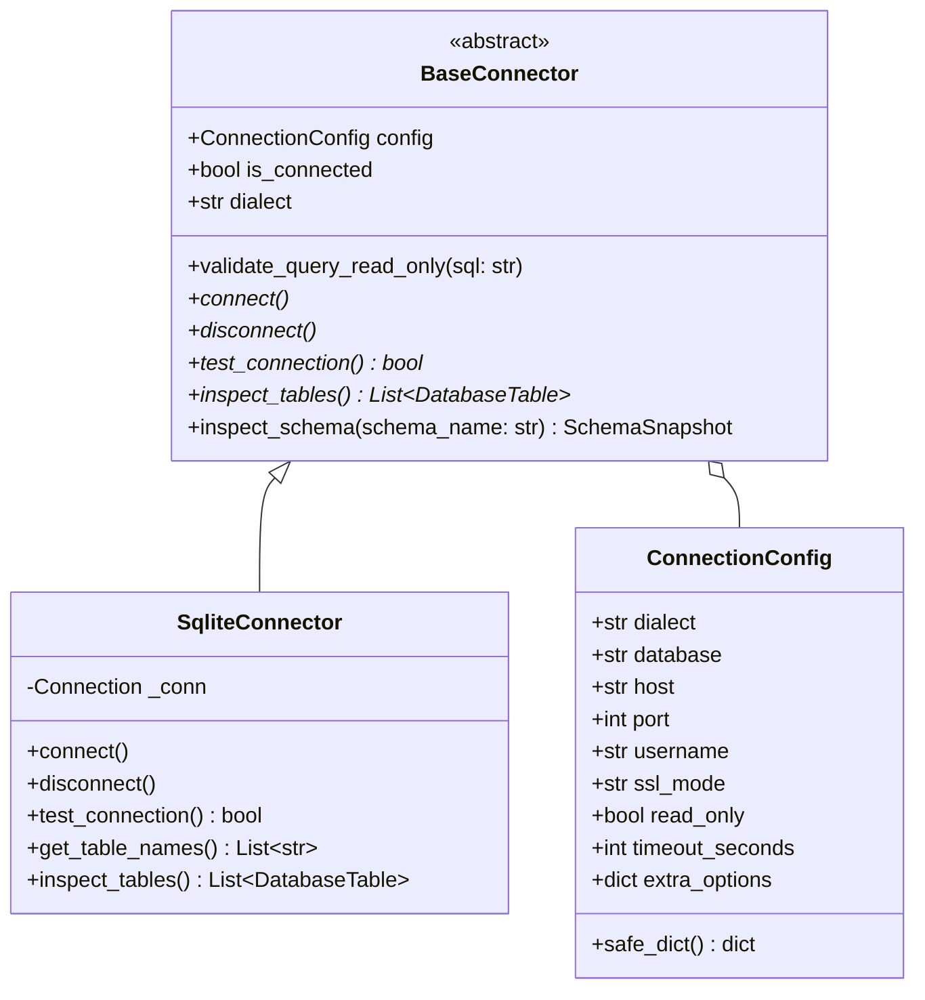

# DERA Database Connector Architecture & Safety Boundaries

> **Package:** `packages/connectors`  
> **Status:** Implemented Base & SQLite; Additional Adapters Planned  
> **Maintainer:** Krishanth  
> **Last Verified:** 2026-10-26 (Commit `e550fdd`)  

---

## 1. Connector Purpose & Design Philosophy

The **DERA Connector Architecture** (`packages/connectors`) governs how DERA interacts with target database engines to extract schema metadata.

Because DERA is designed to connect to enterprise, production, and staging database environments, the connector layer operates under two uncompromising mandates:
1. **Absolute Read-Only Safety:** DERA must never modify, create, drop, or alter database structures or user data during introspection.
2. **Structural Metadata Only:** Connectors query system catalog views (`sqlite_master`, `information_schema`, `pg_catalog`) to extract schema topologies. Connectors do not query or store customer application data rows.

---

## 2. Base Connector Interface (`BaseConnector`)

All database adapters inherit from the abstract base class [`BaseConnector`](../../packages/connectors/src/dera_connectors/base/connector.py).



### 2.1 Connection Lifecycle
- **Instantiation:** Connectors are initialized with an immutable `ConnectionConfig`. Credentials are encapsulated and masked in string representations.
- **Connection Establishment (`connect()`):** Connectors acquire a database handle and immediately execute session-level read-only directives (e.g. `PRAGMA query_only = ON;` in SQLite; `SET TRANSACTION READ ONLY;` in PostgreSQL).
- **Liveness & Privilege Probing (`test_connection() -> bool`):** Verifies that the connection is active and that catalog read privileges are granted without attempting data mutations.
- **Introspection (`inspect_tables() -> List[DatabaseTable]`):** Queries system catalog views and constructs canonical domain models.
- **Snapshot Creation (`inspect_schema()`):** Wraps extracted tables into an immutable `SchemaSnapshot`.
- **Resource Disposal (`disconnect()`):** Closes database handles and terminates active connection pool resources safely. Context manager protocols (`__enter__` and `__exit__`) are supported.

---

## 3. Query Safety & Mutation Interception

Before any introspection query is dispatched to a database, it must pass through `validate_query_read_only()`:

```python
_MUTATION_KEYWORDS = re.compile(
    r"\b(DROP|TRUNCATE|ALTER|CREATE|INSERT|UPDATE|DELETE|GRANT|REVOKE)\b",
    re.IGNORECASE,
)

def validate_query_read_only(self, sql: str) -> None:
    if _MUTATION_KEYWORDS.search(sql):
        raise ReadOnlyViolationError(
            f"Query rejected by read-only connector boundary: {sql[:60]}..."
        )
```

If any mutation token is detected, the query is immediately aborted with a `ReadOnlyViolationError` before network transmission.

---

## 4. SQLite Connector Implementation (`SqliteConnector`)

In [`packages/connectors/src/dera_connectors/sqlite/connector.py`](../../packages/connectors/src/dera_connectors/sqlite/connector.py):
- **Read-Only URI Enforcement:** File databases are opened using the SQLite URI `file:<path>?mode=ro`.
- **Query Only PRAGMA:** The connection executes `PRAGMA query_only = ON;` upon connection.
- **Table Discovery:** Queries `sqlite_master` excluding internal tables:
  ```sql
  SELECT name FROM sqlite_master WHERE type='table' AND name NOT LIKE 'sqlite_%' ORDER BY name ASC;
  ```
- **Column & Key Introspection:** Utilizes `PRAGMA table_info` and `PRAGMA foreign_key_list` to reconstruct column nullability, data types, primary keys, and foreign-key targets.

---

## 5. Dialect Roadmap & Implementation Status

| Database Engine | Dialect Identifier | Current Implementation Status | Read-Only Enforcement Mechanism |
|---|---|---|---|
| **SQLite** | `sqlite` | **Implemented & Verified** | URI `mode=ro` + `PRAGMA query_only = ON;` |
| **PostgreSQL** | `postgresql` | **In Development (Phase 5)** | Session `SET TRANSACTION READ ONLY;` |
| **Supabase PostgreSQL** | `postgresql` | **Planned (Phase 5)** | SSL enforced, session `SET TRANSACTION READ ONLY;` |
| **MySQL** | `mysql` | **Planned (Phase 6)** | `SET SESSION TRANSACTION READ ONLY;` |
| **MariaDB** | `mariadb` | **Planned (Phase 6)** | `SET SESSION TRANSACTION READ ONLY;` |
| **Snowflake** | `snowflake` | **Planned (Phase 8)** | Read-only role permission auditing |

---

## 6. Testing Strategy & Isolation

Connectors are tested across two levels:
1. **Architecture Boundary Tests:** [`tests/architecture/test_module_boundaries.py`](../../tests/architecture/test_module_boundaries.py) validates that safe catalog queries pass `validate_query_read_only()`, while mutating queries (`DROP`, `ALTER`, `TRUNCATE`, `INSERT`, etc.) strictly raise `ReadOnlyViolationError`.
2. **Integration Tests:** [`tests/integration/test_sqlite_connector.py`](../../tests/integration/test_sqlite_connector.py) executes schema extraction against ephemeral in-memory databases and disk-backed SQLite fixtures, asserting that column types, composite primary keys, and foreign keys are mapped accurately into canonical models.

---

## 7. Related Documentation

- [Connector Capability Matrix](CAPABILITY_MATRIX.md)
- [Connectors Documentation Hub](README.md)
- [System Architecture Overview](../architecture/SYSTEM_OVERVIEW.md)
- [Core Engine Guide](../core/README.md)
- [Security Architecture](../security/SECURITY_ARCHITECTURE.md)
