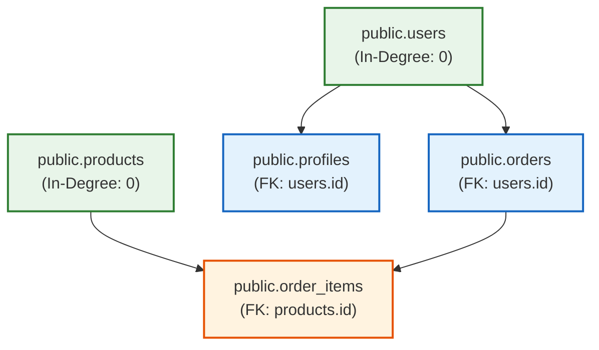

# DERA Graph Engine Documentation & Dependency Analysis

> **Module:** `packages/core/src/dera/graph.py`  
> **Status:** Implemented & Verified  
> **Maintainer:** Krishanth  
> **Last Verified:** 2026-10-26 (Commit `e550fdd`)  

---

## 1. Graph Engine Overview & Principles

In relational database engineering, table creation, migration execution, and seed data insertion must respect referential integrity constraints. If Table `orders` contains a foreign key pointing to Table `users`, the `users` table must be created before `orders`.

The **DERA Graph Engine** models foreign-key relationships as a Directed Acyclic Graph (DAG) and computes deterministic topological creation orders.

### Mathematical Invariants
1. **Dependency Direction:** If Table $A$ holds a foreign key referencing Table $B$, an edge $B \to A$ is constructed. In this formulation, $B$ is the required dependency and $A$ is the dependent consumer.
2. **Deterministic Tie-Breaking:** When multiple independent tables have zero in-degrees (no prerequisites), they are sorted alphabetically by fully-qualified name. This ensures identical topological orders across all executions.
3. **Finite Termination:** Algorithms terminate in finite, bounded time without infinite recursion.

---

## 2. Graph Representation & Data Structures

The dependency graph is represented as an adjacency list mapping table names to the set of tables that depend on them:

```python
graph: dict[str, set[str]] = {
    "public.users": {"public.orders", "public.profiles"},
    "public.orders": {"public.order_items"},
    "public.products": {"public.order_items"},
    "public.order_items": set(),
    "public.profiles": set(),
}
```

### Graph Construction Function
In [`packages/core/src/dera/graph.py`](../../packages/core/src/dera/graph.py):
```python
def build_dependency_graph(tables: Iterable[DatabaseTable]) -> dict[str, set[str]]:
    graph: dict[str, set[str]] = {}
    table_map = {t.fully_qualified_name: t for t in tables}

    for fqn in table_map:
        graph[fqn] = set()

    for table in tables:
        src = table.fully_qualified_name
        for fk in table.foreign_keys:
            tgt = f"{fk.target_schema}.{fk.target_table}"
            if tgt in table_map and tgt != src:
                # tgt (prerequisite) precedes src (referencing)
                graph[tgt].add(src)

    return graph
```

---

## 3. Illustrative Topological Dependency Graph

The following Mermaid diagram illustrates a sample 5-table relational schema and its computed creation dependency order:



**Deterministic Creation Order Output:**
1. `public.products` (zero prerequisites, alphabetical tie-break)
2. `public.users` (zero prerequisites)
3. `public.orders` (satisfied by users)
4. `public.profiles` (satisfied by users)
5. `public.order_items` (satisfied by products and orders)

---

## 4. Topological Sorting Algorithm (Kahn's with Alphabetical Sort)

Topological ordering is computed via a modified Kahn's algorithm in `compute_topological_sort()`:

```python
def compute_topological_sort(tables: Iterable[DatabaseTable]) -> list[str]:
    table_list = list(tables)
    graph = build_dependency_graph(table_list)
    in_degree: dict[str, int] = {k: 0 for k in graph}

    for deps in graph.values():
        for dep in deps:
            in_degree[dep] += 1

    # Deterministic alphabetical ordering for nodes with same in-degree
    queue = sorted([node for node, deg in in_degree.items() if deg == 0])
    order: list[str] = []

    while queue:
        curr = queue.pop(0)
        order.append(curr)

        for neighbor in sorted(graph[curr]):
            in_degree[neighbor] -= 1
            if in_degree[neighbor] == 0:
                queue.append(neighbor)
                queue.sort()

    # If circular dependencies exist, append remaining nodes deterministically
    if len(order) < len(graph):
        remaining = sorted([n for n in graph if n not in order])
        order.extend(remaining)

    return order
```

---

## 5. Circular Dependency Handling & Limitations

When circular foreign keys exist in a schema (e.g., Table A references Table B, and Table B references Table A):
- Kahn's algorithm exhausts its zero-in-degree queue before visiting all nodes (`len(order) < len(graph)`).
- **Current Behavior:** In `dera.graph.compute_topological_sort()`, remaining unreachable nodes are appended in deterministic alphabetical order to ensure finite output without throwing an unhandled exception.
- **Strict Validation Mode:** The domain exception `CycleDetectedError` is defined in `dera_core.exceptions` to allow strict validation pipelines to flag and reject circular schemas when strict acyclicity is required.
- **Known Limitation:** Multi-table mutually circular dependencies require either schema refactoring or multi-statement DDL execution (creating tables before applying `ADD CONSTRAINT FOREIGN KEY`). Full cycle resolution with deferred foreign key generation is planned for Phase 6.

---

## 6. Algorithmic Complexity

| Operation | Time Complexity | Space Complexity | Notes |
|---|---|---|---|
| `build_dependency_graph` | $O(V + E)$ | $O(V + E)$ | $V$ = tables, $E$ = foreign key constraints |
| In-degree calculation | $O(V + E)$ | $O(V)$ | Linear iteration over adjacency sets |
| Topological traversal | $O(V \log V + E \log V)$ | $O(V)$ | Sorting queues and neighbor sets guarantees deterministic ordering |

---

## 7. Executable Example

```python
from dera.models import DatabaseTable, ForeignKeyConstraint, DatabaseColumn
from dera.graph import compute_topological_sort

users = DatabaseTable(
    schema="public", name="users", columns=(DatabaseColumn(name="id", data_type="INTEGER"),)
)

orders = DatabaseTable(
    schema="public",
    name="orders",
    columns=(DatabaseColumn(name="id", data_type="INTEGER"),),
    foreign_keys=(
        ForeignKeyConstraint(
            name="fk_orders_user",
            source_columns=("user_id",),
            target_schema="public",
            target_table="users",
            target_columns=("id",),
        ),
    ),
)

order = compute_topological_sort([orders, users])
print(order)
# Output: ['public.users', 'public.orders']
```

---

## 8. Related Documentation

- [Core Engine Guide](README.md)
- [System Architecture Overview](../architecture/SYSTEM_OVERVIEW.md)
- [Database Connector Architecture](../connectors/CONNECTOR_ARCHITECTURE.md)
- [Shared Schema Contracts](../contracts/SCHEMA_CONTRACTS.md)
