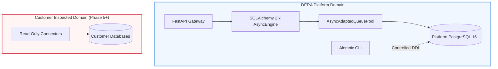
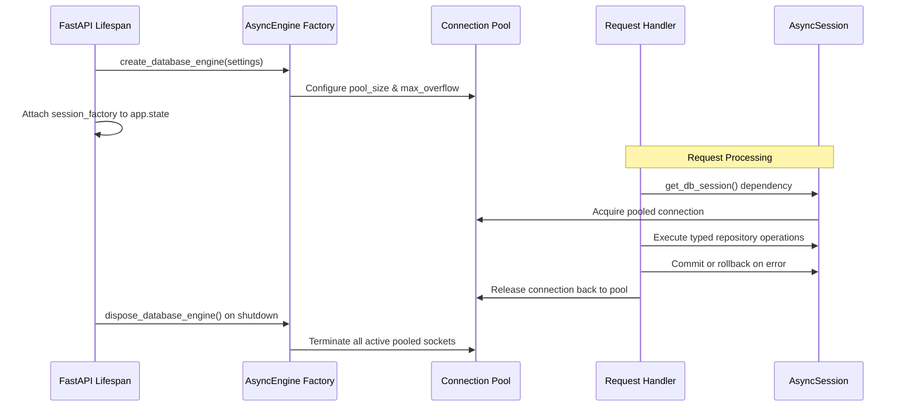

# DERA Platform Database Architecture

## 1. Architectural Mission

The DERA Platform Database provides internal operational state persistence for the DERA platform. It serves as the single source of truth for platform configuration, workspace metadata, future audit records, and internal migration history.

---

## 2. Strict Database Separation Invariant

DERA operates across two independent architectural domains that must never be unified or share database connections:

### Architectural Guarantees

1. **Zero Cross-Contamination**: No connection string, connection pool, or session object is shared between the platform database and customer databases.
2. **Read-Only Customer Databases**: Customer databases inspected in Phase 5+ are accessed exclusively via read-only transactions.
3. **No Platform Migrations on Customer DBs**: Alembic manages exclusively the internal platform schema (`dera_platform_metadata` and future platform tables). It is strictly forbidden to execute Alembic against customer systems.

---

## 3. Component Interaction Lifecycle

---

## 4. Initial Schema: Platform Metadata

Milestone 4.3 intentionally avoids speculative business models (no prematurely created user tables, roles, or billing models). It introduces a single justified operational table:

### Table: `dera_platform_metadata`

| Column | Type | Nullable | Description |
| :--- | :--- | :--- | :--- |
| `key` | `VARCHAR(64)` | No | Unique operational identifier (Primary Key). |
| `value` | `TEXT` | No | Persisted JSON/string representation of state. |
| `description` | `VARCHAR(255)` | Yes | Optional human-readable documentation. |
| `created_at` | `TIMESTAMPTZ` | No | Timestamp in UTC when entry was created. |
| `updated_at` | `TIMESTAMPTZ` | No | Timestamp in UTC when entry was last updated. |
