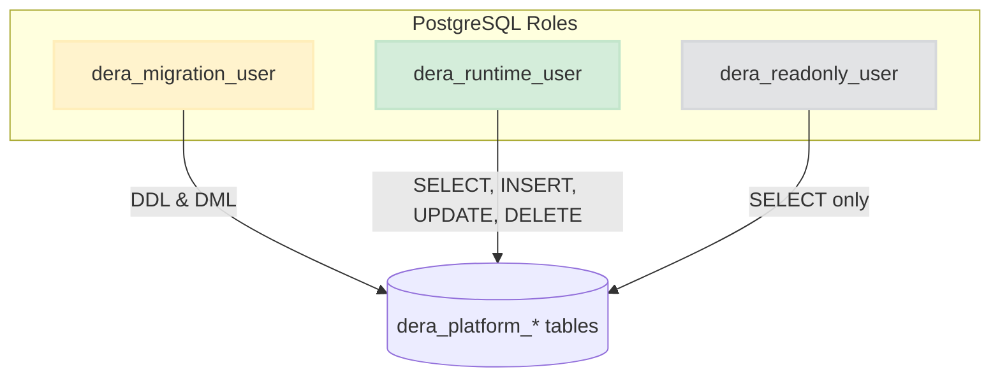

# DERA Database Security & Role Architecture

## 1. Role Separation Principles

In production environments, DERA recommends provisioning separate PostgreSQL database roles adhering to least privilege:

### 1. Migration Role (`dera_migration_user`)

- **Permissions**: Full DDL and DML permissions on platform schemas (`CREATE`, `ALTER`, `DROP`, `REFERENCES`, `INDEX`).
- **Usage**: Used exclusively by CI/CD migration runners and automated schema maintenance jobs.
- **Runtime Access**: Never used by running API gateway worker processes.

### 2. Runtime Application Role (`dera_runtime_user`)

- **Permissions**: `SELECT`, `INSERT`, `UPDATE`, `DELETE` on platform data tables.
- **Restrictions**: Strictly denied `CREATE TABLE`, `DROP TABLE`, `ALTER TABLE`, and superuser privileges.
- **Usage**: Bound to the running FastAPI instances.

### 3. Read-Only Diagnostic Role (`dera_readonly_user`)

- **Permissions**: `SELECT` on all platform tables.
- **Usage**: Used for health monitoring, replication metrics, and operational audits.

---

## 2. Transport & Secret Security

- **TLS Mandatory in Production**: PostgreSQL connections in production must specify `DERA_DB_SSL_MODE=require` or `verify-full`.
- **Zero Secrets in Code**: Database passwords must never be committed to git repositories, `.env.example`, or migration files.
- **Parameterization**: All SQL queries executed by the platform utilize SQLAlchemy bind parameters; dynamic SQL string interpolation is strictly prohibited.
