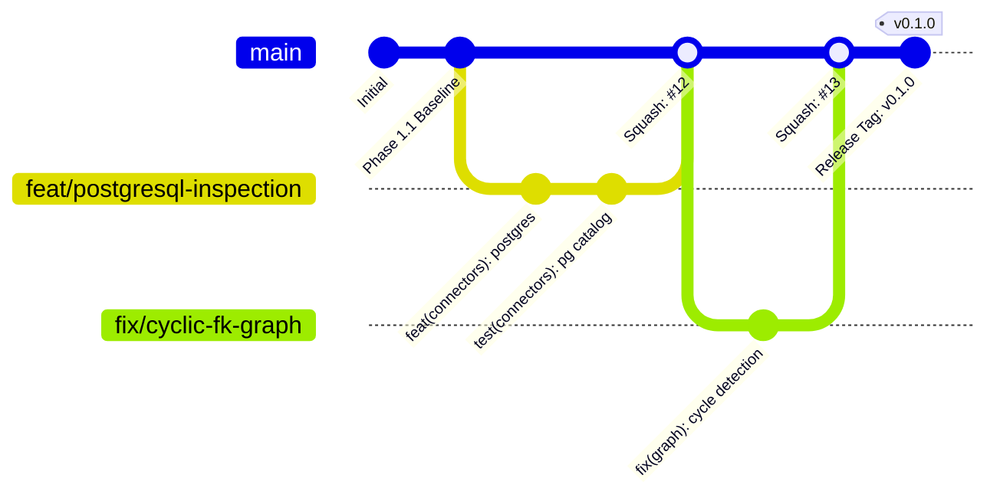

# DERA Git Branching Strategy & Lifecycle

> **Project:** DERA — Database Engineering & Reverse Analysis  
> **Maintainer:** Krishanth ([@krishanth7](https://github.com/krishanth7))  
> **Repository:** [https://github.com/krishanth7/dera](https://github.com/krishanth7/dera)  
> **Standard:** Trunk-Based Development with Protected Mainline  

---

## 1. Architectural Overview

DERA adopts a **lightweight trunk-based development strategy**. All active engineering flows through short-lived feature branches that integrate back into `main` through reviewed, CI-qualified pull requests.



---

## 2. Primary Integration Branch (`main`)

- **Branch Name:** `main`
- **Role:** The authoritative, evergreen, production-ready integration branch.
- **Stability Guarantee:** Every commit on `main` must pass the full qualification gate (Python 3.12/3.13 test suites, static analysis, type checks, CodeQL security scanning, deterministic DAG regressions, and documentation link validations).
- **Direct Pushes:** **Strictly forbidden**. All code changes must arrive through qualified pull requests.
- **Force Pushes (`git push --force`):** **Strictly prohibited**. The linear history of `main` is immutable.
- **Release Tags:** Published tags (e.g., `v0.1.0`) are permanently frozen and must never be deleted or rewritten.

---

## 3. Branch Naming Conventions

Every feature branch created in the central repository must adhere to the standardized prefix schema:

`<category>/<short-description>`

### Standard Prefixes

| Prefix | Intended Purpose | Concrete Examples |
|---|---|---|
| `feat/` | New deterministic capability, engine component, or connector feature | `feat/postgresql-schema-inspection`, `feat/foreign-key-graph` |
| `fix/` | Bug fix, error handling correction, or deterministic calculation repair | `fix/composite-primary-key`, `fix/cyclic-fk-resolution` |
| `docs/` | Architectural guides, setup instructions, or documentation updates | `docs/architecture-guide`, `docs/branching-strategy` |
| `refactor/` | Code structure improvements without functional or external API changes | `refactor/core-models`, `refactor/connector-base` |
| `test/` | Adding, updating, or expanding unit, integration, or architecture tests | `test/schema-normalization`, `test/sqlite-dialect` |
| `ci/` | CI/CD workflows, GitHub Actions, qualification scripts, or DevSecOps | `ci/pr-title-validation`, `ci/gate-optimizations` |
| `build/` | Packaging metadata, dependency configurations, or build tooling | `build/python-pyproject`, `build/web-tsconfig` |
| `security/` | Security controls, least privilege hardening, or vulnerability remediations | `security/connector-permissions`, `security/loopback-binding` |
| `perf/` | Deterministic performance optimizations and memory usage reductions | `perf/schema-normalization`, `perf/dag-cycle-detector` |
| `chore/` | Routine repository maintenance, cleanup, or local developer configurations | `chore/update-editorconfig`, `chore/clean-temp-files` |
| `release/` | Release preparation branches for version staging | `release/v0.1.0`, `release/v0.2.0` |
| `hotfix/` | Critical, out-of-band security or regression patch applied directly to release | `hotfix/v0.1.1-security-patch` |

### Rules for Branch Names
1. **Lowercase Only:** Use lowercase alphanumeric characters, numbers, and hyphens (`-`).
2. **Hyphen Separators:** Separate words with hyphens (e.g., `feat/sqlite-inspection`, **not** `feat/sqlite_inspection` or `feat/sqliteInspection`).
3. **Concise and Descriptive:** Keep branch names under 50 characters while clearly indicating the logical concern.

---

## 4. Branch Lifecycles & Contribution Policies

1. **Short-Lived Scope:** Feature branches should ideally exist for 1–3 days and encompass a single logical concern. Long-lived branches lead to merge divergence and are discouraged.
2. **Freshness Guarantee:** Authors must keep their branches up to date with `main` by rebasing or updating before requesting review:
   ```bash
   git checkout feat/my-feature
   git fetch origin
   git rebase origin/main
   ```
3. **Squash Merging Policy:** DERA enforces **Squash and Merge** on pull requests to ensure `main` retains a clean, linear, and easily bisectable history. Intermediate developer commits (e.g., "wip", "fix typo") are squashed into a single conventional commit on `main`.
4. **Branch Deletion:** Central feature branches should be deleted immediately upon successful merge into `main` to prevent repository clutter.
5. **Preserving Contributor Work:** Maintainers must never delete or force-push branches belonging to external contributors or open discussions.

---

## 5. Fork-Based & Automated Contributions

DERA warmly welcomes external contributors from forks:
- **Fork Branch Names:** External contributors working on personal forks may use any branch naming convention. DERA's CI does not reject fork PRs based solely on the branch name of the fork.
- **Dependabot Branches:** Automated dependency update branches (e.g., `dependabot/npm_and_yarn/...`, `dependabot/github_actions/...`) are first-class participants in the PR workflow and are handled seamlessly by our CI automation.
- **Upstream Syncing:** External contributors should configure `upstream` to stay synchronized:
  ```bash
  git remote add upstream https://github.com/krishanth7/dera.git
  git fetch upstream
  git rebase upstream/main
  ```

---

## 6. Emergency Hotfix Procedure

In the event of a high-severity security vulnerability or critical regression in a published release:
1. Branch from the tagged release commit:
   ```bash
   git checkout -b hotfix/v0.1.1-security-patch v0.1.0
   ```
2. Apply minimal, deterministic fix and verify all tests pass.
3. Open a priority PR with `security(...)` or `fix(...)` Conventional Commit formatting.
4. Review, merge, tag `v0.1.1`, and backport to `main` via cherry-pick or merge.
