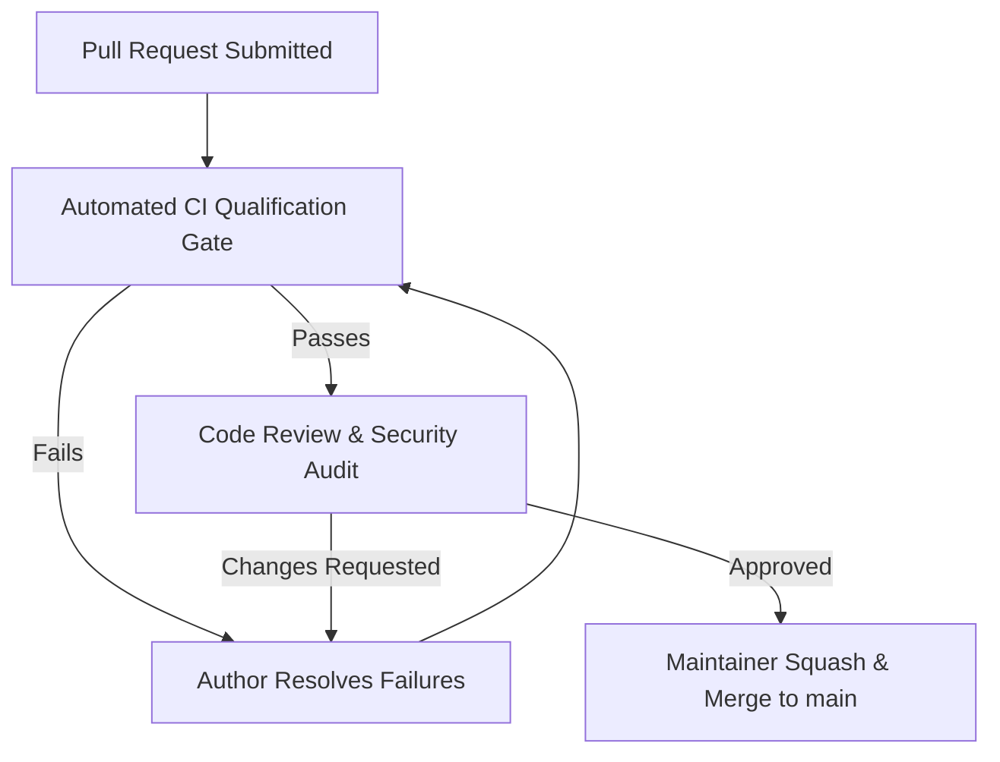

# DERA Code Review Policy & Quality Governance

> **Project:** DERA — Database Engineering & Reverse Analysis  
> **Maintainer:** Bunga Krishanth ([@krishanth7](https://github.com/krishanth7))  
> **Repository:** [https://github.com/krishanth7/dera](https://github.com/krishanth7/dera)  
> **Scope:** Central Repository & Pull Request Reviews  

---

## 1. Objectives of Code Review

In DERA, peer review is a critical engineering control. Every pull request must satisfy technical correctness, security guarantees, architectural discipline, and open-source readability before merging into `main`.

Code review serves four core pillars:
1. **Architectural Integrity:** Ensuring module boundaries between `packages/core`, `packages/connectors`, `apps/api`, and `apps/web` remain strictly decoupled.
2. **Deterministic Engineering:** Enforcing our strict **Zero-AI policy** (no LLMs, no generative models, no external inference APIs).
3. **Database Safety:** Verifying that database connector logic is strictly **read-only** and never executes mutating SQL statements.
4. **Knowledge Sharing:** Helping contributors write maintainable, tested, and high-performance Python and TypeScript code.

---

## 2. Review Requirements Before Merging

A pull request may only be merged into `main` when all of the following conditions are met:

### Mandatory Gates
1. **At Least One Approving Review:** A formal review approval from the designated code owner ([@krishanth7](https://github.com/krishanth7)) is required for all non-trivial changes.
2. **Zero Failing Checks:** All GitHub Actions qualification workflows must pass:
   - `CI Gate` (Composite gate)
   - `CodeQL Analysis` (JavaScript/TypeScript and Python)
   - `Conventional PR Title`
   - `PR Readiness & Declaration`
   - `Static Security Lint & Boundaries`
   - `Python Tests (3.12 & 3.13)`
   - `Deterministic Hash & DAG Regression`
   - `TypeScript Quality & Typecheck`
   - `Markdown & Documentation Validation`
3. **All Conversations Resolved:** Every review comment or thread must be marked as resolved by the reviewer or author after resolution.
4. **Rebased on Latest `main`:** The branch must have no merge conflicts and be based on recent `main` state.

---

## 3. Reviewer Checklist

When evaluating a pull request, reviewers examine:

### A. Deterministic & Architectural Boundaries
- [ ] Does this PR introduce any LLM dependencies or probabilistic AI APIs? (**Disallowed**)
- [ ] Does `packages/core` remain completely independent of web frameworks (FastAPI, React, Next.js)?
- [ ] Do connector implementations depend only on core contracts and vendor drivers?
- [ ] Are circular dependencies avoided across packages?

### B. Security & Database Safety
- [ ] Are all database operations strictly read-only catalog queries?
- [ ] Does the connector guard against SQL injection via parameterized queries?
- [ ] Are database connection strings, passwords, or tokens scrubbed from logs and error traces?
- [ ] Are `.env` secrets or production credentials completely absent from committed files?
- [ ] Are network endpoints bound to secure loopback (`127.0.0.1`) rather than `0.0.0.0` by default?

### C. Testing & Verification
- [ ] Do new functional changes include accompanying unit or integration tests?
- [ ] Do tests execute deterministically and avoid external network calls?
- [ ] Does `python scripts/development/dev.py all` pass without errors?

### D. Documentation & Standards
- [ ] Is the PR title written in Conventional Commit format?
- [ ] Are documentation updates included where public APIs or workflows changed?
- [ ] Do relative Markdown documentation links resolve correctly?

---

## 4. Special Handling for Security-Sensitive PRs

Pull requests touching authentication, API security middleware, database connection lifecycles, or cryptographic hashing must be explicitly labeled `security`.
- Security-sensitive PRs require explicit verification that permissions adhere to the principle of least privilege.
- Vulnerabilities must not be disclosed or discussed in public PRs before responsible remediation (see [SECURITY.md](../../SECURITY.md)).

---

## 5. Merging Protocol

- **Squash and Merge:** All pull requests are merged using GitHub's **Squash and Merge** strategy.
- **Commit Message Format:** The squash commit message must match the validated PR title (Conventional Commit) with the PR description as the body.
- **Automatic Deletion:** Feature branches on the central repository are automatically deleted upon merging.
