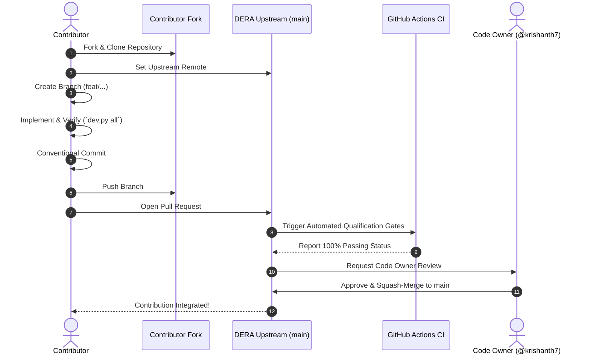

# DERA End-to-End Contribution Workflow

> **Project:** DERA — Database Engineering & Reverse Analysis  
> **Maintainer:** Krishanth ([@krishanth7](https://github.com/krishanth7))  
> **Repository:** [https://github.com/krishanth7/dera](https://github.com/krishanth7/dera)  
> **Audience:** Open-Source Contributors & Core Maintainers  

---

## 1. Overview of the Contribution Lifecycle

This guide provides a comprehensive, step-by-step walkthrough for contributing to DERA. Whether you are adding a new database catalog connector, improving schema normalization, fixing a bug, or translating documentation, follow this workflow to ensure your changes are quickly reviewed and merged.



---

## 2. Step 1: Fork and Clone

1. Navigate to [https://github.com/krishanth7/dera](https://github.com/krishanth7/dera) and click **Fork** (top-right).
2. Clone your fork locally:
   ```bash
   git clone https://github.com/YOUR_USERNAME/dera.git
   cd dera
   ```
3. Configure the official repository as the `upstream` remote:
   ```bash
   git remote add upstream https://github.com/krishanth7/dera.git
   git remote -v
   ```

---

## 3. Step 2: Synchronize and Create a Branch

Before writing code, ensure your local `main` branch is in sync with `upstream/main`:

```bash
git checkout main
git fetch upstream
git rebase upstream/main
```

Create a focused, short-lived feature branch following our [Branching Strategy](./BRANCHING_STRATEGY.md):

```bash
# For a new feature
git checkout -b feat/sqlite-index-inspection

# For a bug fix
git checkout -b fix/composite-foreign-key

# For documentation
git checkout -b docs/connector-guide
```

---

## 4. Step 3: Implement Your Changes

While developing, keep the following core engineering rules in mind:
- **Strict Non-AI Policy:** Do not introduce LLMs, generative models, or cloud AI inference APIs. DERA must remain deterministic.
- **Read-Only Database Safety:** Database connectors must only query system catalogs. Never execute mutating statements (`DROP`, `TRUNCATE`, `ALTER`, `INSERT`, `UPDATE`, `DELETE`, `GRANT`).
- **Decoupled Architecture:** `packages/core` must not depend on web frameworks or concrete database drivers.
- **Secure Defaults:** Bind local servers to `127.0.0.1` by default. Never commit passwords or `.env` files.

---

## 5. Step 4: Local Verification

DERA provides a unified cross-platform CLI tool (`scripts/development/dev.py`) to run tests and linters across Windows, Linux, and macOS:

```bash
# Run all baseline verification checks (compile, tests, typecheck, docs)
python scripts/development/dev.py all

# Run Python unit and architecture tests
python scripts/development/dev.py test

# Run TypeScript compiler static checks
python scripts/development/dev.py typecheck

# Validate documentation internal links and translations
python scripts/development/dev.py validate-docs
```

*(Unix developers with Make installed can also run `make test`, `make typecheck`, or `make lint`.)*

---

## 6. Step 5: Conventional Commit

Commit your changes using the [Conventional Commits](./COMMIT_CONVENTIONS.md) specification:

```bash
git add .
git commit -m "feat(connectors): implement SQLite index and column introspection"
```

To validate that your commit or PR title complies with the format:
```bash
python scripts/development/dev.py validate-title "feat(connectors): implement SQLite index and column introspection"
```

*(Optional: Run `python scripts/development/dev.py install-hooks` to install an automatic local `commit-msg` validation hook.)*

---

## 7. Step 6: Push and Open a Pull Request

Push your branch to your fork:
```bash
git push -u origin feat/sqlite-index-inspection
```

Open a pull request on GitHub:
1. Navigate to [https://github.com/krishanth7/dera/pulls](https://github.com/krishanth7/dera/pulls).
2. Click **New Pull Request** and choose your branch against `main`.
3. Fill out the pull request template completely:
   - Provide a clear **Summary**.
   - Select the **Change Type** checkboxes.
   - Describe your **Testing Performed**.
   - Check the **Security & Deterministic Engineering** confirmation items.

---

## 8. Step 7: Automated CI & Review Process

1. **Automated Qualification:** GitHub Actions will immediately run all status checks (`CI Gate`, `CodeQL`, `PR Title`, `PR Readiness`, `Security Lint`, `Python Tests`, `TypeScript Quality`).
2. **Review Feedback:** Maintainer [@krishanth7](https://github.com/krishanth7) will review your code. If changes are requested:
   - Make the required updates on your branch.
   - Run `python scripts/development/dev.py all` locally.
   - Commit and push to your fork branch; the PR will update automatically.
3. **Squash & Merge:** Once approved and all checks are green, your PR will be squash-merged into `main`!
4. **Post-Merge Cleanup:** Delete your local and remote feature branches:
   ```bash
   git checkout main
   git fetch upstream
   git rebase upstream/main
   git branch -d feat/sqlite-index-inspection
   git push origin --delete feat/sqlite-index-inspection
   ```

---

## 9. GitHub Issue & Label Governance

When submitting issues or reviewing PRs, DERA uses the following standard label taxonomy:

### Change Types
- `type:bug` — An error, unexpected failure, or calculation flaw
- `type:feature` — A new deterministic reverse-engineering capability
- `type:documentation` — Improvements or translations to documentation
- `type:security` — Security fixes, permission improvements, or vulnerability disclosures
- `type:refactor` — Code cleanup without behavior modification
- `type:testing` — Additions or fixes to test suites
- `type:ci` — Build scripts, workflows, and developer tooling

### Priorities
- `priority:critical` — Urgent defect or security issue blocking usage
- `priority:high` — Major issue affecting primary database inspection workflows
- `priority:medium` — Standard feature or defect with a viable workaround
- `priority:low` — Minor improvement, cosmetic adjustment, or small cleanup

### Contribution Status
- `status:needs-triage` — Newly filed issue awaiting maintainer review
- `status:blocked` — Blocked by an upstream dependency or missing architectural prerequisite
- `status:ready` — Approved specification ready for active community implementation
- `good first issue` — Well-scoped tasks ideal for new contributors
- `help wanted` — Open task where community assistance is actively invited
