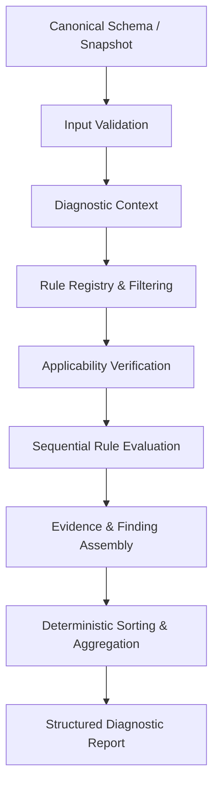

# DERA Diagnostics — Layered Architecture

**Milestone:** Phase 8.1 — Deterministic Schema Diagnostic Rules Engine  
**Status:** Canonical Reference  

---

## 1. Overview

The DERA Diagnostics Rules Engine provides reproducible, static, evidence-based analysis of database schemas without runtime AI models or non-deterministic heuristics. It inspects canonical database metadata, relationship graphs, dependency condensation DAGs, and immutable schema snapshots to produce structured, explainable findings.

---

## 2. Layered Pipeline Architecture

### Layer Descriptions

1. **Canonical Schema / Snapshot Input:** Consumes validated Phase 6.1 `SchemaRepresentation` and Phase 6.5 `SchemaSnapshot` models.
2. **Input Validation & Resource Bounding:** Validates inputs against configurable resource limits (`max_objects`, `max_edges`).
3. **Diagnostic Context:** Constructs an immutable, frozen `DiagnosticContext` bundling schemas, capabilities, graph topologies, and configuration.
4. **Rule Registry:** Manages the catalog of versioned rules, enforcing unique rule IDs and deterministic ordering by `rule_id`.
5. **Applicability Verification:** Evaluates engine compatibility, required capabilities, and metadata completeness before executing a rule.
6. **Sequential Rule Evaluation & Error Isolation:** Evaluates each applicable rule in alphabetical rule ID order. Unhandled rule exceptions are caught, producing an `EVALUATION_ERROR` outcome without interrupting other rules.
7. **Evidence & Finding Assembly:** Validates discrete, typed `DiagnosticEvidence` entries and calculates stable SHA-256 fingerprints.
8. **Deterministic Aggregation:** Sorts findings deterministically by `(-severity.rank, object_id, rule_id, fingerprint)`.
9. **Structured Diagnostic Report:** Generates an immutable `DiagnosticReport` containing findings, rule outcomes, summary metrics, and a cryptographic report content hash.
