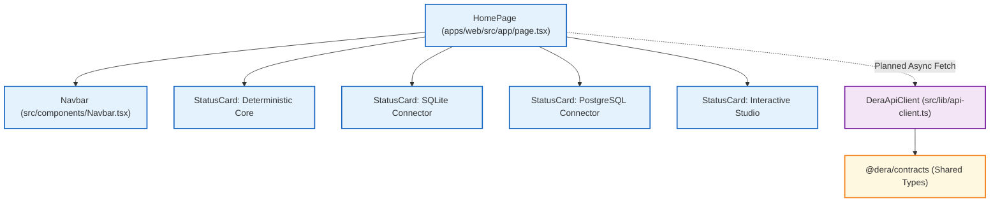

# DERA Frontend Application Architecture

> **Workspace:** `apps/web`  
> **Package Name:** `@dera/web`  
> **Framework:** Next.js 15 / React 19 / TypeScript 5  
> **Status:** Operational Scaffold (Status Dashboard Active)  
> **Maintainer:** Krishanth  
> **Last Verified:** 2026-10-26 (Commit `e550fdd`)  

---

## 1. Overview & Current Implementation Status

The **DERA Web Application** (`apps/web`) is the frontend studio interface for the DERA platform. It is designed to provide database engineers with an intuitive web interface for reviewing inspected schemas, exploring topological dependency ordering, auditing diagnostic anti-pattern warnings, and viewing entity-relationship diagrams.

### Current Implementation Reality: Scaffold Active
In the current phase (Phase 2.4 baseline), `apps/web` operates as a **clean, lightweight status dashboard scaffold**:
- It demonstrates connection to `@dera/contracts` shared TypeScript types.
- It displays live platform subsystem readiness cards ([`StatusCard.tsx`](../../apps/web/src/components/StatusCard.tsx)).
- It provides a type-safe HTTP client ([`DeraApiClient`](../../apps/web/src/lib/api-client.ts)) configured for loopback communication.
- It avoids heavy external styling frameworks, relying on a clean native system font stack and inline CSS properties.

**Important Notice:** The interactive visual ER diagram canvas (React Flow) is planned for **Phase 7**. Do not describe an interactive graphical schema editor or drag-and-drop studio as currently operational.

---

## 2. Directory Structure & Key Files

```
apps/web/
├── package.json                       # npm workspace manifest (@dera/web)
├── tsconfig.json                      # Next.js & TypeScript compiler settings
└── src/
    ├── index.ts                       # Public component and client re-exports
    ├── jsx.d.ts                       # JSX ambient runtime typing
    ├── app/
    │   └── page.tsx                   # Next.js App Router home page (Foundation Status)
    ├── components/
    │   ├── Navbar.tsx                 # Header navigation bar with project tagline
    │   └── StatusCard.tsx             # Subsystem readiness status card
    ├── lib/
    │   └── api-client.ts              # Type-safe fetch client for DERA API
    └── types/
        └── index.ts                   # Web-specific interface definitions
```

---

## 3. Component Architecture & UI Hierarchy

The current web interface is structured around focused React functional components:



### 3.1 Component Responsibilities
- **`HomePage` (`src/app/page.tsx`):** Root view rendering platform headline, executive summary of deterministic principles, subsystem status grid, and engineering guarantee bullet points.
- **`Navbar` (`src/components/Navbar.tsx`):** Top navigation displaying the DERA brand mark and official tagline: *"Understand Every Schema. Engineer Every Change."*
- **`StatusCard` (`src/components/StatusCard.tsx`):** Reusable UI card rendering subsystem title, status badge (`Foundation Active`, `Prototype Active`, `In Development`, `Scaffolding Active`), description, and readiness indicator dot.
- **`DeraApiClient` (`src/lib/api-client.ts`):** Fetch-based API client with methods `getHealth()` and `getMeta()`. Uses safe ambient `process.env.NEXT_PUBLIC_DERA_API_URL` fallback to `http://localhost:8000`.

---

## 4. Security Boundaries in Frontend Code

1. **Zero Database Credentials in Browser:** Database connection passwords, secret connection strings, and database network tokens must never be supplied to or stored within browser state or `apps/web` components.
2. **Read-Only API Consumption:** The web client only consumes read-only GET endpoints.
3. **No Inference or AI Calls:** The frontend contains zero references or SDK calls to OpenAI, Gemini, Claude, or any third-party AI service.

---

## 5. Development & Build Commands

```bash
# Typecheck TypeScript files across all workspaces
npx -p typescript tsc --noEmit

# Run Next.js web application in development mode (from root)
npm run --workspace=@dera/web dev

# Build production bundle
npm run --workspace=@dera/web build
```

---

## 6. Related Documentation

- [Frontend Documentation Hub](README.md)
- [Backend Application Architecture](../backend/APPLICATION_ARCHITECTURE.md)
- [API Contracts Reference](../backend/API_CONTRACTS.md)
- [Shared Schema Contracts](../contracts/SCHEMA_CONTRACTS.md)
- [System Architecture Overview](../architecture/SYSTEM_OVERVIEW.md)
