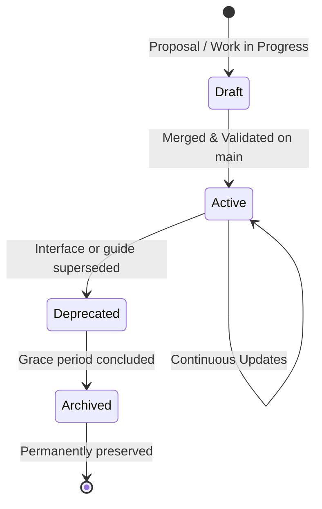

# Documentation Lifecycle Policy

**Project:** DERA — Database Engineering & Reverse Analysis  
**Repository:** [https://github.com/krishanth7/dera](https://github.com/krishanth7/dera)  
**Lead Maintainer:** [Krishanth](https://github.com/krishanth7)  
**License:** [MIT License](../../LICENSE)  

---

## 1. Overview & Purpose

Technical documentation in an evolving open-source engineering project naturally changes as architectures mature, new database connectors are introduced, and older interfaces are refactored. Without explicit lifecycle management, outdated documents accumulate, misleading users and obscuring current architectural standards.

This policy defines the four standardized lifecycle states for all documentation in DERA and specifies procedures for transitions, redirections, archiving, and historical preservation.

---

## 2. Documentation Lifecycle States



### 2.1 State Definitions

| Lifecycle State | Description | Quality & Verification Standards | Permitted Actions |
|---|---|---|---|
| **Draft** | Proposed documentation or work-in-progress architecture specifications located on feature branches or marked with a draft banner. | Must pass Markdown linting and link validation before merging. | Editable; subject to extensive revision or rejection during review. |
| **Active** | Authoritative, production-grade documentation reflecting the current repository behavior on `main`. | 100% verified against code, passing CI checks, synchronized with the 10-language suite where applicable. | Continuously maintained and updated with feature and API changes. |
| **Deprecated** | Documentation describing legacy architectures, deprecated CLI flags, or superseded connector protocols. | Marked with a prominent deprecation notice directing readers to the active replacement. | Retained for a defined deprecation grace period (minimum 1 minor release cycle). |
| **Archived** | Historical documentation preserved for project accountability, architectural lineage, and audit compliance (e.g., completed phase audits, historical decision logs). | Immutable; clearly marked as historical context; not updated for newer features. | Read-only; never deleted or modified except to fix broken external historical citations. |

---

## 3. Deprecation and Warning Banners

When a document enters the **Deprecated** state, a GitHub alert banner must be added at the very top of the document immediately following the title:

```markdown
> [!WARNING]
> **Deprecated Documentation**  
> This guide describes an older architecture or deprecated workflow.  
> Please consult the active guide at [docs/path/to/NEW_GUIDE.md](file:///docs/path/to/NEW_GUIDE.md).
```

When a document enters the **Archived** state, an informational alert banner must be placed at the top:

```markdown
> [!NOTE]
> **Archived Historical Document**  
> This document is an immutable historical record preserved for audit and architectural lineage.  
> It reflects project state at the time of authoring and is not maintained for ongoing releases.
```

---

## 4. Preservation of Architectural Decisions and Audit Records

### 4.1 Architectural Decision Records (ADRs)
- Architectural Decision Records in `docs/architecture/` represent immutable points in time when key engineering decisions were deliberated and approved.
- When an architecture decision is superseded:
  - Do **not** overwrite or delete the original ADR.
  - Update its status header from `Accepted` to `Superseded by ADR-XXXX`.
  - Add a link pointing to the superseding ADR.

### 4.2 Audit Records (`docs/audit/`)
- Audit reports (e.g., Phase 1.1–1.6 audits, Phase 2.1–2.6 audits) serve as verifiable evidence of repository governance and quality milestones.
- **Strict Invariant:** Audit files in `docs/audit/` are permanent historical artifacts. They must never be deleted, truncated, or retroactively modified to alter historical findings.

---

## 5. Deletion & Cleanup Criteria

Documentation should only be permanently deleted from the repository if:
1. It is an unmerged draft or scratch file created during development experiments.
2. It is an exact duplicate of another authoritative document.
3. It has completed the full deprecation cycle, has been superseded by an active guide, and its historical context is fully preserved in Git history or an overarching changelog.

In all cases, deletion requires core maintainer approval (`@krishanth7`).
