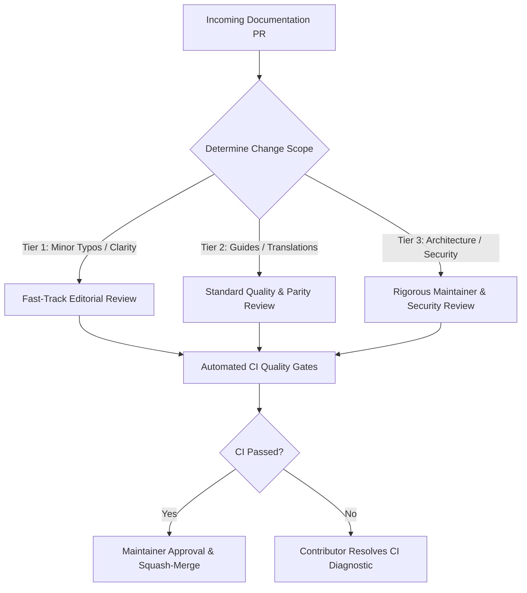

# DERA Documentation Review Policy

> **Project:** DERA — Database Engineering & Reverse Analysis  
> **Tagline:** Understand Every Schema. Engineer Every Change.  
> **Maintainer:** Krishanth (`krishanth7`)  
> **Related Policy:** [`docs/development/CODE_REVIEW_POLICY.md`](../development/CODE_REVIEW_POLICY.md)  

---

## 1. Purpose & Scope

This policy governs the review and verification standards for documentation pull requests in DERA. Our goal is to balance **strict technical accuracy and security** with **low friction for community contributors**.

Review requirements are **proportional to the scope and impact** of the proposed change. A simple typo correction should not face the same review overhead as an architectural specification rewrite.

---

## 2. Review Tiers & Proportional Requirements

### Tier 1: Minor Fixes & Typography
- **Scope:** Typo corrections, grammar clarifications, fixing broken hyperlinks, formatting adjustments.
- **Reviewer:** Any maintainer or triage member.
- **Verification:** Automated documentation validation (`npm run docs:check`) must pass.
- **Turnaround:** Targeted within **1 to 2 business days**.

### Tier 2: Guides, Connectors & Translations
- **Scope:** Adding new tutorials, modifying CLI command documentation, updating README translations, or documenting a database connector.
- **Reviewer:** Domain Editorial Lead or Lead Maintainer.
- **Verification:**
  - Automated CI checks pass (Markdown lint, link validation, i18n parity).
  - Code examples and commands verified by running them locally.
  - Truth-in-documentation check: features must not be exaggerated as production-ready if still planned or in development.
- **Turnaround:** Targeted within **3 to 4 business days**.

### Tier 3: Architecture, Security & Governance
- **Scope:** Changes to `docs/architecture/`, `docs/security/`, `SECURITY.md`, governance policies, or breaking change migration guides.
- **Reviewer:** Primary Project Maintainer (`@krishanth7`) and DevSecOps Lead.
- **Verification:**
  - Full baseline CI suite passed (`dev.py all`).
  - Strict non-AI invariant verification.
  - Threat modeling and least-privilege credential review.
  - Architectural consistency review against established ADRs.
- **Turnaround:** Targeted within **3 to 5 business days**.

---

## 3. When Documentation Updates Are Required

A pull request modifying codebase behavior **must** include corresponding documentation updates in the same PR when it:
1. **Adds or Modifies REST API Endpoints:** Update `docs/backend/APPLICATION_ARCHITECTURE.md` and TypeScript contract schemas in `packages/contracts/`.
2. **Introduces or Modifies a Database Connector:** Update compatibility status in `README.md`, `docs/connectors/CONNECTOR_ARCHITECTURE.md`, and dialect-specific setup instructions.
3. **Changes CLI Commands or Flags:** Update `docs/development/COMMANDS.md` and root `CONTRIBUTING.md`.
4. **Alters Security Protocols or Permissions:** Update `docs/security/DATABASE_SECURITY.md` or `SECURITY.md`.
5. **Deprecates or Breaks an Existing API:** Provide a migration path and document breaking changes in `CHANGELOG.md`.

---

## 4. Translation Synchronization Policy

- **Minor English Documentation Fixes:** Do not require immediate translation across all nine international READMEs. Translating every minor wording tweak creates unnecessary friction.
- **Significant Structural or Capability Changes:** Major changes to `README.md` (e.g. updating the capability status matrix or adding a new database engine) trigger a translation synchronization task tracked in `docs/i18n/`.
- **Navigation Changes:** If a document is added to the 10-language managed navigation targets, `python scripts/docs/generate_language_navigation.py --write` must be executed to keep markers synchronized across all files.

---

## 5. Review Checklist for Maintainers

When reviewing documentation pull requests, maintainers verify:
- [ ] **Truthfulness:** Does the documentation reflect actual verified code behavior?
- [ ] **CI Passing:** Did `Documentation Quality Gates` pass cleanly in GitHub Actions?
- [ ] **Non-AI Invariant:** Does the document preserve DERA's deterministic non-AI identity?
- [ ] **Link Integrity:** Are all relative links and heading anchors verified?
- [ ] **Security:** Are all connection strings, credentials, and passwords safe placeholders?
- [ ] **Accessibility:** Do Mermaid diagrams include descriptive text breakdowns?
