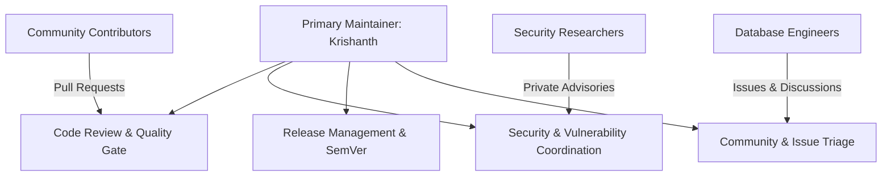

# Maintainer Governance & Repository Stewardship

**Project:** DERA — Database Engineering & Reverse Analysis  
**Repository:** [https://github.com/krishanth7/dera](https://github.com/krishanth7/dera)  
**Primary Maintainer:** [Krishanth](https://github.com/krishanth7) (`@krishanth7`)  
**Security Contact:** `krishanth.b.2008@gmail.com`  
**License:** [MIT License](../../LICENSE)  
**Last Updated:** October 2026

---

## 1. Project Stewardship Model

DERA currently operates under a **maintainer-led open-source governance model** appropriate for an early-stage database engineering platform. 

The primary maintainer provides architectural coherence, software supply chain security, and quality control while actively welcoming community contributions.

As the project matures through subsequent phases and the contributor base expands, DERA plans to evolve toward a formal Steering Committee and Request for Comments (RFC) decision model.

---

## 2. Active Maintainers

| Name / GitHub Handle | Role | Focus Areas | Contact |
|---|---|---|---|
| **Krishanth** ([@krishanth7](https://github.com/krishanth7)) | Project Founder & Lead Maintainer | Architecture, Core Engine, Security, Connectors, CI/CD | `krishanth.b.2008@gmail.com` |

*Note: Code ownership across all repository paths is designated in [`.github/CODEOWNERS`](../../.github/CODEOWNERS).*

---

## 3. Maintainer Responsibilities

Maintainers commit to the following duties:

1. **Architectural Direction:** Ensure all components adhere to the project's foundational invariants:
   - Strictly deterministic, rule-based execution.
   - Zero AI inference or LLM runtime dependencies.
   - Read-only, least-privilege database safety.
   - Zero customer row-data extraction.
2. **Pull Request Qualification:** Review, provide actionable feedback, and qualify community pull requests in accordance with the [Code Review Policy](../development/CODE_REVIEW_POLICY.md).
3. **Security Vulnerability Management:** Triage, investigate, and coordinate patches for privately disclosed security vulnerabilities per [SECURITY.md](../../SECURITY.md) and the [Vulnerability Response Process](../security/VULNERABILITY_RESPONSE.md).
4. **Issue & Community Triage:** Review incoming issues, clarify reproduction steps, tag milestones, and maintain a constructive discussion atmosphere per the [Code of Conduct](../../CODE_OF_CONDUCT.md).
5. **Release Integrity:** Authorize, sign, and publish versioned releases under Semantic Versioning (SemVer 2.0.0).

---

## 4. Code Review & Approval Standards

### Review SLA & Expectations
- **Target Response Time:** Maintainers endeavor to perform initial review of submitted pull requests within **3 to 5 business days**.
- **Objective Standards:** Code reviews evaluate technical correctness, test coverage, deterministic execution, security posture, and documentation parity.
- **Tone:** Reviews must remain polite, specific, constructive, and respectful, adhering to the [Code of Conduct](../../CODE_OF_CONDUCT.md).

### Merge Policy
1. **Mandatory CI Gate:** 100% of required GitHub Actions workflows must pass green before merge.
2. **Reviewer Approval:** At least one code owner approval from `@krishanth7` is required.
3. **Squash-Merge:** Commits on `main` must follow Conventional Commits 1.0.0.
4. **No Direct Pushes:** All modifications to `main` must arrive via qualified pull requests.

---

## 5. Security Escalation & Disclosure

Security concerns take precedence over feature development. When a vulnerability is reported:
1. The maintainer acknowledges the report within **3 business days**.
2. Investigation and reproduction take place in an isolated test environment.
3. Fix development occurs on a private security repository or private fork.
4. Coordinated disclosure is scheduled via GitHub Security Advisories before public release.
5. If the maintainer is unavailable, security alerts escalate directly to the primary email `krishanth.b.2008@gmail.com`.

---

## 6. Release Authority

Only active maintainers have authorization to:
- Tag release commits (`vX.Y.Z`).
- Publish packages to registries (PyPI, npm).
- Publish GitHub Releases and release assets.
- Approve breaking changes (denoted with `!` in Conventional Commits).

---

## 7. Decision-Making & Conflict Resolution

- **Consensus Preferred:** Maintainers seek consensus among contributors and interested parties through open technical discussions on GitHub Issues and Discussions.
- **Dispute Resolution:** In the event of an unresolvable technical disagreement or conflicting design proposals, the Lead Maintainer ([@krishanth7](https://github.com/krishanth7)) makes the final engineering decision, grounding the outcome in DERA's core principles: safety, determinism, performance, and simplicity.
- **Conduct Violations:** Incidents of harassment or unacceptable conduct are handled confidentially by maintainers in accordance with the [Code of Conduct](../../CODE_OF_CONDUCT.md) enforcement guidelines.

---

## 8. Maintainer Inactivity & Succession

To prevent repository stagnation and ensure long-term sustainability:
- If a maintainer becomes unresponsive for more than **60 consecutive days** without prior notice:
  - Emergency security or operational issues may be addressed by designated backup maintainers or repository administrators.
  - Active core contributors who have demonstrated consistent contributions, code ownership, and adherence to security policies may be nominated for maintainer status.
- Additions to maintainer status require demonstration of:
  - Deep technical familiarity with DERA's deterministic architecture.
  - Consistent adherence to Conventional Commits and CI standards.
  - Exemplary conduct and community mentorship.
