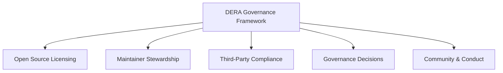

# DERA Governance Framework

**Project:** DERA — Database Engineering & Reverse Analysis  
**Repository:** [https://github.com/krishanth7/dera](https://github.com/krishanth7/dera)  
**Lead Maintainer:** [Krishanth](https://github.com/krishanth7)  
**License:** [MIT License](../../LICENSE)  

---

## 1. Overview

This directory contains the foundational governance documentation, legal policies, and repository stewardship guidelines for **DERA — Database Engineering & Reverse Analysis**.

DERA is an open-source, deterministic database engineering platform built on principles of technical precision, community collaboration, database safety, and full transparency.

---

## 2. Governance Documents

| Document | Purpose | Key Topics Covered |
|---|---|---|
| [**LICENSE**](../../LICENSE) | Legal terms of use and distribution | Permissive MIT License text, copyright attribution to Krishanth. |
| [**MAINTAINERS.md**](MAINTAINERS.md) | Repository leadership & stewardship | Lead maintainer identity, review SLAs, security escalation, release authority, succession. |
| [**THIRD_PARTY_LICENSES.md**](THIRD_PARTY_LICENSES.md) | Dependency compliance & inventory | SPDX identifiers, license compatibility with MIT, copyleft restrictions, supply chain security. |
| [**GOVERNANCE_DECISIONS.md**](GOVERNANCE_DECISIONS.md) | Architectural & governance decision records | Formal decision records (GADs) covering licensing, non-AI mandate, database safety, and Git workflow. |
| [**CODE_OF_CONDUCT.md**](../../CODE_OF_CONDUCT.md) | Community participation standards | Contributor Covenant v2.0, positive behavior standards, enforcement ladder, reporting contact. |
| [**CONTRIBUTING.md**](../../CONTRIBUTING.md) | Contribution lifecycle & guidelines | Step-by-step contribution guide, PR qualification, Conventional Commits, testing requirements. |
| [**SECURITY.md**](../../SECURITY.md) | Security disclosure & vulnerability policy | Supported versions, private reporting channel, responsible disclosure, response SLAs. |

---

## 3. Core Governance Principles

1. **Permissive Open Source:** DERA is licensed under the canonical MIT License. Inbound contributions are licensed under the same terms.
2. **Strictly Deterministic Runtime:** All database reverse engineering, graph modeling, and diagnostics execute deterministically with zero external AI inference dependencies.
3. **Database Safety First:** Connectors prioritize read-only access, least-privilege credentials, and static query mutation interception.
4. **Community Respect & Inclusivity:** All community interactions are held to the highest standards of professional conduct.
5. **Transparent Evolution:** Decisions impacting architecture, security, and repository governance are documented publicly.
