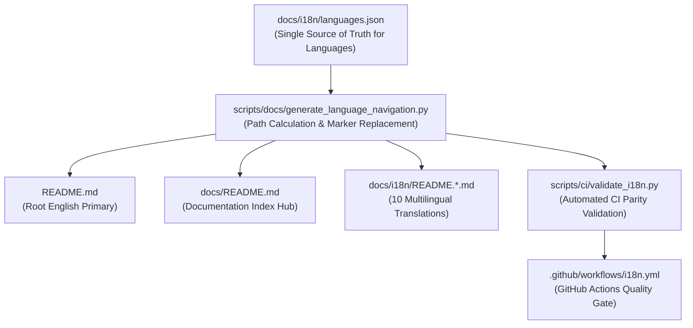

# DERA Documentation Navigation Maintenance Guide

> **Project:** DERA — Database Engineering & Reverse Analysis  
> **Tagline:** Understand Every Schema. Engineer Every Change.  
> **Maintainer:** Krishanth (`krishanth7`)  
> **Documentation Milestone:** Phase 2.3 — Ten-Language Navigation System  

---

## 1. Overview & Architecture

DERA maintains technical documentation across **exactly ten official languages**: English (`en`) as the authoritative documentation source, alongside nine international translations (Spanish `es`, French `fr`, German `de`, Portuguese `pt`, Italian `it`, Japanese `ja`, Korean `ko`, Simplified Chinese `zh-CN`, and Russian `ru`).

To eliminate duplicated configuration, prevent dead links, and ensure deterministic formatting across all ten languages, DERA utilizes a unified, manifest-driven navigation architecture:



---

## 2. Canonical Language Manifest (`docs/i18n/languages.json`)

The single authoritative source of truth for language identity, native naming, and repository file location is `docs/i18n/languages.json`:

```json
{
  "version": 1,
  "default_language": "en",
  "languages": [
    { "code": "en", "name": "English", "native_name": "English", "path": "README.md" },
    { "code": "es", "name": "Spanish", "native_name": "Español", "path": "docs/i18n/README.es.md" },
    { "code": "fr", "name": "French", "native_name": "Français", "path": "docs/i18n/README.fr.md" },
    { "code": "de", "name": "German", "native_name": "Deutsch", "path": "docs/i18n/README.de.md" },
    { "code": "pt", "name": "Portuguese", "native_name": "Português", "path": "docs/i18n/README.pt.md" },
    { "code": "it", "name": "Italian", "native_name": "Italiano", "path": "docs/i18n/README.it.md" },
    { "code": "ja", "name": "Japanese", "native_name": "日本語", "path": "docs/i18n/README.ja.md" },
    { "code": "ko", "name": "Korean", "native_name": "한국어", "path": "docs/i18n/README.ko.md" },
    { "code": "zh-CN", "name": "Simplified Chinese", "native_name": "简体中文", "path": "docs/i18n/README.zh-CN.md" },
    { "code": "ru", "name": "Russian", "native_name": "Русский", "path": "docs/i18n/README.ru.md" }
  ]
}
```

### Manifest Rules
1. **Language Count:** Exactly 10 entries.
2. **Exclusions:** Arabic (`ar`) and all Indian languages (`hi`, `te`, `ta`, `kn`, etc.) are explicitly excluded.
3. **Ordering:** Strict canonical order (English, Spanish, French, German, Portuguese, Italian, Japanese, Korean, Simplified Chinese, Russian).
4. **Code Standards:** Exact BCP 47 codes (`zh-CN` for Simplified Chinese, `ja` for Japanese).

---

## 3. Managed Navigation Markers

Navigation blocks are rendered exclusively between HTML comment markers in targeted Markdown documents:

```markdown
<!-- DERA:I18N_NAV:START -->
[English](../../README.md) | [Español](README.es.md) | **Italiano** | [日本語](README.ja.md)
<!-- DERA:I18N_NAV:END -->
```

### Marker Constraints
- Every target document must contain **exactly one** `<!-- DERA:I18N_NAV:START -->` and one `<!-- DERA:I18N_NAV:END -->`.
- The generator replaces **only** the region between the markers; all surrounding headers, content, and sections remain untouched.
- Duplicate or inverted markers are rejected by both the generator and CI validator.

---

## 4. Relative Link Calculation & Active Language Indication

### Relative Path Rules
The generator dynamically computes relative paths between each documentation file's location and target files, normalizing all separators to forward slashes (`/`):

1. **Root English README (`README.md`):**
   - Active language: `**English**`
   - Other languages: `[Español]` resolves to `docs/i18n/README.es.md`, `[Italiano]` resolves to `docs/i18n/README.it.md`, etc.
2. **Translated READMEs (`docs/i18n/README.<lang>.md`):**
   - English link: `[English]` resolves to `../../README.md`
   - Sibling translations: `[Español]` resolves to `README.es.md`, `[Français]` resolves to `README.fr.md`, etc.
   - Active language: Rendered in bold without a hyperlink (e.g., `**Italiano**`).
3. **Documentation Index (`docs/README.md`):**
   - Index hub is language-neutral; all 10 languages link to their respective README files:
     `[English]` resolves to `../README.md`, `[Español]` resolves to `i18n/README.es.md`, `[Italiano]` resolves to `i18n/README.it.md`, etc.

---

## 5. CLI Usage & Verification

### Non-Mutating Check Mode
Used in CI workflows and pre-commit checks to verify that documentation navigation is in sync:

```bash
python scripts/docs/generate_language_navigation.py --check
```

- Exit code `0`: All 12 files have valid, synchronized navigation.
- Exit code `1`: Out-of-sync files, missing markers, or malformed paths detected.

### Idempotent Write Mode
Used by maintainers to regenerate navigation across all target files:

```bash
python scripts/docs/generate_language_navigation.py --write
```

---

## 6. Translation Status vs. Navigation Availability

In accordance with DERA's documentation lifecycle policy:
- **Navigation Availability:** All 10 official languages remain listed in the navigation bar as long as their respective README files exist.
- **Translation Freshness:** If an international translation is pending updates following changes to the English source of truth, it remains accessible in the navigation bar to provide access for international developers.
- **Stale Translation Flagging:** Parity checks (`scripts/ci/validate_i18n.py`) report synchronization deltas without disabling the navigation system.

---

## 7. Troubleshooting

| Issue | Cause | Remediation |
|---|---|---|
| `Missing navigation markers` | File lacks `<!-- DERA:I18N_NAV:START -->` or `<!-- DERA:I18N_NAV:END -->` | Add the marker pair around the navigation region. |
| `Duplicate navigation markers` | More than one marker pair exists in the document | Remove redundant markers; ensure only one pair is present. |
| `Navigation content out of sync` | File was edited manually without running the generator | Run `python scripts/docs/generate_language_navigation.py --write`. |
| `Path traversal detected` | Manifest path contains `..` outside repository | Ensure paths are relative to repository root and stay within bounds. |
