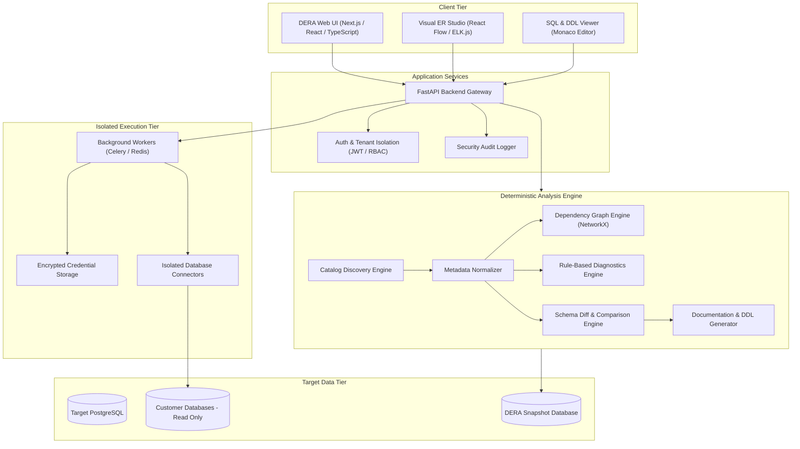
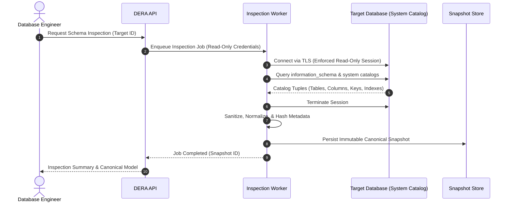
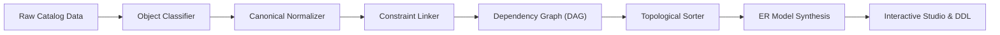
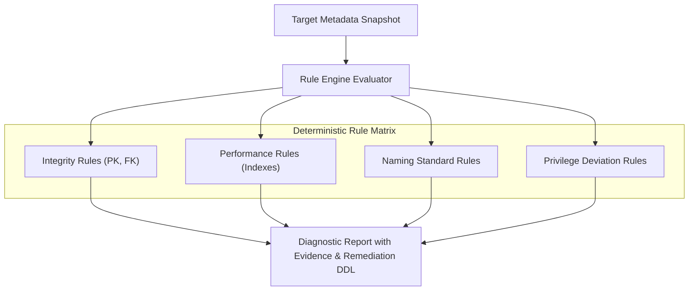
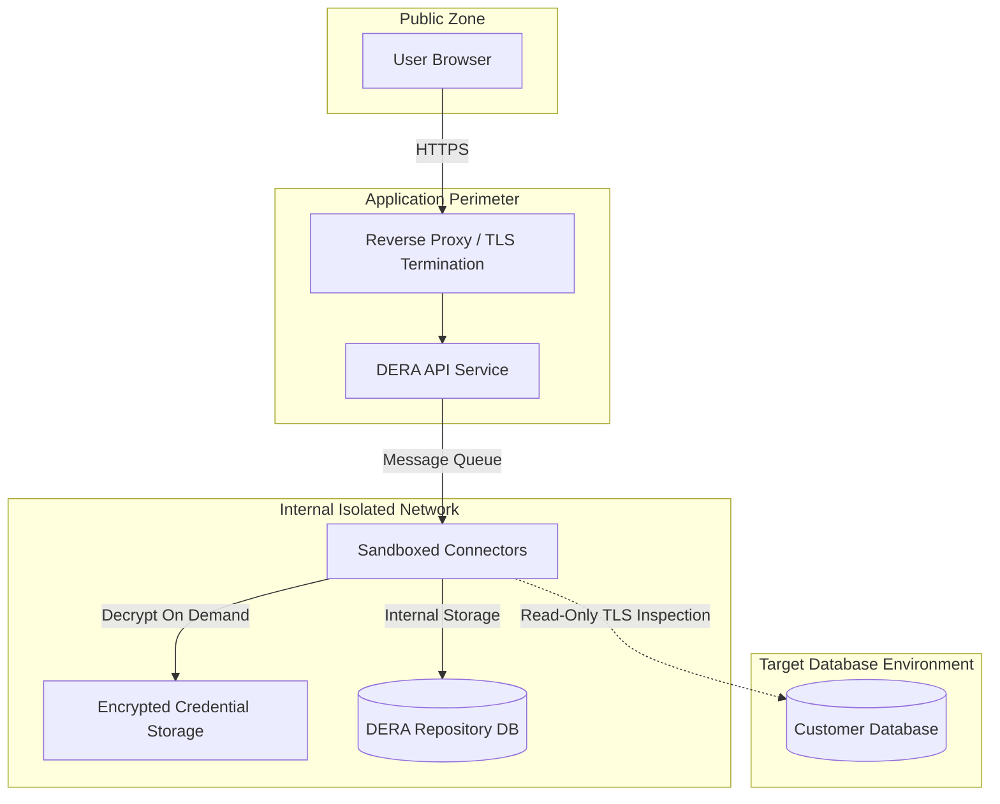
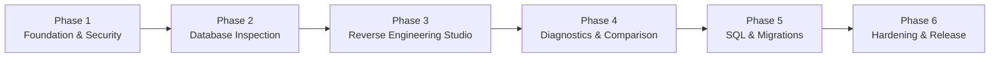

<div dir="rtl">

**قراءة هذه الوثائق باللغات الأخرى:** [English](../../README.md) | [Español](README.es.md) | [Français](README.fr.md) | [Deutsch](README.de.md) | [Português](README.pt.md) | [日本語](README.ja.md) | [한국어](README.ko.md) | [简体中文](README.zh-CN.md) | [العربية](README.ar.md) | [Русский](README.ru.md)

</div>

---

<div align="center">

# DERA

### Database Engineering & Reverse Analysis

**افهم كل مخطط بيانات. هندس كل تغيير بدقة.**

منصة مفتوحة المصدر وحتمية للهندسة العكسية لقواعد البيانات، صُممت للمطورين، مهندسي قواعد البيانات، المعماريين وفرق الهندسة البرمجية.

استكشف هياكل قواعد البيانات، واعرض العلاقات بين الكيانات، وحلل المخططات، وحدد المخاطر الهيكلية، وأنشئ وثائق هندسية موثوقة — بنهج حتمي بالكامل، دون استخدام نماذج الذكاء الاصطناعي أو واجهات الاستدلال الخارجية.

<br/>

[](https://github.com/krishanth7/dera/stargazers)
[](https://github.com/krishanth7/dera/forks)
[](https://github.com/krishanth7/dera/issues)
[](https://github.com/krishanth7/dera/blob/main/LICENSE)
[](https://github.com/krishanth7/dera/releases)
[](https://github.com/krishanth7/dera/actions/workflows/codeql.yml)
[](https://github.com/krishanth7/dera/graphs/contributors)
[](https://github.com/sponsors/krishanth7)

<br/>

[نظرة عامة](#-نظرة-عامة) ·
[المميزات](#-المميزات) ·
[المعمارية](#-المعمارية) ·
[مسارات العمل المرئية](#-مسارات-العمل-المرئية) ·
[الأمان](#-مبادئ-الأمان) ·
[التقنيات المستخدمة](#-التقنيات-المستخدمة) ·
[خطة التطوير](#-خطة-التطوير) ·
[المساهمة](#-المساهمة) ·
[المجتمع](#-المجتمع)

</div>

---

## 🌍 دعم اللغات المتعددة

يوفر مشروع DERA وثائق شاملة بـ 10 لغات دولية. يمكنك استخدام الجدول أدناه أو شريط التنقل العلوي للوصول إلى الوثائق المترجمة:

| اللغة | الرمز | رابط الوثائق | الحالة |
|---|---|---|---|
| 🇬🇧 English | `en` | [English Primary (Root)](../../README.md) · [Synchronized Copy](README.en.md) | المرجع الأساسي |
| 🇪🇸 Español | `es` | [Documentación en Español](README.es.md) | ترجمة كاملة |
| 🇫🇷 Français | `fr` | [Documentation en Français](README.fr.md) | ترجمة كاملة |
| 🇩🇪 Deutsch | `de` | [Dokumentation auf Deutsch](README.de.md) | ترجمة كاملة |
| 🇵🇹 Português | `pt` | [Documentação em Português](README.pt.md) | ترجمة كاملة |
| 🇯🇵 日本語 | `ja` | [日本語ドキュメント](README.ja.md) | ترجمة كاملة |
| 🇰🇷 한국어 | `ko` | [한국어 문서](README.ko.md) | ترجمة كاملة |
| 🇨🇳 简体中文 | `zh-CN` | [简体中文文档](README.zh-CN.md) | ترجمة كاملة |
| 🇸🇦 العربية | `ar` | [الوثائق باللغة العربية](README.ar.md) | ترجمة كاملة |
| 🇷🇺 Русский | `ru` | [Документация на русском](README.ru.md) | ترجمة كاملة |

---

## 📖 نظرة عامة

تشكل قواعد البيانات العلائقية الحديثة الركيزة الأساسية للبنى التحتية البرمجية، ولكن فهم مخطط بيانات معقد ودائم التطور قد يكون مهمة شاقة. غالبًا ما تحتوي أنظمة المؤسسات على مئات الجداول، وآلاف الأعمدة، وعلاقات معقدة من المفاتيح الأجنبية، والفهارس، والقيود، والعروض، والتبعيات المتبادلة.

يتطلب فحص هذه الهياكل وتدقيقها يدويًا وقتًا وجهدًا هندسيًا كبيرًا، وهو عرضة للأخطاء البشرية.

**تم تصميم DERA لحل هذا التحدي بصورة جذرية.**

توفر منصة DERA مساحة عمل موحدة وآمنة لاستكشاف معمارية قواعد البيانات، وإعادة بناء علاقات الكيانات، وتقييم المخاطر الهيكلية، وتوليد وثائق هندسية باستخدام خوارزميات حتمية دقيقة.

### مهمتنا

جعل الهندسة العكسية لقواعد البيانات متاحة، وشفافة، وقابلة للتكرار، وموثوقة لكل مطور برمجيات، ومدير قواعد بيانات، ومعماري نظم.

### فلسفتنا الهندسية

- **حتمية بالتصميم (Deterministic by Design)** — تحليلات قابلة للتكرار بنسبة 100% بالاعتماد على خوارزميات الرسوم البيانية الرياضية والقواعد الثابتة.
- **خالية تمامًا من الذكاء الاصطناعي التوليدي** — لا استخدام لنماذج اللغة الكبيرة (LLMs)، ولا نماذج تعلم الآلة، ولا واجهات استدلال خارجية.
- **الخصوصية أولاً** — تحليل مقتصر حصريًا على البيانات الوصفية (Metadata). لا يتم استخراج أو تخزين بيانات صفوف العملاء نهائيًا.
- **مفتوحة المصدر** — هندسة برمجية شفافة تحت ترخيص MIT المرن.
- **مصممة للمطورين** — أدوات وسير عمل صُممت خصيصًا لتلائم احتياجات مهندسي البرمجيات ومديري قواعد البيانات.
- **الأمان كأساس** — فرض جلسات قراءة فقط، وتشفير كامل لبيانات الاعتماد، وعمليات تنفيذ معزولة.
- **الدقة الهندسية** — استنتاجات تشخيصية قائمة على أدلة ملموسة من كتالوج النظام بدلاً من افتراضات الذكاء الاصطناعي غير الدقيقة.

---

## ✨ المميزات

تستعرض الجداول التالية الإمكانات المخطط لها لمنصة DERA. يتوافق توفر هذه الميزات مع مراحل التطوير والإصدارات الرسمية:

| مجال الميزة | الحالة | الوصف |
|---|---|---|
| **استكشاف قواعد البيانات** | مخطط | استخراج مباشر للبيانات الوصفية للجداول، الأعمدة، القيود، والفهارس |
| **محرك الهندسة العكسية** | مخطط | نمذجة موحدة للمخططات، وتصنيف الكائنات، وحل شبكات التبعيات |
| **استوديو ER المرئي** | مخطط | مخططات تفاعلية لعلاقات الكيانات، وتخطيط تلقائي، وفلترة وتصدير |
| **التشخيص الحتمي** | مخطط | تقييم القواعد الثابتة لاكتشاف المفاتيح المفقودة، والفهارس المكررة، وعيوب التسمية |
| **لقطات ومقارنة المخططات** | مخطط | لقطات تاريخية للمخططات مع تحليل أثر التغييرات الهيكلية |
| **هندسة أداء SQL** | مخطط | فحص الاستعلامات، وتصور خطط التنفيذ، وتقديم توصيات تحسين الفهارس |
| **مُوَلِّد الوثائق** | مخطط | تصدير تلقائي للمستندات بصيغ Markdown، HTML، JSON، نصوص DDL، ومخططات SVG |
| **معمارية الأمان** | مخطط | التحكم في الوصول المستند إلى الأدوار، وضمان وضع القراءة فقط، وعمال معزولون |

### 🔍 استكشاف قواعد البيانات

فحص محركات قواعد البيانات المدعومة واستخراج بيانات الكتالوج الهيكلية:

- قواعد البيانات، والمخططات (Schemas)، والملحقات
- الجداول، والأقسام، والعروض (Views)
- الأعمدة، وأنواع البيانات، وقابلية القيم الفارغة (Nullability)، والتعبيرات الافتراضية
- المفاتيح الأساسية (PK)، والمفاتيح الأجنبية (FK)، وإجراءات المرجعية (`CASCADE`, `RESTRICT`)
- قيود الفرادة، وقيود الفحص (CHECK)، وقيود الاستبعاد
- الفهارس (B-tree, Hash, GIN, GiST)، والفهارس الفريدة، وشروط الفهارس الجزئية
- المتتاليات (Sequences)، وأعمدة الهوية، والمشغلات (Triggers)

### 🧬 محرك الهندسة العكسية

إعادة بناء نماذج المخططات بالاعتماد على استعلامات الكتالوج الأصلية والخوارزميات الحتمية:

- تمثيل موحد للمخطط ومستقل عن محرك قاعدة البيانات المحدد
- تسوية وتوحيد البيانات الوصفية الهيكلية
- بناء رسوم بيانية موجهة غير دورية (DAG) للتبعيات
- تخطيط دقيق للعلاقات المرجعية الفردية والمركبة
- إنشاء لقطات غير قابلة للتغيير ومحمية بتجزئة مشفرة
- إعادة بناء دقيقة لنصوص SQL DDL

### 🕸️ استوديو ER المرئي

استكشاف طوبولوجيا المخطط عبر واجهة تفاعلية حديثة لعلاقات الكيانات:

- عُقد جداول تفاعلية تعرض الأعمدة، والأنواع، والأيقونات المميزة للقيود
- موصلات مرئية لعلاقات المفاتيح الأجنبية مع تحديد التعددية بدقة
- خوارزميات تخطيط تلقائي حتمية (تخطيطات هرمية وموجهة بالقوة)
- تجميع حسب المخططات، وتصنيف بالوسوم، وفصل المخططات الفرعية حسب النطاق
- بحث تفاعلي، وتصفية حسب الأنواع، وتتبع مسار التبعيات
- تصدير عالي الدقة بصيغ المتجهات SVG والصور النقطية PNG

### 🛡️ التشخيص الحتمي لقواعد البيانات

تحليل البيانات الوصفية للمخطط بالرجوع إلى مصفوفة قواعد هندسية قابلة للتخصيص:

| قاعدة التشخيص | الفئة | الوصف |
|---|---|---|
| **غياب المفتاح الأساسي** | التكاملية | تحديد الجداول التي تفتقر إلى قيد مفتاح أساسي صريح |
| **فهرس مكرر محتمل** | الأداء | اكتشاف بادئات الأعمدة المتداخلة أو الفهارس المكررة |
| **مفتاح أجنبي دون فهرس** | الأداء | تمييز أعمدة المفاتيح الأجنبية غير المغطاة بفهارس داعمة |
| **الأنماط المضادة متعددة الأشكال** | التكاملية | رصد العلاقات الضمنية التي تفتقر إلى قيود تكامل مرجعي صريحة |
| **شذوذ القيمة الفارغة والافتراضية** | الاتساق | التنبيه إلى الأعمدة غير القابلة للقيم الفارغة والتي تفتقر إلى قيم افتراضية منطقية |
| **تدقيق معايير التسمية** | التقييس | اكتشاف عدم اتساق حالة الأحرف والحياد عن المعايير المعمارية |
| **انحرافات الصلاحيات** | الأمان | تسليط الضوء على منح الصلاحيات المفرطة على كائنات الكتالوج |

*جميع نتائج التشخيص عبارة عن توصيات مبنية على أدلة مثبتة، ومشفوعة بتبريرات هندسية ونصوص DDL لمعالجة المشكلة.*

### 🔄 مقارنة المخططات ومحرك الفروقات (Diff)

مقارنة لقطات قواعد البيانات بين بيئات العمل المختلفة (التطوير، الاختبار، الإنتاج) أو عبر إصدارات الترحيل:

- الجداول والأعمدة المضافة، والمعدلة، والمحذوفة
- تعديلات أنواع البيانات، والأطوال، وخاصية قبول القيم الفارغة
- إنشاء الفهارس، وحذفها، وتعديل تعريفاتها
- تعديلات القيود وتغييرات التكامل المرجعي
- تصنيف التغييرات الكاسرة (تغييرات آمنة مقابل تغييرات قد تكون مدمرة)
- إنشاء معاينة لنصوص الترحيل مرتبة طوبولوجيًا وفقًا للتبعيات

---

## 🧠 لا ذكاء اصطناعي. فقط هندسة حقيقية.

صُممت DERA عن قصد وبشكل صارم دون أي نماذج ذكاء اصطناعي أو تعلم آلي.

<div dir="ltr">

```text
┌───────────────────────────────────────────────────────────┐
│               STRICT NON-AI ARCHITECTURE                  │
│                                                           │
│   ❌  No OpenAI, Anthropic Claude, or Google Gemini       │
│   ❌  No Groq, DeepSeek, or Hosted Model APIs            │
│   ❌  No Local LLMs (Ollama, vLLM, llama.cpp)            │
│   ❌  No Non-Deterministic Hallucinations                 │
│                                                           │
│   ✅  Native System Catalog Queries (information_schema)   │
│   ✅  Deterministic Graph Algorithms (NetworkX)           │
│   ✅  Abstract Syntax Tree SQL Parsers (SQLGlot)          │
│   ✅  Reproducible Static Rule Engines                    │
│   ✅  Mathematical Schema Diff Algorithms                 │
└───────────────────────────────────────────────────────────┘
```

</div>

**لماذا تعتمد DERA المنهج الحتمي الصارم:**
1. **قابلية التنبؤ التامة:** نفس لقطة المخطط ونفس القواعد ستنتج دائمًا نفس التشخيصات بنسبة 100%.
2. **إمكانية التدقيق الكاملة:** يرتبط كل تحذير وعلاقة في الرسم البياني بدليل مباشر وملموس من كتالوج النظام.
3. **سيادة البيانات:** لا تخرج مخططات وبيانات المؤسسات خارج شبكتك الداخلية إلى موفري خدمات الذكاء الاصطناعي.
4. **الأداء والتكلفة:** صفر تأخير استدلال، صفر تكلفة للرموز (Tokens)، ولا حدود لمعدل الطلبات، واستقلال تام عن السحابة الخارجية.

---

## 🏗️ المعمارية

تتبع DERA معمارية نمطية مصممة لتحقيق سهولة الصيانة، وقابلية التوسع، وتوفير وصول آمن ومحكم إلى قواعد البيانات.

<div dir="ltr">



</div>

---

## 🔬 مسارات العمل المرئية

تنفذ DERA مسارات معالجة حتمية وخاضعة للتدقيق الكامل لفحص البيانات الوصفية، وبناء العلاقات، والتحقق الأمني.

### 1. تسلسل فحص قاعدة البيانات

<div dir="ltr">



</div>

### 2. مسار الهندسة العكسية للمخططات

<div dir="ltr">



</div>

### 3. مسار معالجة البيانات والتشخيص

<div dir="ltr">



</div>

### 4. حدود الأمان والعزل الشبكي

<div dir="ltr">



</div>

### 5. دورة حياة التطوير المخططة

<div dir="ltr">



</div>

---

## 🔒 مبادئ الأمان

نظرًا لأن DERA تتصل بقواعد بيانات حيوية وحساسة، فإن الأمان يمثل الركن الأساسي في بنية النظام.

- **فرض وضع القراءة فقط:** تفرض جميع جلسات الاتصال معاملات القراءة فقط بشكل صارم (`SET SESSION CHARACTERISTICS AS TRANSACTION READ ONLY`).
- **عدم استخراج بيانات صفوف المستخدمين:** تستهدف عمليات الفحص حصريًا كتالوجات النظام (`information_schema`, `pg_catalog`). لا يتم الاستعلام عن أي سجلات بيانات فعلية أو تخزينها.
- **تشفير كامل لبيانات الاعتماد:** تُشفر بيانات الاعتماد أثناء الخمول باستخدام خوارزمية AES-256-GCM ولا تُكتب أبدًا في سجلات النظام أو تُضمن في مستودع الكود.
- **منع هجمات تزوير الطلبات من جانب الخادم (SSRF):** يتم التحقق بدقة من عناوين الخوادم لمنع فحص الشبكات الداخلية أو الوصول إلى خدمات بيانات وصفية سحابية.
- **حسابات قواعد بيانات بأقل الصلاحيات الممكنة:** توفير إرشادات مفصلة لتهيئة أدوار فحص للقراءة فقط دون صلاحيات إدارية.
- **سجلات تدقيق كاملة:** توليد سجلات تدقيق غير قابلة للتعديل لكل عملية فحص، أو تصدير، أو تغيير في الإعدادات.

*للاطلاع على إجراءات الإبلاغ عن الثغرات الأمنية والسياسات التفصيلية، يرجى مراجعة [SECURITY.md](../../SECURITY.md).*

---

## 🛠️ التقنيات المستخدمة

| الطبقة | المكون | التقنية المختارة | الغرض | الحالة |
|---|---|---|---|---|
| **الواجهة الأمامية** | إطار العمل | Next.js, React, TypeScript | تطبيق ويب تفاعلي عالي الاستجابة | مخطط |
| | التنسيق | Tailwind CSS | نظام تصميم حديث ومتناسق | مخطط |
| | مكتبة المكونات | shadcn/ui | مكونات واجهة مستخدم سهلة الوصول | مخطط |
| | التصور الرسومي | React Flow, ELK.js | رسم المخططات والتخطيط التلقائي | مخطط |
| | محرر الكود | Monaco Editor | تمييز بناء جملة SQL وعرض نصوص DDL | مخطط |
| **الواجهة الخلفية** | إطار عمل API | Python 3.12+, FastAPI | خدمات برمجية غير متزامنة عالية الأداء | مخطط |
| | فحص الكتالوج | SQLAlchemy, psycopg | استخراج البيانات الوصفية وإدارة تجمعات الاتصال | مخطط |
| | تحليل SQL | SQLGlot | توليد شجرة الإعراب المجردة (AST) بشكل مستقل عن المحرك | مخطط |
| | معالجة الرسوم | NetworkX | حل التبعيات والترتيب الطوبولوجي | مخطط |
| | إدارة المهام | Celery, Redis | عمال فحص معزولون وغير متزامنون | مخطط |
| **قواعد البيانات** | قاعدة بيانات DERA | PostgreSQL | تخزين اللقطات، وجلسات المستخدمين، وسجلات التدقيق | مخطط |
| | إدارة الترحيل | Alembic | إدارة إصدارات وتحديثات قاعدة بيانات DERA | مخطط |
| **العمليات والجودة** | الحاويات | Docker, Docker Compose | بيئة تطوير ونشر معيارية وقابلة للتكرار | مخطط |
| | التحليل الأمني | CodeQL, Dependabot | فحص أمني تلقائي وتدقيق الاعتماديات | مُطبق |
| | الاختبارات | Pytest, Playwright | اختبارات الوحدة واختبارات التكامل والواجهة | مخطط |

---

## 🗄️ توافق محركات قواعد البيانات

تم تصميم DERA بهندسة موصلات معيارية تدعم محركات قواعد البيانات الحديثة:

| محرك قاعدة البيانات | حالة الموصل | مصدر الكتالوج | الجدول الزمني المستهدف |
|---|---|---|---|
| **PostgreSQL** (v12 - v17) | قيد التطوير | `pg_catalog`, `information_schema` | المرحلة 2 (MVP) |
| **Supabase PostgreSQL** | قيد التطوير | موصل PostgreSQL الأصلي | المرحلة 2 (MVP) |
| **MySQL** (v8.0+) | مخطط | `information_schema`, `performance_schema` | المرحلة 5 |
| **SQLite** (v3.35+) | مخطط | `sqlite_master`, أوامر `PRAGMA` | المرحلة 5 |
| **MariaDB** (v10.5+) | مخطط | `information_schema` | المرحلة 5 |
| **Microsoft SQL Server** | مخطط | `sys.tables`, `INFORMATION_SCHEMA` | المرحلة 5 |
| **Oracle Database** | قيد المراجعة | عروض قاموس البيانات (`ALL_*`, `DBA_*`) | تقييم مستقبلي |

---

## 🚀 البدء السريع

مشروع DERA حاليًا في مرحلة التطوير التأسيسي والمعماري. سيتم نشر تعليمات التثبيت للبيئات الإنتاجية تباعًا مع إنجاز مراحل الإصدار.

### المتطلبات الأساسية (مخططة)

- Python 3.12 أو أحدث
- Node.js LTS (v20+)
- PostgreSQL 15+
- Docker و Docker Compose
- Git

### استنساخ المستودع

<div dir="ltr">

```bash
git clone https://github.com/krishanth7/dera.git
cd dera
```

</div>

### بيئة التطوير المحلية (مخططة)

<div dir="ltr">

```bash
# نسخ إعدادات البيئة
cp .env.example .env

# تشغيل بيئة التطوير عبر Docker Compose
docker compose -f infrastructure/docker/docker-compose.dev.yml up --build
```

</div>

> **ملاحظة:** يتم بناء الكود البرمجي للمنصة بشكل نشط. يرجى متابعة [خطة التطوير](#-خطة-التطوير) لمعرفة آخر المستجدات.

---

## 📁 هيكل المستودع

<div dir="ltr">

```text
dera/
├── .github/
│   ├── ISSUE_TEMPLATE/           # قوالب البلاغات والاقتراحات
│   ├── workflows/                # مسارات عمل CodeQL والمراجعة الأمنية
│   ├── PULL_REQUEST_TEMPLATE.md  # قالب طلبات السحب الموحد
│   ├── dependabot.yml            # إعدادات تحديثات Dependabot التلقائية
│   └── FUNDING.yml               # إعدادات دعم ورعاية المشروع
├── docs/
│   ├── README.md                 # دليل الوثائق الرئيسي الشامل
│   ├── i18n/                     # الوثائق متعددة اللغات المتزامنة
│   │   ├── README.en.md          # النسخة الإنجليزية المرجعية المتزامنة
│   │   ├── README.es.md          # الوثائق باللغة الإسبانية
│   │   ├── README.fr.md          # الوثائق باللغة الفرنسية
│   │   ├── README.de.md          # الوثائق باللغة الألمانية
│   │   ├── README.pt.md          # الوثائق باللغة البرتغالية
│   │   ├── README.ja.md          # الوثائق باللغة اليابانية
│   │   ├── README.ko.md          # الوثائق باللغة الكورية
│   │   ├── README.zh-CN.md       # الوثائق باللغة الصينية المبسطة
│   │   ├── README.ar.md          # الوثائق باللغة العربية (متوافقة مع RTL)
│   │   └── README.ru.md          # الوثائق باللغة الروسية
│   ├── architecture/             # المواصفات المعمارية
│   ├── development/              # أدلة الإعداد والمعايير الهندسية
│   ├── security/                 # نماذج التهديدات والممارسات الأمنية
│   └── contributing/             # أدلة وإرشادات المساهمين
├── CODE_OF_CONDUCT.md            # ميثاق السلوك للمساهمين
├── CONTRIBUTING.md               # إرشادات المساهمة التفصيلية
├── LICENSE                       # رخصة MIT
├── README.md                     # الصفحة الرئيسية للمستودع
├── SECURITY.md                   # السياسة الأمنية الشاملة
└── .gitignore                    # قواعد استبعاد الملفات في Git
```

</div>

---

## 🗺️ خطة التطوير

### المرحلة 1 — التأسيس والأمان
- [x] ترسيخ الهوية الرسمية للمشروع وترخيصه برخصة (MIT)
- [x] إعداد الفحص الأمني الثابت للتطبيقات عبر CodeQL
- [x] اعتماد ميثاق السلوك وسياسات الأمان المؤسسية
- [x] بناء معمارية الوثائق الدولية بـ 10 لغات
- [ ] إعداد هيكل المستودع متعدد الحزم (`apps/web`, `apps/api`)
- [ ] تكوين بيئة التطوير عبر Docker وتجهيز مسار التكامل المستمر الأساسي

### المرحلة 2 — محرك فحص قواعد البيانات
- [ ] تطوير موصل استخراج البيانات الوصفية الأصلي لـ PostgreSQL
- [ ] استخراج الجداول، الأعمدة، القيود، الفهارس، والعروض
- [ ] بناء النموذج المعياري الموحد لتسوية المخططات
- [ ] إنشاء مخزن لقطات المخطط المشفرة وغير القابلة للتغيير
- [ ] تطبيق ضمانات القراءة فقط وحدود انتهاء مهلة الاستعلامات

### المرحلة 3 — استوديو الهندسة العكسية
- [ ] بناء استوديو تفاعلي لمخططات ER باستخدام React Flow
- [ ] تطوير خوارزميات التخطيط الهرمي التلقائي
- [ ] إضافة التصفية حسب المخططات، والبحث المتقدم، والتجميع حسب النطاق
- [ ] إتاحة استعراض شجرة التبعيات (DAG) وتصورها بصريًا
- [ ] تصدير المخططات بدقة فائقة بصيغتي SVG و PNG

### المرحلة 4 — التشخيص ومقارنة المخططات
- [ ] تنفيذ محرك التشخيص الحتمي القائم على القواعد الثابتة
- [ ] بناء القواعد: المفاتيح المفقودة، الفهارس المكررة، المفاتيح غير المفهرسة
- [ ] تطوير خوارزمية مقارنة الفروقات بين لقطات المخططات (Snapshot Diff)
- [ ] توليد معاينات مرتبة لتغييرات وترحيلات نصوص DDL
- [ ] إتاحة تصدير تقارير التشخيص بصيغ Markdown و JSON و HTML

### المرحلة 5 — الهندسة المتقدمة والموصلات الإضافية
- [ ] إدراج تحليل AST لاستعلامات SQL ومقاييس التعقيد عبر SQLGlot
- [ ] بناء أداة مرئية لاستعراض خطط التنفيذ (`EXPLAIN ANALYZE`)
- [ ] تطوير موصلات قواعد بيانات MySQL و SQLite
- [ ] توليد أوامر DDL المرتبة تلقائيًا وفق التبعيات

### المرحلة 6 — الجاهزية والاعتمادية الإنتاجية
- [ ] إجراء تدقيق واختبارات اختراق أمنية شاملة
- [ ] تنفيذ اختبارات أداء قياسية للمخططات الضخمة (أكثر من 1,000 جدول)
- [ ] التحقق التام من عزل المستأجرين ونزاهة سجلات التدقيق
- [ ] نشر صور الحاويات الرسمية للإصدار v1.0.0 وأدلة النشر المؤسسي

---

## 🧪 استراتيجية الاختبار وضمان الجودة

تلتزم DERA بالصرامة الهندسية من خلال مسارات اختبار مؤتمتة وقابلة للتكرار:

- **اختبارات الوحدة:** فحص معالجات البيانات الوصفية، والرسوم البيانية، وقواعد التشخيص ببيانات اختبار تركيبية.
- **اختبارات التكامل:** التحقق من الموصلات بالاتصال بحاويات معزولة لقواعد بيانات PostgreSQL و MySQL و SQLite.
- **التحقق الحتمي:** التأكد من أن لقطات المخطط المتطابقة تولد دائمًا نفس بصمات التجزئة ونتائج التشخيص بدقة تامة.
- **الاختبارات الأمنية:** فحص مستمر عبر CodeQL، وتدقيق الثغرات في الاعتماديات، وتفقد تسرب المفاتيح السرية.
- **اختبارات شاملة (E2E):** اختبارات للمتصفح عبر Playwright للتأكد من تفاعلية المخططات وسرعة الاستجابة.

---

## 🤝 المساهمة

نرحب بمساهمات المهندسين، وخبراء قواعد البيانات، والكتّاب التقنيين، والباحثين الأمنيين من جميع أنحاء العالم.

يرجى مراجعة دليل [CONTRIBUTING.md](../../CONTRIBUTING.md) و [ميثاق السلوك](../../CODE_OF_CONDUCT.md) قبل تقديم طلبات السحب (PRs).

### خطوات المساهمة

1. قم بإنشاء تفرع (Fork) للمستودع على GitHub.
2. أنشئ فرعًا خاصًا بميزتك: `git checkout -b feat/your-feature-name`.
3. اتبع معايير رسائل الالتزام [Conventional Commits](../../CONTRIBUTING.md#commit-message-guidelines).
4. اكتب اختبارات الوحدة أو التكامل ذات الصلة.
5. تأكد من نجاح فحوصات CodeQL واختبارات سلامة الوثائق.
6. افتح طلب سحب (Pull Request) إلى الفرع `main` لمراجعته من قبل مسؤولي المشروع.

---

## 💬 المجتمع

- [GitHub Discussions](https://github.com/krishanth7/dera/discussions) — لطرح الأسئلة ومناقشة الأفكار في هندسة البيانات.
- [GitHub Issues](https://github.com/krishanth7/dera/issues) — للإبلاغ عن المشكلات البرمجية واقتراح الميزات الجديدة.
- [GitHub Pull Requests](https://github.com/krishanth7/dera/pulls) — لتقديم المساهمات البرمجية والتحسينات التوثيقية.
- [Releases](https://github.com/krishanth7/dera/releases) — لمتابعة سجل الإصدارات الرسمية للمشروع.

---

## ❤️ دعم المشروع

DERA هو مشروع هندسي مستقل مفتوح المصدر. يمكنك دعم استمرار تطويره من خلال:

- منح نجمة (Star) للمستودع على GitHub
- مشاركة المشروع مع زملائك في مجتمع الهندسة البرمجية
- المساهمة بتطوير موصلات جديدة، أو قواعد تشخيص، أو تحسين الوثائق
- [دعم المطور عبر GitHub Sponsors](https://github.com/sponsors/krishanth7)

---

## 📜 الترخيص

مشروع DERA مرخص بموجب **[رخصة MIT المرنة](../../LICENSE)**.

<div dir="ltr">

```text
Copyright (c) 2026 Krishanth
```

</div>

---

## 👨‍💻 المسؤول عن المشروع

**Krishanth**  
المؤسس والمسؤول الرئيسي عن المشروع

- GitHub: [@krishanth7](https://github.com/krishanth7)  
- المستودع: [github.com/krishanth7/dera](https://github.com/krishanth7/dera)  
- البريد الإلكتروني: `krishanth.b.2008@gmail.com`

*مشروع DERA هو مبادرة هندسية مستقلة مفتوحة المصدر يديرها Krishanth، وتُعتبر مختبرات OVIC Labs جزءًا معترفًا به من النظام البيئي الهندسي الأوسع للمطور.*

---

<div align="center">

### DERA — Database Engineering & Reverse Analysis

**افهم كل مخطط بيانات. هندس كل تغيير بدقة.**

*صُممت بدقة هندسية، وحتمية رياضية، وشفافية مفتوحة المصدر.*

© 2026 مساهمو DERA. Distributed under the MIT License.

[العودة إلى الأعلى](#dera)

</div>
