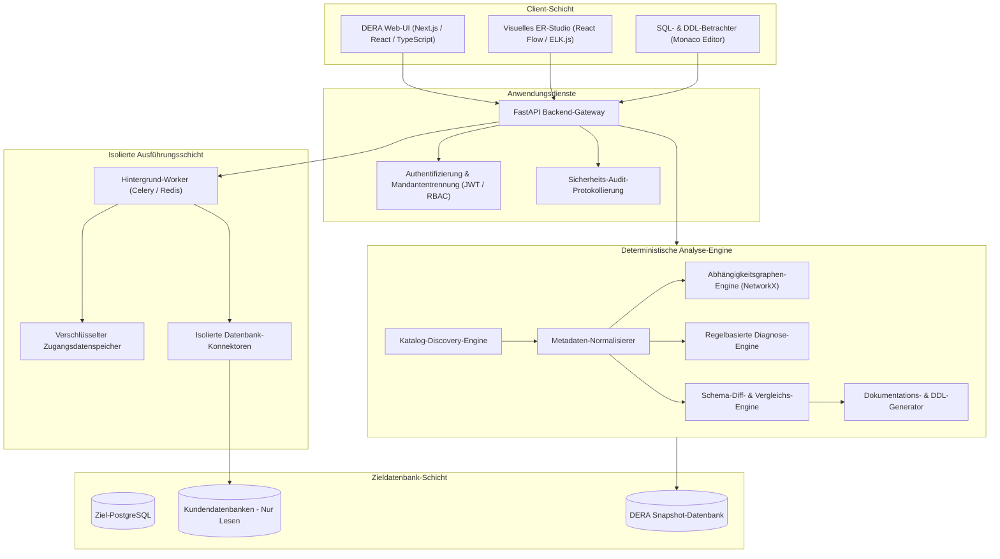
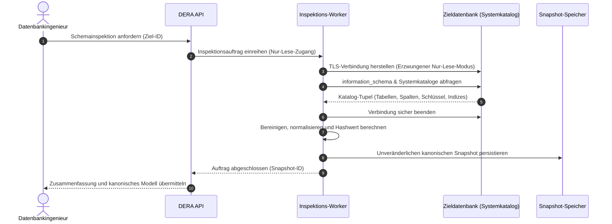
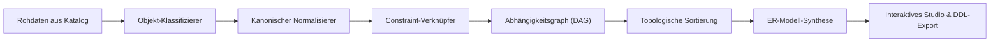
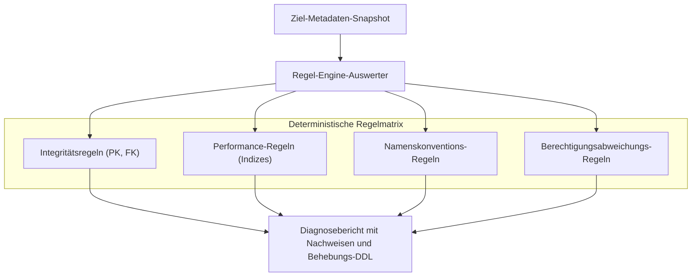
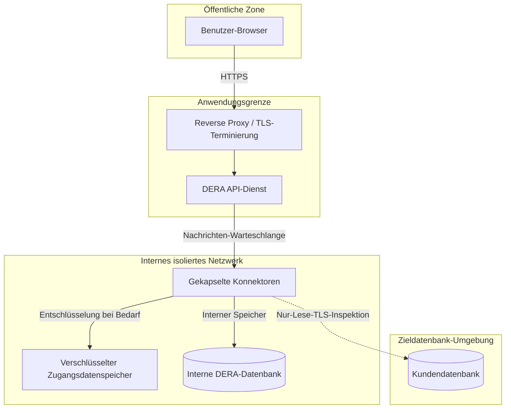
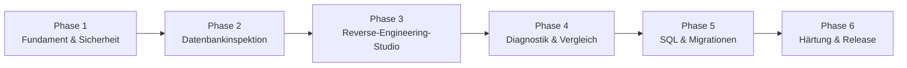

**Diese Dokumentation lesen auf:** [English](../../README.md) | [Español](README.es.md) | [Français](README.fr.md) | [Deutsch](README.de.md) | [Português](README.pt.md) | [日本語](README.ja.md) | [한국어](README.ko.md) | [简体中文](README.zh-CN.md) | [العربية](README.ar.md) | [Русский](README.ru.md)

---

<div align="center">

# DERA

### Database Engineering & Reverse Analysis

**Verstehe jedes Schema. Gestalte jede Änderung.**

Eine deterministische Open-Source-Plattform für Datenbank-Reverse-Engineering, entwickelt für Softwareentwickler, Datenbankingenieure, Architekten und Entwicklungsteams.

Erforschen Sie Datenbankstrukturen, visualisieren Sie Beziehungen, analysieren Sie Schemata, identifizieren Sie strukturelle Risiken und generieren Sie technische Dokumentationen — vollständig deterministisch, ohne KI-Modelle oder externe KI-Inferenz-APIs.

<br/>

[](https://github.com/krishanth7/dera/stargazers)
[](https://github.com/krishanth7/dera/forks)
[](https://github.com/krishanth7/dera/issues)
[](https://github.com/krishanth7/dera/blob/main/LICENSE)
[](https://github.com/krishanth7/dera/releases)
[](https://github.com/krishanth7/dera/actions/workflows/codeql.yml)
[](https://github.com/krishanth7/dera/graphs/contributors)
[](https://github.com/sponsors/krishanth7)

<br/>

[Überblick](#-überblick) ·
[Funktionen](#-funktionen) ·
[Architektur](#-architektur) ·
[Visuelle Pipelines](#-visuelle-pipelines) ·
[Sicherheit](#-sicherheitsprinzipien) ·
[Technologie-Stack](#-technologie-stack) ·
[Roadmap](#-entwicklungs-roadmap) ·
[Mitwirken](#-mitwirken) ·
[Community](#-community)

</div>

---

## 🌍 Sprachunterstützung

DERA stellt eine umfassende Dokumentation in 10 internationalen Sprachen bereit. Nutzen Sie die nachfolgende Tabelle oder die obere Navigationsleiste, um zur lokalisierten Dokumentation zu gelangen:

| Sprache | Code | Dokumentationslink | Status |
|---|---|---|---|
| 🇬🇧 English | `en` | [English Primary (Root)](../../README.md) · [Synchronized Copy](README.en.md) | Hauptreferenz |
| 🇪🇸 Español | `es` | [Documentación en Español](README.es.md) | Vollständige Übersetzung |
| 🇫🇷 Français | `fr` | [Documentation en Français](README.fr.md) | Vollständige Übersetzung |
| 🇩🇪 Deutsch | `de` | [Dokumentation auf Deutsch](README.de.md) | Vollständige Übersetzung |
| 🇵🇹 Português | `pt` | [Documentação em Português](README.pt.md) | Vollständige Übersetzung |
| 🇯🇵 日本語 | `ja` | [日本語ドキュメント](README.ja.md) | Vollständige Übersetzung |
| 🇰🇷 한국어 | `ko` | [한국어 문서](README.ko.md) | Vollständige Übersetzung |
| 🇨🇳 简体中文 | `zh-CN` | [简体中文文档](README.zh-CN.md) | Vollständige Übersetzung |
| 🇸🇦 العربية | `ar` | [الوثائق باللغة العربية](README.ar.md) | Vollständige Übersetzung |
| 🇷🇺 Русский | `ru` | [Документация на русском](README.ru.md) | Vollständige Übersetzung |

---

## 📖 Überblick

Moderne relationale Datenbanken bilden das solide Rückgrat moderner Softwareinfrastrukturen. Dennoch ist das Verstehen eines unbekannten oder historisch gewachsenen Schemas oft eine erhebliche Herausforderung. Unternehmenssysteme umfassen regelmäßig hunderte Tabellen, tausende Spalten, komplexe Fremdschlüsselbeziehungen, Indizes, Integritätsbedingungen, Ansichten (Views) und weitreichende Abhängigkeiten.

Diese Strukturen manuell zu erfassen und zu auditieren, bindet wertvolle Entwicklungszeit und birgt Risiken menschlicher Fehler.

**DERA wurde entwickelt, um dieses Problem gezielt zu lösen.**

DERA bietet einen einheitlichen und sicheren Arbeitsbereich, um Datenbankarchitekturen zu untersuchen, Entity-Relationship-Modelle zu rekonstruieren, strukturelle Entwurfsrisiken aufzudecken und technische Dokumentationen anhand deterministischer Algorithmen zu erstellen.

### Unsere Mission

Datenbank-Reverse-Engineering zugänglich, transparent, reproduzierbar und verlässlich für jeden Softwareentwickler, Datenbankadministrator und Systemarchitekten zu machen.

### Unsere Philosophie

- **Deterministisch durch Design** — Reproduzierbare Analysen basierend auf mathematischen Graphenalgorithmen und statischen Regelsätzen.
- **Strikt ohne generative KI** — Keine Large Language Models (LLMs), keine Machine-Learning-Modelle und keine externen KI-Inferenz-APIs.
- **Datenschutz an erster Stelle** — Reine Analyse von Strukturmetadaten. Es werden standardmäßig keine Datensätze oder Tabelleninhalte von Kunden ausgelesen.
- **Open Source** — Transparente Ingenieursarbeit unter der freien MIT-Lizenz.
- **Fokus auf Entwickler** — Praxisnahe Workflows für Softwareingenieure und DBAs.
- **Sicherheit als Fundament** — Erzwungene Nur-Lese-Verbindungen, verschlüsselte Zugangsdaten und isolierte Ausführungsumgebungen.
- **Technische Verlässlichkeit** — Evidenzbasierte Diagnoseergebnisse statt halluzinierter Erklärungen.

---

## ✨ Funktionen

Im Folgenden werden die geplanten Plattformfähigkeiten von DERA beschrieben. Ihre Verfügbarkeit richtet sich nach der jeweiligen Entwicklungsphase und den veröffentlichten Releases.

| Funktionsbereich | Status | Beschreibung |
|---|---|---|
| **Datenbank-Discovery** | Geplant | Native Extraktion von Metadaten zu Tabellen, Spalten, Constraints und Indizes |
| **Reverse-Engineering-Kern** | Geplant | Kanonische Schemamodellierung, Objektklassifizierung und Auflösung von Abhängigkeiten |
| **Visuelles ER-Studio** | Geplant | Interaktive Entity-Relationship-Diagramme, automatisches Layout, Filter und Exporte |
| **Deterministische Diagnostik** | Geplant | Statische Regelauswertung zur Erkennung fehlender Primärschlüssel, redundanter Indizes und Entwurfsfehlern |
| **Schema-Snapshots & Diff** | Geplant | Versionierte Schema-Snapshots und Auswirkungsanalysen struktureller Änderungen |
| **SQL-Performance-Engineering**| Geplant | Abfrageprüfung, Ausführungsplan-Visualisierung und Indexempfehlungen |
| **Dokumentationsgenerator** | Geplant | Automatisierte Exporte nach Markdown, HTML, JSON, SQL-DDL und SVG-Diagramme |
| **Sicherheitsarchitektur** | Geplant | Rollenbasierte Zugriffskontrolle, garantierter Nur-Lese-Zugriff und isolierte Worker |

### 🔍 Datenbank-Discovery

Untersuchen Sie unterstützte Datenbank-Engines und extrahieren Sie strukturelle Kataloginformationen:

- Datenbanken, Schemata und Erweiterungen
- Tabellen, Partitionen und Ansichten (Views)
- Spalten, Datentypen, Nullierbarkeit und Standardausdrücke (Defaults)
- Primärschlüssel, Fremdschlüssel und referenzielle Aktionen (`CASCADE`, `RESTRICT`)
- Unique-Constraints, Check-Constraints und Exklusions-Bedingungen
- Indizes (B-Tree, Hash, GIN, GiST), Unique-Indizes und partielle Index-Prädikate
- Sequenzen, Identitätsspalten und Trigger

### 🧬 Reverse-Engineering-Kern

Rekonstruieren Sie Schemamodelle mittels nativer Systemkatalogabfragen und deterministischer Algorithmen:

- Kanonische, engine-agnostische Schemarepräsentation
- Standardisierte Normalisierung struktureller Metadaten
- Aufbau gerichteter azyklischer Abhängigkeitsgraphen (DAG)
- Zuordnung einfacher und zusammengesetzter Fremdschlüsselbeziehungen
- Generierung unveränderlicher, kryptografisch gesicherter Schema-Snapshots
- Deterministische Rekonstruktion von SQL-DDL-Anweisungen

### 🕸️ Visuelles ER-Studio

Erforschen Sie die Schematopologie über eine interaktive Entity-Relationship-Oberfläche:

- Interaktive Tabellenknoten mit Anzeige von Spalten, Datentypen und Constraints
- Visuelle Fremdschlüsselverbinder mit exakter Kardinalitätsanzeige
- Deterministische automatische Layout-Algorithmen (hierarchisch und kraftbasiert)
- Schemabasierte Gruppierung, Tagging und domänenspezifische Teilgraphen
- Interaktive Volltextsuche, Typfilterung und Pfadanalyse von Abhängigkeiten
- Hochauflösende Exporte in den Vektorformaten SVG und Pixelgrafiken PNG

### 🛡️ Deterministische Datenbank-Diagnostik

Analysieren Sie Schema-Metadaten anhand konfigurierbarer Entwurfsregeln zur Identifikation struktureller Risiken:

| Diagnoseregel | Kategorie | Beschreibung |
|---|---|---|
| **Fehlender Primärschlüssel** | Integrität | Erkennt Tabellen ohne deklarierte Primärschlüssel-Bedingung |
| **Potenziell redundanter Index** | Performance | Findet überlappende oder redundante Spaltenpräfixe in Indizes |
| **Nicht-indizierter Fremdschlüssel**| Performance | Markiert Fremdschlüsselspalten ohne passenden unterstützenden Index |
| **Polymorphe Anti-Patterns** | Integrität | Erkennt lose Fremdschlüsselbeziehungen ohne relationale Integritätsregeln |
| **Nullierbarkeit & Default-Anomalien**| Konsistenz | Meldet Not-Null-Spalten ohne sinnvolle Standardwertdefinitionen |
| **Namenskonventions-Audit** | Standardisierung | Findet Abweichungen von einheitlichen Architektur- und Benennungsstandards |
| **Rechte- und Berechtigungsabweichungen** | Sicherheit | Weist auf übermäßige Berechtigungen auf Katalogobjekten hin |

*Alle Diagnosebefunde sind evidenzbasierte Empfehlungen inklusive technischer Begründung und konkreten DDL-Behebungsanweisungen.*

### 🔄 Schema-Vergleich & Diff-Engine

Vergleichen Sie Datenbank-Snapshots über verschiedene Umgebungen (Entwicklung, Staging, Produktion) oder Versionsstände hinweg:

- Hinzugefügte, geänderte und entfernte Tabellen sowie Spalten
- Modifikationen von Datentypen, Größen und Nullierbarkeitsvorgaben
- Erstellung, Löschung und Anpassung von Indexdefinitionen
- Constraint-Modifikationen und Anpassungen referenzieller Integritätsregeln
- Klassifizierung von Breaking Changes (abwärtskompatibel vs. potenziell destruktiv)
- Vorschau geordneter Migrationsskripte unter Einhaltung topologischer Abhängigkeiten

---

## 🧠 Keine KI. Reine Ingenieurskunst.

DERA verzichtet bewusst und vollständig auf künstliche Intelligenz und Machine-Learning-Modelle.

```text
┌───────────────────────────────────────────────────────────┐
│               STRIKTE ARCHITEKTUR OHNE KI                 │
│                                                           │
│   ❌  Kein OpenAI, Anthropic Claude oder Google Gemini    │
│   ❌  Keine gehosteten Inferenz-APIs wie Groq o. DeepSeek │
│   ❌  Keine lokalen LLMs (Ollama, vLLM, llama.cpp)        │
│   ❌  Keine nicht-deterministischen Halluzinationen       │
│                                                           │
│   ✅  Native Systemkatalog-Abfragen (information_schema)  │
│   ✅  Deterministische Graphenalgorithmen (NetworkX)      │
│   ✅  Formale SQL-AST-Parser (SQLGlot)                    │
│   ✅  Reproduzierbare statische Regelsysteme              │
│   ✅  Mathematische Schema-Vergleichsalgorithmen          │
└───────────────────────────────────────────────────────────┘
```

**Warum DERA deterministisch arbeitet:**
1. **Vorhersehbarkeit:** Ein identischer Schema-Snapshot und dieselbe Regelkonfiguration liefern ausnahmslos identische Analyseergebnisse.
2. **Nachvollziehbarkeit:** Jede Warnung, Beziehung und Graphenkante verweist direkt auf konkrete Systemkatalogdaten.
3. **Datensouveränität:** Ihre Unternehmensschemata und Metadaten verlassen zu keinem Zeitpunkt Ihr Netzwerk in Richtung dritter Modellanbieter.
4. **Effizienz & Kosten:** Keine Inferenzlatenz, keine Token-Abrechnung, keine API-Ratenbegrenzungen und keine Abhängigkeit von Cloud-Diensten.

---

## 🏗️ Architektur

DERA basiert auf einer modularen Architektur, die für hohe Wartbarkeit, Erweiterbarkeit und maximale Sicherheit beim Datenbankzugriff ausgelegt ist.



---

## 🔬 Visuelle Pipelines

DERA führt deterministische, auditierbare Prozesse zur Metadateninspektion, Beziehungssynthese und Sicherheitsvalidierung durch.

### 1. Ablauf der Datenbankinspektion



### 2. Schema-Reverse-Engineering-Pipeline



### 3. Metadatenverarbeitungs- & Diagnose-Pipeline



### 4. Sicherheitsgrenzen & Isolation



### 5. Geplanter Entwicklungslebenszyklus



---

## 🔒 Sicherheitsprinzipien

Da DERA Verbindungen zu geschäftskritischen Datenbanken herstellt, bildet Sicherheit das zentrale Fundament der gesamten Plattformarchitektur.

- **Erzwungener Nur-Lese-Modus:** Verbindungssitzungen setzen zwingend transaktionale Nur-Lese-Modi durch (`SET SESSION CHARACTERISTICS AS TRANSACTION READ ONLY`).
- **Kein Auslesen von Datensätzen:** Es werden ausschließlich Systemkataloge (`information_schema`, `pg_catalog`) inspiziert. Anwendungsdatenzeilen werden weder abgefragt noch gespeichert.
- **Keine Passwörter im Klartext:** Zugangsdaten werden im Ruhezustand via AES-256-GCM verschlüsselt und niemals in Protokolldateien geschrieben, exportiert oder versioniert.
- **SSRF-Prävention:** Verbindungsziele werden streng validiert, um unautorisierte Scans interner Netze oder Zugriffe auf Cloud-Metadatendienste zu unterbinden.
- **Prinzip der geringsten Rechte:** Leitfäden für das Einrichten unprivilegierter, auditierbarer Nur-Lese-Rollen ohne administrative Befugnisse.
- **Revisionssichere Protokollierung:** Jede Inspektion, jeder Export und jede Konfigurationsänderung erzeugt einen unveränderbaren Audit-Eintrag.

*Vollständige Richtlinien zur Meldung von Sicherheitslücken finden Sie in [SECURITY.md](../../SECURITY.md).*

---

## 🛠️ Technologie-Stack

| Schicht | Komponente | Technologie | Einsatzzweck | Status |
|---|---|---|---|---|
| **Frontend** | Framework | Next.js, React, TypeScript | Interaktive Webanwendung | Geplant |
| | Styling | Tailwind CSS | Konsistentes, responsives Designsystem | Geplant |
| | Komponenten | shadcn/ui | Barrierefreie Benutzeroberfläche | Geplant |
| | ER-Visualisierung | React Flow, ELK.js | Graphendarstellung & automatisches Layout | Geplant |
| | Code-Editor | Monaco Editor | SQL-Syntax-Highlighting und DDL-Ansicht | Geplant |
| **Backend** | API-Framework | Python 3.12+, FastAPI | Asynchrone Hochleistungs-APIs | Geplant |
| | Kataloginspektion | SQLAlchemy, psycopg | Metadatenextraktion & Verbindungspooling | Geplant |
| | SQL-Parsing | SQLGlot | Engine-unabhängige SQL-AST-Generierung | Geplant |
| | Graphenalgorithmen | NetworkX | Zyklenprüfung und topologische Sortierung | Geplant |
| | Task-Queue | Celery, Redis | Isolierte asynchrone Inspektions-Worker | Geplant |
| **Speicher** | DERA-Datenbank | PostgreSQL | Speicherung von Snapshots, Sitzungen und Audit-Logs | Geplant |
| | Migrationen | Alembic | Versionierte Migrationen der DERA-Systemdatenbank | Geplant |
| **DevOps & QA** | Container | Docker, Docker Compose | Reproduzierbare Entwicklung und Bereitstellung | Geplant |
| | SAST & Sicherheit | CodeQL, Dependabot | Automatische Sicherheits- und Abhängigkeitsprüfungen | Implementiert |
| | Testing | Pytest, Playwright | Backend-Unit-Tests und Frontend-E2E-Tests | Geplant |

---

## 🗄️ Datenbank-Kompatibilität

DERA verfügt über eine modulare Konnektor-Architektur zur Anbindung moderner relationaler und verteilter Datenbanksysteme:

| Datenbank-Engine | Konnektor-Status | Katalogquelle | Ziel-Meilenstein |
|---|---|---|---|
| **PostgreSQL** (v12 - v17) | In Entwicklung | `pg_catalog`, `information_schema` | Phase 2 (MVP) |
| **Supabase PostgreSQL** | In Entwicklung | Nativer PostgreSQL-Konnektor | Phase 2 (MVP) |
| **MySQL** (v8.0+) | Geplant | `information_schema`, `performance_schema` | Phase 5 |
| **SQLite** (v3.35+) | Geplant | `sqlite_master`, `PRAGMA`-Befehle | Phase 5 |
| **MariaDB** (v10.5+) | Geplant | `information_schema` | Phase 5 |
| **Microsoft SQL Server** | Geplant | `sys.tables`, `INFORMATION_SCHEMA` | Phase 5 |
| **Oracle Database** | In Prüfung | Data-Dictionary-Views (`ALL_*`, `DBA_*`) | Zukünftige Evaluierung |

---

## 🚀 Erste Schritte

DERA befindet sich derzeit in der Phase des architektonischen und konzeptionellen Aufbaus. Konfigurationen für den Produktiveinsatz werden mit Erreichen der jeweiligen Versionen bereitgestellt.

### Voraussetzungen (Geplant)

- Python 3.12 oder neuer
- Node.js LTS (v20+)
- PostgreSQL 15+
- Docker und Docker Compose
- Git

### Repository klonen

```bash
git clone https://github.com/krishanth7/dera.git
cd dera
```

### Lokale Entwicklungsumgebung (Geplant)

```bash
# Umgebungsvorlage vorbereiten
cp .env.example .env

# Entwicklungsstack via Docker Compose starten
docker compose -f infrastructure/docker/docker-compose.dev.yml up --build
```

> **Hinweis:** Die Anwendungsbasis befindet sich im aktiven Aufbau. Verfolgen Sie den Fortschritt in der [Entwicklungs-Roadmap](#-entwicklungs-roadmap).

---

## 📁 Repository-Struktur

```text
dera/
├── .github/
│   ├── ISSUE_TEMPLATE/           # Strukturierte GitHub-Issue-Vorlagen
│   ├── workflows/                # Workflows für CodeQL, Dependency Review und CI
│   ├── PULL_REQUEST_TEMPLATE.md  # Standardisierte Pull-Request-Vorlage
│   ├── dependabot.yml            # Automatische Abhängigkeitsaktualisierungen
│   └── FUNDING.yml               # Sponsoring-Konfiguration des Maintainers
├── docs/
│   ├── README.md                 # Umfassender Dokumentationsindex
│   ├── i18n/                     # Synchronisierte mehrsprachige Dokumentation
│   │   ├── README.en.md          # Synchronisierte englische Referenzkopie
│   │   ├── README.es.md          # Spanische Dokumentation
│   │   ├── README.fr.md          # Französische Dokumentation
│   │   ├── README.de.md          # Deutsche Dokumentation
│   │   ├── README.pt.md          # Portugiesische Dokumentation
│   │   ├── README.ja.md          # Japanische Dokumentation
│   │   ├── README.ko.md          # Koreanische Dokumentation
│   │   ├── README.zh-CN.md       # Chinesische Dokumentation (Vereinfacht)
│   │   ├── README.ar.md          # Arabische Dokumentation (RTL-konform)
│   │   └── README.ru.md          # Russische Dokumentation
│   ├── architecture/             # Architekturspezifikationen
│   ├── development/              # Setup-Anleitungen und Entwicklungsstandards
│   ├── security/                 # Bedrohungsmodelle und Sicherheitsrichtlinien
│   └── contributing/             # Leitfäden für Mitwirkende
├── CODE_OF_CONDUCT.md            # Verhaltenskodex (Contributor Covenant)
├── CONTRIBUTING.md               # Ausführliche Beitragsrichtlinien
├── LICENSE                       # MIT-Lizenz
├── README.md                     # Hauptseite des Repositories
├── SECURITY.md                   # Umfassende Sicherheitsrichtlinie
└── .gitignore                    # Git-Ausschlussregeln
```

---

## 🗺️ Entwicklungs-Roadmap

### Phase 1 — Fundament & Sicherheit
- [x] Offizielle Identität und MIT-Lizenzierung etablieren
- [x] Statische CodeQL-Sicherheitsanalyse einrichten
- [x] Verhaltenskodex und Sicherheitsrichtlinien implementieren
- [x] Internationale 10-Sprachen-Dokumentationsarchitektur aufbauen
- [ ] Monorepo-Struktur für Anwendungen initialisieren (`apps/web`, `apps/api`)
- [ ] Docker-Entwicklungsumgebung und Basis-CI konfigurieren

### Phase 2 — Datenbank-Inspektions-Engine
- [ ] Nativ-Konnektor für PostgreSQL-Metadaten entwickeln
- [ ] Tabellen, Spalten, Constraints, Indizes und Views extrahieren
- [ ] Kanonisches Modell zur Schemanormalisierung implementieren
- [ ] Unveränderlichen, kryptografischen Snapshot-Speicher aufbauen
- [ ] Nur-Lese-Garantien und Abfrage-Timeouts implementieren

### Phase 3 — Reverse-Engineering-Studio
- [ ] Interaktives ER-Studio auf Basis von React Flow entwickeln
- [ ] Algorithmen für automatisierte hierarchische Layouts erstellen
- [ ] Schema-Filterung, Suche und Domänengruppierung integrieren
- [ ] Traversierung und Visualisierung von Abhängigkeitsgraphen (DAG)
- [ ] Hochauflösenden Diagrammexport nach SVG und PNG implementieren

### Phase 4 — Diagnostik & Schema-Vergleich
- [ ] Deterministische, regelbasierte Diagnose-Engine entwickeln
- [ ] Grundregeln etablieren: Fehlende PKs, redundante Indizes, unindizierte FKs
- [ ] Algorithmus für Schema-Snapshot-Vergleiche implementieren
- [ ] Strukturierte Vorschauen für DDL-Migrationsänderungen erstellen
- [ ] Diagnoseberichte im Markdown-, JSON- und HTML-Format exportieren

### Phase 5 — Fortgeschrittenes Engineering & Konnektoren
- [ ] SQL-AST-Abfrageanalyse und Komplexitätsmetriken via SQLGlot integrieren
- [ ] Ausführungsplan-Visualisierer (`EXPLAIN ANALYZE`) bereitstellen
- [ ] Datenbank-Konnektoren für MySQL und SQLite entwickeln
- [ ] Automatische Generierung abhängigkeitsgeprüfter Migrationsskripte

### Phase 6 — Produktionshärtung
- [ ] Umfassende Sicherheitstests und Penetrationstests durchführen
- [ ] Leistungsbenchmarks mit Großschemata (über 1.000 Tabellen) abschließen
- [ ] Mandantenisolierung und lückenlose Audit-Protokollierung validieren
- [ ] Offizielle v1.0.0-Container-Images und Bereitstellungsanleitungen veröffentlichen

---

## 🧪 Test- & Qualitätsstrategie

DERA gewährleistet hohe Softwarequalität durch automatisierte und reproduzierbare Tests:

- **Unit-Tests:** Überprüfen Metadaten-Parser, Zyklenfreiheit in Graphen und Diagnoseregeln mit synthetischen Testdaten.
- **Integrationstests:** Validieren das Konnektorverhalten gegen containerisierte Instanzen von PostgreSQL, MySQL und SQLite.
- **Deterministische Verifikation:** Stellt sicher, dass identische Schema-Snapshots ausnahmslos identische Hashwerte und Diagnoseergebnisse liefern.
- **Sicherheitsprüfungen:** Kontinuierliches CodeQL-Scanning, automatisierte Dependency-Reviews und Secret-Leak-Checks.
- **End-to-End-Tests:** Playwright-Browsertests zur Validierung von Diagramminteraktionen und reaktivem Verhalten.

---

## 🤝 Mitwirken

Beiträge von Entwicklern, Datenbankspezialisten, technischen Redakteuren und Sicherheitsforschern aus der ganzen Welt sind herzlich willkommen.

Bitte lesen Sie unseren [CONTRIBUTING.md](../../CONTRIBUTING.md)-Leitfaden und den [Verhaltenskodex](../../CODE_OF_CONDUCT.md), bevor Sie einen Pull Request einreichen.

### Entwicklungs-Workflow

1. Forken Sie das Repository auf GitHub.
2. Erstellen Sie einen fokussierten Branch: `git checkout -b feat/ihr-feature-name`.
3. Folgen Sie den Vorgaben für [Conventional Commits](../../CONTRIBUTING.md#commit-message-guidelines).
4. Fügen Sie entsprechende Unit- oder Integrationstests hinzu.
5. Stellen Sie sicher, dass CodeQL-Analysen und Dokumentationstests fehlerfrei durchlaufen.
6. Eröffnen Sie einen Pull Request gegen den `main`-Branch zur Begutachtung durch die Maintainer.

---

## 💬 Community

- [GitHub Discussions](https://github.com/krishanth7/dera/discussions) — Fragen stellen, Ideen einbringen und über Datenbank-Engineering diskutieren.
- [GitHub Issues](https://github.com/krishanth7/dera/issues) — Fehlerberichte oder Funktionsanfragen einreichen.
- [GitHub Pull Requests](https://github.com/krishanth7/dera/pulls) — Code- und Dokumentationsbeiträge einreichen.
- [Releases](https://github.com/krishanth7/dera/releases) — Offizielle Versionshinweise verfolgen.

---

## ❤️ Projekt unterstützen

DERA ist ein unabhängiges Open-Source-Ingenieursprojekt. Sie können die Weiterentwicklung aktiv unterstützen durch:

- Vergabe eines Sterns (Star) für das Repository auf GitHub
- Teilen des Projekts in Ihren fachlichen Netzwerken
- Beisteuern von Konnektoren, Diagnoseregeln oder Dokumentationsbeiträgen
- [Sponsoring über GitHub Sponsors](https://github.com/sponsors/krishanth7)

---

## 📜 Lizenz

DERA wird unter der freien **[MIT-Lizenz](../../LICENSE)** bereitgestellt.

```text
Copyright (c) 2026 Krishanth
```

---

## 👨‍💻 Maintainer

**Krishanth**  
Gründer & Haupt-Maintainer

- GitHub: [@krishanth7](https://github.com/krishanth7)  
- Repository: [github.com/krishanth7/dera](https://github.com/krishanth7/dera)  
- Kontakt: `krishanth.b.2008@gmail.com`

*DERA ist ein unabhängiges Open-Source-Projekt, das von Krishanth gepflegt wird. OVIC Labs wird als Teil des übergeordneten Entwicklungs-Ökosystems des Maintainers anerkannt.*

---

<div align="center">

### DERA — Database Engineering & Reverse Analysis

**Verstehe jedes Schema. Gestalte jede Änderung.**

*Entwickelt mit technischer Präzision, mathematischem Determinismus und Open-Source-Transparenz.*

© 2026 DERA-Mitwirkende. Lizenziert unter der MIT-Lizenz.

[Nach oben](#dera)

</div>
