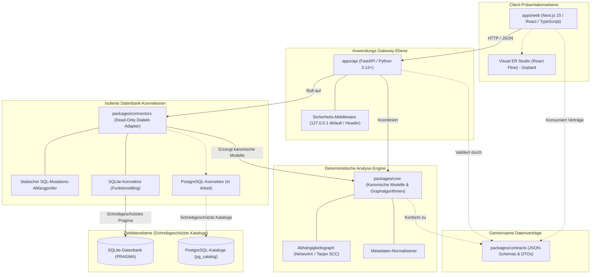

**Diese Dokumentation lesen auf:** [English (Root)](../../README.md) | [Español](README.es.md) | [Français](README.fr.md) | [Deutsch](README.de.md) | [Português](README.pt.md) | [Italiano](README.it.md) | [日本語](README.ja.md) | [한국어](README.ko.md) | [简体中文](README.zh-CN.md) | [Русский](README.ru.md)

---

<div align="center">

# DERA

### Database Engineering & Reverse Analysis

**Verstehe jedes Schema. Entwickle jede Änderung.**

Eine unabhängige, deterministische Open-Source-Plattform für Datenbank-Engineering und Reverse Engineering, entwickelt für Softwareentwickler, Datenbankarchitekten und Ingenieurteams.

Erkunden Sie Datenbankstrukturen, rekonstruieren Sie Entitätsbeziehungen, bewerten Sie strukturelle Risiken und planen Sie Schemaänderungen — vollständig deterministisch, ohne KI-Modelle oder externe Inferenz-APIs.

<br/>

[](../../LICENSE)
[](https://github.com/krishanth7/dera/actions/workflows/ci.yml)
[](https://github.com/krishanth7/dera/actions/workflows/codeql.yml)
[](https://github.com/krishanth7/dera/actions/workflows/documentation.yml)
[](../../pyproject.toml)
[](../../tsconfig.json)
[-orange?style=for-the-badge)](#-streng-ohne-ki-architektur)
[](../../CONTRIBUTING.md)

<br/>

[Überblick](#-überblick) ·
[Funktionsmatrix](#-statusmatrix-der-funktionen) ·
[Architektur](#-architekturübersicht) ·
[Monorepo-Struktur](#-repository-struktur) ·
[Erste Schritte](#-erste-schritte) ·
[Datenbankkompatibilität](#-datenbank-kompatibilitätsmatrix) ·
[Sicherheit](#-sicherheitsprinzipien) ·
[Dokumentations-Hub](#-entwickler-dokumentationsnavigation) ·
[Roadmap](#-master-roadmap) ·
[Mitwirken](#-mitwirken) ·
[Community](#-community)

</div>

---

## 🌍 Sprachunterstützung

DERA stellt eine synchronisierte Dokumentation in 10 internationalen Sprachen bereit. Die englische README-Datei dient gemäß unserem [Dokumentations-Wartungsvertrag](../development/README_MAINTENANCE.md) als maßgebliche Referenz.

| Sprache | Code | Dokumentationslink | Status |
|---|---|---|---|
| 🇬🇧 English | `en` | [English Primary (Root)](../../README.md) · [Synchronized Copy](README.en.md) | **Maßgebliche Referenzquelle** |
| 🇪🇸 Español | `es` | [Documentación en Español](README.es.md) | Vollständige Übersetzung |
| 🇫🇷 Français | `fr` | [Documentation en Français](README.fr.md) | Vollständige Übersetzung |
| 🇩🇪 Deutsch | `de` | [Dokumentation auf Deutsch](README.de.md) | Vollständige Übersetzung |
| 🇵🇹 Português | `pt` | [Documentação em Português](README.pt.md) | Vollständige Übersetzung |
| 🇮🇹 Italiano | `it` | [Documentazione in Italiano](README.it.md) | Vollständige Übersetzung |
| 🇯🇵 日本語 | `ja` | [日本語ドキュメント](README.ja.md) | Vollständige Übersetzung |
| 🇰🇷 한국어 | `ko` | [한국어 문서](README.ko.md) | Vollständige Übersetzung |
| 🇨🇳 简体中文 | `zh-CN` | [简体中文文档](README.zh-CN.md) | Vollständige Übersetzung |
| 🇷🇺 Русский | `ru` | [Документация на русском](README.ru.md) | Vollständige Übersetzung |

---

## 📖 Überblick

Moderne relationale Datenbanken bilden das Rückgrat jeder Softwareinfrastruktur. Das Verständnis unbekannter, historisch gewachsener oder sich schnell verändernder Schemata stellt jedoch erhebliche Herausforderungen dar:
- **Komplexe Schemata:** Unternehmensdatenbanken umfassen häufig Hunderte von Tabellen, Tausende Spalten und undokumentierte Fremdschlüsselbeziehungen.
- **Architekturschulden:** Zirkuläre Fremdschlüsselabhängigkeiten, fehlende Primärschlüssel, nicht indizierte Fremdschlüssel und redundante Indizes häufen sich unbemerkt an.
- **Migrationsrisiken:** Schemaänderungen ohne vollständigen topologischen Graphen bergen Risiken wie Sperren-Eskalationen, Datenverlust und kaskadierende Constraint-Verletzungen.
- **Datenschutz & Sicherheit:** Unternehmen dürfen Produktionsanmeldeinformationen und vertrauliche Datensätze keinesfalls externen Cloud-KI-Diensten aussetzen.

**DERA wurde entwickelt, um diese Probleme durch mathematischen Determinismus zu lösen.**

DERA bietet eine modulare Open-Source-Plattform, die Kataloge relationaler Datenbanken untersucht, Abhängigkeitsgraphen rekonstruiert, strukturelle Risiken bewertet und Migrationen anhand überprüfbarer Algorithmen simuliert.

### Wesentliche Ingenieursprinzipien

1. **Deterministisch durch Design:** Jeder Schema-Snapshot, jede topologische Graphsortierung und jeder Diagnosebericht ist reproduzierbar und fußt auf relationaler Algebra.
2. **Streng ohne KI:** Keine generative KI, keine Large Language Models (LLMs), keine Vektordatenbanken und keine externen Inferenz-APIs.
3. **Schreibgeschützte Datenbanksicherheit:** Durchsetzung von reinem Lesezugriff auf Verbindungsebene, statische AST-Abfrageblockierung von Mutationen und ausschließliche Metadaten-Katalogabfragen.
4. **Keine Extraktion von Kundenzeilendaten:** Reine Metadaten-Introspektion (`information_schema`, `pg_catalog`, `sqlite_master`). Anwendungsdatensätze werden niemals abgefragt, übertragen oder gespeichert.
5. **Entkoppelte Monorepo-Architektur:** Klare Modulgrenzen isolieren Graphalgorithmen, Konnektoren, das API-Gateway und das Visual Studio.
6. **Open Source & Permissiv:** Unabhängige Software unter der liberalen [MIT-Lizenz](../../LICENSE).

---

## 🧠 Streng ohne KI-Architektur

DERA ist bewusst ohne Komponenten für künstliche Intelligenz oder maschinelles Lernen konzipiert.

```text
┌───────────────────────────────────────────────────────────┐
│              STRENG OHNE KI-ARCHITEKTUR                   │
│                                                           │
│   ❌  Kein OpenAI, Anthropic Claude oder Google Gemini    │
│   ❌  Keine Groq-, DeepSeek- oder gehosteten Modell-APIs  │
│   ❌  Keine lokalen LLMs (Ollama, vLLM, llama.cpp)        │
│   ❌  Keine stochastischen Schätzungen / Halluzinationen  │
│   ❌  Keine Cloud-Vektoreinbettungen oder externes RAG    │
│                                                           │
│   ✅  Native Systemkatalogabfragen (information_schema)   │
│   ✅  Mathematische Graphalgorithmen (NetworkX / Tarjan)  │
│   ✅  Abstract Syntax Tree SQL-Parser (SQLGlot)           │
│   ✅  Reproduzierbare statische Regel-Engines             │
│   ✅  Kryptografische Hash-Fingerabdrücke (SHA-256)       │
└───────────────────────────────────────────────────────────┘
```

**Warum DERA deterministisch ist:**
- **Mathematische Nachvollziehbarkeit:** Jede Beziehung, Warnung vor Zyklen und Diagnose stützt sich auf konkrete Katalogbeweise und exakte Graphalgorithmen.
- **Byte-für-Byte-Reproduzierbarkeit:** Eine Prüfung desselben Schema-Snapshots liefert auf jeder Entwickler- und CI-Umgebung stets identische Ergebnisse.
- **Datensouveränität für Unternehmen:** Schemata und Topologien verlassen niemals Ihr Netzwerk in Richtung externer Modellanbieter.
- **Keine Betriebskosten für KI:** Keine Tokenkosten, keine Ratenbegrenzungen und keine Latenzen durch externe Inferenz.

---

## 📊 Statusmatrix der Funktionen

DERA pflegt eine transparente Berichterstattung auf Basis von im Repository vorhandenem und automatisiert getestetem Code:

| Funktion | Status | Implementierungsnachweis | Monorepo-Pfad |
|---|:---:|---|---|
| **Kanonische Schemamodelle** | **Implementiert** | Kanonische Modelle `Column`, `Table`, `ForeignKey`, `Index` | [`packages/core/src/dera/models.py`](../../packages/core/src/dera/models.py) |
| **Abhängigkeitsgraph-Engine** | **Implementiert** | Zyklenfester DAG & topologische Sortierung (Tarjan SCC) | [`packages/core/src/dera/graph.py`](../../packages/core/src/dera/graph.py) |
| **Mutations-Abfangprüfer (Read-Only)** | **Implementiert** | Statische AST-Prüfung blockiert destruktives SQL (`DROP`, `ALTER` etc.) | [`packages/connectors/src/dera_connectors/base/`](../../packages/connectors/src/dera_connectors/base/connector.py) |
| **SQLite-Katalogintrospektion** | **Implementiert** | Erkennung von Tabellen, Spalten, PK, FK und Indizes | [`packages/connectors/src/dera_connectors/sqlite/`](../../packages/connectors/src/dera_connectors/sqlite/connector.py) |
| **PostgreSQL-Katalogprüfung** | **In Arbeit** | Integrationstests mit temporärem PostgreSQL-Container | [`tests/integration/`](../../tests/integration/) |
| **API-Gateway & Telemetrie** | **Implementiert** | FastAPI-Dienst mit Localhost-Bindung und Integritäts-Endpoints | [`apps/api/src/dera_api/main.py`](../../apps/api/src/dera_api/main.py) |
| **Web-Studio-Anwendungsbasis** | **Implementiert** | Next.js 15 TypeScript-Basis & Architektur-Statuskarte | [`apps/web/src/app/page.tsx`](../../apps/web/src/app/page.tsx) |
| **Gemeinsame Datenverträge** | **Implementiert** | Versionierte JSON-Schemas und Serialisierungs-DTOs | [`packages/contracts/schemas/`](../../packages/contracts/schemas/) |
| **Visuelle ER-Studio-Leinwand** | Geplant | Interaktive Diagrammleinwand basierend auf React Flow | Phase 7 Roadmap |
| **Deterministische Regelmatrix** | Geplant | Erkennung fehlender PK, unindizierter FK und redundanter Indizes | Phase 8 Roadmap |
| **Snapshot-Diff-Engine** | Geplant | Semantischer Snapshot-Vergleich & DDL-Vorschau | Phase 9 Roadmap |
| **SQL-AST-Leistungsanalyse** | Geplant | SQLGlot-Abfragekomplexität & Ausführungsplan-Visualisierer | Phase 10 Roadmap |

> **Status-Legende:**
> - **`Implementiert`** &mdash; Im Code realisiert, verifiziert und durch Tests in der CI abgedeckt.
> - **`In Arbeit`** &mdash; In aktiver Entwicklung und Integrationstestung im aktuellen Meilenstein.
> - **`Geplant`** &mdash; Eingeplant in der 12-Phasen-Entwicklungs-Roadmap.

---

## 🏗️ Architekturübersicht

DERA gliedert seine Funktionalitäten in entkoppelte Bereiche gemäß unserer [Monorepo-Architektur-Spezifikation](../architecture/README_ARCHITECTURE.md):



### Textuelle Architekturbeschreibung (Barrierefreiheit)
- **Client-Präsentationsebene (`apps/web`):** Next.js 15 TypeScript-Frontend, das per JSON mit der API kommuniziert und die interaktive ER-Studio-Leinwand bereitstellen wird.
- **Anwendungs-Gateway-Ebene (`apps/api`):** FastAPI-Backend, standardmäßig an `127.0.0.1` gebunden, für Zustandsüberwachung, Katalogrouten und Sicherheits-Middleware.
- **Gemeinsame Datenverträge (`packages/contracts`):** JSON-Schema-Definitionen und TypeScript-Schnittstellen für Tabellen, Spalten, Indizes und Snapshots.
- **Deterministische Core-Engine (`packages/core`):** Reine Python-Bibliothek für Domänenmodelle, Tarjans SCC-Algorithmus, topologische Sortierung und Normalisierung.
- **Isolierte Datenbank-Konnektoren (`packages/connectors`):** Modulare Adapter für Katalogabfragen (`sqlite_master`, `pg_catalog`) mit vorangehender AST-Prüfung gegen SQL-Mutationen.
- **Zieldatenebene (Schreibgeschützt):** Die Zieldatenbanken des Nutzers. DERA verbindet sich ausschließlich mit unprivilegierten Nur-Lese-Rechten.

Weiterführende Dokumentation:
- [Architektur- und Blueprint-Leitfaden](../architecture/README_ARCHITECTURE.md)
- [Modulgrenzen und Abhängigkeitsregeln](../architecture/MODULE_BOUNDARIES.md)
- [Verzeichnisstruktur des Monorepos](../architecture/MONOREPO_STRUCTURE.md)
- [Architecture Decision Record (ADR 0001)](../architecture/adr/0001-monorepo-architecture.md)

---

## 📁 Repository-Struktur

Der reale Aufbau des DERA-Monorepos gestaltet sich wie folgt:

```text
dera/
├── apps/
│   ├── api/                      # FastAPI-Backend und Health-Endpoints
│   │   ├── src/dera_api/         # Gateway-Routen, Middleware und Schemas
│   │   └── pyproject.toml        # API-Paketspezifikation
│   └── web/                      # Next.js 15 TypeScript Frontend Studio
│       ├── src/                  # App-Router, Komponenten und API-Client
│       └── package.json          # Web-Workspace-Konfiguration
├── packages/
│   ├── core/                     # Kanonische Modelle und Graphverarbeitung
│   │   └── src/dera_core/        # Schemamodelle, DAG-Algorithmen und Graphentheorie
│   ├── connectors/               # Adapter zur Metadaten-Extraktion
│   │   └── src/dera_connectors/  # Basis-Konnektor, Mutationsschutz und SQLite
│   └── contracts/                # Gemeinsame JSON-Schemas und Verträge
│       └── schemas/              # Versionierte Verträge für APIs und Snapshots
├── tests/
│   ├── architecture/             # Tests auf AST-Importgrenzen
│   ├── integration/              # Integrationstests für SQLite und PostgreSQL
│   ├── regression/               # Deterministische Regressionsprüfungen für DAGs
│   └── unit/                     # Unit-Tests für Modelle, Titel und Readiness
├── scripts/
│   ├── ci/                       # CI-Validierungsskripte (Docs, i18n, PR-Güte)
│   └── development/              # Plattformübergreifender CLI-Runner (dev.py)
├── docs/
│   ├── audit/                    # Repository-Audits, Baselines und Berichte
│   ├── architecture/             # Monorepo-Blueprint, Grenzen und ADRs
│   ├── development/              # Onboarding, Befehle und Git-Workflow
│   ├── governance/               # Governance, Maintainer, GAD-Aufzeichnungen
│   ├── security/                 # Bedrohungsmodell, DB-Sicherheit und Meldeprozesse
│   ├── community/                # Community-Hub, Richtlinien und Issue-Triage
│   ├── roadmap/                  # Master-Entwicklungs-Roadmap in 12 Phasen
│   └── i18n/                     # Synchronisierte Dokumentation in 10 Sprachen
├── .github/
│   ├── workflows/                # Enterprise CI/CD, CodeQL und Gates
│   ├── ISSUE_TEMPLATE/           # Strukturierte YAML-Vorlagen für Meldungen
│   ├── PULL_REQUEST_TEMPLATE/    # Spezialisierte PR-Vorlagen
│   ├── CODEOWNERS                # Code-Eigentümerschaften
│   └── PULL_REQUEST_TEMPLATE.md  # Standard-PR-Qualifikationsvorlage
├── pyproject.toml                # Haupt-Python-Konfiguration (PEP 621)
├── package.json                  # Haupt-npm-Konfiguration
├── tsconfig.json                 # Strikte TypeScript-Konfiguration
├── Makefile                      # Standard-Befehlsautomatisierung
├── CONTRIBUTING.md               # Ausführlicher Leitfaden für Mitwirkende
├── SECURITY.md                   # Sicherheitsrichtlinie und Meldewege
└── LICENSE                       # MIT-Lizenz
```

---

## 🚀 Erste Schritte

DERA enthält ein plattformübergreifendes CLI-Werkzeug (`scripts/development/dev.py`), um das Monorepo unter Windows, Linux und macOS einheitlich zu prüfen und zu starten.

### Voraussetzungen

| Werkzeug | Mindestversion | Empfohlene Version | Prüfbefehl |
|---|---|---|---|
| **Python** | `3.12+` | `3.12` oder `3.13` | `python --version` |
| **Node.js** | `20.x LTS` | `20.x` oder `22.x LTS` | `node --version` |
| **Git** | `2.30+` | Neueste | `git --version` |

### 1. Repository klonen

```bash
git clone https://github.com/krishanth7/dera.git
cd dera
```

### 2. Umgebung einrichten

Kopieren Sie die Vorlage für eine sichere Umgebung:

```bash
# Windows PowerShell
Copy-Item .env.example .env

# Linux / macOS
cp .env.example .env
```

### 3. Python-Umgebung erstellen

```bash
# Linux / macOS
python3 -m venv .venv
source .venv/bin/activate
pip install -e ".[dev]"

# Windows PowerShell
python -m venv .venv
.venv\Scripts\Activate.ps1
pip install -e ".[dev]"
```

### 4. Node.js-Abhängigkeiten installieren

```bash
npm install
```

### 5. Vollständige Validierungssuite ausführen

Überprüfen Sie alle Python-Module, TypeScript-Typen, Tests und Dokumentationslinks:

```bash
python scripts/development/dev.py all
```

**Erwartetes Ergebnis:**
```text
Ran 32 tests in 0.25s
OK (skipped=2)
Validating 69 markdown documentation files...
SUCCESS: All 69 markdown documentation files are valid.
Validating 10 multilingual documentation files in i18n...
SUCCESS: All 10 language documentation files verified with valid navigation and parity.
[SUCCESS]: All development baseline checks passed successfully.
```

### 6. Wichtige Entwicklerbefehle

| Aufgabe | Multiplattform-CLI (`dev.py`) | GNU Make (UNIX / macOS) |
|---|---|---|
| **Alle Tests ausführen** | `python scripts/development/dev.py test` | `make test` |
| **TypeScript prüfen** | `python scripts/development/dev.py typecheck` | `make typecheck` |
| **Python kompilieren** | `python scripts/development/dev.py compile` | `make build` |
| **Dokumentation prüfen** | `python scripts/development/dev.py validate-docs` | `make lint` |
| **PR- / Commit-Titel prüfen** | `python scripts/development/dev.py validate-title "<titel>"` | `make validate-title TITLE="..."` |
| **Lokalen API-Server starten** | `python -m uvicorn dera_api.main:app --reload --port 8000` | `make dev-api` |
| **Web-Studio-Frontend starten** | `npm run dev --workspace=apps/web` | `npm run dev --workspace=apps/web` |

Detaillierte Anweisungen finden Sie im [Leitfaden für die ersten Schritte](../development/GETTING_STARTED.md) und im [Befehlskatalog](../development/COMMANDS.md).

---

## 🗄️ Datenbank-Kompatibilitätsmatrix

DERA setzt auf eine modulare Konnektor-Architektur. Die Unterstützungsstufen basieren auf realem Code und Testabdeckung:

| Datenbanksystem | Unterstützte Versionen | Konnektor-Status | Introspektionsmechanismus | Nur-Lese-Schutzmaßnahme |
|---|:---:|:---:|---|---|
| **SQLite** | 3.35+ | **Implementiert** | `sqlite_master`, `PRAGMA table_info`, `PRAGMA foreign_key_list` | Statische AST-Blockierung & `PRAGMA query_only = ON` |
| **PostgreSQL** | 12 – 17 | **In Arbeit** | `pg_catalog`, `information_schema` | `SET default_transaction_read_only = ON` & Lese-Rollen |
| **Supabase PostgreSQL** | Cloud / Lokal | **In Arbeit** | Native PostgreSQL-Katalogabfragen | Lesezugriff auf Verbindungsebene & unprivilegierte Rollen |
| **MySQL** | 8.0+ | Geplant | `information_schema`, `performance_schema` | Transaktionsmodus für reinen Lesezugriff |
| **MariaDB** | 10.5+ | Geplant | `information_schema` | Transaktionsmodus für reinen Lesezugriff |
| **Microsoft SQL Server** | 2019+ | Geplant | `sys.tables`, `INFORMATION_SCHEMA` | Reine Benutzer-Leseberechtigungen |

> [!NOTE]
> Konnektoren im Status **`In Arbeit`** werden kontinuierlich gegen temporäre Container in der CI getestet. Als **`Geplant`** markierte Konnektoren sind Teil von Phase 5 der Roadmap.

---

## 🔒 Sicherheitsprinzipien

Sicherheit bildet das zentrale Fundament von DERA. Bei der Interaktion mit Datenbanksystemen greifen mehrschichtige Schutzmechanismen:

1. **Statischer Abfrage-Mutations-Abfangprüfer:** Vor jeder Ausführung eines SQL-Befehls prüft ein AST-Parser die Schlüsselwörter. Anweisungen wie `DROP`, `ALTER`, `TRUNCATE`, `INSERT`, `UPDATE`, `DELETE`, `GRANT` oder `REVOKE` werden sofort abgewiesen.
2. **Reine Katalogabfragen:** Die Analyse beschränkt sich ausnahmslos auf Systemmetadaten (`information_schema`, `pg_catalog`, `sqlite_master`). Anwendungsdatensätze werden nie abgefragt.
3. **Standardmäßige Loopback-Bindung:** Entwicklungs- und API-Server binden standardmäßig an `127.0.0.1`, um eine unbeabsichtigte Freigabe im Netzwerk zu verhindern.
4. **Datenbankkonten mit minimalen Rechten:** DERA arbeitet ausschließlich mit unprivilegierten Nur-Lese-Rollen ohne administrative Befugnisse.
5. **Keine gespeicherten Zugangsdaten:** Anmeldedaten werden weder auf Datenträger geschrieben noch in Git oder Logs festgehalten.
6. **Verantwortungsvolle Offenlegung:** Sicherheitslücken werden vertraulich über unsere [Sicherheitsrichtlinie](../../SECURITY.md) gemeldet.

> [!NOTE]
> DERA wendet bewährte Open-Source-Sicherheitsverfahren an (CodeQL, Bandit SAST, Secret Scanning). Es werden keine kommerziellen Drittzertifizierungen (wie SOC 2 oder ISO 27001) beansprucht.

Spezifische Sicherheitsdokumente:
- [**Datenbank-Sicherheitsrichtlinie**](../security/DATABASE_SECURITY.md) — Kataloginspektion und Sitzungsisolation.
- [**Standards für sichere Entwicklung**](../security/SECURE_DEVELOPMENT.md) — Eingabevalidierung und DevSecOps-Gates.
- [**Reaktionsprozess bei Schwachstellen**](../security/VULNERABILITY_RESPONSE.md) — 5-stufiger Triage-Workflow und Advisorys.
- [**Bedrohungsmodell-Matrix**](../security/model.md) — Angriffsvektoren und Schutzmaßnahmen.

---

## 📚 Entwickler-Dokumentationsnavigation

Übersicht über die strukturierte Dokumentation:

| Bereich | Zentrale Leitfäden |
|---|---|
| **Architektur** | [Monorepo-Blueprint](../architecture/README_ARCHITECTURE.md) · [Modulgrenzen](../architecture/MODULE_BOUNDARIES.md) · [Monorepo-Struktur](../architecture/MONOREPO_STRUCTURE.md) · [ADRs](../architecture/adr/0001-monorepo-architecture.md) |
| **Entwicklung** | [Erste Schritte](../development/GETTING_STARTED.md) · [Befehlskatalog](../development/COMMANDS.md) · [Umgebungseinrichtung](../development/ENVIRONMENT.md) · [Fehlerbehebung](../development/TROUBLESHOOTING.md) |
| **Dokumentationslebenszyklus** | [Wartungsvertrag](../development/README_MAINTENANCE.md) · [Technische Richtlinien](../development/README_GUIDELINES.md) |
| **Governance & Betreuung** | [Maintainer-Richtlinie](../governance/MAINTAINERS.md) · [Governance-Entscheidungen](../governance/GOVERNANCE_DECISIONS.md) · [Drittanbieter-Lizenzen](../governance/THIRD_PARTY_LICENSES.md) |
| **Sicherheit** | [Sicherheitsrichtlinie](../../SECURITY.md) · [Datenbanksicherheit](../security/DATABASE_SECURITY.md) · [Sichere Entwicklung](../security/SECURE_DEVELOPMENT.md) · [Meldeprozesse](../security/VULNERABILITY_RESPONSE.md) |
| **Community & Triage** | [Leitfaden für Mitwirkende](../../CONTRIBUTING.md) · [Diskussionsleitfaden](https://github.com/krishanth7/dera/discussions) · [Issue-Triage](https://github.com/krishanth7/dera/issues) · [Verhaltenskodex](../../CODE_OF_CONDUCT.md) |
| **Audits & Prüfung** | [Audit-Übersicht](../audit/README.md) · [Phase 2.1 README-Audit](../audit/PHASE_2_1_README_AUDIT.md) · [Repository-Baseline](../audit/BASELINE.md) |
| **Roadmap** | [Master-Roadmap in 12 Phasen](../roadmap/README.md) |

---

## 🗺️ Master-Roadmap

DERA folgt einer strukturierten **12-Phasen-Roadmap** zur Entwicklung einer vollständigen Plattform für Datenbank-Reverse-Engineering:

- [x] **Phase 1: Repository-Fundament und Governance**
  - [x] Phase 1.1: Vollständiges Repository-Audit und Baseline
  - [x] Phase 1.2: Enterprise-Monorepo-Architektur (`apps/`, `packages/`)
  - [x] Phase 1.3: Git-Branching, Conventional Commits und PR-Gates
  - [x] Phase 1.4: Professionelle README, Projektidentität und Architekturdiagramme
  - [x] Phase 1.5: Sicherheitsrichtlinie, Schwachstellenmeldung und Maintainer-Regeln
  - [x] Phase 1.6: Strukturierte Issue-Vorlagen, Diskussionsregeln und Community-Workflows (PR #20)
- [ ] **Phase 2: Mehrsprachige Dokumentation & Entwicklererlebnis**
  - [x] Phase 2.1: Maßgebliche englische README und Dokumentationsbasis (PR #21)
  - [x] Phase 2.2: Synchronisierte internationale Dokumentation in 9 Sprachen (In Arbeit)
- [x] **Phase 3: GitHub Actions, CI/CD-Automatisierung & DevSecOps**
- [ ] **Phase 4: Backend- & Plattform-Infrastruktur**
- [ ] **Phase 5: Datenbank-Konnektoren & Metadaten-Inspektion**
- [ ] **Phase 6: Reverse-Engineering-Kern-Engine**
- [ ] **Phase 7: Frontend & Visuelles Engineering-Studio**
- [ ] **Phase 8: Diagnose & Schema-Intelligenz**
- [ ] **Phase 9: Schema-Vergleich & Migrations-Engineering**
- [ ] **Phase 10: SQL-Analyse & Engineering-Werkzeuge**
- [ ] **Phase 11: Enterprise-Sicherheit, Zuverlässigkeit & Qualitätssicherung**
- [ ] **Phase 12: Release, Bereitstellung & Open-Source-Wachstum**

Weitere Einzelheiten finden Sie in der [Entwicklungs-Roadmap](../roadmap/README.md).

---

## 🤝 Mitwirken

Wir freuen uns über Beiträge von Softwareentwicklern, Datenbankadministratoren, Sicherheitsforschern und technischen Redakteuren weltweit!

### Ressourcen für Mitwirkende

- **[Leitfaden für Mitwirkende](../../CONTRIBUTING.md):** Umfassende Anleitungen und Standards für Beteiligungen.
- **[Beitrags-Workflow](../development/CONTRIBUTION_WORKFLOW.md):** Technische Richtlinien für Entwicklung, Tests und PR-Qualifikation.
- **[Branching-Strategie](../development/BRANCHING_STRATEGY.md):** Trunk-basierte Entwicklung und Namenskonventionen (`feat/...`, `fix/...`).
- **[Commit-Konventionen](../development/COMMIT_CONVENTIONS.md):** Conventional Commits 1.0.0 Spezifikation und SemVer-Zuordnung.
- **[Code-Review-Richtlinie](../development/CODE_REVIEW_POLICY.md):** Kriterien für Peer-Reviews und Genehmigungen.
- **[Verhaltenskodex](../../CODE_OF_CONDUCT.md):** Gemeinschaftsstandards und Durchsetzungsrichtlinien.

---

## 💬 Community

- [GitHub Discussions](https://github.com/krishanth7/dera/discussions) — Fragen stellen, Ideen austauschen und über Datenbank-Engineering diskutieren.
- [GitHub Issues](https://github.com/krishanth7/dera/issues) — Fehler melden oder neue Funktionen vorschlagen.
- [GitHub Pull Requests](https://github.com/krishanth7/dera/pulls) — Code-, Test- und Dokumentationsbeiträge einreichen.
- [Private Sicherheitshinweise](https://github.com/krishanth7/dera/security/advisories/new) — Sicherheitslücken vertraulich melden.
- [Governance-Entscheidungen](../governance/GOVERNANCE_DECISIONS.md) — Architektur- und Community-Beschlüsse einsehen.

---

## 📜 Lizenz

DERA wird unter der liberalen **[MIT-Lizenz](../../LICENSE)** bereitgestellt.

```text
Copyright (c) 2026 Krishanth
```

---

## 👨‍💻 Maintainer

**Krishanth**  
Gründer & Leitender Maintainer

- GitHub: [@krishanth7](https://github.com/krishanth7)  
- Repository: [github.com/krishanth7/dera](https://github.com/krishanth7/dera)  
- Kontakt: `krishanth.b.2008@gmail.com`

*DERA ist ein unabhängiges Open-Source-Projekt, das von Krishanth gepflegt wird. OVIC Labs wird als Teil des weiteren Ingenieur-Ökosystems des Maintainers anerkannt.*

---

<div align="center">

### DERA — Database Engineering & Reverse Analysis

**Verstehe jedes Schema. Entwickle jede Änderung.**

*Erbaut mit mathematischem Determinismus, Ingenieurspräzision und Open-Source-Transparenz.*

© 2026 DERA-Mitwirkende. Bereitgestellt unter der MIT-Lizenz.

[Nach oben](#dera)

</div>
