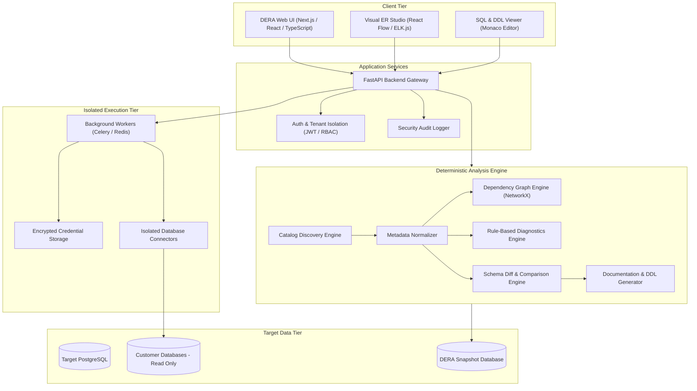
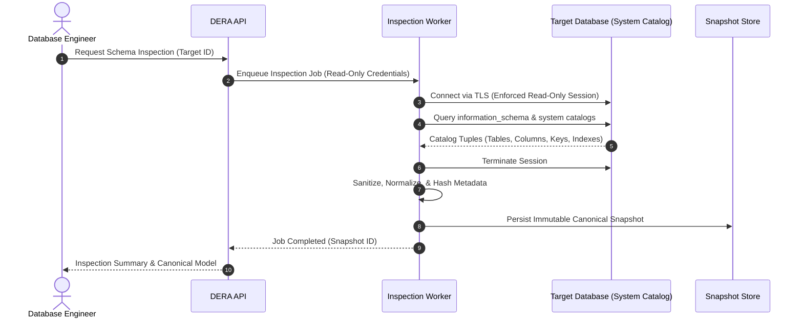
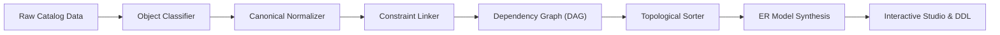
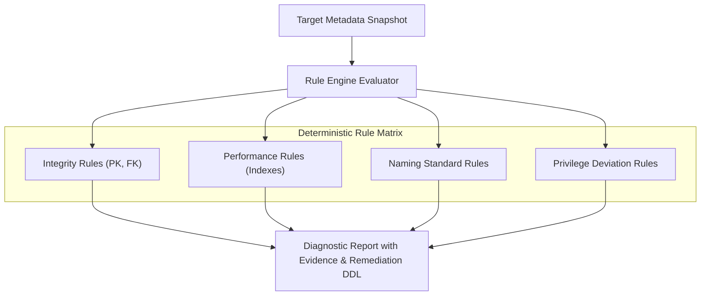
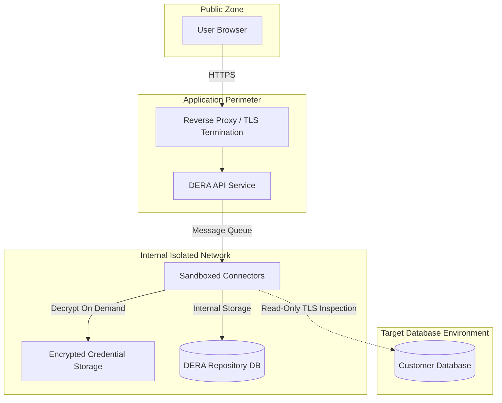
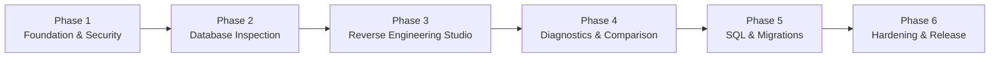

**Read this documentation in:** [English (Root)](../../README.md) | [Español](README.es.md) | [Français](README.fr.md) | [Deutsch](README.de.md) | [Português](README.pt.md) | [日本語](README.ja.md) | [한국어](README.ko.md) | [简体中文](README.zh-CN.md) | [العربية](README.ar.md) | [Русский](README.ru.md)

---

<div align="center">

# DERA

### Database Engineering & Reverse Analysis

**Understand Every Schema. Engineer Every Change.**

An enterprise-grade open-source, deterministic database reverse-engineering platform for developers, database engineers, architects, and engineering teams.

Explore database structures, visualize relationships, analyze schemas, identify structural risks, and generate engineering documentation — completely deterministic, without AI models or external AI APIs.

<br/>

[](https://github.com/krishanth7/dera/stargazers)
[](https://github.com/krishanth7/dera/forks)
[](https://github.com/krishanth7/dera/issues)
[](https://github.com/krishanth7/dera/blob/main/LICENSE)
[](https://github.com/krishanth7/dera/releases)
[](https://github.com/krishanth7/dera/actions/workflows/codeql.yml)
[](https://github.com/krishanth7/dera/graphs/contributors)
[](https://github.com/sponsors/krishanth7)

<br/>

[Overview](#-overview) ·
[Features](#-features) ·
[Architecture](#-architecture) ·
[Visual Pipelines](#-visual-pipelines) ·
[Security](#-security-principles) ·
[Technology Stack](#-technology-stack) ·
[Roadmap](#-development-roadmap) ·
[Contributing](#-contributing) ·
[Community](#-community)

</div>

---

## 🌍 Language Support

DERA provides documentation in 10 international languages. Use the table below or the top navigation bar to access the localized documentation:

| Language | Code | Documentation Link | Status |
|---|---|---|---|
| 🇬🇧 English | `en` | [English Primary (Root)](../../README.md) · [Synchronized Copy](README.en.md) | Primary Reference |
| 🇪🇸 Español | `es` | [Documentación en Español](README.es.md) | Full Translation |
| 🇫🇷 Français | `fr` | [Documentation en Français](README.fr.md) | Full Translation |
| 🇩🇪 Deutsch | `de` | [Dokumentation auf Deutsch](README.de.md) | Full Translation |
| 🇵🇹 Português | `pt` | [Documentação em Português](README.pt.md) | Full Translation |
| 🇯🇵 日本語 | `ja` | [日本語ドキュメント](README.ja.md) | Full Translation |
| 🇰🇷 한국어 | `ko` | [한국어 문서](README.ko.md) | Full Translation |
| 🇨🇳 简体中文 | `zh-CN` | [简体中文文档](README.zh-CN.md) | Full Translation |
| 🇸🇦 العربية | `ar` | [الوثائق باللغة العربية](README.ar.md) | Full Translation |
| 🇷🇺 Русский | `ru` | [Документация на русском](README.ru.md) | Full Translation |

---

## 📖 Overview

Modern relational databases are the foundational backbone of software infrastructure, but understanding an unfamiliar, evolving schema can be challenging. Enterprise systems often encompass hundreds of tables, thousands of columns, intricate foreign-key relationships, indexes, constraints, views, and cross-object dependencies.

Understanding and auditing these structures manually requires substantial engineering effort, prone to human oversight.

**DERA is engineered to solve this challenge.**

DERA provides a unified, secure workspace for exploring database architecture, reconstructing entity relationships, evaluating structural risks, and generating documentation through deterministic algorithms.

### Our Mission

Make database reverse engineering accessible, transparent, reproducible, and reliable for every developer, database administrator, and software architect.

### Our Philosophy

- **Deterministic by Design** — Reproducible analysis using mathematical graph algorithms and static rules.
- **Strictly No Generative AI** — Zero LLMs, zero machine learning models, and zero external AI inference APIs.
- **Privacy First** — Pure structural metadata analysis. No customer table-row data is extracted by default.
- **Open Source** — Transparent engineering under the permissive MIT license.
- **Developer Focused** — Native workflows built for software engineers and DBAs.
- **Security First** — Enforced read-only connections, credential encryption, and isolated execution.
- **Engineering Accuracy** — Evidence-based diagnostic findings instead of hallucinated explanations.

---

## ✨ Features

The following describes DERA's platform capabilities. Availability corresponds to the development phase and published releases.

| Feature Area | Status | Description |
|---|---|---|
| **Database Discovery** | Planned | Native metadata extraction across tables, columns, constraints, and indexes |
| **Reverse Engineering Core** | Planned | Canonical schema modeling, object classification, and dependency resolution |
| **Visual ER Studio** | Planned | Interactive entity-relationship diagrams, auto-layouts, filtering, and exports |
| **Deterministic Diagnostics** | Planned | Static rule evaluation detecting missing keys, redundant indexes, and naming flaws |
| **Schema Snapshot & Diff** | Planned | Versioned schema snapshots and structural change impact analysis |
| **SQL Performance Engineering**| Planned | Query inspection, plan visualization, and index optimization recommendations |
| **Documentation Generator** | Planned | Automated export to Markdown, HTML, JSON, SQL DDL, and SVG diagrams |
| **Security Architecture** | Planned | Role-based access control, read-only guarantees, and isolated workers |

### 🔍 Database Discovery

Inspect supported database engines and extract structural catalog information:

- Databases, schemas, and extensions
- Tables, partitions, and views
- Columns, data types, nullability, and default expressions
- Primary keys, foreign keys, and referential actions (`CASCADE`, `RESTRICT`)
- Unique constraints, check constraints, and exclusion constraints
- Indexes (B-tree, Hash, GIN, GiST), unique indexes, and partial index predicates
- Sequences, identity columns, and triggers

### 🧬 Reverse Engineering Engine

Reconstruct schema models using native metadata queries and deterministic algorithms:

- Canonical, engine-agnostic schema representation
- Structural metadata normalization
- Topological dependency graph construction
- Composite and single-column foreign-key mapping
- Immutable schema snapshot generation
- Deterministic SQL DDL reconstruction

### 🕸️ Visual ER Studio

Explore schema topology through an interactive entity-relationship interface:

- Interactive table nodes displaying columns, types, and constraints
- Visual foreign-key relationship connectors with cardinality indicators
- Deterministic automatic layout algorithms (hierarchical and force-directed)
- Schema-level grouping, tagging, and domain-driven subgraphs
- Interactive search, type filtering, and isolated dependency path tracing
- High-resolution SVG and PNG export capabilities

### 🛡️ Deterministic Database Diagnostics

Analyze schema metadata against configurable engineering rules to identify design risks:

| Diagnostic Rule | Category | Description |
|---|---|---|
| **Missing Primary Key** | Integrity | Identifies tables lacking an explicit primary key constraint |
| **Potentially Redundant Index** | Performance | Detects overlapping or duplicate index column prefixes |
| **Unindexed Foreign Key** | Performance | Flags foreign-key columns lacking supporting index coverage |
| **Polymorphic Anti-Patterns** | Integrity | Identifies loose foreign key relationships lacking referential constraints |
| **Nullability & Default Anomalies**| Consistency | Flags non-nullable columns without sensible default definitions |
| **Naming Convention Auditing** | Standardization | Detects case inconsistency and deviations from architectural guidelines |
| **Privilege Deviations** | Security | Highlights excessive grant privileges on catalog objects |

*Diagnostic findings are evidence-based recommendations paired with detailed justification and DDL guidance.*

### 🔄 Schema Comparison & Diff Engine

Compare database snapshots across environments (development, staging, production) or migration revisions:

- Added, modified, and removed tables and columns
- Data type alterations, sizing changes, and nullability modifications
- Index additions, deletions, and definition adjustments
- Constraint modifications and referential changes
- Breaking change classification (safe vs. potentially destructive)
- Migration preview generation with dependency-aware ordering

---

## 🧠 No AI. Just Engineering.

DERA is deliberately designed without artificial intelligence or machine learning models.

```text
┌───────────────────────────────────────────────────────────┐
│               STRICT NON-AI ARCHITECTURE                  │
│                                                           │
│   ❌  No OpenAI, Anthropic Claude, or Google Gemini       │
│   ❌  No Groq, DeepSeek, or Hosted Model APIs            │
│   ❌  No Local LLMs (Ollama, vLLM, llama.cpp)            │
│   ❌  No Non-Deterministic Hallucinations                 │
│                                                           │
│   ✅  Native System Catalog Queries (information_schema)   │
│   ✅  Deterministic Graph Algorithms (NetworkX)           │
│   ✅  Abstract Syntax Tree SQL Parsers (SQLGlot)          │
│   ✅  Reproducible Static Rule Engines                    │
│   ✅  Mathematical Schema Diff Algorithms                 │
└───────────────────────────────────────────────────────────┘
```

**Why DERA is Deterministic:**
1. **Predictability:** The same schema snapshot and rule configuration will always yield identical diagnostic results.
2. **Auditability:** Every warning, relationship, and graph edge links directly to concrete catalog evidence.
3. **Data Sovereignty:** Enterprise database schemas and structural metadata never leave your network to third-party model inference providers.
4. **Performance & Cost:** Zero inference latency, zero token pricing, zero rate-limiting, and zero reliance on external availability.

---

## 🏗️ Architecture

DERA follows a modular architecture designed for maintainability, extensibility, and secure database access.



---

## 🔬 Visual Pipelines

DERA executes deterministic, auditable pipelines for metadata inspection, relationship synthesis, and security validation.

### 1. Database Inspection Flow



### 2. Schema Reverse-Engineering Pipeline



### 3. Metadata Processing & Diagnostics Pipeline



### 4. Security Boundaries & Isolation



### 5. Planned Development Lifecycle



---

## 🔒 Security Principles

Because DERA connects to mission-critical databases, security is the primary architecture pillar.

- **Enforced Read-Only Mode:** Connection sessions enforce read-only execution modes (`SET SESSION CHARACTERISTICS AS TRANSACTION READ ONLY`).
- **No Table Row Extraction:** Analysis inspects database system catalogs (`information_schema`, `pg_catalog`) exclusively. Application records are not queried or stored.
- **Zero Hardcoded Secrets:** Credentials are encrypted at rest using AES-256-GCM and never logged, exported, or committed.
- **SSRF Prevention:** Connection targets are strictly validated to prevent unauthorized internal network scanning or cloud metadata access.
- **Least-Privilege Database Accounts:** Comprehensive guidance for provisioning unprivileged, read-only audit roles.
- **Auditable Operations:** Every inspection, export, and configuration modification generates an immutable audit record.

*For complete vulnerability disclosure procedures and guidelines, consult [SECURITY.md](../../SECURITY.md).*

---

## 🛠️ Technology Stack

| Layer | Component | Selection | Purpose | Status |
|---|---|---|---|---|
| **Frontend** | Framework | Next.js, React, TypeScript | Interactive web application | Planned |
| | Styling | Tailwind CSS | Consistent, responsive design system | Planned |
| | Component Library | shadcn/ui | Accessible UI components | Planned |
| | ER Visualization | React Flow, ELK.js | Interactive graph rendering & auto-layout | Planned |
| | Code Editor | Monaco Editor | SQL syntax highlighting and DDL viewing | Planned |
| **Backend** | API Framework | Python 3.12+, FastAPI | High-performance asynchronous API services | Planned |
| | Catalog Inspection | SQLAlchemy, psycopg | Database catalog extraction and connection pooling | Planned |
| | SQL Parsing | SQLGlot | Engine-agnostic SQL AST generation and transpilation | Planned |
| | Graph Processing | NetworkX | Dependency resolution and topological sorting | Planned |
| | Task Queue | Celery, Redis | Isolated asynchronous inspection workers | Planned |
| **Data Storage** | DERA Database | PostgreSQL | Metadata snapshot storage, user sessions, audit logs | Planned |
| | Migrations | Alembic | Version-controlled DERA database migrations | Planned |
| **DevOps & QA** | Containers | Docker, Docker Compose | Reproducible local development and deployment | Planned |
| | SAST & Security | CodeQL, Dependabot | Automated vulnerability and dependency scanning | Implemented |
| | Testing | Pytest, Playwright | Backend unit tests and frontend E2E tests | Planned |

---

## 🗄️ Database Compatibility

DERA is designed with a pluggable connector architecture to support modern relational and distributed database engines:

| Database Engine | Connector Status | Catalog Source | Target Timeline |
|---|---|---|---|
| **PostgreSQL** (v12 - v17) | In Development | `pg_catalog`, `information_schema` | Phase 2 (MVP) |
| **Supabase PostgreSQL** | In Development | PostgreSQL native connector | Phase 2 (MVP) |
| **MySQL** (v8.0+) | Planned | `information_schema`, `performance_schema` | Phase 5 |
| **SQLite** (v3.35+) | Planned | `sqlite_master`, `PRAGMA` table info | Phase 5 |
| **MariaDB** (v10.5+) | Planned | `information_schema` | Phase 5 |
| **Microsoft SQL Server** | Planned | `sys.tables`, `INFORMATION_SCHEMA` | Phase 5 |
| **Oracle Database** | Under Review | Data Dictionary Views (`ALL_*`, `DBA_*`) | Future Evaluation |

---

## 🚀 Getting Started

DERA is currently in active architecture and foundational development. Production deployment configurations will be published as release milestones are completed.

### Prerequisites (Planned)

- Python 3.12 or newer
- Node.js LTS (v20+)
- PostgreSQL 15+
- Docker and Docker Compose
- Git

### Cloning the Repository

```bash
git clone https://github.com/krishanth7/dera.git
cd dera
```

### Local Development Environment (Planned)

```bash
# Clone and prepare environment
cp .env.example .env

# Launch the development stack via Docker Compose
docker compose -f infrastructure/docker/docker-compose.dev.yml up --build
```

> **Note:** The application codebase is under active initial development. Check the [Development Roadmap](#-development-roadmap) for progress updates.

---

## 📁 Repository Structure

```text
dera/
├── .github/
│   ├── ISSUE_TEMPLATE/           # Structured GitHub issue templates
│   ├── workflows/                # CodeQL, Dependency Review, and CI workflows
│   ├── PULL_REQUEST_TEMPLATE.md  # Standardized pull request template
│   ├── dependabot.yml            # Automated dependency update configuration
│   └── FUNDING.yml               # Maintainer funding configuration
├── docs/
│   ├── README.md                 # Complete documentation index
│   ├── i18n/                     # Synchronized multilingual documentation
│   │   ├── README.en.md          # Synchronized English reference copy
│   │   ├── README.es.md          # Spanish documentation
│   │   ├── README.fr.md          # French documentation
│   │   ├── README.de.md          # German documentation
│   │   ├── README.pt.md          # Portuguese documentation
│   │   ├── README.ja.md          # Japanese documentation
│   │   ├── README.ko.md          # Korean documentation
│   │   ├── README.zh-CN.md       # Simplified Chinese documentation
│   │   ├── README.ar.md          # Arabic documentation (RTL compliant)
│   │   └── README.ru.md          # Russian documentation
│   ├── architecture/             # Architectural specifications
│   ├── development/              # Setup guides and engineering standards
│   ├── security/                 # Threat models and security practices
│   └── contributing/             # Contributor documentation
├── CODE_OF_CONDUCT.md            # Contributor Covenant Code of Conduct
├── CONTRIBUTING.md               # Detailed contribution guidelines
├── LICENSE                       # MIT License
├── README.md                     # Primary repository landing page
├── SECURITY.md                   # Comprehensive security policy
└── .gitignore                    # Git ignore specifications
```

---

## 🗺️ Development Roadmap

### Phase 1 — Foundation & Security
- [x] Establish official repository identity and licensing (MIT)
- [x] Configure CodeQL static application security testing
- [x] Implement Contributor Covenant Code of Conduct and Security Policies
- [x] Implement 10-language international documentation architecture
- [ ] Initialize monorepo application structure (`apps/web`, `apps/api`)
- [ ] Configure Docker development environment and baseline CI

### Phase 2 — Database Inspection Engine
- [ ] Implement native PostgreSQL metadata connector
- [ ] Extract tables, columns, constraints, indexes, and views
- [ ] Build canonical, engine-agnostic schema normalization model
- [ ] Implement immutable, cryptographic schema snapshot storage
- [ ] Add read-only connection enforcement and query timeout safeguards

### Phase 3 — Reverse Engineering Studio
- [ ] Build interactive React Flow entity-relationship studio
- [ ] Implement automated hierarchical layout algorithms
- [ ] Add schema filtering, search, and domain grouping
- [ ] Build dependency DAG traversal and visualization
- [ ] Add high-resolution SVG and PNG diagram export

### Phase 4 — Diagnostics & Schema Comparison
- [ ] Implement deterministic rule-based diagnostic engine
- [ ] Build rules: Missing PK, Redundant Indexes, Unindexed Foreign Keys
- [ ] Implement schema comparison algorithm (Snapshot Diff)
- [ ] Generate structured DDL change migration previews
- [ ] Add exportable diagnostic reports in Markdown, JSON, and HTML

### Phase 5 — Advanced Engineering & Connectors
- [ ] Add SQL AST query inspection and complexity metrics via SQLGlot
- [ ] Implement execution plan visualizer (`EXPLAIN ANALYZE`)
- [ ] Develop MySQL and SQLite database connectors
- [ ] Add migration sequencing and dependency-ordered DDL generation

### Phase 6 — Production Hardening
- [ ] Execute comprehensive security testing and vulnerability audits
- [ ] Perform large-schema performance benchmarking (1,000+ tables)
- [ ] Validate multi-tenant isolation and audit logging
- [ ] Publish official v1.0.0 container images and deployment guides

---

## 🧪 Testing & Quality Strategy

DERA maintains engineering rigor through repeatable automated testing:

- **Unit Testing:** Tests metadata parsing, graph cycles, and diagnostic rules with synthetic fixtures.
- **Integration Testing:** Tests connectors against containerized PostgreSQL, MySQL, and SQLite instances.
- **Deterministic Verification:** Guarantees that identical schema snapshots yield identical hash signatures and diagnostic findings.
- **Security Testing:** Continuous CodeQL scanning, dependency vulnerability reviews, and credential leak checks.
- **End-to-End Testing:** Playwright browser tests validating diagram interaction and layout responsiveness.

---

## 🤝 Contributing

Contributions are welcome from engineers, database specialists, documentation writers, and security researchers worldwide.

Please review our [CONTRIBUTING.md](../../CONTRIBUTING.md) guide and [Code of Conduct](../../CODE_OF_CONDUCT.md) before submitting pull requests.

### Development Workflow

1. Fork the repository on GitHub.
2. Create a focused branch: `git checkout -b feat/your-feature-name`.
3. Follow the [Conventional Commits](../../CONTRIBUTING.md#commit-message-guidelines) specification.
4. Add corresponding unit or integration tests.
5. Ensure CodeQL and documentation validation checks pass.
6. Open a pull request against `main` for maintainer review.

---

## 💬 Community

- [GitHub Discussions](https://github.com/krishanth7/dera/discussions) — Ask questions, propose ideas, and discuss database engineering.
- [GitHub Issues](https://github.com/krishanth7/dera/issues) — Report bugs or submit feature proposals.
- [GitHub Pull Requests](https://github.com/krishanth7/dera/pulls) — Submit code and documentation contributions.
- [Releases](https://github.com/krishanth7/dera/releases) — Track official release notes.

---

## ❤️ Support the Project

DERA is an independent open-source engineering initiative. You can support its continued development by:

- Starring the repository on GitHub
- Sharing the project with your engineering network
- Contributing connectors, rules, or documentation
- [Sponsoring the project on GitHub Sponsors](https://github.com/sponsors/krishanth7)

---

## 📜 License

DERA is distributed under the permissive **[MIT License](../../LICENSE)**.

```text
Copyright (c) 2026 Krishanth
```

---

## 👨‍💻 Maintainer

**Bunga Krishanth**  
Founder & Lead Maintainer

- GitHub: [@krishanth7](https://github.com/krishanth7)  
- Repository: [github.com/krishanth7/dera](https://github.com/krishanth7/dera)  
- Contact: `krishanth.b.2008@gmail.com`

*DERA is an independent open-source project maintained by Bunga Krishanth. OVIC Labs is acknowledged as part of the maintainer's broader engineering ecosystem.*

---

<div align="center">

### DERA — Database Engineering & Reverse Analysis

**Understand Every Schema. Engineer Every Change.**

*Built with engineering precision, mathematical determinism, and open-source transparency.*

© 2026 DERA Contributors. Distributed under the MIT License.

[Back to Top](#dera)

</div>
