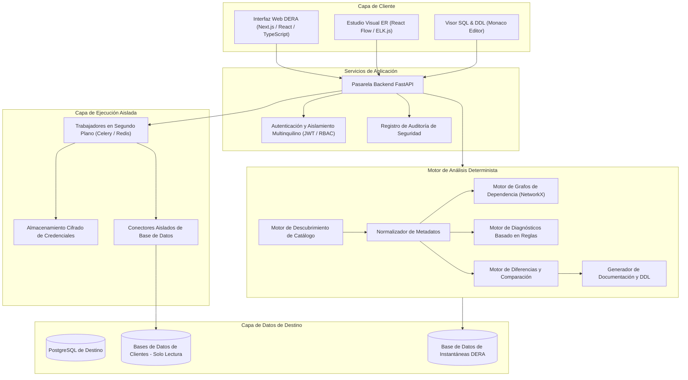
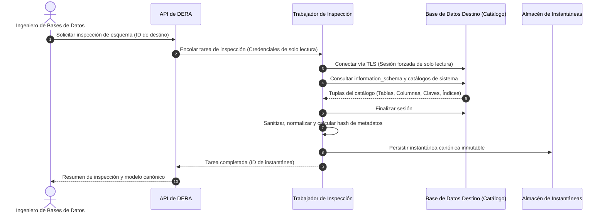
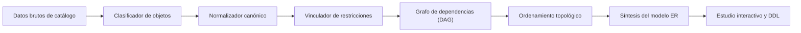
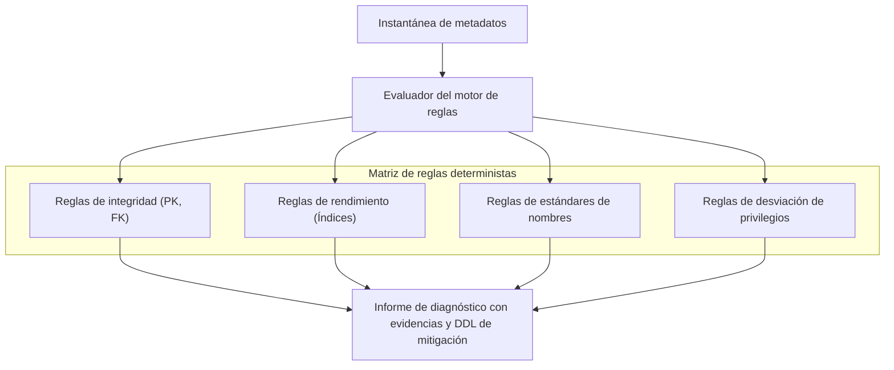
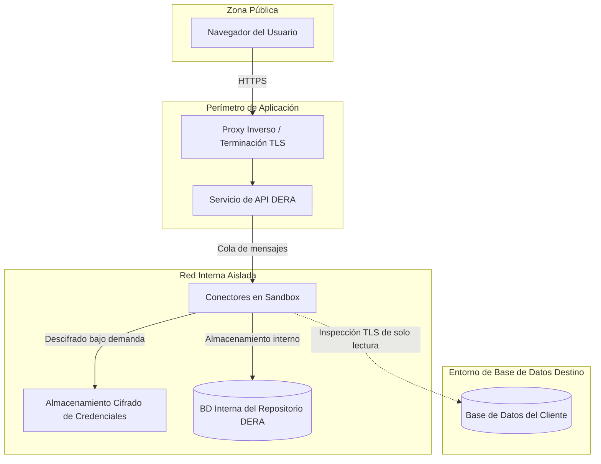
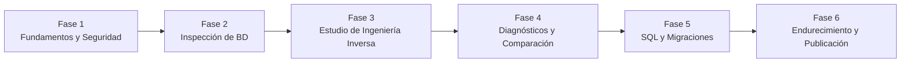

**Leer esta documentación en:** [English](../../README.md) | [Español](README.es.md) | [Français](README.fr.md) | [Deutsch](README.de.md) | [Português](README.pt.md) | [日本語](README.ja.md) | [한국어](README.ko.md) | [简体中文](README.zh-CN.md) | [العربية](README.ar.md) | [Русский](README.ru.md)

---

<div align="center">

# DERA

### Database Engineering & Reverse Analysis

**Comprende cada esquema. Diseña cada cambio.**

Una plataforma de ingeniería inversa de bases de datos determinista y de código abierto para desarrolladores, ingenieros de bases de datos, arquitectos y equipos de ingeniería.

Explora estructuras de bases de datos, visualiza relaciones, analiza esquemas, identifica riesgos estructurales y genera documentación técnica — de forma completamente determinista, sin modelos de IA ni APIs externas de IA.

<br/>

[](https://github.com/krishanth7/dera/stargazers)
[](https://github.com/krishanth7/dera/forks)
[](https://github.com/krishanth7/dera/issues)
[](https://github.com/krishanth7/dera/blob/main/LICENSE)
[](https://github.com/krishanth7/dera/releases)
[](https://github.com/krishanth7/dera/actions/workflows/codeql.yml)
[](https://github.com/krishanth7/dera/graphs/contributors)
[](https://github.com/sponsors/krishanth7)

<br/>

[Descripción general](#-descripción-general) ·
[Características](#-características) ·
[Arquitectura](#-arquitectura) ·
[Flujos visuales](#-flujos-visuales) ·
[Seguridad](#-principios-de-seguridad) ·
[Pila tecnológica](#-pila-tecnológica) ·
[Hoja de ruta](#-hoja-de-ruta-de-desarrollo) ·
[Contribución](#-cómo-contribuir) ·
[Comunidad](#-comunidad)

</div>

---

## 🌍 Soporte multilingüe

DERA ofrece documentación en 10 idiomas internacionales. Utiliza la tabla siguiente o la barra de navegación superior para consultar la documentación localizada:

| Idioma | Código | Enlace de documentación | Estado |
|---|---|---|---|
| 🇬🇧 English | `en` | [English Primary (Root)](../../README.md) · [Synchronized Copy](README.en.md) | Referencia principal |
| 🇪🇸 Español | `es` | [Documentación en Español](README.es.md) | Traducción completa |
| 🇫🇷 Français | `fr` | [Documentation en Français](README.fr.md) | Traducción completa |
| 🇩🇪 Deutsch | `de` | [Dokumentation auf Deutsch](README.de.md) | Traducción completa |
| 🇵🇹 Português | `pt` | [Documentação em Português](README.pt.md) | Traducción completa |
| 🇯🇵 日本語 | `ja` | [日本語ドキュメント](README.ja.md) | Traducción completa |
| 🇰🇷 한국어 | `ko` | [한국어 문서](README.ko.md) | Traducción completa |
| 🇨🇳 简体中文 | `zh-CN` | [简体中文文档](README.zh-CN.md) | Traducción completa |
| 🇸🇦 العربية | `ar` | [الوثائق باللغة العربية](README.ar.md) | Traducción completa |
| 🇷🇺 Русский | `ru` | [Документация на русском](README.ru.md) | Traducción completa |

---

## 📖 Descripción general

Las bases de datos relacionales modernas representan el pilar fundamental de la infraestructura de software, pero comprender un esquema complejo y en constante evolución puede resultar difícil. Los sistemas empresariales a menudo abarcan cientos de tablas, miles de columnas, relaciones complejas de claves foráneas, índices, restricciones, vistas y dependencias entre objetos.

Comprender y auditar estas estructuras manualmente requiere un gran esfuerzo de ingeniería y conlleva riesgos de omisión humana.

**DERA ha sido diseñado para resolver este desafío.**

DERA proporciona un entorno de trabajo unificado y seguro para explorar la arquitectura de bases de datos, reconstruir relaciones entre entidades, evaluar riesgos estructurales y generar documentación técnica mediante algoritmos deterministas.

### Nuestra misión

Hacer que la ingeniería inversa de bases de datos sea accesible, transparente, reproducible y confiable para cada desarrollador, administrador de bases de datos y arquitecto de software.

### Nuestra filosofía

- **Determinista por diseño** — Análisis reproducible mediante algoritmos de grafos matemáticos y reglas estáticas.
- **Estrictamente sin IA generativa** — Cero LLMs, cero modelos de aprendizaje automático y cero APIs externas de inferencia de IA.
- **Privacidad ante todo** — Análisis exclusivo de metadatos estructurales. Por defecto no se extraen registros ni filas de clientes.
- **Código abierto** — Ingeniería transparente bajo la licencia permisiva MIT.
- **Enfocado en desarrolladores** — Flujos de trabajo diseñados para ingenieros de software y DBAs.
- **Seguridad primordial** — Conexiones de solo lectura forzadas, cifrado de credenciales y ejecución aislada.
- **Rigor técnico** — Diagnósticos basados en evidencia verificable en lugar de explicaciones alucinadas.

---

## ✨ Características

A continuación se describen las capacidades de la plataforma DERA. Su disponibilidad corresponde a la fase de desarrollo y a las versiones publicadas.

| Área de funcionalidad | Estado | Descripción |
|---|---|---|
| **Descubrimiento de bases de datos** | Planificado | Extracción nativa de metadatos de tablas, columnas, restricciones e índices |
| **Núcleo de ingeniería inversa** | Planificado | Modelado canónico de esquemas, clasificación de objetos y resolución de dependencias |
| **Estudio visual ER** | Planificado | Diagramas interactivos entidad-relación, distribución automática, filtros y exportaciones |
| **Diagnósticos deterministas** | Planificado | Evaluación de reglas estáticas para detectar claves faltantes, índices redundantes y nombres |
| **Instantáneas y comparación de esquemas** | Planificado | Instantáneas versionadas de esquemas y análisis de impacto de cambios estructurales |
| **Ingeniería de rendimiento SQL** | Planificado | Inspección de consultas, visualización de planes y recomendaciones de optimización de índices |
| **Generador de documentación** | Planificado | Exportación automatizada a Markdown, HTML, JSON, SQL DDL y diagramas SVG |
| **Arquitectura de seguridad** | Planificado | Control de acceso basado en roles, garantías de solo lectura y procesos de trabajo aislados |

### 🔍 Descubrimiento de bases de datos

Inspecciona motores de bases de datos compatibles y extrae información estructural del catálogo del sistema:

- Bases de datos, esquemas y extensiones
- Tablas, particiones y vistas
- Columnas, tipos de datos, nulabilidad y expresiones por defecto
- Claves primarias, claves foráneas y acciones referenciales (`CASCADE`, `RESTRICT`)
- Restricciones únicas, restricciones check y restricciones de exclusión
- Índices (B-tree, Hash, GIN, GiST), índices únicos y predicados de índices parciales
- Secuencias, columnas de identidad y disparadores (triggers)

### 🧬 Núcleo de ingeniería inversa

Reconstruye modelos de esquemas mediante consultas nativas al catálogo y algoritmos deterministas:

- Representación de esquema canónica e independiente del motor
- Normalización de metadatos estructurales
- Construcción de grafos acíclicos dirigidos (DAG) de dependencias
- Mapeo de claves foráneas simples y compuestas
- Generación de instantáneas inmutables de esquemas
- Reconstrucción determinista de sentencias SQL DDL

### 🕸️ Estudio visual ER

Explora la topología del esquema a través de una interfaz interactiva entidad-relación:

- Nodos de tabla interactivos con visualización de columnas, tipos y restricciones
- Conectores visuales de relaciones de clave foránea con indicadores de cardinalidad
- Algoritmos deterministas de distribución automática (jerárquicos y basados en fuerzas)
- Agrupación por esquemas, etiquetas y subgrafos por dominio
- Búsqueda interactiva, filtrado por tipos y trazado de rutas de dependencia
- Exportación en alta resolución a formatos SVG y PNG

### 🛡️ Diagnósticos deterministas de bases de datos

Analiza los metadatos del esquema frente a reglas de ingeniería configurables para detectar riesgos de diseño:

| Regla de diagnóstico | Categoría | Descripción |
|---|---|---|
| **Clave primaria ausente** | Integridad | Identifica tablas que carecen de una restricción de clave primaria explícita |
| **Índice potencialmente redundante** | Rendimiento | Detecta prefijos de columnas de índice superpuestos o duplicados |
| **Clave foránea sin índice** | Rendimiento | Señala columnas de clave foránea que carecen de cobertura de índice adecuada |
| **Antipatrones polimórficos** | Integridad | Identifica relaciones foráneas implícitas sin restricciones referenciales |
| **Anomalías en nulabilidad y valores por defecto** | Consistencia | Advierte sobre columnas no nulas sin definiciones de valores por defecto coherentes |
| **Auditoría de convenciones de nombres** | Estandarización | Detecta inconsistencias tipográficas y desviaciones de las directrices arquitectónicas |
| **Desviaciones de privilegios** | Seguridad | Destaca privilegios de acceso excesivos sobre los objetos del catálogo |

*Los hallazgos de diagnóstico son recomendaciones basadas en evidencias acompañadas de justificaciones detalladas e instrucciones DDL de mitigación.*

### 🔄 Comparación de esquemas y motor de diferencias

Compara instantáneas de bases de datos entre entornos (desarrollo, staging, producción) o entre revisiones de migración:

- Tablas y columnas añadidas, modificadas y eliminadas
- Modificaciones en tipos de datos, tamaños y nulabilidad
- Altas, bajas y ajustes en definiciones de índices
- Modificaciones en restricciones y cambios referenciales
- Clasificación de cambios incompatibles (seguros vs. potencialmente destructivos)
- Generación de previsualización de migraciones con ordenamiento según dependencias

---

## 🧠 Cero IA. Pura ingeniería.

DERA está deliberadamente diseñado sin inteligencia artificial ni modelos de aprendizaje automático.

```text
┌───────────────────────────────────────────────────────────┐
│              ARQUITECTURA ESTRICTA SIN IA                 │
│                                                           │
│   ❌  Sin OpenAI, Anthropic Claude ni Google Gemini       │
│   ❌  Sin Groq, DeepSeek ni APIs de modelos alojados      │
│   ❌  Sin LLMs locales (Ollama, vLLM, llama.cpp)          │
│   ❌  Sin alucinaciones no deterministas                  │
│                                                           │
│   ✅  Consultas nativas a catálogos (information_schema)  │
│   ✅  Algoritmos de grafos deterministas (NetworkX)       │
│   ✅  Analizadores AST de SQL rigurosos (SQLGlot)         │
│   ✅  Motores de reglas estáticas reproducibles           │
│   ✅  Algoritmos matemáticos de comparación de esquemas   │
└───────────────────────────────────────────────────────────┘
```

**Por qué DERA es determinista:**
1. **Previsibilidad:** La misma instantánea de esquema y configuración de reglas producirá siempre diagnósticos idénticos.
2. **Auditabilidad:** Cada advertencia, relación y arista del grafo se fundamenta directamente en evidencias concretas del catálogo.
3. **Soberanía del dato:** Los esquemas de bases de datos corporativas y sus metadatos nunca abandonan su red hacia proveedores externos de inferencia.
4. **Rendimiento y coste:** Cero latencia de inferencia, cero costes de tokens, cero límites de tasa de peticiones y cero dependencia de servicios externos.

---

## 🏗️ Arquitectura

DERA sigue una arquitectura modular concebida para ofrecer mantenibilidad, extensibilidad y un acceso seguro a las bases de datos.



---

## 🔬 Flujos visuales

DERA ejecuta flujos auditables y deterministas para la inspección de metadatos, la síntesis de relaciones y la validación de seguridad.

### 1. Flujo de inspección de bases de datos



### 2. Flujo de ingeniería inversa de esquemas



### 3. Flujo de procesamiento de metadatos y diagnósticos



### 4. Límites de seguridad y aislamiento



### 5. Ciclo de vida de desarrollo planificado



---

## 🔒 Principios de seguridad

Dado que DERA se conecta a bases de datos de misión crítica, la seguridad constituye el eje central de su diseño.

- **Modo de solo lectura garantizado:** Las sesiones de conexión configuran transacciones en modo de solo lectura estricto (`SET SESSION CHARACTERISTICS AS TRANSACTION READ ONLY`).
- **Cero extracción de datos de usuario:** La inspección consulta exclusivamente los catálogos del sistema (`information_schema`, `pg_catalog`). Los registros de la aplicación jamás se consultan ni se almacenan.
- **Sin secretos en código:** Las credenciales se cifran en reposo mediante AES-256-GCM y nunca se registran en logs, ni se exportan ni se incluyen en el control de versiones.
- **Prevención de SSRF:** Las direcciones y nombres de host de conexión se validan para impedir escaneos de redes internas o accesos a metadatos de servicios cloud.
- **Cuentas de base de datos con mínimo privilegio:** Documentación detallada para aprovisionar roles de auditoría de solo lectura sin permisos elevados.
- **Operaciones auditables:** Cada inspección, exportación y cambio de configuración genera un registro inmutable de auditoría.

*Para consultar los procedimientos y pautas de divulgación de vulnerabilidades, revisa [SECURITY.md](../../SECURITY.md).*

---

## 🛠️ Pila tecnológica

| Capa | Componente | Tecnología elegida | Propósito | Estado |
|---|---|---|---|---|
| **Frontend** | Framework | Next.js, React, TypeScript | Aplicación web interactiva | Planificado |
| | Estilos | Tailwind CSS | Sistema de diseño coherente y adaptable | Planificado |
| | Componentes UI | shadcn/ui | Componentes accesibles | Planificado |
| | Visualización ER | React Flow, ELK.js | Renderizado de grafos y distribución automática | Planificado |
| | Editor de código | Monaco Editor | Resaltado sintáctico de SQL y visor de DDL | Planificado |
| **Backend** | Framework API | Python 3.12+, FastAPI | Servicios API asíncronos de alto rendimiento | Planificado |
| | Inspección de catálogo | SQLAlchemy, psycopg | Extracción de metadatos y grupos de conexiones | Planificado |
| | Análisis SQL | SQLGlot | AST de SQL independiente del motor | Planificado |
| | Procesamiento de grafos | NetworkX | Resolución de dependencias y ordenación topológica | Planificado |
| | Cola de tareas | Celery, Redis | Procesos de trabajo asíncronos aislados | Planificado |
| **Almacenamiento** | Base de datos DERA | PostgreSQL | Almacén de instantáneas, sesiones y auditoría | Planificado |
| | Migraciones | Alembic | Control de versiones de la base de datos de DERA | Planificado |
| **DevOps y QA** | Contenedores | Docker, Docker Compose | Entorno de desarrollo reproducible y despliegue | Planificado |
| | SAST y Seguridad | CodeQL, Dependabot | Análisis estático de vulnerabilidades y dependencias | Implementado |
| | Pruebas | Pytest, Playwright | Pruebas unitarias de backend y E2E de frontend | Planificado |

---

## 🗄️ Compatibilidad de bases de datos

DERA incorpora una arquitectura de conectores modulares para admitir motores relacionales y distribuidos modernos:

| Motor de base de datos | Estado del conector | Fuente de catálogo | Cronograma objetivo |
|---|---|---|---|
| **PostgreSQL** (v12 - v17) | En desarrollo | `pg_catalog`, `information_schema` | Fase 2 (MVP) |
| **Supabase PostgreSQL** | En desarrollo | Conector nativo de PostgreSQL | Fase 2 (MVP) |
| **MySQL** (v8.0+) | Planificado | `information_schema`, `performance_schema` | Fase 5 |
| **SQLite** (v3.35+) | Planificado | `sqlite_master`, `PRAGMA` table info | Fase 5 |
| **MariaDB** (v10.5+) | Planificado | `information_schema` | Fase 5 |
| **Microsoft SQL Server** | Planificado | `sys.tables`, `INFORMATION_SCHEMA` | Fase 5 |
| **Oracle Database** | En evaluación | Vistas del diccionario de datos (`ALL_*`, `DBA_*`) | Evaluación futura |

---

## 🚀 Primeros pasos

DERA se encuentra actualmente en fase de desarrollo fundacional y arquitectónico. Las configuraciones para producción se publicarán conforme se completen las metas de cada versión.

### Requisitos previos (Planificados)

- Python 3.12 o superior
- Node.js LTS (v20+)
- PostgreSQL 15+
- Docker y Docker Compose
- Git

### Clonar el repositorio

```bash
git clone https://github.com/krishanth7/dera.git
cd dera
```

### Entorno de desarrollo local (Planificado)

```bash
# Clonar y preparar el entorno
cp .env.example .env

# Iniciar la pila de desarrollo con Docker Compose
docker compose -f infrastructure/docker/docker-compose.dev.yml up --build
```

> **Nota:** La base de código de la aplicación se encuentra en desarrollo activo. Consulta la [Hoja de ruta de desarrollo](#-hoja-de-ruta-de-desarrollo) para seguir el progreso.

---

## 📁 Estructura del repositorio

```text
dera/
├── .github/
│   ├── ISSUE_TEMPLATE/           # Plantillas estructuradas de incidencias de GitHub
│   ├── workflows/                # Flujos de trabajo de CodeQL, revisión de dependencias y CI
│   ├── PULL_REQUEST_TEMPLATE.md  # Plantilla estandarizada de solicitud de extracción (PR)
│   ├── dependabot.yml            # Configuración de actualizaciones automáticas de Dependabot
│   └── FUNDING.yml               # Configuración de patrocinio del mantenedor
├── docs/
│   ├── README.md                 # Índice general de documentación
│   ├── i18n/                     # Documentación multilingüe sincronizada
│   │   ├── README.en.md          # Copia de referencia sincronizada en inglés
│   │   ├── README.es.md          # Documentación en español
│   │   ├── README.fr.md          # Documentación en francés
│   │   ├── README.de.md          # Documentación en alemán
│   │   ├── README.pt.md          # Documentación en portugués
│   │   ├── README.ja.md          # Documentación en japonés
│   │   ├── README.ko.md          # Documentación en coreano
│   │   ├── README.zh-CN.md       # Documentación en chino simplificado
│   │   ├── README.ar.md          # Documentación en árabe (compatible con RTL)
│   │   └── README.ru.md          # Documentación en ruso
│   ├── architecture/             # Especificaciones arquitectónicas
│   ├── development/              # Guías de configuración y estándares de ingeniería
│   ├── security/                 # Modelos de amenazas y prácticas de seguridad
│   └── contributing/             # Documentación para colaboradores
├── CODE_OF_CONDUCT.md            # Código de conducta Contributor Covenant
├── CONTRIBUTING.md               # Directrices detalladas para contribuir
├── LICENSE                       # Licencia MIT
├── README.md                     # Página principal del repositorio
├── SECURITY.md                   # Política exhaustiva de seguridad
└── .gitignore                    # Reglas de omisión de Git
```

---

## 🗺️ Hoja de ruta de desarrollo

### Fase 1 — Fundamentos y Seguridad
- [x] Establecer la identidad oficial del repositorio y la licencia (MIT)
- [x] Configurar el análisis estático de seguridad de aplicaciones con CodeQL
- [x] Implementar el Código de conducta y las Políticas de seguridad
- [x] Implementar la arquitectura de documentación internacional en 10 idiomas
- [ ] Inicializar la estructura monorepo de la aplicación (`apps/web`, `apps/api`)
- [ ] Configurar el entorno de desarrollo en Docker y la integración continua base

### Fase 2 — Motor de inspección de bases de datos
- [ ] Implementar el conector nativo de metadatos para PostgreSQL
- [ ] Extraer tablas, columnas, restricciones, índices y vistas
- [ ] Construir el modelo canónico de normalización de esquemas
- [ ] Implementar el almacenamiento criptográfico e inmutable de instantáneas
- [ ] Añadir garantías de conexión de solo lectura y límites de tiempo de consulta

### Fase 3 — Estudio de ingeniería inversa
- [ ] Construir el estudio interactivo de entidad-relación con React Flow
- [ ] Implementar algoritmos de distribución jerárquica automatizada
- [ ] Añadir filtros de esquema, búsqueda y agrupación por dominios
- [ ] Construir la visualización y recorrido de grafos de dependencia (DAG)
- [ ] Permitir la exportación de diagramas en alta resolución a formatos SVG y PNG

### Fase 4 — Diagnósticos y comparación de esquemas
- [ ] Implementar el motor de diagnóstico basado en reglas deterministas
- [ ] Crear reglas: Clave primaria ausente, Índices redundantes, Claves foráneas sin índice
- [ ] Implementar el algoritmo de comparación de esquemas (Snapshot Diff)
- [ ] Generar vistas previas estructuradas de cambios y migraciones en DDL
- [ ] Permitir la exportación de informes diagnósticos en Markdown, JSON y HTML

### Fase 5 — Ingeniería avanzada y nuevos conectores
- [ ] Incorporar análisis AST de consultas SQL y métricas de complejidad mediante SQLGlot
- [ ] Implementar el visualizador de planes de ejecución (`EXPLAIN ANALYZE`)
- [ ] Desarrollar conectores para bases de datos MySQL y SQLite
- [ ] Añadir ordenación de migraciones y generación de DDL en secuencia de dependencias

### Fase 6 — Endurecimiento para producción
- [ ] Realizar pruebas integrales de seguridad y auditorías de vulnerabilidades
- [ ] Ejecutar pruebas de rendimiento con esquemas masivos (más de 1.000 tablas)
- [ ] Validar el aislamiento multinquilino y el registro de auditoría
- [ ] Publicar las imágenes oficiales de contenedor v1.0.0 y guías de despliegue

---

## 🧪 Estrategia de pruebas y calidad

DERA mantiene el rigor de la ingeniería mediante pruebas automatizadas y reproducibles:

- **Pruebas unitarias:** Verifican el análisis de metadatos, los ciclos en grafos y las reglas de diagnóstico con datos sintéticos.
- **Pruebas de integración:** Validan los conectores contra instancias en contenedor de PostgreSQL, MySQL y SQLite.
- **Verificación determinista:** Asegura que instantáneas de esquema idénticas generen exactamente las mismas firmas hash y diagnósticos.
- **Pruebas de seguridad:** Escaneo continuo con CodeQL, revisión de vulnerabilidades en dependencias y verificación de fugas de credenciales.
- **Pruebas de extremo a extremo:** Pruebas de navegador con Playwright para validar la interacción con diagramas y la responsividad.

---

## 🤝 Cómo contribuir

Agradecemos las contribuciones de ingenieros, especialistas en bases de datos, redactores técnicos e investigadores de seguridad de todo el mundo.

Por favor, revisa nuestra guía [CONTRIBUTING.md](../../CONTRIBUTING.md) y el [Código de conducta](../../CODE_OF_CONDUCT.md) antes de enviar solicitudes de extracción (pull requests).

### Flujo de trabajo de desarrollo

1. Haz un fork del repositorio en GitHub.
2. Crea una rama específica: `git checkout -b feat/nombre-de-tu-caracteristica`.
3. Sigue la especificación de [Conventional Commits](../../CONTRIBUTING.md#commit-message-guidelines).
4. Añade las pruebas unitarias o de integración correspondientes.
5. Asegúrate de que los análisis de CodeQL y las validaciones de documentación pasen satisfactoriamente.
6. Abre un pull request hacia la rama `main` para la revisión de los mantenedores.

---

## 💬 Comunidad

- [GitHub Discussions](https://github.com/krishanth7/dera/discussions) — Formula preguntas, propón ideas y debate sobre ingeniería de bases de datos.
- [GitHub Issues](https://github.com/krishanth7/dera/issues) — Informa sobre errores o plantea solicitudes de funcionalidades.
- [GitHub Pull Requests](https://github.com/krishanth7/dera/pulls) — Envía contribuciones de código y documentación.
- [Releases](https://github.com/krishanth7/dera/releases) — Consulta las notas oficiales de lanzamiento.

---

## ❤️ Apoya el proyecto

DERA es una iniciativa de ingeniería de código abierto independiente. Puedes respaldar su desarrollo continuo:

- Otorgando una estrella al repositorio en GitHub
- Compartiendo el proyecto con tu red profesional de ingeniería
- Aportando conectores, reglas o mejoras en la documentación
- [Patrocinando el proyecto en GitHub Sponsors](https://github.com/sponsors/krishanth7)

---

## 📜 Licencia

DERA se distribuye bajo la permisiva **[Licencia MIT](../../LICENSE)**.

```text
Copyright (c) 2026 Krishanth
```

---

## 👨‍💻 Mantenedor

**Bunga Krishanth**  
Fundador y Mantenedor Principal

- GitHub: [@krishanth7](https://github.com/krishanth7)  
- Repositorio: [github.com/krishanth7/dera](https://github.com/krishanth7/dera)  
- Correo electrónico: `krishanth.b.2008@gmail.com`

*DERA es un proyecto independiente de código abierto mantenido por Bunga Krishanth. OVIC Labs es reconocido como parte del ecosistema de ingeniería más amplio del mantenedor.*

---

<div align="center">

### DERA — Database Engineering & Reverse Analysis

**Comprende cada esquema. Diseña cada cambio.**

*Construido con precisión de ingeniería, determinismo matemático y transparencia de código abierto.*

© 2026 Colaboradores de DERA. Distribuido bajo la Licencia MIT.

[Volver arriba](#dera)

</div>
