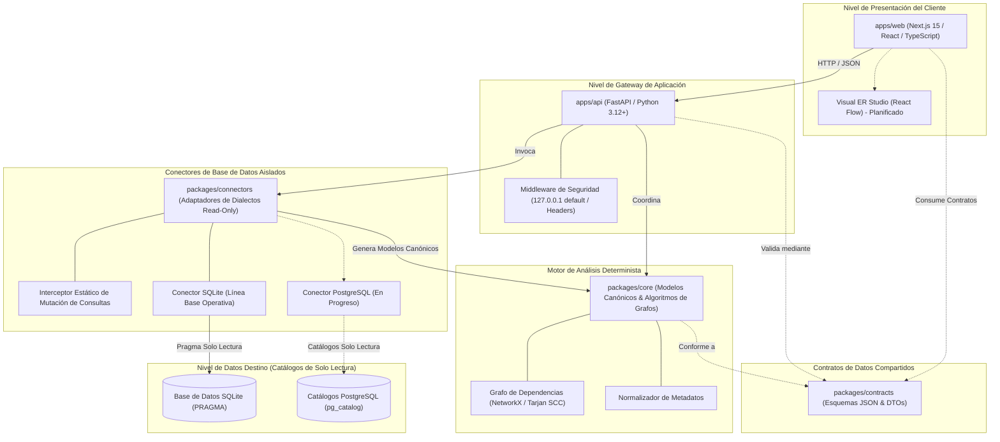

<!-- DERA:I18N_NAV:START -->
[English](../../README.md) | **Español** | [Français](README.fr.md) | [Deutsch](README.de.md) | [Português](README.pt.md) | [Italiano](README.it.md) | [日本語](README.ja.md) | [한국어](README.ko.md) | [简体中文](README.zh-CN.md) | [Русский](README.ru.md)
<!-- DERA:I18N_NAV:END -->

---

<div align="center">

# DERA

### Database Engineering & Reverse Analysis

**Comprende cada esquema. Diseña cada cambio.**

Una plataforma independiente y de código abierto para la ingeniería e ingeniería inversa de bases de datos, diseñada para desarrolladores, arquitectos de bases de datos y equipos de ingeniería.

Explora estructuras de bases de datos, reconstruye relaciones entre entidades, evalúa riesgos estructurales y planifica cambios de esquema — de forma completamente determinista, sin modelos de inteligencia artificial ni APIs externas de inferencia.

<br/>

[](../../LICENSE)
[](https://github.com/krishanth7/dera/actions/workflows/ci.yml)
[](https://github.com/krishanth7/dera/actions/workflows/codeql.yml)
[](https://github.com/krishanth7/dera/actions/workflows/documentation.yml)
[](../../pyproject.toml)
[](../../tsconfig.json)
[-orange?style=for-the-badge)](#-arquitectura-estrictamente-sin-ia)
[](../../CONTRIBUTING.md)

<br/>

[Descripción General](#-descripción-general) ·
[Matriz de Funcionalidades](#-matriz-del-estado-de-funcionalidades) ·
[Arquitectura](#-panorámica-de-la-arquitectura) ·
[Estructura Monorepo](#-estructura-del-repositorio) ·
[Primeros Pasos](#-primeros-pasos) ·
[Compatibilidad de Bases de Datos](#-matriz-de-compatibilidad-de-bases-de-datos) ·
[Seguridad](#-principios-de-seguridad) ·
[Navegación de Documentación](#-navegación-de-la-documentación-para-desarrolladores) ·
[Hoja de Ruta](#-hoja-de-ruta-principal) ·
[Cómo Contribuir](#-cómo-contribuir) ·
[Comunidad](#-comunidad)

</div>

---

## 🌍 Soporte Multilingüe

DERA mantiene documentación sincronizada en 10 idiomas internacionales. El README en inglés actúa como la fuente canónica de verdad de acuerdo con nuestro [Contrato de Mantenimiento de Documentación](../development/README_MAINTENANCE.md).

| Idioma | Código | Enlace de Documentación | Estado |
|---|---|---|---|
| 🇬🇧 English | `en` | [English Primary (Root)](../../README.md) · [Synchronized Copy](README.en.md) | **Fuente Autoritativa de Verdad** |
| 🇪🇸 Español | `es` | [Documentación en Español](README.es.md) | Traducción Completa |
| 🇫🇷 Français | `fr` | [Documentation en Français](README.fr.md) | Traducción Completa |
| 🇩🇪 Deutsch | `de` | [Dokumentation auf Deutsch](README.de.md) | Traducción Completa |
| 🇵🇹 Português | `pt` | [Documentação em Português](README.pt.md) | Traducción Completa |
| 🇮🇹 Italiano | `it` | [Documentazione in Italiano](README.it.md) | Traducción Completa |
| 🇯🇵 日本語 | `ja` | [日本語ドキュメント](README.ja.md) | Traducción Completa |
| 🇰🇷 한국어 | `ko` | [한국어 문서](README.ko.md) | Traducción Completa |
| 🇨🇳 简体中文 | `zh-CN` | [简体中文文档](README.zh-CN.md) | Traducción Completa |
| 🇷🇺 Русский | `ru` | [Документация на русском](README.ru.md) | Traducción Completa |

---

## 📖 Descripción General

Las bases de datos relacionales modernas representan la columna vertebral de la infraestructura de software. Sin embargo, comprender esquemas desconocidos, heredados o en rápida evolución presenta importantes desafíos de ingeniería:
- **Esquemas Complejos:** Las bases de datos empresariales suelen abarcar cientos de tablas, miles de columnas y relaciones de clave foránea no documentadas.
- **Deuda Arquitectónica:** Dependencias circulares entre claves foráneas, claves primarias ausentes, claves foráneas sin índices e índices redundantes se acumulan en silencio con el tiempo.
- **Riesgos de Migración:** Modificar esquemas sin un grafo topológico completo arriesga bloqueos en cascada, pérdida de datos e infracciones de restricciones de integridad.
- **Privacidad y Seguridad:** Las organizaciones no pueden arriesgarse a exponer credenciales de producción o registros de datos confidenciales a servicios de IA en la nube.

**DERA está diseñado para resolver estos desafíos mediante determinismo matemático.**

DERA proporciona una plataforma modular y de código abierto que inspecciona los catálogos del sistema, reconstruye grafos de dependencias, evalúa riesgos estructurales y genera vistas previas de migración mediante algoritmos verificables y reproducibles.

### Principios Fundamentales de Ingeniería

1. **Determinista por Diseño:** Cada instantánea del esquema, ordenamiento topológico del grafo y diagnóstico es reproducible y se basa en el álgebra relacional.
2. **Estrictamente sin IA:** Cero IA generativa, cero modelos de lenguaje grandes (LLMs), cero bases de datos vectoriales y cero APIs de inferencia externas.
3. **Seguridad de Solo Lectura:** Aplicación estricta de solo lectura a nivel de conexión, bloqueo estático de mutaciones SQL mediante AST y consultas exclusivas a catálogos.
4. **Cero Extracción de Datos de Filas de Clientes:** Pura introspección de metadatos (`information_schema`, `pg_catalog`, `sqlite_master`). Las filas de las tablas de aplicación nunca se extraen, transmiten ni almacenan.
5. **Arquitectura Monorepo Desacoplada:** Límites arquitectónicos nítidos que aíslan algoritmos de grafos, conectores de bases de datos, el gateway API y el estudio visual.
6. **Código Abierto y Permisivo:** Software independiente publicado bajo la permisiva [Licencia MIT](../../LICENSE).

---

## 🧠 Arquitectura Estrictamente sin IA

DERA está intencionalmente diseñado sin componentes de inteligencia artificial ni aprendizaje automático.

```text
┌───────────────────────────────────────────────────────────┐
│           ARQUITECTURA ESTRICTAMENTE SIN IA               │
│                                                           │
│   ❌  Sin OpenAI, Anthropic Claude ni Google Gemini       │
│   ❌  Sin APIs de Groq, DeepSeek ni modelos alojados      │
│   ❌  Sin LLMs locales (Ollama, vLLM, llama.cpp)          │
│   ❌  Sin predicciones estocásticas ni alucinaciones      │
│   ❌  Sin embeddings vectoriales en nube ni RAG externo   │
│                                                           │
│   ✅  Consultas nativas a catálogos (information_schema)  │
│   ✅  Algoritmos matemáticos de grafos (NetworkX/Tarjan)  │
│   ✅  Analizadores SQL por Abstract Syntax Tree (SQLGlot) │
│   ✅  Motores de reglas estáticas reproducibles           │
│   ✅  Huellas criptográficas de hash (SHA-256)            │
└───────────────────────────────────────────────────────────┘
```

**Por qué DERA es Determinista:**
- **Auditabilidad Matemática:** Cada relación, advertencia de ciclo y diagnóstico cita evidencia concreta de catálogo y algoritmos de grafos reproducibles.
- **Reproducibilidad Byte por Byte:** Ejecutar una auditoría sobre la misma instantánea genera resultados idénticos en cualquier máquina o flujo CI.
- **Soberanía de Datos Empresariales:** Los esquemas y topologías jamás abandonan su red hacia proveedores de modelos externos.
- **Cero Costos Operativos:** Cero costos por tokens, cero límites de tasa (rate limiting) y cero latencia de red por inferencia.

---

## 📊 Matriz del Estado de Funcionalidades

DERA mantiene un informe transparente basado en el código efectivamente implementado y comprobado por pruebas automatizadas:

| Funcionalidad | Estado | Evidencia de Implementación | Ubicación en Monorepo |
|---|:---:|---|---|
| **Modelos de Esquema Base** | **Implementado** | Modelos canónicos `Column`, `Table`, `ForeignKey`, `Index` | [`packages/core/src/dera/models.py`](../../packages/core/src/dera/models.py) |
| **Motor de Grafos de Dependencia** | **Implementado** | DAG resistente a ciclos y ordenamiento topológico (Tarjan SCC) | [`packages/core/src/dera/graph.py`](../../packages/core/src/dera/graph.py) |
| **Interceptor de Mutación (Read-Only)** | **Implementado** | Análisis estático AST que bloquea SQL destructivo (`DROP`, `ALTER`, etc.) | [`packages/connectors/src/dera_connectors/base/`](../../packages/connectors/src/dera_connectors/base/connector.py) |
| **Introspección de Catálogo SQLite** | **Implementado** | Detección de tablas, columnas, PK, FK e índices | [`packages/connectors/src/dera_connectors/sqlite/`](../../packages/connectors/src/dera_connectors/sqlite/connector.py) |
| **Inspección de Catálogo PostgreSQL** | **En Progreso** | Pruebas de integración con contenedor efímero de PostgreSQL | [`tests/integration/`](../../tests/integration/) |
| **Gateway API y Telemetría** | **Implementado** | Servicio FastAPI con enlace a localhost y endpoints de salud | [`apps/api/src/dera_api/main.py`](../../apps/api/src/dera_api/main.py) |
| **Base de la Aplicación Web Studio** | **Implementado** | Base Next.js 15 TypeScript y panel de estado arquitectónico | [`apps/web/src/app/page.tsx`](../../apps/web/src/app/page.tsx) |
| **Contratos de Datos Compartidos** | **Implementado** | Esquemas JSON versionados y DTOs de serialización | [`packages/contracts/schemas/`](../../packages/contracts/schemas/) |
| **Lienzo Visual ER Studio** | Planificado | Lienzo interactivo basado en React Flow | Hoja de Ruta Fase 7 |
| **Matriz de Reglas Deterministas** | Planificado | Detección de PK faltantes, FK sin índices e índices redundantes | Hoja de Ruta Fase 8 |
| **Motor Diff de Instantáneas** | Planificado | Comparación semántica de instantáneas y previsualización DDL | Hoja de Ruta Fase 9 |
| **Analizador de Rendimiento AST SQL** | Planificado | Complejidad de consultas SQLGlot y visualizador de planes | Hoja de Ruta Fase 10 |

> **Leyenda de Estados:**
> - **`Implementado`** &mdash; Codificado, verificado y respaldado por pruebas automatizadas en CI.
> - **`En Progreso`** &mdash; En desarrollo activo y pruebas de integración en el hito actual.
> - **`Planificado`** &mdash; Programado en la hoja de ruta de desarrollo de 12 fases.

---

## 🏗️ Panorámica de la Arquitectura

DERA organiza sus capacidades en espacios de trabajo desacoplados según nuestra [Especificación Arquitectónica de Monorepo](../architecture/README_ARCHITECTURE.md):



### Desglose Textual de la Arquitectura (Accesibilidad)
- **Nivel de Presentación del Cliente (`apps/web`):** Frontend Next.js 15 TypeScript que se comunica con la API mediante JSON y albergará el lienzo visual de diagramas ER.
- **Nivel de Gateway de Aplicación (`apps/api`):** Backend FastAPI enlazado a `127.0.0.1` por defecto, que aloja telemetría de salud, rutas de extracción de catálogo y middleware de seguridad.
- **Contratos de Datos Compartidos (`packages/contracts`):** Definiciones JSON Schema e interfaces TypeScript que determinan el formato canónico para tablas, columnas, índices y relaciones.
- **Motor Central Determinista (`packages/core`):** Biblioteca en Python puro que implementa modelos de dominio canónicos, componentes fuertemente conexas de Tarjan, ordenamiento topológico y normalización.
- **Conectores de Base de Datos Aislados (`packages/connectors`):** Adaptadores conectables que consultan catálogos de metadatos (`sqlite_master`, `pg_catalog`). Interceptan y bloquean cualquier mutación SQL antes de su ejecución.
- **Nivel de Datos Destino (Solo Lectura):** Las bases de datos del usuario. DERA se conecta únicamente con credenciales de solo lectura sin privilegios administrativos.

Para especificaciones técnicas detalladas:
- [Guía Arquitectónica y Blueprint](../architecture/README_ARCHITECTURE.md)
- [Límites de Módulos y Reglas de Dependencia](../architecture/MODULE_BOUNDARIES.md)
- [Estructura de Directorios del Monorepo](../architecture/MONOREPO_STRUCTURE.md)
- [Registro de Decisiones Arquitectónicas (ADR 0001)](../architecture/adr/0001-monorepo-architecture.md)

---

## 📁 Estructura del Repositorio

La organización real del monorepo DERA se estructura de la siguiente manera:

```text
dera/
├── apps/
│   ├── api/                      # Backend FastAPI y endpoints de estado
│   │   ├── src/dera_api/         # Rutas del gateway, middleware y esquemas
│   │   └── pyproject.toml        # Especificación de empaquetado de la API
│   └── web/                      # Frontend estudio Next.js 15 TypeScript
│       ├── src/                  # App router, componentes y cliente API
│       └── package.json          # Configuración del workspace web
├── packages/
│   ├── core/                     # Modelos canónicos y motor de procesamiento de grafos
│   │   └── src/dera_core/        # Modelos de esquema, algoritmos DAG y grafos
│   ├── connectors/               # Adaptadores de extracción de metadatos
│   │   └── src/dera_connectors/  # Conector base, guardas de mutación y SQLite
│   └── contracts/                # Contratos y esquemas JSON compartidos
│       └── schemas/              # Contratos versionados para API e instantáneas
├── tests/
│   ├── architecture/             # Pruebas de límites de importación AST
│   ├── integration/              # Pruebas de integración sobre SQLite y PostgreSQL
│   ├── regression/               # Pruebas de regresión determinista en DAG y hashes
│   └── unit/                     # Pruebas unitarias de modelos, títulos y validación
├── scripts/
│   ├── ci/                       # Scripts de validación CI (docs, i18n, PR readiness)
│   └── development/              # Runner CLI unificado multiplataforma (dev.py)
├── docs/
│   ├── audit/                    # Auditorías del repositorio, baselines y conformidades
│   ├── architecture/             # Blueprint del monorepo, límites y ADRs
│   ├── development/              # Guías de bienvenida, comandos y flujos Git
│   ├── governance/               # Gobierno, mantenedores, decisiones GAD y licencias
│   ├── security/                 # Modelo de amenazas, seguridad DB y vulnerabilidades
│   ├── community/                # Hub comunitario, guías y triaje de incidencias
│   ├── roadmap/                  # Hoja de ruta maestra de desarrollo de 12 fases
│   └── i18n/                     # Documentación técnica sincronizada en 10 idiomas
├── .github/
│   ├── workflows/                # CI/CD empresarial, CodeQL y compuertas automáticas
│   ├── ISSUE_TEMPLATE/           # Plantillas YAML estructuradas para bugs y features
│   ├── PULL_REQUEST_TEMPLATE/    # Plantillas de pull request especializadas
│   ├── CODEOWNERS                # Definición de propietarios del código
│   └── PULL_REQUEST_TEMPLATE.md  # Plantilla estándar para cualificación de PRs
├── pyproject.toml                # Configuración principal del workspace Python (PEP 621)
├── package.json                  # Configuración principal del workspace npm
├── tsconfig.json                 # Configuración TypeScript en modo estricto
├── Makefile                      # Automatización estándar de comandos de desarrollo
├── CONTRIBUTING.md               # Guía exhaustiva para contribuidores
├── SECURITY.md                   # Política de divulgación coordinada de vulnerabilidades
└── LICENSE                       # Licencia MIT
```

---

## 🚀 Primeros Pasos

DERA incluye una herramienta CLI multiplataforma (`scripts/development/dev.py`) para verificar, probar y ejecutar el monorepo en Windows, Linux y macOS sin complicaciones.

### Requisitos Previos

| Herramienta | Versión Mínima | Versión Recomendada | Comando de Comprobación |
|---|---|---|---|
| **Python** | `3.12+` | `3.12` o `3.13` | `python --version` |
| **Node.js** | `20.x LTS` | `20.x` o `22.x LTS` | `node --version` |
| **Git** | `2.30+` | Más reciente | `git --version` |

### 1. Clonar el Repositorio

```bash
git clone https://github.com/krishanth7/dera.git
cd dera
```

### 2. Configurar el Entorno

Copia la plantilla de entorno seguro:

```bash
# Windows PowerShell
Copy-Item .env.example .env

# Linux / macOS
cp .env.example .env
```

### 3. Configurar el Entorno Virtual de Python

```bash
# Linux / macOS
python3 -m venv .venv
source .venv/bin/activate
pip install -e ".[dev]"

# Windows PowerShell
python -m venv .venv
.venv\Scripts\Activate.ps1
pip install -e ".[dev]"
```

### 4. Instalar Dependencias de Node.js

```bash
npm install
```

### 5. Ejecutar la Suite Completa de Validación

Verifica que todos los paquetes Python, compiladores TypeScript, pruebas y enlaces de documentación sean válidos:

```bash
python scripts/development/dev.py all
```

**Resultado Esperado:**
```text
Ran 32 tests in 0.25s
OK (skipped=2)
Validating 69 markdown documentation files...
SUCCESS: All 69 markdown documentation files are valid.
Validating 10 multilingual documentation files in i18n...
SUCCESS: All 10 language documentation files verified with valid navigation and parity.
[SUCCESS]: All development baseline checks passed successfully.
```

### 6. Catálogo de Comandos para Desarrolladores

| Tarea | CLI Multiplataforma (`dev.py`) | GNU Make (UNIX / macOS) |
|---|---|---|
| **Ejecutar todas las pruebas** | `python scripts/development/dev.py test` | `make test` |
| **Comprobar tipos TypeScript** | `python scripts/development/dev.py typecheck` | `make typecheck` |
| **Compilar bytecode Python** | `python scripts/development/dev.py compile` | `make build` |
| **Validar documentación** | `python scripts/development/dev.py validate-docs` | `make lint` |
| **Validar título de PR / commit** | `python scripts/development/dev.py validate-title "<título>"` | `make validate-title TITLE="..."` |
| **Iniciar servidor API local** | `python -m uvicorn dera_api.main:app --reload --port 8000` | `make dev-api` |
| **Iniciar frontend web studio** | `npm run dev --workspace=apps/web` | `npm run dev --workspace=apps/web` |

Para instrucciones detalladas, consulta la [Guía de Primeros Pasos](../development/GETTING_STARTED.md) y el [Catálogo de Comandos](../development/COMMANDS.md).

---

## 🗄️ Matriz de Compatibilidad de Bases de Datos

DERA implementa una arquitectura de conectores modular y aislada. Los niveles de soporte reflejan código funcional y pruebas automatizadas:

| Motor de Base de Datos | Versiones Soportadas | Estado del Conector | Mecanismo de Introspección | Protección de Solo Lectura |
|---|:---:|:---:|---|---|
| **SQLite** | 3.35+ | **Implementado** | `sqlite_master`, `PRAGMA table_info`, `PRAGMA foreign_key_list` | Bloqueador AST estático y `PRAGMA query_only = ON` |
| **PostgreSQL** | 12 – 17 | **En Progreso** | `pg_catalog`, `information_schema` | `SET default_transaction_read_only = ON` y roles de solo lectura |
| **Supabase PostgreSQL** | Cloud / Local | **En Progreso** | Extracción nativa de catálogos PostgreSQL | Sesión de solo lectura en conexión y roles sin privilegios |
| **MySQL** | 8.0+ | Planificado | `information_schema`, `performance_schema` | Modo de transacción en sesión de solo lectura |
| **MariaDB** | 10.5+ | Planificado | `information_schema` | Modo de transacción en sesión de solo lectura |
| **Microsoft SQL Server** | 2019+ | Planificado | `sys.tables`, `INFORMATION_SCHEMA` | Permisos de usuario en solo lectura |

> [!NOTE]
> Los conectores marcados como **`En Progreso`** se validan mediante pruebas automatizadas con contenedores efímeros en CI. Los conectores marcados como **`Planificado`** están programados en la Fase 5.

---

## 🔒 Principios de Seguridad

La seguridad es el pilar de ingeniería fundamental de DERA. Al interactuar con infraestructuras de bases de datos, la plataforma aplica defensas en profundidad:

1. **Interceptor Estático de Mutaciones:** Antes de ejecutar cualquier consulta SQL, pasa por un validador léxico AST. Cualquier sentencia con `DROP`, `ALTER`, `TRUNCATE`, `INSERT`, `UPDATE`, `DELETE`, `GRANT` o `REVOKE` se bloquea al instante.
2. **Inspección Exclusiva de Catálogos:** La exploración se restringe a metadatos del sistema (`information_schema`, `pg_catalog`, `sqlite_master`). Jamás se consultan datos de filas de las aplicaciones.
3. **Dirección Loopback por Defecto:** Los servidores de desarrollo y endpoints se enlazan a `127.0.0.1` para evitar la exposición involuntaria a redes externas.
4. **Cuentas de Base de Datos con Mínimos Privilegios:** DERA opera utilizando únicamente roles de solo lectura sin permisos administrativos.
5. **Cero Secretos Almacenados:** Las credenciales jamás se escriben en disco, ni se registran en control de versiones o registros de ejecución.
6. **Divulgación Responsable:** Las vulnerabilidades se comunican y gestionan de forma coordinada a través de nuestra [Política de Seguridad](../../SECURITY.md).

> [!NOTE]
> DERA implementa rigurosas prácticas de seguridad de código abierto (CodeQL, Bandit SAST, detección de secretos). No reclama certificaciones comerciales de terceros (como SOC 2 o ISO 27001).

Para consultar la documentación especializada de seguridad:
- [**Política de Seguridad en Bases de Datos**](../security/DATABASE_SECURITY.md) — Inspección de catálogos, credenciales y sesiones.
- [**Estándares de Desarrollo Seguro**](../security/SECURE_DEVELOPMENT.md) — Validación de entradas y compuertas DevSecOps.
- [**Proceso de Respuesta ante Vulnerabilidades**](../security/VULNERABILITY_RESPONSE.md) — Flujo de triaje en 5 fases y avisos privados.
- [**Matriz del Modelo de Amenazas**](../security/model.md) — Análisis de vectores de ataque y mitigaciones.

---

## 📚 Navegación de la Documentación para Desarrolladores

Explora el conjunto completo de documentación de DERA:

| Dominio | Guías Clave |
|---|---|
| **Arquitectura** | [Blueprint del Monorepo](../architecture/README_ARCHITECTURE.md) · [Límites de Módulos](../architecture/MODULE_BOUNDARIES.md) · [Estructura del Monorepo](../architecture/MONOREPO_STRUCTURE.md) · [ADRs](../architecture/adr/0001-monorepo-architecture.md) |
| **Desarrollo** | [Primeros Pasos](../development/GETTING_STARTED.md) · [Catálogo de Comandos](../development/COMMANDS.md) · [Configuración del Entorno](../development/ENVIRONMENT.md) · [Resolución de Problemas](../development/TROUBLESHOOTING.md) |
| **Ciclo de Vida Documental** | [Contrato de Mantenimiento](../development/README_MAINTENANCE.md) · [Pautas Técnicas](../development/README_GUIDELINES.md) |
| **Gobierno y Custodia** | [Política de Mantenedores](../governance/MAINTAINERS.md) · [Decisiones de Gobierno](../governance/GOVERNANCE_DECISIONS.md) · [Licencias de Terceros](../governance/THIRD_PARTY_LICENSES.md) |
| **Seguridad** | [Política de Seguridad](../../SECURITY.md) · [Seguridad en Bases de Datos](../security/DATABASE_SECURITY.md) · [Desarrollo Seguro](../security/SECURE_DEVELOPMENT.md) · [Respuesta a Vulnerabilidades](../security/VULNERABILITY_RESPONSE.md) |
| **Comunidad y Triaje** | [Guía de Contribución](../../CONTRIBUTING.md) · [Guía de Discusiones](https://github.com/krishanth7/dera/discussions) · [Triaje de Incidencias](https://github.com/krishanth7/dera/issues) · [Código de Conducta](../../CODE_OF_CONDUCT.md) |
| **Auditorías y Verificación** | [Índice de Auditorías](../audit/README.md) · [Auditoría README Fase 2.1](../audit/PHASE_2_1_README_AUDIT.md) · [Línea Base del Repositorio](../audit/BASELINE.md) |
| **Hoja de Ruta** | [Hoja de Ruta Maestra de 12 Fases](../roadmap/README.md) |

---

## 🗺️ Hoja de Ruta Principal

DERA ejecuta una **Hoja de Ruta de 12 Fases** para construir una plataforma integral de ingeniería inversa de bases de datos:

- [x] **Fase 1: Fundación del Repositorio y Gobernanza**
  - [x] Fase 1.1: Auditoría completa del repositorio y baseline
  - [x] Fase 1.2: Estructura monorepo empresarial (`apps/`, `packages/`)
  - [x] Fase 1.3: Estrategia de ramas Git, Conventional Commits y compuertas PR
  - [x] Fase 1.4: README profesional, identidad del proyecto y diagramas de arquitectura
  - [x] Fase 1.5: Política de seguridad, informe de vulnerabilidades y gobierno
  - [x] Fase 1.6: Formularios estructurados de incidencias, discusiones y operaciones comunitarias (PR #20)
- [ ] **Fase 2: Documentación Multilingüe y Experiencia del Desarrollador**
  - [x] Fase 2.1: README autoritativo primario en inglés y base documental (PR #21)
  - [x] Fase 2.2: Documentación internacional sincronizada en 9 idiomas (En Progreso)
- [x] **Fase 3: GitHub Actions, Automatización CI/CD y DevSecOps**
- [ ] **Fase 4: Backend e Infraestructura de Plataforma**
- [ ] **Fase 5: Conectores de Bases de Datos e Inspección de Metadatos**
- [ ] **Fase 6: Motor Central de Ingeniería Inversa**
- [ ] **Fase 7: Frontend y Estudio Visual de Ingeniería**
- [ ] **Fase 8: Diagnóstico e Inteligencia de Esquemas**
- [ ] **Fase 9: Comparación de Esquemas e Ingeniería de Migraciones**
- [ ] **Fase 10: Análisis de SQL y Herramientas de Ingeniería**
- [ ] **Fase 11: Seguridad Empresarial, Fiabilidad y QA a Gran Escala**
- [ ] **Fase 12: Lanzamiento, Despliegue y Crecimiento de Código Abierto**

Para consultar los hitos, plazos y entregables, revisa la [Hoja de Ruta de Desarrollo](../roadmap/README.md).

---

## 🤝 Cómo Contribuir

¡Damos una cálida bienvenida a las contribuciones de ingenieros de software, administradores de bases de datos, investigadores de seguridad y redactores técnicos de todo el mundo!

### Recursos para Contribuidores

- **[Guía de Contribución](../../CONTRIBUTING.md):** Instrucciones completas y estándares de colaboración.
- **[Flujo de Trabajo de Contribución](../development/CONTRIBUTION_WORKFLOW.md):** Guía técnica para desarrollo, pruebas y cualificación de PRs.
- **[Estrategia de Ramas](../development/BRANCHING_STRATEGY.md):** Desarrollo trunk-based y convenciones de ramas (`feat/...`, `fix/...`).
- **[Convenciones de Commits](../development/COMMIT_CONVENTIONS.md):** Especificación Conventional Commits 1.0.0 y mapeo SemVer.
- **[Política de Revisión de Código](../development/CODE_REVIEW_POLICY.md):** Criterios de revisión por pares, aprobación de code owners y compuertas.
- **[Código de Conducta](../../CODE_OF_CONDUCT.md):** Estándares comunitarios y directrices de cumplimiento.

---

## 💬 Comunidad

- [Discusiones en GitHub](https://github.com/krishanth7/dera/discussions) — Plantea dudas, comparte ideas y debate sobre ingeniería inversa de bases de datos.
- [Incidencias en GitHub](https://github.com/krishanth7/dera/issues) — Informa sobre errores o propón mejoras.
- [Pull Requests en GitHub](https://github.com/krishanth7/dera/pulls) — Envía contribuciones de código, pruebas o documentación.
- [Avisos Privados de Seguridad](https://github.com/krishanth7/dera/security/advisories/new) — Comunica vulnerabilidades de forma privada.
- [Decisiones de Gobierno](../governance/GOVERNANCE_DECISIONS.md) — Registros arquitectónicos y dirección comunitaria.

---

## 📜 Licencia

DERA se distribuye bajo la permisiva **[Licencia MIT](../../LICENSE)**.

```text
Copyright (c) 2026 Krishanth
```

---

## 👨‍💻 Mantenedor

**Krishanth**  
Fundador y Mantenedor Principal

- GitHub: [@krishanth7](https://github.com/krishanth7)  
- Repositorio: [github.com/krishanth7/dera](https://github.com/krishanth7/dera)  
- Contacto: `krishanth.b.2008@gmail.com`

*DERA es un proyecto de código abierto independiente mantenido por Krishanth. OVIC Labs es reconocido como parte del ecosistema de ingeniería del mantenedor.*

---

<div align="center">

### DERA — Database Engineering & Reverse Analysis

**Comprende cada esquema. Diseña cada cambio.**

*Construido con determinismo matemático, rigor de ingeniería y transparencia de código abierto.*

© 2026 Contribuidores de DERA. Distribuido bajo la Licencia MIT.

[Volver arriba](#dera)

</div>
