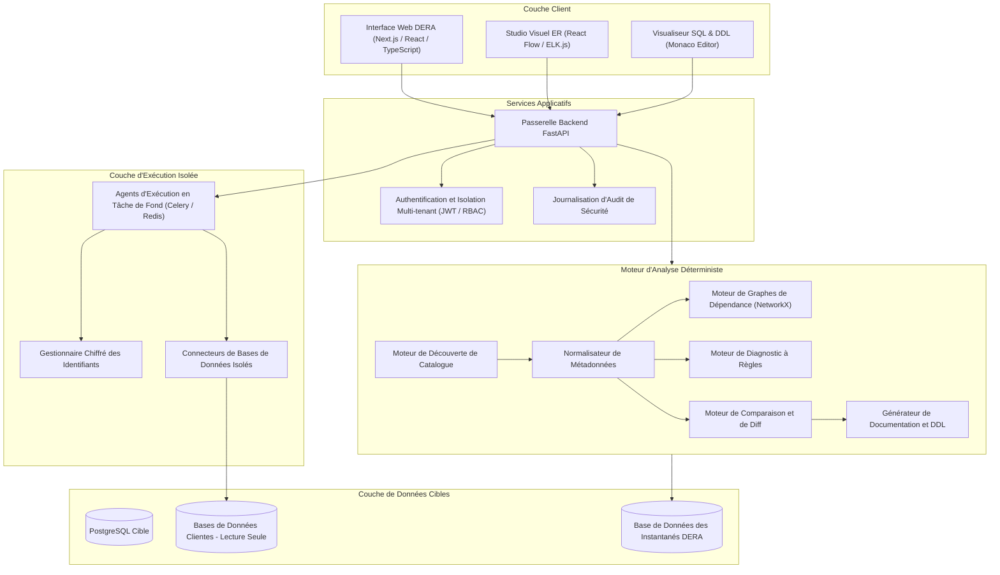
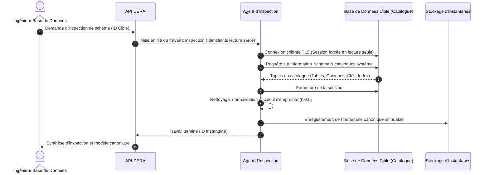
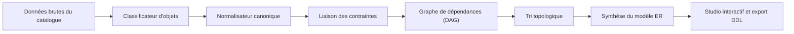
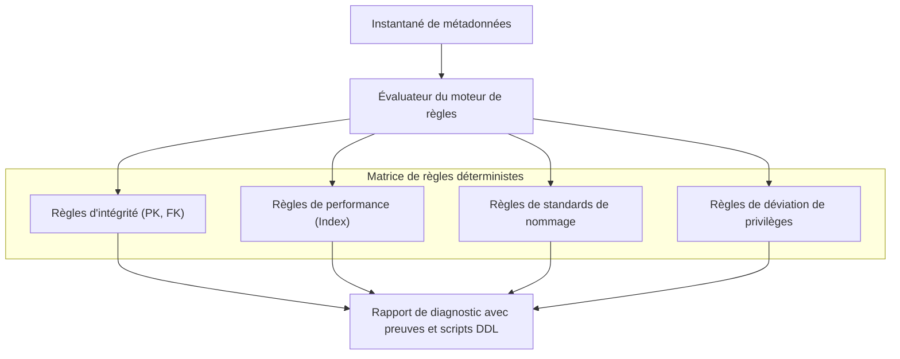
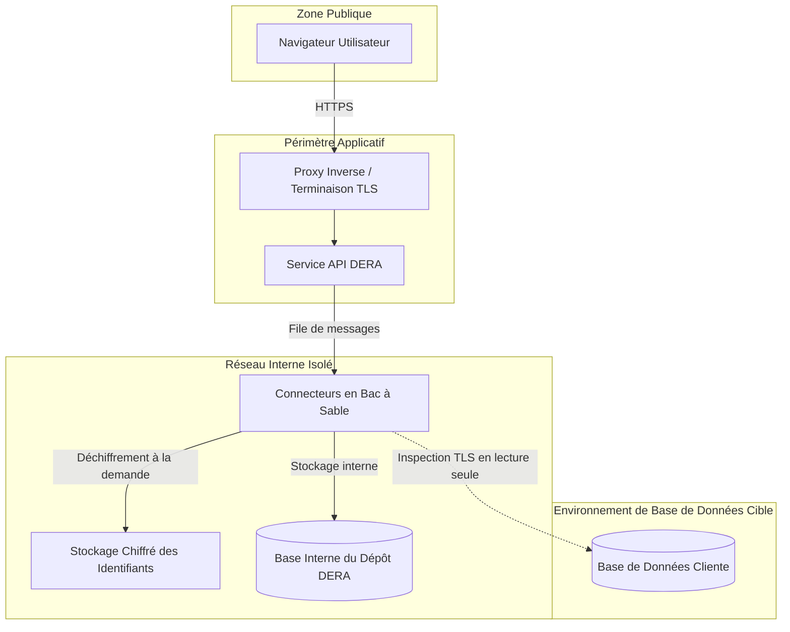
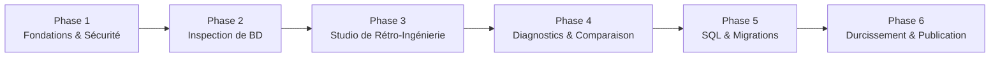

**Lire cette documentation en :** [English](../../README.md) | [Español](README.es.md) | [Français](README.fr.md) | [Deutsch](README.de.md) | [Português](README.pt.md) | [日本語](README.ja.md) | [한국어](README.ko.md) | [简体中文](README.zh-CN.md) | [العربية](README.ar.md) | [Русский](README.ru.md)

---

<div align="center">

# DERA

### Database Engineering & Reverse Analysis

**Comprenez chaque schéma. Concevez chaque changement.**

Une plateforme déterministe et open-source de rétro-ingénierie de bases de données pour les développeurs, ingénieurs de bases de données, architectes et équipes d'ingénierie.

Explorez les structures de bases de données, visualisez les relations, analysez les schémas, identifiez les risques structurels et générez une documentation technique — de manière entièrement déterministe, sans modèles d'IA ni APIs externes d'IA.

<br/>

[](https://github.com/krishanth7/dera/stargazers)
[](https://github.com/krishanth7/dera/forks)
[](https://github.com/krishanth7/dera/issues)
[](https://github.com/krishanth7/dera/blob/main/LICENSE)
[](https://github.com/krishanth7/dera/releases)
[](https://github.com/krishanth7/dera/actions/workflows/codeql.yml)
[](https://github.com/krishanth7/dera/graphs/contributors)
[](https://github.com/sponsors/krishanth7)

<br/>

[Présentation](#-présentation) ·
[Fonctionnalités](#-fonctionnalités) ·
[Architecture](#-architecture) ·
[Pipelines visuels](#-pipelines-visuels) ·
[Sécurité](#-principes-de-sécurité) ·
[Pile technologique](#-pile-technologique) ·
[Feuille de route](#-feuille-de-route-de-développement) ·
[Contribution](#-comment-contribuer) ·
[Communauté](#-communauté)

</div>

---

## 🌍 Support multilingue

DERA propose une documentation complète en 10 langues internationales. Utilisez le tableau ci-dessous ou la barre de navigation supérieure pour accéder à la documentation localisée :

| Langue | Code | Lien vers la documentation | Statut |
|---|---|---|---|
| 🇬🇧 English | `en` | [English Primary (Root)](../../README.md) · [Synchronized Copy](README.en.md) | Référence principale |
| 🇪🇸 Español | `es` | [Documentación en Español](README.es.md) | Traduction intégrale |
| 🇫🇷 Français | `fr` | [Documentation en Français](README.fr.md) | Traduction intégrale |
| 🇩🇪 Deutsch | `de` | [Dokumentation auf Deutsch](README.de.md) | Traduction intégrale |
| 🇵🇹 Português | `pt` | [Documentação em Português](README.pt.md) | Traduction intégrale |
| 🇯🇵 日本語 | `ja` | [日本語ドキュメント](README.ja.md) | Traduction intégrale |
| 🇰🇷 한국어 | `ko` | [한국어 문서](README.ko.md) | Traduction intégrale |
| 🇨🇳 简体中文 | `zh-CN` | [简体中文文档](README.zh-CN.md) | Traduction intégrale |
| 🇸🇦 العربية | `ar` | [الوثائق باللغة العربية](README.ar.md) | Traduction intégrale |
| 🇷🇺 Русский | `ru` | [Документация на русском](README.ru.md) | Traduction intégrale |

---

## 📖 Présentation

Les bases de données relationnelles modernes constituent l'épine dorsale des architectures logicielles, mais comprendre un schéma complexe et en constante mutation s'avère souvent délicat. Les systèmes d'entreprise comportent fréquemment des centaines de tables, des milliers de colonnes, des clés étrangères intriquées, des index, des contraintes, des vues et de multiples dépendances d'objets.

Comprendre et auditer ces structures manuellement requiert un temps considérable et demeure sujet aux erreurs humaines.

**DERA est conçu pour répondre précisément à ce défi.**

DERA offre un espace de travail unifié et sécurisé pour explorer l'architecture des bases de données, reconstruire les relations d'entités, évaluer les risques structurels et générer une documentation d'ingénierie grâce à des algorithmes déterministes.

### Notre mission

Rendre la rétro-ingénierie de bases de données accessible, transparente, reproductible et fiable pour chaque développeur, administrateur de bases de données et architecte logiciel.

### Notre philosophie

- **Déterministe par conception** — Analyses rigoureuses et reproductibles fondées sur la théorie des graphes et des règles statiques.
- **Strictement sans IA générative** — Aucun LLM, aucun modèle d'apprentissage automatique, aucune API externe d'inférence d'IA.
- **Priorité absolue à la confidentialité** — Analyse exclusive des métadonnées de catalogue. Aucune donnée applicative client n'est extraite par défaut.
- **Open Source** — Ingénierie transparente et collaborative sous licence permissive MIT.
- **Orienté développeur** — Outils concrets conçus pour les ingénieurs logiciels et les DBAs.
- **Sécurité dès la conception** — Connexions forcées en lecture seule, chiffrement des identifiants et processus d'exécution isolés.
- **Exactitude technique** — Recommandations fondées sur des preuves tangibles plutôt que sur des explications approximatives ou hallucinéess.

---

## ✨ Fonctionnalités

Le tableau suivant présente les capacités fonctionnelles prévues de la plateforme DERA, classées selon leur état de développement.

| Domaine fonctionnel | Statut | Description |
|---|---|---|
| **Découverte de bases de données** | Planifié | Extraction native des métadonnées de tables, colonnes, contraintes et index |
| **Cœur de rétro-ingénierie** | Planifié | Modélisation canonique de schéma, classification d'objets et résolution de dépendances |
| **Studio visuel ER** | Planifié | Diagrammes entité-relation interactifs, disposition automatique, filtres et exports |
| **Diagnostics déterministes** | Planifié | Évaluation de règles statiques identifiant les clés manquantes, index redondants et anomalies |
| **Instantanés & Comparateur de schémas** | Planifié | Instantanés versionnés et analyse d'impact des évolutions structurelles |
| **Ingénierie de performance SQL** | Planifié | Inspection des requêtes, visualisation des plans d'exécution et préconisations d'indexation |
| **Générateur de documentation** | Planifié | Exportations automatisées en Markdown, HTML, JSON, scripts SQL DDL et schémas SVG |
| **Architecture de sécurité** | Planifié | Contrôle d'accès basé sur les rôles, garanties de lecture seule et conteneurs isolés |

### 🔍 Découverte de bases de données

Inspectez les moteurs de bases de données pris en charge et extrayez la structure du catalogue système :

- Bases de données, schémas et extensions
- Tables, partitions et vues
- Colonnes, types de données, nullabilité et valeurs par défaut
- Clés primaires, clés étrangères et actions référentielles (`CASCADE`, `RESTRICT`)
- Contraintes d'unicité, contraintes check et contraintes d'exclusion
- Index (B-tree, Hash, GIN, GiST), index uniques et prédicats d'index partiels
- Séquences, colonnes d'identité et déclencheurs (triggers)

### 🧬 Cœur de rétro-ingénierie

Reconstruisez les modèles relationnels grâce à des requêtes natives de catalogue et des algorithmes déterministes :

- Représentation de schéma canonique et indépendante du moteur
- Normalisation rigoureuse des métadonnées structurelles
- Construction de graphes de dépendance acycliques (DAG)
- Cartographie des relations de clés étrangères simples et composites
- Génération d'instantanés cryptographiques et immuables
- Reconstruction déterministe des définitions SQL DDL

### 🕸️ Studio visuel ER

Explorez la topologie relationnelle via une interface interactive entité-relation :

- Nœuds de tables interactifs affichant colonnes, types et contraintes
- Connecteurs visuels de clés étrangères avec indication précise de la cardinalité
- Algorithmes déterministes de disposition automatique (hiérarchique et orientée forces)
- Regroupement par schémas, étiquettes et sous-graphes thématiques
- Recherche interactive, filtrage par type et mise en évidence des chemins de dépendance
- Export haute résolution aux formats vectoriels SVG et matriciels PNG

### 🛡️ Diagnostics déterministes de bases de données

Analysez les métadonnées de schéma à l'aide de règles d'ingénierie configurables pour détecter les risques de conception :

| Règle de diagnostic | Catégorie | Description |
|---|---|---|
| **Clé primaire manquante** | Intégrité | Identifie les tables dépourvues de contrainte de clé primaire explicite |
| **Index potentiellement redondant** | Performance | Détecte les index superposés ou partageant un préfixe de colonnes identique |
| **Clé étrangère non indexée** | Performance | Signale les colonnes de clés étrangères dépourvues d'index de couverture |
| **Anti-patrons polymorphiques** | Intégrité | Identifie les relations implicites non sécurisées par des contraintes référentielles |
| **Anomalies de nullabilité et valeurs par défaut** | Cohérence | Signale les colonnes non nullables sans valeur par défaut adéquate |
| **Audit des conventions de nommage** | Standardisation | Détecte les incohérences de casse et les entorses aux conventions d'architecture |
| **Écarts de privilèges** | Sécurité | Met en lumière les attributions de droits excessives sur les objets du catalogue |

*Chaque résultat de diagnostic constitue une recommandation étayée par des preuves techniques et accompagnée du script DDL de remédiation.*

### 🔄 Comparaison de schémas et moteur de différences

Comparez les instantanés de bases de données entre différents environnements (développement, recette, production) ou révisions de migration :

- Tables et colonnes ajoutées, modifiées ou supprimées
- Changements de types de données, tailles et contraintes de nullabilité
- Ajouts, suppressions et ajustements de définitions d'index
- Modifications de contraintes et ajustements des règles d'intégrité
- Qualification des ruptures de compatibilité (sécurisées vs potentiellement destructives)
- Prévisualisation ordonnée des scripts de migration selon les dépendances

---

## 🧠 Zéro IA. Pure ingénierie.

DERA est délibérément conçu sans modèles d'intelligence artificielle ni apprentissage automatique.

```text
┌───────────────────────────────────────────────────────────┐
│              ARCHITECTURE STRICTE SANS IA                 │
│                                                           │
│   ❌  Aucun modèle OpenAI, Anthropic Claude ou Gemini     │
│   ❌  Aucun service hébergé Groq ou DeepSeek              │
│   ❌  Aucun LLM local (Ollama, vLLM, llama.cpp)           │
│   ❌  Aucune hallucination non déterministe               │
│                                                           │
│   ✅  Requêtes natives aux catalogues (information_schema)│
│   ✅  Algorithmes mathématiques de graphes (NetworkX)     │
│   ✅  Analyseurs syntaxiques AST rigoureux (SQLGlot)      │
│   ✅  Moteurs de règles statiques et reproductibles       │
│   ✅  Algorithmes formels de comparaison de schémas       │
└───────────────────────────────────────────────────────────┘
```

**Pourquoi DERA est déterministe :**
1. **Prévisibilité :** Un instantané de schéma et une configuration de règles identiques produiront toujours des diagnostics rigoureusement identiques.
2. **Traçabilité :** Chaque avertissement, relation et liaison de graphe s'appuie directement sur des données concrètes du catalogue système.
3. **Souveraineté des données :** Vos schémas et métadonnées ne quittent jamais votre infrastructure vers des fournisseurs tiers de modèles d'inférence.
4. **Performance et coût :** Zéro latence d'inférence, zéro coût de jeton (token), aucune limitation de débit d'API et aucune dépendance envers un service externe.

---

## 🏗️ Architecture

DERA s'articule autour d'une architecture modulaire privilégiant la maintenabilité, l'extensibilité et la sécurité des accès aux bases de données.



---

## 🔬 Pipelines visuels

DERA exécute des processus déterministes et auditables pour l'inspection des métadonnées, la synthèse des relations et la validation de sécurité.

### 1. Flux d'inspection de base de données



### 2. Pipeline de rétro-ingénierie de schémas



### 3. Pipeline de traitement des métadonnées et diagnostics



### 4. Périmètre de sécurité et isolation



### 5. Cycle de vie du développement planifié



---

## 🔒 Principes de sécurité

Étant donné que DERA se connecte à des bases de données critiques, la sécurité constitue le pilier majeur de notre architecture.

- **Mode lecture seule garanti :** Chaque session de connexion impose explicitement une transaction en lecture seule (`SET SESSION CHARACTERISTICS AS TRANSACTION READ ONLY`).
- **Aucune extraction de données client :** Les opérations ciblent exclusivement les catalogues système (`information_schema`, `pg_catalog`). Aucune ligne applicative n'est interrogée ou sauvegardée.
- **Aucun secret dans le code :** Les identifiants sont chiffrés au repos à l'aide de l'algorithme AES-256-GCM et ne sont jamais enregistrés dans les journaux, exportés ou versionnés.
- **Prévention SSRF :** Les hôtes et adresses réseau cibles sont rigoureusement validés afin d'empêcher tout balayage de réseaux internes ou l'accès aux métadonnées des fournisseurs cloud.
- **Comptes de base de données à moindre privilège :** Documentation complète pour configurer des rôles d'audit en lecture seule sans droits d'administration.
- **Traçabilité et audit :** Chaque inspection, exportation et modification de configuration génère un enregistrement d'audit immuable.

*Pour consulter nos procédures complètes de signalement et de divulgation des vulnérabilités, référez-vous à [SECURITY.md](../../SECURITY.md).*

---

## 🛠️ Pile technologique

| Couche | Composant | Choix technologique | Fonction | Statut |
|---|---|---|---|---|
| **Frontend** | Framework | Next.js, React, TypeScript | Application web interactive | Planifié |
| | Styles | Tailwind CSS | Système de design cohérent et réactif | Planifié |
| | Bibliothèque UI | shadcn/ui | Composants graphiques accessibles | Planifié |
| | Visualisation ER | React Flow, ELK.js | Rendu de graphes et disposition automatique | Planifié |
| | Éditeur de code | Monaco Editor | Coloration syntaxique SQL et affichage DDL | Planifié |
| **Backend** | Framework API | Python 3.12+, FastAPI | Services API asynchrones haute performance | Planifié |
| | Inspection de catalogue | SQLAlchemy, psycopg | Extraction de métadonnées et gestion de pool | Planifié |
| | Analyseur SQL | SQLGlot | Génération d'AST SQL agnostique du moteur | Planifié |
| | Algorithmes de graphes | NetworkX | Résolution de dépendances et tri topologique | Planifié |
| | Gestionnaire de tâches | Celery, Redis | Agents d'exécution asynchrones et isolés | Planifié |
| **Stockage** | Base de données DERA | PostgreSQL | Instantanés de métadonnées, sessions, journaux d'audit | Planifié |
| | Migrations | Alembic | Versionnage du schéma de base de données DERA | Planifié |
| **DevOps & QA** | Conteneurisation | Docker, Docker Compose | Environnement de développement et déploiement reproductibles | Planifié |
| | SAST & Sécurité | CodeQL, Dependabot | Détection statique de vulnérabilités et analyse des dépendances | Implémenté |
| | Tests automatisés | Pytest, Playwright | Tests unitaires backend et tests E2E frontend | Planifié |

---

## 🗄️ Compatibilité des bases de données

DERA est conçu selon une architecture à connecteurs modulaires afin de supporter les moteurs relationnels modernes :

| Moteur de base de données | Statut du connecteur | Source de catalogue | Calendrier cible |
|---|---|---|---|
| **PostgreSQL** (v12 - v17) | En développement | `pg_catalog`, `information_schema` | Phase 2 (MVP) |
| **Supabase PostgreSQL** | En développement | Connecteur natif PostgreSQL | Phase 2 (MVP) |
| **MySQL** (v8.0+) | Planifié | `information_schema`, `performance_schema` | Phase 5 |
| **SQLite** (v3.35+) | Planifié | `sqlite_master`, commande `PRAGMA` | Phase 5 |
| **MariaDB** (v10.5+) | Planifié | `information_schema` | Phase 5 |
| **Microsoft SQL Server** | Planifié | `sys.tables`, `INFORMATION_SCHEMA` | Phase 5 |
| **Oracle Database** | À l'étude | Vues du dictionnaire de données (`ALL_*`, `DBA_*`) | Évaluation future |

---

## 🚀 Premiers pas

DERA est actuellement en cours de développement architectural et fondamental. Les configurations officielles de production seront publiées au fil des jalons validés.

### Prérequis (Planifiés)

- Python 3.12 ou version ultérieure
- Node.js LTS (v20+)
- PostgreSQL 15+
- Docker et Docker Compose
- Git

### Cloner le dépôt

```bash
git clone https://github.com/krishanth7/dera.git
cd dera
```

### Environnement de développement local (Planifié)

```bash
# Cloner et initialiser l'environnement
cp .env.example .env

# Démarrer la pile de développement avec Docker Compose
docker compose -f infrastructure/docker/docker-compose.dev.yml up --build
```

> **Note :** Le code applicatif fait l'objet d'un développement actif. Consultez la [Feuille de route de développement](#-feuille-de-route-de-développement) pour suivre les avancées.

---

## 📁 Structure du dépôt

```text
dera/
├── .github/
│   ├── ISSUE_TEMPLATE/           # Modèles structurés d'incidents et requêtes GitHub
│   ├── workflows/                # Workflows CodeQL, revue des dépendances et CI
│   ├── PULL_REQUEST_TEMPLATE.md  # Modèle standardisé de demande d'intégration (PR)
│   ├── dependabot.yml            # Configuration des mises à jour automatiques Dependabot
│   └── FUNDING.yml               # Configuration du parrainage du mainteneur
├── docs/
│   ├── README.md                 # Index exhaustif de la documentation
│   ├── i18n/                     # Documentation multilingue synchronisée
│   │   ├── README.en.md          # Copie de référence synchronisée en anglais
│   │   ├── README.es.md          # Documentation en espagnol
│   │   ├── README.fr.md          # Documentation en français
│   │   ├── README.de.md          # Documentation en allemand
│   │   ├── README.pt.md          # Documentation en portugais
│   │   ├── README.ja.md          # Documentation en japonais
│   │   ├── README.ko.md          # Documentation en coréen
│   │   ├── README.zh-CN.md       # Documentation en chinois simplifié
│   │   ├── README.ar.md          # Documentation en arabe (support RTL)
│   │   └── README.ru.md          # Documentation en russe
│   ├── architecture/             # Spécifications de l'architecture
│   ├── development/              # Guides d'installation et standards d'ingénierie
│   ├── security/                 # Modèles de menaces et pratiques de sécurité
│   └── contributing/             # Documentation d'aide aux contributeurs
├── CODE_OF_CONDUCT.md            # Code de conduite Contributor Covenant
├── CONTRIBUTING.md               # Guide complet de contribution
├── LICENSE                       # Licence MIT
├── README.md                     # Page d'accueil principale du dépôt
├── SECURITY.md                   # Politique globale de sécurité
└── .gitignore                    # Règles d'exclusion Git
```

---

## 🗺️ Feuille de route de développement

### Phase 1 — Fondations & Sécurité
- [x] Définir l'identité officielle du projet et la licence (MIT)
- [x] Configurer l'analyse statique de sécurité avec CodeQL
- [x] Mettre en place le Code de conduite et les politiques de sécurité
- [x] Déployer l'architecture de documentation internationale en 10 langues
- [ ] Initialiser la structure monorepo de l'application (`apps/web`, `apps/api`)
- [ ] Configurer l'environnement de développement Docker et l'intégration continue de base

### Phase 2 — Moteur d'inspection de base de données
- [ ] Développer le connecteur natif d'extraction de métadonnées pour PostgreSQL
- [ ] Extraire tables, colonnes, contraintes, index et vues
- [ ] Construire le modèle canonique et agnostique de normalisation de schéma
- [ ] Implémenter le stockage cryptographique et immuable des instantanés
- [ ] Intégrer les garanties de session en lecture seule et les temporisations de requêtes

### Phase 3 — Studio de rétro-ingénierie
- [ ] Concevoir le studio interactif entité-relation avec React Flow
- [ ] Développer les algorithmes de disposition hiérarchique automatique
- [ ] Intégrer le filtrage par schéma, la recherche et le regroupement par domaine
- [ ] Construire la visualisation et la traversée des dépendances en graphe (DAG)
- [ ] Permettre l'exportation des diagrammes haute résolution aux formats SVG et PNG

### Phase 4 — Diagnostics & Comparaison de schémas
- [ ] Implémenter le moteur de diagnostic déterministe fondé sur des règles
- [ ] Établir les règles : Clé primaire manquante, Index redondants, Clés étrangères non indexées
- [ ] Développer l'algorithme de comparaison d'instantanés (Snapshot Diff)
- [ ] Produire des prévisualisations ordonnées des scripts DDL de migration
- [ ] Permettre l'exportation de rapports de diagnostic en Markdown, JSON et HTML

### Phase 5 — Ingénierie avancée & Nouveaux connecteurs
- [ ] Intégrer l'analyse AST des requêtes SQL et les métriques de complexité avec SQLGlot
- [ ] Développer le visualiseur de plans d'exécution (`EXPLAIN ANALYZE`)
- [ ] Développer les connecteurs de bases de données pour MySQL et SQLite
- [ ] Intégrer la génération de scripts DDL ordonnés selon les dépendances

### Phase 6 — Durcissement pour la production
- [ ] Réaliser des audits exhaustifs de sécurité et des tests d'intrusion
- [ ] Conduire des tests de charge et de performance sur de volumineux schémas (+ de 1 000 tables)
- [ ] Valider l'étanchéité multi-tenant et la complétude des journaux d'audit
- [ ] Publier les images officielles de conteneurs v1.0.0 et les manuels de déploiement

---

## 🧪 Stratégie de tests et d'assurance qualité

DERA applique des méthodes d'ingénierie rigoureuses grâce à des tests automatisés et reproductibles :

- **Tests unitaires :** Valident le parsing de métadonnées, la détection de cycles dans les graphes et les règles de diagnostic à l'aide de jeux de données synthétiques.
- **Tests d'intégration :** Évaluent le comportement des connecteurs face à des instances conteneurisées de PostgreSQL, MySQL et SQLite.
- **Vérification déterministe :** Garantit que des instantanés de schéma identiques génèrent scrupuleusement les mêmes empreintes cryptographiques et conclusions d'audit.
- **Tests de sécurité :** Analyse continue avec CodeQL, contrôle automatisé des failles de dépendances et détection de fuites d'identifiants.
- **Tests de bout en bout (E2E) :** Tests automatisés avec Playwright pour éprouver l'ergonomie, la fluidité des diagrammes et l'adaptabilité de l'interface.

---

## 🤝 Comment contribuer

Les contributions de développeurs, experts en bases de données, rédacteurs techniques et chercheurs en sécurité du monde entier sont les bienvenues.

Merci de consulter attentivement notre guide [CONTRIBUTING.md](../../CONTRIBUTING.md) ainsi que le [Code de conduite](../../CODE_OF_CONDUCT.md) avant de soumettre vos contributions.

### Déroulement d'une contribution

1. Créez un fork du dépôt sur GitHub.
2. Créez une branche dédiée : `git checkout -b feat/nom-de-votre-fonctionnalite`.
3. Respectez la convention [Conventional Commits](../../CONTRIBUTING.md#commit-message-guidelines).
4. Ajoutez les tests unitaires ou d'intégration correspondants.
5. Vérifiez la réussite des analyses CodeQL et des contrôles de documentation.
6. Ouvrez une demande d'intégration (pull request) vers la branche `main` pour examen par les mainteneurs.

---

## 💬 Communauté

- [GitHub Discussions](https://github.com/krishanth7/dera/discussions) — Échangez, posez vos questions et débattez autour de l'ingénierie de données.
- [GitHub Issues](https://github.com/krishanth7/dera/issues) — Signalez un bogue ou soumettez une suggestion de fonctionnalité.
- [GitHub Pull Requests](https://github.com/krishanth7/dera/pulls) — Proposez vos modifications de code et vos enrichissements de documentation.
- [Releases](https://github.com/krishanth7/dera/releases) — Consultez les notes officielles de publication.

---

## ❤️ Soutenir le projet

DERA est une initiative indépendante d'ingénierie logicielle open-source. Vous pouvez soutenir activement son développement :

- En attribuant une étoile (Star) au dépôt sur GitHub
- En partageant le projet au sein de vos réseaux d'ingénieurs
- En contribuant au développement de connecteurs, de règles de diagnostic ou de documentation
- [En parrainant le projet sur GitHub Sponsors](https://github.com/sponsors/krishanth7)

---

## 📜 Licence

DERA est distribué sous la licence permissive **[MIT License](../../LICENSE)**.

```text
Copyright (c) 2026 Krishanth
```

---

## 👨‍💻 Mainteneur

**Krishanth**  
Fondateur et Mainteneur Principal

- GitHub : [@krishanth7](https://github.com/krishanth7)  
- Dépôt : [github.com/krishanth7/dera](https://github.com/krishanth7/dera)  
- Contact : `krishanth.b.2008@gmail.com`

*DERA est un projet open-source indépendant maintenu par Krishanth. OVIC Labs est reconnu comme faisant partie intégrante de l'écosystème d'ingénierie élargi du mainteneur.*

---

<div align="center">

### DERA — Database Engineering & Reverse Analysis

**Comprenez chaque schéma. Concevez chaque changement.**

*Bâti avec rigueur technique, déterminisme mathématique et transparence open-source.*

© 2026 Contributeurs DERA. Distribué sous licence MIT.

[Retour en haut](#dera)

</div>
